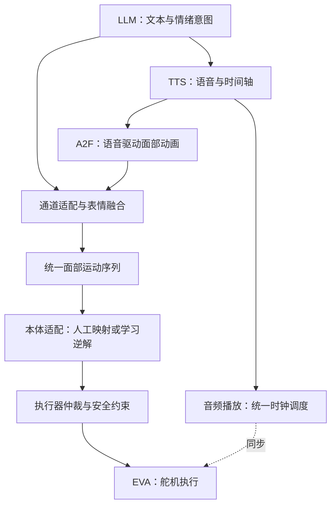

# EVA × Audio2Face：语音表情控制方案 V1.1

> 本体：原版 EVA｜版本：V1.1｜更新：2026-10-10\
> 状态：工程方案，尚未实机验收。文中采样数量与求解预算均为起始建议，需实测调整。

## 1. 核心思路：生成动作，再让本体实现

机器人脸的物理因果是：**舵机运动 → 机构与拉索运动 → 硅胶形变 → 可见表情。** 控制任务则反过来：希望出现某种表情，求出安全的舵机命令。

系统分工：

- **LLM、TTS：** 决定说什么，生成实际语音。
- **Audio2Face（A2F）：** 根据语音生成口型及相关面部运动。
- **本体适配：** 把运动意图转换成 EVA 能实现的动作。
- **相机与视觉测量：** 观察真机形变，支持标定、训练和验收。

采用两步落地：**先用人工映射跑通，再按实测需要加入学习适配。** 人工方案达到产品要求，可以持续使用；组合形变难以调准、标定工作反复时，再训练 EVA 自模型。

| 路线 | 面部运动到舵机的转换 | 自行训练模型数量 |
| --- | --- | --- |
| 人工基线 | 标定映射＋组合规则＋安全约束 | 0 |
| 学习适配 | 目标形变重定向＋自模型逆解＋安全约束 | 1：舵机命令 → 预测形变 |

两条路线均复用预训练 LLM、TTS、A2F 和视觉工具。学习适配用于拟合非线性与耦合，是否优于人工映射要实测；它不能增加机械自由度或弥补不足的执行器带宽。

## 2. 完整数据链路

| 模块 | 输入 → 输出 | 主要职责 |
| --- | --- | --- |
| LLM | 对话 → 文本、情绪和行为意图 | 决定说什么、关注谁、是否点头等意图 |
| TTS | 文本 → 音频及时间轴 | 同一波形送入 A2F 并用于播放 |
| A2F | 音频、可选情绪条件 → 面部动画 | 生成与语音配合的连续口型；输出格式依模型与管线而定 |
| 通道适配与融合 | 动画＋情绪 → 统一运动序列 | 统一语义，处理强度、区域优先级和冲突 |
| 本体适配 | 运动序列 → 面部舵机目标 | 人工映射直接求命令；学习路线先生成目标形状再逆解 |
| 仲裁与执行 | 面部、眼部、颈部目标 → 安全命令 | 每个执行器只有一个最终控制源，按时执行 |

**Face Landmarker 位于测量支路：相机图像 → 面部关键点。** 它用于标定、采样和验收；首期不要求在线每帧拍照。

## 3. 统一接口与数字预览

### 3.1 Blendshape 与 FaceMotion-52

Blendshape 权重描述张嘴、闭眼、嘴角上扬等局部运动的强度。52 维或 33 维代表不同的通道集合，不能仅凭维数或数组索引互换。

本文保留 `FaceMotion-52` 作为**项目内部运动协议名**，不是 AI 模型、软件产品或关键点检测器。其核心字段为：

| 字段 | 约定 |
| --- | --- |
| `schema_version` | 通道名称、顺序和语义版本 |
| `timestamp_ms` | 相对同一音频时间轴的目标展示时间 |
| `blendshapes` | 52 个具名权重；按协议定义范围，通常为 0～1 |
| `gaze`、`head_pose` | 独立行为字段；明确坐标系、单位和优先级 |

权重之和不必为 1；52 个通道也不是 52 个完整表情。14 个面部舵机不能独立复现所有通道，缺失动作要合并、降级或屏蔽。

A2F 原始输出不保证直接符合这个协议。根据所选管线进行 Blendshape 求解或语义适配，不能只重排数组。情绪优先使用模型支持的条件接口；叠加表情时保护闭唇等关键口型，避免重复增强。

### 3.2 工具各自负责什么

| 工具 | 用途 | 边界 |
| --- | --- | --- |
| Audio2Face-3D SDK | 本地语音到面部动画推理 | 首期复用预训练模型；回归与扩散路线按质量和延迟评估 |
| Maya＋Maya-ACE | 查看 A2F 动画、口型与音频同步 | 若已验证最终接口与融合结果，可直接作为预览环境 |
| Blender／Unity | 绑定统一接口、预览或集成交互 | 可选；无需为了流程完整而重复搭建 |
| MetaHuman DNA＋RigLogic | 描述并驱动 MetaHuman 数字角色 | 数字角色绑定数据与运行时，不替代 EVA 标定或自模型 |

**预览应消费最终适配、融合后的运动序列。** 数字脸看起来正确，只证明动画及时间轴正确，不能证明 EVA 的硅胶、拉索和舵机能实现相同效果。

软件入口与官方说明见文末参考资料；代码、模型权重和角色素材分别按其许可证使用。

## 4. EVA 标定与人工基线

原版 EVA 共 25 个 MG90S 舵机：14 个驱动面部皮肤、5 个驱动眼球／眼睑、6 个驱动颈部。实际编号和传动关系以装配为准。[1]

| 执行器组 | 首期方式 | 标定边界 |
| --- | --- | --- |
| 面部皮肤：14 个 | 人工映射；必要时学习适配 | 只拟合这些驱动可影响的区域 |
| 眼球／眼睑：5 个 | 几何／动作映射＋行为调度 | 若参与联合逆解，相关驱动必须进入模型输入 |
| 颈部：6 个 | 几何标定、姿态逆解与限幅 | 6 个执行器不等于 6 个独立姿态自由度 |

### 4.1 标定依据与输出

依据是**通道动作语义、真机实际形变和产品要求**，而不是把不同脸型的绝对位置照搬过来。

每个驱动记录：中性值、运动方向、命令单位、安全行程、速度限制和关联区域。无位置回读时，记录的是“位置命令”，不是实测角度。

逐个标定 EVA 支持的运动通道，保存弱、中、强档位的**完整舵机向量**及照片；随后检查说话＋微笑等组合。单舵机限位之外，还要验证对抗拉索、机构干涉和动作过渡。

### 4.2 第一版映射

局部线性基线为：

$$
p=p_0+Ab
$$

其中，$p_0$ 为中性命令，$b$ 为统一运动权重，$A$ 的每一列为某个通道对应的舵机增量。需要时使用分段插值和组合修正。

执行前限制位置、速度与安全组合。**单通道标定准确，不代表任意线性叠加都准确或安全。** 人工基线同时用于产品试运行、学习求解初值和异常回退。

## 5. Face Landmarker：把照片变成形状数据

它的基本过程是：**检测脸部 → 估计面部关键点 → 可选预测表情系数。** 输出位置来自预训练视觉模型对图像的估计。[4]

| 输出 | 含义 | 本方案用途 |
| --- | --- | --- |
| 面部关键点 | 嘴角、唇缘、眉毛、眼睑等位置 | 作为实际形变观测及训练标签 |
| 52 个表情系数 | 局部面部动作强度的估计 | 辅助分析或动画采集，首期不作为唯一监督 |
| 面部变换矩阵 | 标准脸到检测脸的空间变换 | 辅助处理姿态与对齐 |

当前官方模型输出 478 个关键点，旧 Face Mesh 和部分项目使用 468 点。选取可控区域的 $K$ 个点，固定检测器版本、索引和归一化方法。

首期使用二维坐标：`x、y` 是归一化图像位置，单目 `z` 是估计的相对深度，不能当作毫米级三维测量。[5] 固定相机和头部可简化标定；运行时涉及头部移动的视觉反馈，需要额外做姿态补偿。

先检查检测器在 EVA 硅胶脸上的稳定性；持续误检时改用标记点或专用关键点测量，不能把误检当标签。

## 6. “照镜子”学习：采集真机响应，训练正向模型

### 6.1 模型学习什么

“照镜子”就是相机观察机器人自身，不要求真实镜子。

$$
\hat y=g_\theta(p)
$$

| 符号 | 含义 |
| --- | --- |
| $p$ | 归一化舵机命令；首期 14 维 |
| $y$ | 真机执行后，从照片测得并对齐的关键点 |
| $\hat y$ | 自模型预测的关键点 |
| $\theta$ | 自模型的网络参数 |

采用小型 MLP，学习“发出这组命令，脸将变成什么样”。训练标签来自 **EVA 自己的观测**，不是 A2F 输出或某张目标人脸。

### 6.2 采样怎样设计

**随机采样应限定在已验证的安全范围及组合内。** 推荐混合以下数据：

| 数据类型 | 采集方式 | 作用 |
| --- | --- | --- |
| 单驱动扫描 | 其他驱动保持中性，扫描安全行程 | 测量单驱动响应 |
| 相关驱动组合 | 嘴角＋下颌等共同动作 | 测量耦合 |
| 受约束随机组合 | 安全域内采样，平缓过渡 | 扩大覆盖 |
| 人工姿态及附近扰动 | 闭唇、微笑、抬眉等姿态周围采样 | 加密实际使用区域 |

人工预置不是必需条件。可先建立 **10～15 个基础姿态模板**，按需采集不同强度，形成约 **20～40 个有效姿态样本**；这只是工程起点，远不足以替代组合数据。优先覆盖中性、闭唇、开口、微笑、嘴角和眉部动作，不必凑齐 52 种表情。

Morpheus 报告约 5,000 组受约束随机采样，用于其 26 个面部执行器的自建模。[6] 该数量是项目实例，不是 EVA 的保证值，也不是训练轮数。

### 6.3 采集与训练流程

1. 固定相机、光照、头部和非建模驱动，建立中性脸与安全域。
2. 发送命令 $p_i$，等待形变稳定，再拍照、测得 $y_i$。
3. 保存 $(p_i,y_i)$、原始图像、时间戳和质量标记，剔除未稳定或误检样本。
4. 按采集批次、动作组合划分训练／验证／测试集，避免相邻重复帧泄漏。
5. 用已有数据离线训练，最小化预测与观测的差：

$$
L_{\mathrm{train}}=\frac1N\sum_i\|g_\theta(p_i)-y_i\|_W^2
$$

$W$ 表示区域权重，可提高嘴唇的重要性。每轮训练只更新 **网络参数 $\theta$**，不需要重新驱动机器人或拍照，也不需要播放 A2F 动画。

训练完成后，用未见过的组合检查预测精度；误差集中在哪些区域，就补采哪些动作。

## 7. 本体重定向：生成 EVA 的目标形状

**重定向定义“想让 EVA 的脸怎样变化”；自模型描述“命令会让 EVA 怎样变化”。** 两者不可混为一个模型。

经通道适配得到的权重 $b$ 表达动作强度，不能直接与关键点坐标相减。先获得数字形状，再转成 EVA 目标：

$$
y^*=R(b)
$$

### 7.1 具体步骤

1. **驱动数字脸：** 用统一权重驱动固定角色的绑定，获得当前网格形状。
2. **提取对应点：** 读取嘴角、唇缘、眉毛等网格点并投影到一致视角；或渲染正面图，再用 Face Landmarker 检测。
3. **统一坐标：** 建立两边的语义对应，去除整体姿态和拍摄尺度差异。
4. **提取相对运动：** 当前数字形状减去数字中性形状，保留动作变化。
5. **适配 EVA：** 加到 EVA 的中性形状上，按区域调整幅度，屏蔽不支持的动作。

在已对齐、归一化的坐标中，第一版可采用：

$$
\tilde y^*_{\mathrm{EVA}}=
\tilde y_{\mathrm{EVA},0}
+D\big(\tilde y_{\mathrm{数字},t}-\tilde y_{\mathrm{数字},0}\big)
$$

$D$ 表示区域比例和强度配置；归一化基准应固定，避免把动作本身的变化抵消掉。

例如，数字脸嘴角上移量为中性嘴宽的 5%，可以先按 EVA 中性嘴宽的 5% 生成目标，再依据标定范围调整。**不能直接复制另一张脸的绝对坐标。**

### 7.2 重定向的工程边界

- 第一版使用人工对应与区域增益配置，不必再训练一个模型。
- 目标仅覆盖建模执行器能影响的区域，独立眼球／眼睑动作交给对应控制器。
- 几何目标不一定整体可达；预先降低已知不可实现的要求，逆解时再寻找安全近似解。
- 数字绑定可直接计算形变，不必在屏幕上播放；采用图像检测时也可离屏渲染。
- 若要省去在线渲染检测，需预先建立、验证目标映射，尤其检查组合动作。

## 8. 在线逆解：在模型内寻找舵机命令

### 8.1 没有拍照，误差从哪里来

当前命令 $p$ 经自模型得到预测形状 $\hat y$，重定向得到目标 $y^*$，两者相减：

$$
e_{\mathrm{pred}}=g_\theta(p)-y^*
$$

这是**预测形状误差**，不是执行后测到的真机误差。真实误差还包含自模型预测不准的部分；若持续拍照测量并据此纠正命令，才形成视觉闭环。

### 8.2 怎样找到合适的命令

冻结 $\theta$，以上一帧命令或人工映射结果为初值：

$$
p_t^*=\arg\min_{p\in\mathcal S}
\left[\|g_\theta(p)-y_t^*\|_W^2
+\lambda\|p-p_{t-1}\|^2\right]
$$

第一项逼近表情目标，第二项减少帧间跳变；$\mathcal S$ 包含联合安全域及每帧变化量限制。

一次迭代包括：**预测形状 → 计算误差 → 求误差对命令的梯度 → 调整命令 → 检查约束。** 达到误差要求、改善很小或预算耗尽时停止，最后才发送命令。

梯度描述每个命令微小变化对误差的影响，来自已学到的本体响应。它在冻结的网络内计算，**不需要新的照片或训练标签，也不把梯度穿过真实硅胶和舵机。** 求解器需支持对输入求导，普通仅前向推理接口不会自动提供这个梯度。

这不是暴力枚举。若 14 个舵机各取 10 档，枚举有 $10^{14}$ 种组合；梯度优化每次同时调整整个命令向量。它可能停在局部较优解，不保证全局最优。

### 8.3 迭代次数与时间预算

没有通用的“多少次、多少毫秒”。可先按下表实测，再选择满足质量要求的最小计算量：

| 配置 | 起始建议 |
| --- | --- |
| 迭代次数 | 比较 1、3、5、10、20 次 |
| 计算预算 | 可先尝试每次求解不超过 5 ms；这是设计目标，不是性能承诺 |
| 动画周期 | 30 FPS 为 33.3 ms／帧；50 Hz 为 20 ms／帧，均需给其他环节留时间 |
| 延迟记录 | 中位数、P95、P99 与超时率，同时记录目标残差 |
| 超时处理 | 保留当前最佳安全解；异常时平滑保持或回退到标定姿态 |

小型 MLP 的运算量较低，但实际延迟还受框架调用、数据传输和约束处理影响。Morpheus 报告的整体推理帧率不能直接当作每次完整逆解耗时。[6]

### 8.4 训练与求解的区别

| 项目 | 离线训练自模型 | 在线求解命令 |
| --- | --- | --- |
| 已知数据 | 采集命令 $p_i$ 与实拍形状 $y_i$ | 目标形状 $y^*$ 与上一帧命令 |
| 比较对象 | 预测形状与实际观测 | 预测形状与动画目标 |
| 更新对象 | 网络参数 $\theta$ | 命令 $p$，网络参数固定 |
| 真机参与 | 训练前采集，必要时补采 | 只执行最后选定的命令 |
| 相机用途 | 产生训练标签 | 可选验收、监测或反馈 |

首期不在线逐帧修改网络权重。若求解成为瓶颈，可预计算动作序列，或后续训练目标到命令的快速模型；后者才是新增的第二个模型。

## 9. 注视、眨眼、颈部与语音同步

| 行为 | 上层决定什么 | 本地控制怎样执行 |
| --- | --- | --- |
| 注视 | LLM／交互状态选择关注对象 | 视觉持续跟踪对象，眼球控制器计算并平滑角度 |
| 眨眼 | 可由行为意图触发，平时自动调度 | 状态机生成眼睑轨迹，与说话表情仲裁 |
| 颈部 | 面向对象、点头等动作意图 | 姿态轨迹、机构逆解、限幅与速度限制 |

LLM 不负责每帧生成角度。眨眼虽然可以出现在 Blendshape 通道中，最终仍只能有一个眼睑控制源。

- **统一时钟：** A2F 使用实际播放的 TTS 波形；运动帧按音频时间戳调度。
- **适量缓冲：** 覆盖模型前瞻、计算、通信和机构响应，按实测口型偏差补偿；需要时提前求解短段动作。
- **区分频率：** 动画帧率、逆解频率、命令发送频率和 PWM 频率分别配置。发送 50 Hz 命令不代表机构具有 50 Hz 运动带宽。
- **保护口型：** 平滑不能抹去闭唇动作；用户打断时同时取消过期音频和动作。

静态自模型描述稳定后的形变，不描述迟滞、回差、延迟或快速运动过程。若语音速度下误差明显增加，先检查机构带宽和同步，再按需要加入历史命令／状态，升级动态模型。

## 10. 实施顺序与验收

| 阶段 | 交付物 | 验收重点 |
| --- | --- | --- |
| ① 数字链路 | 固定音频、A2F、统一接口、预览 | 通道语义、融合结果和口型时间轴 |
| ② 人工基线 | 驱动配置、映射、基础姿态、安全约束 | 动作可重复，组合与过渡安全，连续语音可用 |
| ③ 学习适配，按需实施 | 数据集、自模型、重定向配置、逆解器 | 留出组合的预测误差、真机形变误差、求解延迟 |
| ④ 交互集成 | 流式调度、注视、眨眼、颈部仲裁 | 同步、打断、失联恢复和长时间运行 |

人工与学习方案对比时，保持**同一音频、同一 A2F 输出、同一本体**，只替换适配模块；比较闭唇、开口、组合表情、抖动、同步和重复性。样机确定验收阈值，不能用单帧拟合代替连续语音验收。

更换面具、重穿拉索或调整预紧后，复验映射与模型，按误差补采。始终保存图像、标定配置、检测器和模型版本，以便定位变化原因。

## 11. 参考资料与版本说明

以下为官方资料及原始论文；本方案中的样本配置、重定向简化与求解预算属于工程建议。

1. [EVA 官方设计：执行器分组与硬件](https://www.creativemachineslab.com/eva.html)
2. [NVIDIA Audio2Face-3D SDK](https://github.com/NVIDIA/Audio2Face-3D-SDK)
3. [NVIDIA Maya-ACE](https://github.com/NVIDIA/Maya-ACE)
4. [MediaPipe Face Landmarker：模型流程与输出](https://developers.google.com/edge/mediapipe/solutions/vision/face_landmarker)
5. [NormalizedLandmark：坐标与深度定义](https://developers.google.com/edge/api/mediapipe/java/com/google/mediapipe/tasks/components/containers/NormalizedLandmark)
6. [Morpheus 原始论文：自建模、采样与逆解](https://arxiv.org/html/2507.16645v1)
7. [EVA 相关研究：Smile Like You Mean It](https://www.cs.columbia.edu/~bchen/aiface/)
8. [MetaHuman Devkit：DNA 与 RigLogic](https://www.metahuman.com/devkit)

**V1.1 相对 V1.0：** 增加人工基线与升级条件；明确训练标签、预测误差和求解目标的区别；补充采样设计、重定向步骤、梯度逆解与实时预算；统一眼部、颈部和音频调度边界。
