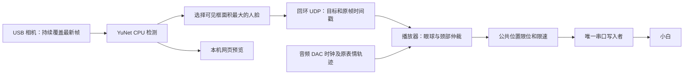

# 小白人脸水平跟随方案 V1.0

日期：2026-10-19。已完成最大人脸检测、网页观察、眼球水平跟踪和颈部接力，保存现场认可的三倍转头速度效果。精确注视角度、相机视场与机械传动比尚未标定。

## 1. 启动与恢复

先按 [README](../README.md) 恢复播放器、视觉依赖和固定版本 YuNet 模型，保留本机歌曲、61 通道 JSON 和最终标定文件，分别在两个终端执行：

```bash
./track_person_xiaobai.sh
# 另一个终端；视觉服务已运行时无需重复启动
./play_0001_xiaobai_tracking.sh --check
./play_0001_xiaobai_tracking.sh
```

预览：`http://127.0.0.1:8765/`。视觉服务不连接舵机，也可独立观察人脸选择。相机使用配置中的 `/dev/v4l/by-id/…`，避免依赖易变的 `/dev/videoN`。换 USB 口后需停止旧视觉进程并重新启动，再刷新网页；当前不自动重连。

播放按 `Ctrl+C` 停止，或创建 `outputs/xiaobai/STOP`。停止发送不会卸掉颈部扭矩；下次启动前由操作员移除 STOP 文件。更换机器人或安装位置后重新核对方向与范围。

## 2. 数据流与控制权



多人时逐帧选择有效人脸中画面内可见面积最大的那个；不做身份识别或说话人判断。注视点优先使用双眼关键点中点，缺失时使用框中心；图像向右为正，仅控制水平方向。

视觉采集、推理和网页请求独立于音频/串口循环。目标经 `127.0.0.1:14786` 广播；播放器非阻塞读取，拒绝超过300ms、未来、乱序、非法数值及旋转/镜像不一致的包。相机停顿后停止广播有效目标，播放器按原帧时间戳释放跟踪。

眼球模式只覆盖ID8、23；眼头模式增加ID32。上下眼神、眨眼、眉毛和嘴部沿用原动画，输入JSON不改写；ID33、34只监测并保持既有目标。TTL/RS485共享FE-URT2 UART，只有播放器向总线发动作包。

## 3. 已认可参数

`play_0001_xiaobai_tracking.sh` 固定下列播放默认值；控制配置保存在 `xiaobai/person_gaze.json` 和 `xiaobai/playback_profile_0001_observation.json`：

| 项目 | 当前值 |
| --- | --- |
| 歌曲与播放 | `0001.wav`、对应61通道JSON；60fps、100%面部幅度 |
| 音频 | DAC时钟同步，200ms请求缓冲；缓冲不是实测端到端延迟 |
| 检测 | YuNet CPU；640×480，申请30fps，检测上限20Hz；实际频率查看日志 |
| 摄像头 | 固定于头部，随头部转动，不随眼球转动 |
| 左眼ID8 | 负向/中位/正向：1818 / 2047 / 2332 |
| 右眼ID23 | 1804 / 2047 / 2358；两眼公共限速300计数/秒 |
| 眼球响应 | 死区0.035，滤波60ms，增益1，归一化限速2.5/秒 |
| 接管与丢失 | 接管120ms，旧帧失效后额外保持400ms，再以800ms释放 |
| 颈轴 | ID32，SM85BLHV，RS485；ID34是侧弯，排除水平跟踪 |
| 转头行程 | 2047±160，即1887～2207；启动时核对设备限位 |
| 三倍转头速度 | 75计数/秒，增益180，软件加减速70计数/秒² |
| 颈部接力 | 眼球偏转启动0.14、停止0.07；先行80ms，滤波120ms |
| 正常结束 | 最后约5.2秒缓慢回中，保留使能 |

眼球端点继承既有命令包络，现场确认了跟随方向；不代表已测得注视角度。ID32已确认左右转头，编码器正负到实际角度的独立标定仍待完成，保留 `horizontal_direction_confirmed=false`。

普通入口 `play_0001_xiaobai.sh` 仍默认原歌曲编排、颈部保持；显式 `--track-person` 仅跟眼球，`--track-neck` 启用眼头联动。转头倍率1/2/3分别限速25/50/75计数/秒，软件加减速35/70/70计数/秒²；倍率不会改变音频速度或眼球参数，实际到位时间不保证精确按倍数缩短。

## 4. 眼头接力逻辑

固定头部相机的画面偏差经死区、低通、增益映射为眼球位置。颈部读取上一帧经过公共限速的双眼命令，结合当前有效目标方向，眼球偏离舒适区后先行约80ms，颈部逐步分担转动；无需等待眼球到限位。这里使用命令状态，不是眼球实测位置。

真实转头改变相机画面中的剩余偏差，眼球因而自然回收。不从眼球目标直接扣除颈部命令，否则会重复补偿，或在头部未实际运动时伪造眼球回中。

颈部独立滤波、启停滞回、速度和加减速限制，接近边界提前减速；反向时旧滤波记忆不能继续请求旧方向驱动。丢脸时减速保持；正常结束预留回中时间。中断不强制回中。

反馈故障按现场授权仅记录；损坏报文不作为有效反馈。保留目标限位、限速、标定哈希、启动模式及扭矩检查，不自动使能、卸载或写EEPROM；软件验证不证明舵机内部保护已开启。

## 5. 验证与已知边界

软件测试覆盖最大人脸选择、坏包及过期包、镜像配置、固定/随眼相机、口型不被覆盖、方向反转、丢脸、眼头接力、三档速度限制和正常回中。双向眼头耦合及卡住模拟用于检查逻辑；模拟传动比和延迟是假设值，不是机器人标定值。

最近换相机USB口并恢复视觉后，三倍速度连续完整播放三遍，每遍约112.89秒；发送6773、6770、6772帧，共跳过7帧过时动作。各轮ID32目标覆盖1887～2207，命令速度覆盖±75计数/秒，结束目标均2047；实测位置总体1889～2205。用户随后认可效果并要求保存。测量不证明每帧机械到位或已消除全部抖动。

以前“仅向右转”的复核未发现软件禁止负向命令：25计数/秒时从正端到中位至少需6.4秒，短时负向目标可能只够回中。独立±160试验与最新整曲记录均出现低于2047的反馈，但机械双侧一致性仍需后续硬件验证。

本机证据保存在被忽略的 `outputs/xiaobai/`：`latest_eyes_neck_speed3_repeat3.txt` 指向最近三遍摘要；`latest_eye_head_logic_review.txt` 指向离线接力分析。每次播放另存参数、逐帧目标、跟踪状态及串口追踪；视觉默认不保存人脸图像，显式 `--snapshot` 才保存最后一帧。源码仓库不包含歌曲、视频、模型或运行日志。

验收时观察左右移动、多人切换和丢失恢复，确认眼睛先响应、转头后眼球回收、嘴部与音频同步。目标频繁交替时最大框规则可能发生切换；身份锁定、垂直跟踪和精确视线角度留待后续。

## 参考

- [OpenCV FaceDetectorYN 教程](https://docs.opencv.org/4.x/d0/dd4/tutorial_dnn_face.html)
- [OpenCV Zoo YuNet模型及许可](https://github.com/opencv/opencv_zoo/tree/main/models/face_detection_yunet)
