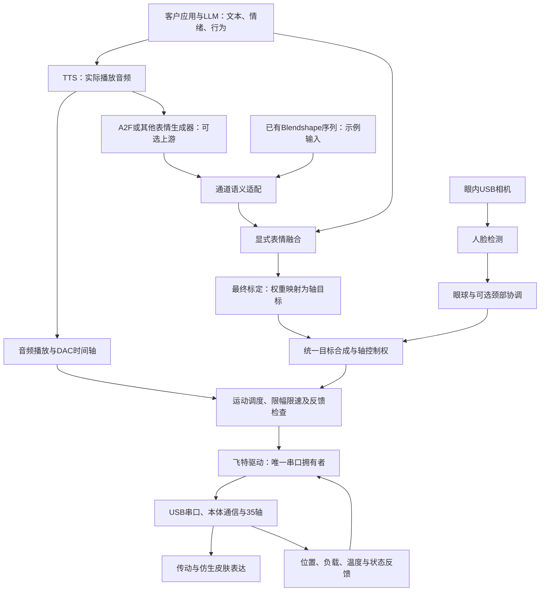

# 语音与表情控制架构

版本0.2｜2026-10-26。可选上游由客户接入；本轮使用已有音频和表情序列。

[离线架构图](ARCHITECTURE.html)。本体为当前墨甲35轴机电头，学习逆解是后续扩展。

## 1. 整体链路

## 2. 输入输出与职责

| 模块 | 输入→输出 | 状态和边界 |
|---|---|---|
| LLM/业务 | 对话→文本、情绪与行为意图 | 客户负责，不逐帧生成舵机指令 |
| TTS | 文本→实际播放波形 | 客户提供，示例使用PCM16 WAV |
| A2F | 音频→网格或表情系数，取决于模型和求解流程 | 保留上游工具，Jetson实时推理不在本轮验收 |
| 通道适配 | 原始通道→项目命名系数 | `motion/expression.py`，语义不能仅靠数组长度匹配 |
| 表情融合 | 多来源系数→一组系数 | 显式选择通道、强度和优先级；示例不自动叠加新表情 |
| 标定映射 | 系数→30个已标定轴的名义位置 | `motion/mapping.py`，使用最终标定 |
| 跟踪 | 图像偏差、眼球反馈→眼/颈目标 | `vision/pursuit.py`，移动眼内相机模型 |
| 合成/执行 | 多源目标→受约束的最终指令 | `motion/ownership.py`和`runtime/playback.py` |
| 硬件 | 指令→报文及反馈 | `hardware/feetech/`，当前直接飞特协议 |

## 3. 同步与控制权

离线输入先映射为名义轨迹；播放时由音频DAC输出时钟选择目标帧，按实际控制周期限制运动。源帧率、音频采样率、相机帧率、控制频率和反馈频率分别记录；60Hz控制不等于机械轴每帧到位。

跟踪开启后独占对应眼球/颈部轴，其余面部保持作品输入。相机进程不连接串口，运动进程统一发送位置，并用剩余控制时隙读取反馈。三个示例只改变控制权集合，不复制播放算法。

跟踪目标有有效期；丢脸沿用保持、释放和自然回中逻辑。眼颈协调依据图像偏差增长、眼球反馈运动及眼球饱和，无固定“先动眼睛等待若干毫秒再动脖子”的计时器。

## 4. 后续扩展

现有路径是“Blendshape→标定映射→约束执行”。自模型可作为另一种映射/求解后端，保留表情接口、控制权、运动约束和反馈。真机采集训练、学习逆解及ROS2/ros2_control尚未在三个示例中实现。所有示例直接引用同一源码包，没有历史兼容模块。
