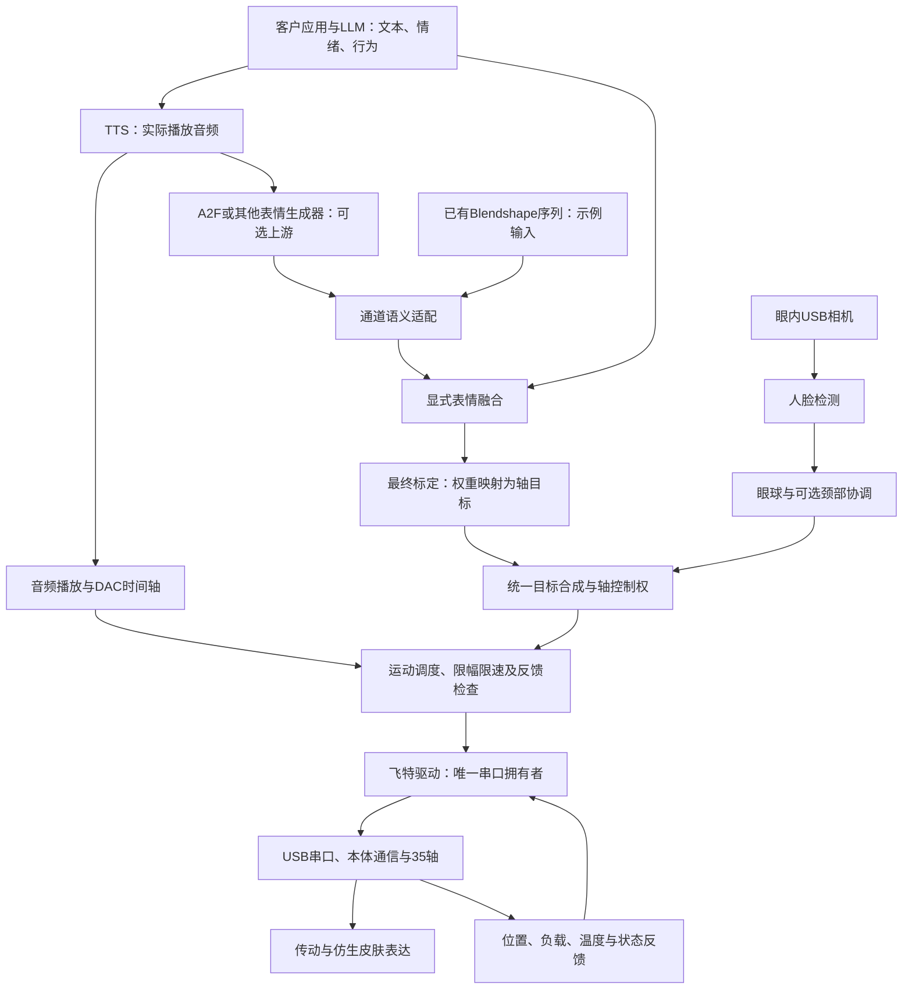
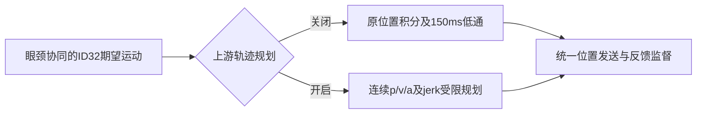

# 语音与表情控制架构

版本0.2｜2026-10-26。可选上游由客户接入；本轮使用已有音频和表情序列。

[离线架构图](ARCHITECTURE.html)。本体为当前墨甲35轴机电头，学习逆解是后续扩展。

## 1. 整体链路

## 2. 输入输出与职责

| 模块 | 输入→输出 | 状态和边界 |
|---|---|---|
| LLM/业务 | 对话→文本、情绪与行为意图 | 客户负责，不逐帧生成舵机指令 |
| TTS | 文本→实际播放波形 | 客户提供，示例使用PCM16 WAV |
| A2F | 音频→网格或表情系数，取决于模型和求解流程 | 保留上游工具，Jetson实时推理不在本轮验收 |
| 通道适配 | 原始通道→项目命名系数 | `motion/expression.py`，语义不能仅靠数组长度匹配 |
| 表情融合 | 多来源系数→一组系数 | 显式选择通道、强度和优先级；示例不自动叠加新表情 |
| 标定映射 | 系数→30个已标定轴的名义位置 | `motion/mapping.py`，使用最终标定 |
| 跟踪 | 图像偏差、眼球反馈→眼/颈目标 | `vision/pursuit.py`，移动眼内相机模型 |
| 合成/执行 | 多源目标→受约束的最终指令 | `motion/ownership.py`和`runtime/playback.py` |
| 硬件 | 指令→报文及反馈 | `hardware/feetech/`，当前直接飞特协议 |

## 3. 同步与控制权

离线输入先映射为名义轨迹；播放时由音频DAC输出时钟选择目标帧，按实际控制周期限制运动。源帧率、音频采样率、相机帧率、控制频率和反馈频率分别记录；60Hz控制不等于机械轴每帧到位。

跟踪开启后独占对应眼球/颈部轴，其余面部保持作品输入。相机进程不连接串口，运动进程统一发送位置，并用剩余控制时隙读取反馈。三个示例只改变控制权集合，不复制播放算法。

跟踪目标有有效期；丢脸沿用保持、释放和自然回中逻辑。眼颈协调依据图像偏差增长、眼球反馈运动、实测行程压力及眼球饱和，无固定“先动眼睛等待若干毫秒再动脖子”的计时器。移动眼内相机可以在眼球行程不断消耗时减小画面偏差，因此不能只用“偏差是否继续增大”决定颈部是否参与；当前实测使用25%行程且仍有同向运动、显著偏差时可请求辅助。两侧条件一致，不把命令位置当成实测位置。

ID32采用可选的[上游轨迹规划](UPSTREAM_TRAJECTORY_PLANNING.md)，示例3当前默认开启，不改变眼球、作品或控制权。开启时由单轴速度/加速度/jerk受限规划接管目标平滑，显式关闭才使用150ms位置低通，两层不叠加；软件参考约束与硬件寄存器41/46分开，物理效果必须实测。

## 4. 后续扩展

可选的[33/34并联颈部跟踪](PARALLEL_NECK_TRACKING.md)将纵向图像误差和小比例眼线倾角映射到平台任务，再利用32在平台上方的实际偏航变换与CAD闭链雅可比共同驱动33/34。原横向眼球和32控制不变；新增双轴也经同一个拥有者和串口发送，关闭新功能时恢复原保持方式。

现有路径是“Blendshape→标定映射→约束执行”。自模型可作为另一种映射/求解后端，保留表情接口、控制权、运动约束和反馈。真机采集训练、学习逆解及ROS2/ros2_control尚未在三个示例中实现。所有示例直接引用同一源码包，没有历史兼容模块。

## 5. 多本体适配：小帅独立三轴颈部

以上35轴与眼内相机描述针对默认墨甲。`--robot configs/robots/xiaoshuai/robot.json`选择小帅的33轴清单、标定和作品目标；中间通道、播放、串口实现共用，运行配置及控制权按本体选择。

| 本体 | 相机 | 颈部后端 | 示例1／2／3本次准备轴数 |
|---|---|---|---|
| 墨甲 | 右眼内，随ID23转动 | ID32左右＋ID33/34并联平台，按CAD闭链解算 | 35／35／35，按原规则保持未参与轴 |
| 小帅 | 眉心固定 | ID32左右、ID33俯仰、ID34翻滚，分别规划，不使用并联逆解 | 25／29／32，未参与轴不发送位置或使能 |

小帅的`vision/independent_follow.py`复用`VisualNeckAssist`招募俯仰协助，复用`motion/upstream.py`给独立轴生成连续参考；翻滚由图像眼线相对倾斜给出轻微跟随目标，不声称识别了绝对人体姿态。`motion/ownership.py`统一覆盖其拥有的7个眼颈轴；`runtime/playback.py`仍是唯一运动串口拥有者。固定相机的纵向误差可同时驱动眼球与俯仰，不依赖“相机在哪一只眼内”的条件。

小帅机械方向已有用户观察确认，联合跟踪效果仍需现场验收。具体方向、初始范围、回中策略和指令见[小帅配置](../../configs/robots/xiaoshuai/README.md)。历史类名`MojiaPlaybackGaze`及校验名保留接口兼容，不表示为小帅复制了墨甲几何或参数。
