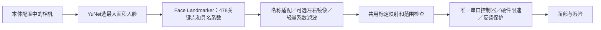

# 实时表情跟随：面部与眼睑

## 1. 功能和边界

机器人实时模仿相机中人的面部表情。第一版控制面部与眼睑，眼球、颈部保持进入节目时的姿态，整个准备、回中、运行和退出流程均不向保持轴发送位置或使能指令。



本节目不播放音频，不启动A2F，不打开麦克风，也不读取旧作品的表情或目标JSON。它用来分别验证识别系数、标定目标、发出的位置和编码器反馈；皮肤动作是否自然仍需现场观察。

Face Landmarker的52项包括`_neutral`和51个表情系数，与本项目的52基础表情不是相同的数组。程序按名称适配，忽略`_neutral`，将模型不提供的`TongueOut`明确置零。眼球方向系数不会接管保持轴；不输出头部姿态动作。左右默认采用同名解剖通道，需要镜像模仿时用`--mirror-expression on`交换左右表情通道。

## 2. 准备和启动

进入仓库目录，先安装标准运行环境（首次执行`./tools/setup.sh`）。再准备共用的可选感知依赖：

```bash
python3 tools/setup_face_landmarker.py
```

当前已验证安装平台为ARM64 Orin、Ubuntu24.04、Python3.12。该命令安装独立的视觉环境、下载并校验固定Face Landmarker模型；不需要A2F模型或GPU推理工程，也不会连接舵机、相机或音频。互动唱歌复用这份感知依赖。

检查配置，不驱动任何硬件：

```bash
.venv/bin/python -m vivis.interaction.programs expression-follow \
  --robot configs/robots/xiaoshuai/robot.json --check
```

确认当前连接的是所选本体，机器头已上电、颈部可靠支撑、串口和相机可访问，停止占用设备的其他服务。启动一分钟跟随：

```bash
.venv/bin/python -m vivis.interaction.programs expression-follow \
  --robot configs/robots/xiaoshuai/robot.json --seconds 60
```

小帅只准备、回中、监测并控制25个面部轴，包含眼睑；ID7/8/22/23和32/33/34保持原位，无映射的ID29不接管。程序沿用小帅原有RAM速度、加速度、标定和EEPROM范围，不为新节目改变这些参数。

| 参数 | 意义 |
| --- | --- |
| `--robot` | 本体定义，决定相机、标定、舵机型号、限位、运行和保护参数 |
| `--seconds 60` | 回中完成后跟随60秒；允许1～600秒 |
| `--gain 1.0` | 所有具名表情系数的统一增益；默认1.0，范围0.1～2.0，放大后裁剪到0～1 |
| `--mirror-expression off` | 默认同名左右映射；`on`交换左右成对通道，不改变相机图像方向 |
| `--check` | 离线检查，报告缺失依赖，不打开设备和模型 |
| `--output 路径` | 使用新的日志目录，已有目录不会覆盖 |

监控地址：`http://127.0.0.1:8765/`。页面显示识别系数和真机控制状态；表情节目中模拟眼球保持居中，不表示编码器测量值。

相机有多人或其他机器头时，沿用现有最大面积人脸选择器。请让测试者的脸完整、清晰且最大；这不是身份识别，不能保证跨越遮挡后仍选择同一个人。

## 3. 观察与日志

等待`EXPRESSION FOLLOW START`后，依次微笑、张嘴、嘟唇、抬眉、闭眼，每种保持约1秒，再恢复自然状态。先验证保持姿态是否对应，再观察自然速度的眨眼，避免把感知低采样率、舵机动态响应与静态标定范围混为一谈。

默认系数滤波时间常数60ms。超过相机新鲜度窗口后保持150ms，再用400ms释放目标，随后由同一滤波器收敛到中性。该逻辑只处理实时视觉丢失，不修改作品源JSON，也不推断语音停顿。

日志保存在`outputs/expression_follow/时间戳/`：

| 文件 | 用途 |
| --- | --- |
| `tracking.json`、`settings.json`、`profile.json`、`home.json` | 本次配置快照，非新的参数来源 |
| `vision/detections.jsonl` | 相机采集时间、所选人脸、原始具名系数及关键点数量；默认不保存人脸照片或原始视频 |
| `preparation.json` | 面部轴启动检查、RAM恢复和回中证据 |
| `playback_log.json` | 单调时钟、实际发送目标、反馈、告警和停止原因 |
| `summary.json` | 完成状态、有效识别帧数、源系数峰值、映射目标范围；不代表皮肤运动测量 |

控制循环目标60Hz，感知帧率取决于实测相机和CPU负载；60Hz控制不等于每秒识别60张不同图像。使用最新观测，不积压旧表情等待补播。

按`Ctrl+C`提前退出；停止目标发送、关闭本次启动的视觉服务，保持安全姿态和既有扭矩，不突然回中或卸载颈部。硬件保护、反馈看门狗、位置约束和连续传感器确认策略继续生效。

## 4. 两种节目切换

先退出当前节目，待进程释放设备后再启动另一个。两个节目及原有示例共用同一控制锁，禁止并行向串口写入。

```bash
# 节目A：实时表情跟随（无音频）
.venv/bin/python -m vivis.interaction.programs expression-follow --seconds 60

# 节目B：本地实时A2F互动唱歌（另需完成P0依赖准备）
.venv/bin/python -m vivis.interaction.programs singing \
  --robot configs/robots/xiaoshuai/robot.json --work 0001 --repeat 1
```

当前默认本体为小帅；更换本体应显式传入对应`--robot`，重新核对标定、硬件限位和相机方向并现场验收，不能直接宣称新本体已验证。

参考：[Google官方Face Landmarker说明](https://developers.google.com/edge/mediapipe/solutions/vision/face_landmarker)、[技术方案开发日志](多模态交互与社交表达技术方案-开发日志.md)。
