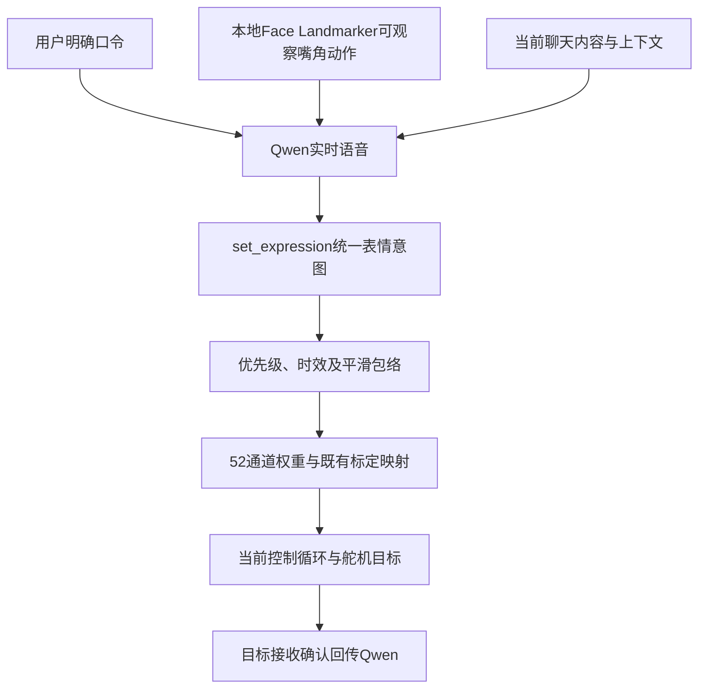

# 表情意图与三状态现场验收

更新：2026-11-10。已扩为52基础表情单通道及组合，复用当前标定，不增加舵机特例，不修改上游素材或硬件参数。

## 1. 意图如何执行



标定启动时加载，运行时计算，不每帧读标定文件。Qwen不接触舵机ID或寄存器。当前微笑使用现有MouthSmileLeft/Right、CheekSquintLeft/Right通道；收回笑容不意味着全轴回中，语音口型、眨眼及眼颈逻辑继续工作。正式控制与反馈仍归现有唯一硬件进程。

唯一配置：[expression_intent.json](../../configs/interaction/expression_intent.json)。语音服务把意图写到本次会话`voice/expression_intent.json`，交互控制循环接收后写同目录`expression_intent.ack.json`。这不是第二套舵机驱动。

## 2. 当前开放的意图

| expression | 作用 | 示例 |
|---|---|---|
| smile | 平滑微笑 | 笑一个，保持几秒 |
| neutral | 收回笑容，保留说话口型等功能 | 别笑了，恢复正常 |
| attentive | 认真、中性的回应标签；本版面部动作同收回笑容 | 认真听我说 |
| auto | 释放意图覆盖，恢复原有自动微笑回应 | 恢复自然回应 |
| 任一标准52通道名 | 按该通道标定驱动，intensity调节幅度 | EyeBlinkLeft、BrowInnerUp、JawOpen |
| custom＋weights | 实时组合基础表情 | 悲伤、哭脸、大笑、惊讶等候选组合 |

不再把悲伤、哭脸、大笑等限制为必须重新标定后才可尝试：Qwen可实时生成基础通道组合，组合是否准确自然需现场评价。点头属于颈部姿态，不在52表情通道内，仍未开放。

同一接口有`command`（明确口令）和`social`（聊天自动回应）两种来源。明确口令在有效期内优先，自动回应不能立即覆盖它；新的明确口令可以替换旧口令。默认有效期8秒，最长30秒；到期平滑恢复原有自动回应。`auto`可提前释放覆盖。

`intensity`范围0～1，默认1。便捷`smile`保持现有微笑增量上限0.5；单通道和`custom.weights`使用0～1标定权重，intensity作为整体乘数。不重写标定或设备速度。平滑上升/收回使用配置中的时间常数，不等于机械到位时间。

当前仅在准备完成的交互态执行意图。预设歌曲、剧本和表情模仿节目保留各自控制权；现场表情意图验收放在交互态，先退出节目再测试。

## 3. 合理回应与模仿的区别

原有本地微笑观察继续作为轻量自动回应；Qwen现在还接收当前单人画面的新鲜嘴角动作摘要，并结合用户话语调用同一个接口。例如，笑着抱怨时可调用`attentive`，避免只因嘴角上扬就持续陪笑。

这仍是首版语义调节，并非完整情绪识别。嘴角系数只是可观察动作，不证明用户内心状态；Qwen没有收到视频帧，皱眉等观察尚未接入本版上下文。不能把一例测试通过宣传为所有情境都能正确共情。

`target_accepted`表示控制循环收到平滑目标，不能证明编码器、皮肤动作已经到位。日志中的`cloud_tool`记录工具参数和拒绝原因，`expression_result`记录接收确认或超时。失败时不得仅凭模型口头回答声称执行成功。

## 4. 本次同时修复

1. 停止、待机工具只要求`action`，不依赖无关节目参数和唤醒字段；冗余的合法节目ID会规范化移除。缺少唤醒词、画面无人不能阻止任务退出。无效节目点播、迟到工具仍校验。
2. 调用被拒时记录具体错误，发声受限并要求模型纠正工具调用。准备阶段与实际就绪状态分开回传；目标状态已经就绪时不重复取消和回中。
3. 仅对服务端明确的`response_idle_timeout`重新建立Qwen连接；不重开麦克风、不重启机器头、不回退本地识别。同一来访者保留有界文字续接上下文；换人重置时清除。其他网络、鉴权、音频或硬件故障维持原停止机制。
4. 来人稳定入镜时长改为2秒。这里只是接待触发时长，不含原有准备、回中和开口耗时；离开重置及重复欢迎间隔维持原配置。

## 5. 启动与测试顺序

机器头上电、串口和音频连接可靠后执行一次：

```bash
sudo systemctl restart vivis-p1.service
journalctl -u vivis-p1.service --since '2 minutes ago' -f
```

不清空旧日志，也不需要重启日志服务。`outputs/p1/`下自动建立新的启动目录。

| 顺序 | 操作 | 验收重点 |
|---|---|---|
| 1 | 无人安静超过4分钟，再喊小帅 | 没有整机退出；云端空闲续接后仍可唤醒 |
| 2 | 短暂入镜不到2秒后离开；再持续站定超过2秒 | 减少误接待；稳定出现后主动问候，站着不重复欢迎 |
| 3 | 交互态说笑一个、别笑了、恢复自然回应 | 面部实际变化，平滑收放，未覆盖说话口型及眼颈 |
| 4 | 微笑说今天很开心；再笑着说其实今天很难过，请认真听 | Qwen选择合适标签；后者应收敛笑容而非机械陪笑 |
| 5 | 依次点播白骨夫人、宇飞剧本、表情跟随，中途说退出，聊会儿 | 一次响应；任务实际停下后再进入交互，无虚假成功 |
| 6 | 任务中说自己玩去吧；随后语音或来人唤醒 | 正确回待机、恢复交互；三状态仍由Qwen监听 |
| 7 | 熟人问我是谁、我的背景；说一个偏好，离开再回来追问；有条件时换人 | 正确称呼、资料与历史关联，不串用其他人的记忆 |

反馈约略时间、原话、实际表情/动作和主观等待时间即可；开发侧对应工具请求、任务取消、准备完成和目标接收的时间。默认不需要启用PCM录音；若要分析采音才单独开启。

## 6. 验证范围

离线覆盖表情参数与时效、明确指令优先、平滑收放、原标定映射接入、目标确认、停止参数规范化、错误纠正，以及特定空闲超时续接。云端文字探测验证模型可调用微笑、收回、认真回应和停止工具；不代替真实语音、识人或皮肤运动验收。

真实云端静默探测：输入合成零PCM，未打开实际麦克风；约185秒内出现180秒服务端空闲超时并建立第二次连接，模拟麦克风只打开一次，无cloud_error。此次旧连接清理及重连有约3.4秒窗口，期间不保证云端指令无间断接收；不能将它描述为零延迟续接。现场应检查安静待机后能否正常唤醒，若恰在续接窗口需结合日志分析。

最终离线交付自检：586项，3项跳过、其余通过；三示例及素材配置检查通过，`git diff --check`通过。本轮未驱动真机、未重启现场服务，需按第5节验收。

## 7. 首次自动接待的空会话修复（2026-11-10）

15:17现场自检与回中通过，但访客尚未说话，首次主动欢迎直接发送`response.create`，Qwen因会话没有user消息返回`invalid_value`，管理器按原故障机制退出。这是自动接待冷启动路径的遗漏，并非应当忽略的任意云端错误。

现在每次控制器主动发起欢迎/返回交互回应前，先发送明确标注`source=local_controller_event`、`human_speech=false`的对话事件，等待对应`conversation.item.created`确认后再生成回复。协议要求用user角色承载输入，但内容明确不是人说的话，不生成虚假ASR文本、不写入用户个人事实。期间若用户开始说话、状态变化或失去发声许可，不继续发过时欢迎请求；事件确认超时仍明确报错，不绕过校验。

真实Qwen加模拟来人/静默PCM的完整语音服务探测：3.43秒收到欢迎回复，`cloud_errors=0`，模拟麦克风opens=1，用户转写数0，未打开真实麦克风、音箱、相机或串口。另有确认顺序、错误确认ID、取消清理、完整冷启动路径的离线测试。

复测时重启服务后先保持安静，不先喊小帅，进入镜头稳定站定，确认它能主动欢迎并保持运行，再继续第5节其他项目。云端冷启动诊断命令（不驱动设备）：

```bash
outputs/speech/venv/bin/python tools/probe_cloud_control.py --scenario reception
```

## 8. 52通道与组合表达（2026-11-10）

上一版人为只开放微笑和中性，是软件接口范围过窄，不能据此说已有基础表情需要重新标定。现在接口接受所有52个标准名称，并支持命名权重字典组合。例如：

```json
{"expression":"custom","weights":{"BrowInnerUp":0.8,"MouthFrownLeft":0.7,"MouthFrownRight":0.7},"source":"command"}
```

此为云端测试实际产生的悲伤候选；不是新增标定或固定动画。单通道可用`{"expression":"EyeBlinkLeft","intensity":0.8,"duration_s":3}`，也可用custom字典。标准通道名唯一来自`configs/schemas/blendshape_channels_61.csv`。

明确姿态指令按标定识别共享执行轴，暂时覆盖相关口型或眼球控制资源，未涉及资源继续原有行为，到期或auto后平滑交还。聊天自动回应让位于正在说话的口部轴和跟踪眼轴，不争夺这些资源；确认里记录ownership_excluded_ids。原作品及旧角度适配不变。直接52通道输入使用明确的blendshapes眼部语义，不让9个角度字段中的零覆盖EyeLook权重。

软件接受52通道，不等于文件中的每个名称都有有效动作。当前离线核对：

| 本体 | 有有效目标位移 | 当前无有效目标位移的通道 |
|---|---|---|
| 小帅 | 46/52 | JawForward、JawRight、JawLeft、MouthClose、CheekPuff、TongueOut |
| 墨甲 | 49/52 | MouthClose、MouthRollLower、CheekPuff |

小帅的CheekPuff/TongueOut为空映射；上述4个下颌通道只有ID31=2050近中位端点，当前已接受的JawOpen下颌所有权规则抑制了它们。本次没有修改该规则。墨甲列出的3项为空映射。以上是当前有效标定、映射规则、停用轴及限位共同决定的名义结果，不是实测皮肤表现。

控制循环对请求中的通道逐项确认：没有有效位移返回no_calibrated_displacement；自动回应因说话/跟踪让位返回blocked_by_ownership，不能混称标定不存在或动作完成。

```bash
.venv/bin/python tools/check_expression_channels.py
.venv/bin/python tools/check_expression_channels.py --robot configs/robots/mojia/robot.json
```

现场在交互态依次说：抬一下眉毛、只闭左眼保持3秒、做个悲伤表情、大笑一个、恢复正常。观察眉眼嘴是否协同、左右是否正确、收放是否平滑；不以云端口头答应代替实际动作。


## 9. 有文字但语音被切断与响应延迟（2026-11-10）

165335会话17:04的笑话已经收到音频并开始播放，随后短暂丢脸触发no_face_no_wake。目标回复resp_QVGM7bk7HiFPi7xdyBjby收到8.8秒音频，2067.930声卡首帧后，2068.969触发静默，清掉368640个48k样本（约7.68秒）。因此完整文字输出不代表完整语音已经播出。

人脸丢失宽限从0.5秒改为2秒，允许短暂漏检；持续无人仍会静默，状态/节目控制权及停止规则保持。2秒不是每句回复额外等待。新增cloud_audio_suppressed日志记录声音被拦截的状态，避免把云端生成和实际播放混为一谈。

稳定交互中按用户话轮只取第一次声卡播放，排除主动欢迎和后续重复回复：16轮，Qwen确认结束到首DAC中位0.368秒、95分位1.983秒、样本最大2.332秒。最大一例约1.997秒在确认结束到首音频包，之后0.335秒到首DAC。这不包含用户实际尾音到云端语义判句的时间，也不包含唤醒/任务切换准备，不是全链路保证上限。

新增reply_latency日志，分别记录confirmed_end_to_first_dac_s、confirmed_end_to_first_packet_s和first_packet_to_dac_s，并明确endpoint_definition；主动事件不伪装用户问答、同一话轮的续答不重复计入首声。

本地工具续答/状态观察轮询从200ms缩为50ms（唯一配置p1.realtime_voice.control_poll_interval_s），单次等待最多减少约150ms。不改音色、语速、A2F同步或硬件参数，不宣称这个改动已降低现场端到端P95。

当前仍使用smart_turn_v2。[官方客户端文档](https://help.aliyun.com/zh/model-studio/fun-audiochat-client-events)说明silence_duration_ms只对server_vad生效，对smart_turn系列无效；不能把服务端返回的默认3000ms当作固定判句等待，也不能只把它写小就声称加速。需要比较判句模式时，应单独测试误切句和误打断，不直接牺牲已验证的附和声处理。

精确测量人真正停话到喇叭首声，需显式短时录音并标注本机采音/参考/ADC-DAC时间轴；本轮没有开启常驻PCM录音。重启后先测连续说话时短暂侧脸是否还误切，再说5～10句普通短问答，反馈主观等待，我方对应reply_latency日志继续定位。


## 10. 当前无脸时序：15秒静默、60秒待机（用户指定，2026-11-10）

第9节2秒是上次修复时的取值，现由用户改为15秒。当前唯一配置为speech_presence.face_loss_grace_s=15、reception.return_to_standby_after_s=60。

- 连续无脸不超过约15秒，容忍短暂离开或漏检，仍可交互。
- 超过约15秒，未另获显式唤醒许可时停止语音输出，仍在交互态。
- 连续无人约60秒，未有唤醒许可时回接待待机；不是15+60秒。
- 原3秒来访离场清理不得提前关闭仍在许可期内的云端语音会话；明确换人、可见身份不确定的隔离规则保留。
- 来人稳定入镜2秒触发欢迎、显式唤醒许可、原有设备保护均保持。

重启服务加载新配置。此修改不增加每句话的首声等待，也不修改音色、语速或舵机参数。
