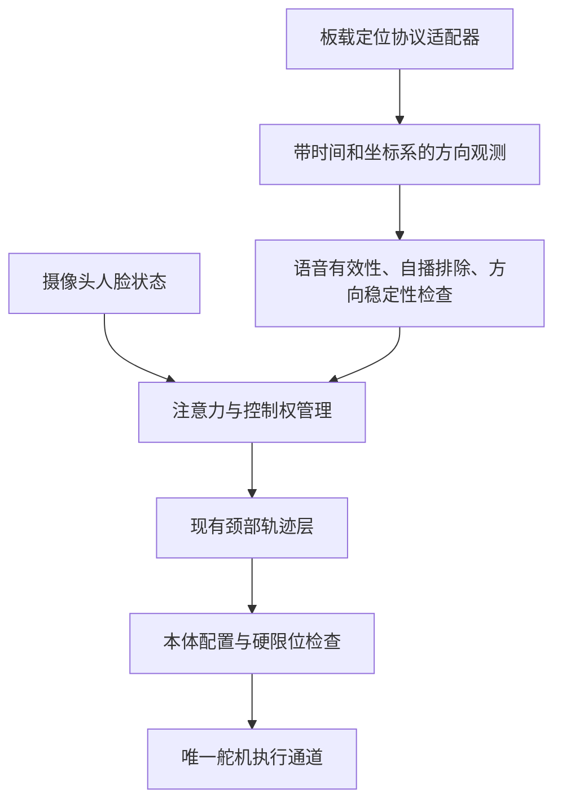

# HK-QXMIC-V3.0音频与声源定位接入核查

首次核查：2026-11-08；最近更新：2026-11-26。本文保留历史调查并区分厂家资料、实测与设计。最新已实现独立TTL声源方位观测工具，见第12节；USB串口驱动已补齐、端口可打开，实际方位帧与站位关系仍待验收。板载算法参数控制、循声转头与多人归属未实现，本轮不修改固件、音量或机器人运动参数。

## 1. 当前结论

已使用板卡USB音频输出，但不能确认当前固件内AEC、NS、AGC各项开关。厂家列出的算法能力不等于当前接法下已生效。用户听到原始混音中自己声音大、机器人声小，不能单独证明AEC开启；声音比例也受距离、朝向、播放幅度和其他拾音处理影响。

主机所谓“原始录音”是板卡USB输出、Orin软件AEC之前的音频，不保证未经板载DSP。要验证某算法，优先读取明确的固件状态，并在相同摆位、输入、音量下做开／关或正确参考接通／断开对照；目前没有可靠的板卡控制协议，不能假造关闭状态。

## 2. 文档与版本差异

| 资料 | 定位输出描述 | 图纸／局限 |
| --- | --- | --- |
| 用户提供的[20250114 PDF](https://www.haokaisz.com/uploads/soft/20250114/1736845201.pdf) | 第1页写I²C | 第2页图纸标题HK-QXMIC-V1.0；6页规格资料，无控制协议 |
| [厂家当前产品页](https://www.haokaisz.com/proshow/1/HK-QXMIC-V1-0)链接的[20250625 PDF](https://www.haokaisz.com/uploads/soft/20250625/1750848854.pdf) | 第1页写串口TTL | 第2页图纸标题HK-QXMIC-V3.0，同时标有I²C与独立坐标输出口；无引脚／帧定义 |
| 用户提供的[英文产品页](https://haokaimic.com/products/qxmic-v3-0) | 写TTL及LED指向 | 产品介绍，不提供默认开关、命令或DOA协议；功放参数与上述PDF有差异，不能据此选电气参数 |

两份PDF第3页均列出AEC、NS、AGC及USB音频能力，但没有“默认开启”的明确声明，也没有算法参数名、范围、设置／读取命令。当前不能验证默认状态或提供可执行调参指令。本次公开资料检索只找到规格书和产品介绍，未找到完整用户／开发手册或可验证的型号专用Linux SDK；不代表厂家不存在内部资料。

完整V3.0接口图比网页V1.0配图多出独立坐标输出等标注。此前基于网页配图提出的版本疑问应按此区分，不能把V1.0图直接当作用户板卡的V3.0接线图。I²C与TTL可能涉及版本差别，也可能是多接口并存，暂不判定。

资料哈希与只读USB核查保存在本地忽略目录`outputs/diagnostics/20261108_realtime_echo/haokai/research_manifest.json`；交付阅读不依赖该目录。

## 3. USB端已经确认什么

| 项目 | 只读核查结果 | 不能推导的结论 |
| --- | --- | --- |
| 固件字符串 | CF-IC / DOV，VID:PID为ff00:0002 | 不代表操作系统认错型号；不能凭名称推断DSP芯片 |
| 音频端点 | 采集与播放均为48kHz、16bit、2通道 | 不说明每项板载算法状态 |
| 两路采集 | 录音中右路比左路晚1个48k采样，移位后约99.9998%样本相同 | 不是已确认的原始／处理通道，也不是可直接用于主机DOA的五路原始阵列 |
| ALSA控制 | Mic／PCM音量和开关 | 不能把普通音量当作AGC开关 |
| HID描述符 | Consumer媒体按键，8个单比特输入，无声明的角度或Feature报告 | 没发现经此HID直接读DOA的字段；不排除未公开的厂商USB请求 |
| 串口 | 当前板卡USB描述符未见CDC串口接口 | 不代表板卡独立TTL接口不存在 |

没有探测未知厂商命令、刷固件、读写未知I²C寄存器或占用舵机串口。

## 4. AEC参考接入

当前路径：

```text
声音 → 麦克风板（内部DSP状态未知）→ USB → Orin软件AEC候选 → 后续ASR／云端
                                           ↑
Orin → 独立USB音箱 ── 实际数字播放参考 ───────┘
```

板载AEC要有效处理机器人自播，必须有符合其实现要求的参考。V3.0规格书第2页明确标有3.5mm回采、4针回采、无功放喇叭输出、功放输出及坐标输出接口。这是有价值的接入线索，仍未给出回采允许电平、针脚、阻抗、通道及内部路由。

后续优先验证以下一种经厂家确认的方案：

1. 声音通过板卡USB播放，再由板卡音频输出到合适的音箱／功放，核实是否自动取得内部参考。
2. 保留独立音箱，把对应播放参考按规定电平送到板卡回采口，核实其外部参考路由。

上述是候选连接拓扑，不是接线指令。不能把功放喇叭端直接当作线路电平参考，也不能猜4针定义；确认资料后再实接。SDK可能用于切换参考或算法，但若固件已固定启用且线路正确，普通USB采音不必安装SDK。关键是厂家说明，不是先下载一个软件包。

现场A→B→A2测试曾尝试把同一数字参考送入板卡USB播放，未见明确的板卡输出回声衰减；只说明当前USB接法／时序／固件组合未证实有效，不证明板载AEC不存在或默认关闭。

用户试听主机软件AEC默认输出仍有约10%～20%主观人声损伤；双讲判定候选减轻损伤且该试听片段未听到机器人泄漏。记录为离线改善，不等于板载AEC生效、完全无损或实时云端通过。详见[语音试验记录](REALTIME_VOICE_TEST.md)。

## 5. DOA接入前必须补齐的协议

| 分类 | 必需资料 |
| --- | --- |
| 板卡身份 | 当前PCB版本、固件版本读取方法、与V1.0／V3.0资料的对应关系 |
| 物理接口 | 实物坐标输出口的引脚、电平；TTL／I²C是否同时支持；是否能通过USB读取 |
| TTL | 波特率、数据位／校验／停止位、输出是否主动推送、完整帧样例、校验及无效值 |
| I²C | 地址、寄存器、主从关系、频率、读取时序及无效值 |
| 角度 | 单位／分辨率、0度物理位置、顺逆时针、是否只是水平角 |
| 状态 | 语音有效标志、静音时角度行为、刷新率、时间戳、置信度（若有） |
| 自播／多人 | 自播时DOA是否抑制、AEC与定位的处理关系、双讲与多人时输出哪一声源 |
| 配置 | AEC／NS／AGC默认值、读写命令、重启保持性及Linux ARM64工具／源码 |

以上为早期缺项清单。2026-11-26已从用户提供的独立操作说明补齐TTL波特率、帧头、方位范围和校验，见第12节。语音有效标志、无声行为、时间戳等未说明的字段仍不能猜测；LED正确也不证明主机已经拿到角度。

## 6. 在Vivis中的后续设计（尚未实现）

DOA用于“先循声转向，再由视觉接管”，不直接在麦克风驱动里写舵机。优先只提供水平目标方向，不把未知的高度／距离伪装为观测值。



上游只接收标准方向观测，不知道HK-QXMIC协议或ID32。厂商协议放在硬件适配器，阵列安装位置、零点偏置、正方向及本体关节映射放在配置。既有视觉、表情、节目控制权和Ruckig逻辑继续复用。

必须先确认阵列安装坐标系：固定在桌面／底座与随头转动的阵列，角度换算不同；后者必须结合测得的当前头部姿态，前者不能反复叠加头部角度。若阵列与头部相距较远，还需评估位置偏差带来的近场指向误差。不能用DOA角度直接线性映射为舵机计数而跳过这些转换。

建议的行为与验收顺序：

1. 先只记录方向，不连接运动。用户在已知前／左／右／后方逐次说话，验证角度零点、正方向、静音无效值和数据延迟。
2. 机器人仅自播、用户双讲、两人轮流说话分别测试。不能只凭麦克风有音量就转头，防止追自己的音箱。
3. 相机无脸且发现有效用户语音时，由注意力层生成一次平顺的循声搜索；获得稳定人脸后交还视觉跟随。多个来源不得同时争写颈部。
4. 真正待机维持原有策略：不因任意声音持续跟随，可在有效唤醒后启用循声；节目状态和交互状态的具体权限单独配置。
5. 首次运动只验证水平方向、小范围、可取消，并保留既有回中与停止行为；通过后再按本体范围扩大。软件无效／过期数据不得转成随机运动。

## 7. 可转给厂家的资料请求

> 我们使用HK-QXMIC-V3.0五麦环形阵列，USB连接Jetson AGX Orin／Ubuntu，当前USB枚举为CF-IC DOV。请提供与实物PCB及固件对应的用户／开发手册：
>
> 1. AEC、NS、AGC出厂默认开关与参数，状态读取及设置方法；是否必须SDK，Linux ARM64工具／源码及固件版本读取方法。
> 2. AEC参考来源、内部USB播放参考路由，以及3.5mm／4针回采口的针脚和允许电平；独立USB音箱的推荐接法。
> 3. 声源定位究竟使用TTL、I²C还是均支持；提供引脚、电平、协议、实际数据帧／寄存器示例、角度零点正方向、无效值和刷新率。
> 4. 静音、自播、双讲及多人条件下的DOA行为，是否带语音有效标志／置信度。
>
> 我们拿到的两份官方PDF分别写I²C和TTL，且图纸型号有V1.0与V3.0，请确认应使用哪一版，不希望猜协议或错误接线。

厂家当前产品页列有技术／销售联系方式。尚未代用户发送任何邮件或消息。下一步需要核对实物正反面、主芯片与接口丝印照片，以及阵列最终固定位置；这些照片能帮助确认版本，但不能代替未公开的协议。

## 8. 2026-11-11实接复测与P1试运行

用户新提供的11页《HK-QXMI..V3声源定位阵列麦..格书.pdf》第9页标出耳机输出和回采，第10页给出耳机口连接有源音箱的方案，第11页给出主机模拟输出分两路送音箱与回采的方案。现场音箱只有USB，用户用3.5mm线连接阵列板耳机输出与回采输入。

本次按如下路径验证并接入P1。

```text
实际播放PCM ── USB音箱 ── 空气声 ── 阵列麦克风
     └────── DOV播放 ── 耳机输出 ── 3.5mm线 ── 回采输入
阵列板USB采音 ── 48kHz转16kHz ── Qwen
```

### 8.1 同一摆位的仅播放对照

`outputs/array_probe/20261111_084232_892981`中，USB音箱播放电平相同，依次关闭、开启、关闭DOV播放参考，板端USB采音RMS分别为−37.06、−77.90、−36.88dBFS。开启参考时自播段电平降低约41dB，撤掉参考后恢复。录音无削波和回调告警。

`20261111_085138_361308`继续采集单讲及两种双讲，导出同源板端直出和叠加当前`voice-preserve`软件处理的WAV。用户试听后选择板端直出。软件处理前后的文件来自同一段有回采的录音，跨天录音的说话响度有差异。

### 8.2 当前配置和播放实现

唯一开关位于`configs/interaction/p1.json`的`realtime_voice.board_reference_device`，本轮值为`"DOV:"`。P1实时语音绕过主机AEC及其附带降噪，保留采样转换。`voice-preserve`配置用于切回测试。

实时语音、预录歌曲、剧本和本地提示音的实际PCM共用`BoardReferenceOutput`复制到阵列板。立体声分别保留左右通道，单声道复制两路。使用各自PortAudio时钟映射和时间插值，把回采对齐到音箱DAC时间，音量和取消淡出均进入同一份复制数据。两路输出随扬声器租约一起释放，麦克风在切换过程中持续采集。

为使音箱PCM能及时到达回采回调，对话音箱使用至少120ms的缓冲，本机DOV回采为20ms。节目继续采用其200ms音箱缓冲。口型使用音箱自身DAC时间。设备打开失败、回采回调停止或连续缺帧时进入现有故障退出流程。

2026-11-11修正欠载判定：PortAudio的单次`output_underflow`表示输出曾出现数据缺口，不等于输入麦克风故障。原实现把任意回调状态直接升级为致命故障，导致15:19的P1会话退出。现在单次欠载记录告警，继续发送当前DAC时间对应的PCM；健康回调清零连续计数，连续5个回调欠载仍失败。`priming_output`是预填充状态，不作为故障。原有回采回调停止、连续3次PCM覆盖不足及设备打开失败处理保留；不补播过期参考数据，不自动切换主机AEC。

欠载次数、最大连续次数与阈值进入`board_reference`统计；常驻语音的`voice/cloud_events.jsonl`记录`board_reference_warning`及恢复事件，回调中不写日志或阻塞等待。依据见[sounddevice回调状态说明](https://python-sounddevice.readthedocs.io/en/0.5.3/api/misc.html#sounddevice.CallbackFlags.output_underflow)。隔离源码完成72项音频、管理器、口型同步与身份控制相关回归；含4项新增回采状态回归。该验证不等于真实长聊零欠载或双讲听感验收。

### 8.3 验证结果

- 新增3项回归覆盖立体声末帧复制与DAC时间、回采缺帧和启动失败清理。隔离源码运行完整交付自检，655项中652项通过、3项跳过。就绪事件中主机AEC状态的记录随后做了纠正，相关9项管理器测试通过。
- Orin本地音频实测完成实时语音→节目WAV→实时语音切换。3段回采均无缺帧，麦克风处理回调无告警，送出的采音PCM逐帧等于主机AEC之前的PCM。
- 正式P1会话`outputs/p1/20261111_092416_612473`完成回中、唤醒、聊天、表情跟随、宇飞剧本、白骨夫人及语音退出后回交互。剧本880次、歌曲947次回采回调均无缺帧。两首作品在播放途中退出，完整播完后的回接仍可在后续长测中观察。
- 现场用户确认人声完整、没有明显自说自话。首次普通问候出现漏唤醒，较长回复也曾因视觉判定访客离开而中断，日志已区分这两种情况。

### 8.4 切回主机软件处理

将`realtime_voice.board_reference_device`改为`null`，然后重启P1，恢复原`voice-preserve`主机处理。配置为`"DOV:"`时需保留本轮已验收的耳机输出到回采输入连接。正式运行可执行以下命令。

```bash
sudo systemctl restart vivis-p1.service
journalctl -u vivis-p1.service --since '1 minute ago' -f
```

启动日志会报告DOV回采和主机AEC关闭。WAV播放日志的`board_reference`记录回调、缺帧与故障，常驻语音的退出摘要记录实际`aec_backend`及回采统计。上述实测验证了当前接线的效果，板载NS／AGC各自的状态读取和参数设置仍需厂家提供对应固件说明。

## 9. 2026-11-23低录音电平与功能状态复核

用户试听聊天档案，确认用户录音普遍偏小。以下是只读核查，未调整音量、板载固件、AEC或运动配置；未启动麦克风录音实验。

### 9.1 本机已确认的事实

- 本次USB恢复后，DOV仍按设备名匹配；声卡编号从此前的4变为3，不使用固定编号选择麦克风。
- `amixer -c DOV contents`显示`Mic Capture Switch=on`、`Mic Capture Volume=3996/3996`，已到当前USB控制暴露的上限；描述符报告最大+15.60dB。此值不是板载AGC开关，也不能据此证明内部前置增益的真实范围或模拟效果。
- DOV播放开关为on、音量999/999，描述符报告+3.90dB；它属于播放／AEC参考一侧，不是麦克风输入增益。本轮没有修改它。
- `20261123_113813_018702/voice/cloud_events.jsonl`的584条`audio_meter`记录中，`raw_rms`与`uplink_rms`全部相等，最大差值0。结合当前板载参考模式，证明软件AEC前后未附加输入衰减；程序只保留48k→16k采样转换和PCM格式转换。这里的raw已经来自板端USB输出，并非五个咪头各自的原始信号。
- 同一会话保存25段用户WAV，约128.2秒；21段绑定何工、4段other。24个声纹结果均在质量筛选处拒收：quiet6次、insufficient_speech18次；最后一段WAV已保存，USB故障前未取得声纹结果。没有声纹参考不等于没有录音。
- 当前声纹质量规则按固定绝对RMS门槛及2.5秒高于帧能量门槛的时长筛选。这会拒收部分可转写但幅度较低的语音；是否应改成更适合本机的判据，须结合试听和独立单讲录音，不通过降低身份匹配阈值掩盖采样问题。

### 9.2 功能清单：能力与验证分开

| 功能 | 本项目状态 |
|---|---|
| USB阵列采音 | 已使用DOV，48kHz双声道取第0路；未发现主机额外压低输入。 |
| 板载AEC | 已接耳机输出→回采并同步送实际播放PCM，11月11日对照曾验证约41dB自播衰减。近期出现自播泄漏，不能把旧验收当作今天仍正常的证据；当前效果待复测。 |
| 板载AGC／人声增强 | 厂商列出内置能力，但本机尚无可读的开关、目标电平或增益状态；不能声称已启用或关闭，也不能仅凭声音小认定损坏。 |
| 板载NS／ANC降噪 | 厂商列出内置能力；当前逐项状态和抑制强度尚不可核实。主机附加降噪随软件AEC关闭。 |
| 喇叭功放 | 用于扬声器输出。当前采用独立USB音箱，未接板卡功放端；不使用它不会造成USB拾音变小。不要将功放输出接入未知电平的回采端。 |
| DOA和LED方位 | 厂商提供TTL坐标输出及LED指向能力；本项目尚未接入TTL协议。USB音频不直接提供五路原始阵列或已解析的方向信息。 |
| 讲话检测 | 当前交互使用Qwen的语音／轮次检测；板载VAD开关和输出协议尚未确认，不能作为已接入功能。 |

### 9.3 资料和接下来怎样验证

再次核对本机用户提供的11页`HK-QXMI..V3声源定位阵列麦..格书.pdf`（第5／6页列参数及AEC、ANC、AGC、SE，第9—11页为接线操作图），以及厂家[当前产品页](https://www.haokaisz.com/products/HK-QXMIC-V3.0-5/)、[支持与下载](https://www.haokaisz.com/support/)中的[6页规格书](https://www.haokaisz.com/downloads/HK-QXMIC-V3.0-5.pdf)。仍未找到该固件的算法控制协议。不同资料的建议拾音距离和功放功率存在差异，不用于推断本机电气参数。

下一步先做无音箱播放、相同说话人和同一句话的近／远距离板端直出录音，观察实际电平、清晰度、底噪和削波，区分距离／安装、板载输出电平与声纹软件门槛。软件放大可改善播放响度，但不能证明AGC启用，也不能恢复已被DSP删掉的语音。确认AGC、NS是否开启及如何调节，需要厂家提供当前固件的状态读取和参数说明。

可向厂家转述：当前设备USB标识ff00:0002／CF-IC DOV，USB采集音量已到描述符上限，但用户录音偏小。请确认本PCB／固件的AGC、NS、SE、AEC默认状态及读取方法、AGC目标电平／最大增益、USB音量与内部增益的关系、回采电平要求，并提供Linux ARM64可用的配置方法。现有资料只说明免驱USB音频，不意味着必须额外安装SDK，更不意味着普通ALSA音量能够控制这些算法。

### 9.4 0.5米／1米无音箱单讲对照（2026-11-23）

用户按约定完成5秒静音、20秒0.5米及20秒1米录音，两次读相同短句。交互服务停止，`arecord`直接采集DOV的48kHz／PCM16／双声道输出；不打开音箱、云端、相机或舵机，不叠加主机AEC／NS／AGC。前后ALSA控制快照完全一致，未修改板载或主机参数。

| 指标 | 0.5米 | 1米 |
|---|---:|---:|
| 实际文件时长 | 20.00秒 | 20.00秒 |
| 全段RMS（含静音） | −37.38dBFS | −44.77dBFS |
| 发声帧RMS | −33.85dBFS | −40.83dBFS |
| 峰值 | −15.14dBFS | −23.62dBFS |
| 削波样本 | 0 | 0 |
| 现有声纹质量门槛 | accepted | quiet |

发声帧仅在本次诊断中按20ms RMS高于−60dBFS选取，便于排除两段不同长度的静音；不是运行中的新VAD或识别阈值。静音段板端输出约−84.85dBFS，该数据已经经过未知状态的板载DSP，不能据此计算咪头原始声学SNR。两路在相差一个48kHz采样点后约99.9998%一致，切换声道不能解决低电平。

两个距离的发声电平相差约6.98dB，本次未显示把两种距离强力拉平的增益补偿；真人响度和房间传播并非受控声源，不能仅据此断言AGC关闭、损坏或没有任何作用。当前USB采集增益已到暴露上限，喇叭功放不是采集增益。

仅在本机对未放大的音频运行现有SenseVoice作可懂度旁证：0.5米两遍原句均完整转写；1米第二遍“停止”的“止”漏识，其余原句转写到位。ASR漏字不能直接当作音频真的缺字，人工听感仍需确认。另在内存中提取两段CAM++特征，对照余弦相似度约0.655，接近当前匹配门槛；这一个同人距离样本不能当作声音认人通过，也未写入个人声纹参考库。

原始WAV及哈希保留在本地私有测试目录，`analysis/index.html`提供原声和两段同为＋12dB的固定放大试听版；均无削波，不做分别归一化、AEC或降噪。放大版只便于试听，不是运行配置修改，也不能恢复已经缺失的语音。下一步先确认1米放大后的原话是否清晰完整，再决定声纹质量判据或输入电平调试；不降低身份匹配阈值来掩盖采样不足。

用户随后确认1米＋12dB试听版完整清晰。继续仅离线比较0、＋6、＋12dB固定增益：1米原电平的本地SenseVoice第二遍漏一个字，＋6和＋12dB均完整转写，且通过现有声纹质量门槛；两段在＋6／＋12dB下均没有削波。0.5米＋6dB峰值约−9.1dBFS，＋12dB约−3.1dBFS，前者保留更多余量，建议作为下一步现场对照值。当前Qwen实时输入仍是板端输出经采样和格式转换后的原电平，＋12dB仅存在于试听文件；本轮没有上线任何输入增益，没有降低声纹比对门槛，也未改变板载回采或主机AEC配置。本地单讲转写结果不代表Qwen或双讲通过，残余回声与噪声也会随固定增益一起放大，仍需自播／双讲现场验收。

## 10. 用户选择＋9dB输入增益（2026-11-23）

用户试听＋6dB后说明，录音时已比平常聊天更大声，因此选择＋9dB作为下一轮现场值。唯一配置来源为`configs/perception/speech.json`的`capture.input_gain_db=9.0`，默认未提供该字段为0；可用范围0—12dB，0关闭，修改后重启语音服务生效。

固定增益在`AudioIO`的48k→16k及可选前端处理之后，仅作用于发送给Qwen／同路本地ASR的PCM。聊天档案和声纹观察复用同一份放大后的PCM；`--record-audio`中的`microphone_16k.wav`保留增益前输入，`uplink_16k.wav`保存实际上行。音箱播放、DOV板载AEC参考、舵机、身份比对阈值以及板卡／ALSA控制不变；不新增AGC、限幅压缩算法或主机AEC／NS。沿用原PCM边界饱和转换，防止溢出反号，并将近满幅样本计数写入统计，不因单个大声样本退出管理器。

启动ready事件及日志显示实际输入增益。`audio_meter`增加`input_gain_db`、`pre_gain_rms`、`uplink_peak_abs`和本帧`uplink_clipped_samples`；退出摘要保留累计近满幅计数。现有静音／资格与身份匹配规则不变。

使用新`AudioIO.process`离线回放原0.5米／1米各20秒WAV，与0dB逐帧比较：增益前PCM和播放参考完全一致，输出均为320000个16k采样、无新增时长或丢帧，近满幅计数0。两段＋9dB峰值分别约−6.21、−14.61dBFS，本地SenseVoice均完整转写，两段均通过原声纹质量门槛。未将这些对照音频自动入库，也没有把质量门槛通过说成声音身份已识别成功。试听及回放记录位于原私有距离对照目录的`analysis/`。

离线增益、前端、实时语音、常驻语音、恢复、控制和档案相关106项检查中105项通过、1项可选本地AEC依赖跳过；P1及三示例离线检查通过。未重启服务或打开硬件。现场仍需验证正常音量0.5米／1米单讲、近距离略大声、机器人自播时用户安静、用户插话双讲；观察增益是否放大残余回声造成自聊。

## 11. 重启后的DOV播放回采控制恢复（2026-11-23）

现场发现重启后DOV `PCM Playback Volume`原始值会回到0/0，恢复为之前验收使用的999/999后继续验证。描述符中0对应0dB、999对应3.90dB，因此不能把“0%”直接解释为硬件静音，也不能仅凭该控制值证明板载AEC已经正常工作。日志同时出现播报被转写为用户输入，说明存在自播回流；其最终消声效果仍需用户安静时的真机复测。

`configs/perception/board_reference_mixer.json`保存这一板卡的回采输出配置。`BoardReferenceOutput`在打开双路输出流前，只检查匹配DOV设备的播放音量和播放开关：不符时恢复999/999与on，并独立回读；已经符合只读取。设备或控制异常进入既有输出恢复流程，不假装参考已就绪。每次重新打开输出都会核验，覆盖重连与USB恢复。启动日志／输出统计保留核验结果。

不修改麦克风控制、独立USB音箱音量、＋9dB输入增益，不增加主机AEC、NS或AGC。软件仍把实际音箱PCM同步送DOV，3.5mm输出→回采线仍须保持连接；电平核验不能检查物理线是否插好。

## 12. TTL方位只读观测（2026-11-26）

### 12.1 已取得的独立协议说明

用户提供的`HK-QXMI..V3.pdf`，标题《声源定位串口读取坐标操作说明》，不是11页音频规格书。原件SHA256为`253961527fca9156f2fe3de811c7b97f3f8d68ef2d6a932c259369e873f29bcd`。协议内容现固化为实现与配置，运行不依赖旧工程里的PDF。

| 项目 | 文档与截图内容 | 本次处理 |
| --- | --- | --- |
| 转接板 | USB-SERIAL CH340 | 仅选择独立、匹配的USB转接板；不回退打开舵机串口 |
| 物理连线 | 麦板TX接转接板RX，另接GND | 接收工具不发送查询或设置命令，不改现有连线 |
| 主机串口 | 1,000,000 baud；截图为8数据位、无校验、1停止位 | 1000000/8N1；不启用软件／硬件流控 |
| 有效字段 | `55 AA [坐标] [FF－坐标]` | 坐标仅0—11，校验通过才发布；支持任意分包和失步重同步 |
| 文档例子 | `55 AA 05 FA 00 E2 7E` | 前4字节给出坐标5；其余字节含义未定义，不编造为距离或置信度 |
| 建议读取间隔 | 200—300ms | 主机读超时200ms、观测发布起测250ms；不把它冒充实测板卡刷新率 |
| 安装坐标 | 写明180°对应00，示意图分为12个方位 | 发布编号及板卡名义角度，尚不发布机器人左右或舵机目标 |

图示是12个区域，不是连续高精度角度。当前按文档名义约定计算`(180 + 编号×30) mod 360`：

| 编号 | 0 | 1 | 2 | 3 | 4 | 5 | 6 | 7 | 8 | 9 | 10 | 11 |
| --- | --- | --- | --- | --- | --- | --- | --- | --- | --- | --- | --- | --- |
| 板卡名义角度／度 | 180 | 210 | 240 | 270 | 300 | 330 | 0 | 30 | 60 | 90 | 120 | 150 |

该角度仅便于记录和比较，不能视为精确区间中心或Orin／机器头坐标。安装正反面、朝向、编号增长方向和机器人正前方偏置，需真人前／后／左／右对照后确认。规格书所述±15°不是本次测得的误差。

### 12.2 实现范围与状态

- 硬件适配：`src/vivis/hardware/haokai.py`，负责帧校验、重同步、接收和过期状态，不依赖舵机控制。
- 独立观测：`src/vivis/speech/sound_direction.py`，终端显示与证据保存，不打开音箱、麦克风、相机或舵机。
- 唯一配置：`configs/perception/sound_direction.json`。默认匹配USB VID:PID `1a86:7523`的CH340；18:42已确认实物身份，补驱动后为`/dev/ttyUSB0`。多个匹配设备必须显式指定端口，不猜哪个是声源板。
- 只读指接收协议字节、不发板卡命令；打开时仍需设置主机UART波特率／8N1，关闭流控并请求独占。不是修改麦板固件或EEPROM。
- 最长单次观察300秒，默认30秒；每次独立目录，原始数据最多1MiB、事件最多2MiB，超额保留截断标志，解析继续。不会覆盖旧实验。
- 新鲜度起测0.75秒；超时将当前坐标清空并显示`stale`，但不据此判断人已停止说话。重复方位帧也不能证明人在持续发声。
- 协议没有给出VAD、置信度、距离、高度和板卡采样时间。这些字段保持未知；接收时间是主机时间，不能冒充声音发生时间。
- 尚未接入P1注意力、身份融合、业务或运动控制。不能依据此日志重标说话人、授权私人查询或驱动转头。

离线回放覆盖厂家例子、12方位、逐字节分包、错误校验、非法编号、长噪声、过期、串口别名隔离、日志限额及真实PTY收流；PTY不是物理USB设备，不证明电气接线或现场定位准确性。

### 12.3 当前实机阻塞与恢复

早前检查仅见两个USB根控制器，未发现CH340、CH343、DOV或摄像头。内核在2026-11-26 13:09:28明确记录`xHCI host controller not responding`、`HC died`，随后多个USB设备同时断开。可确认USB主控／驱动故障，不能仅凭此判断是集线器、供电、线材还是驱动最先引发。

没有自动重启Orin、重绑定USB主控、启动P1或打开舵机。实机收流需操作者恢复USB主控并重新枚举；不能因工具离线通过而宣称“已经读到方位”。

**18:42后的新检查：USB可见但缺串口驱动。**操作者18:41正常停止P1。此时`lsusb`能看到CH340（`1a86:7523`），`lsusb -t`对应接口却为`Driver=[none]`，无`ttyUSB`节点；`modinfo ch341`提示模块不存在。舵机的CH343（`1a86:55d3`）仍绑定`usb_ch343`，有独立`/dev/ttyCH343USB0`。这是缺少串口驱动，与早前USB主控整体失去响应应分别处理。

已从[Linux稳定版v6.8.12官方源码](https://github.com/gregkh/linux/blob/v6.8.12/drivers/usb/serial/ch341.c)取未修改的`ch341.c`，使用本机`6.8.12-1021-tegra`头文件编译；vermagic与现有`usbserial`模块一致，支持目标`1a86:7523`，不匹配舵机`1a86:55d3`。加载后产生`/dev/ttyUSB0`，舵机驱动保持原绑定。模块安装在`/lib/modules/6.8.12-1021-tegra/extra/vivis/ch341.ko`并更新模块索引，依USB别名自动加载。更换内核后需重新核对模块匹配。源码哈希、编译日志和安装信息保存于`outputs/diagnostics/ch341_driver_20261126/`，外部源码及二进制不入Git。

随后按1000000／8N1接收5秒，串口打开／读取／关闭无异常，但`bytes_received=0`、`valid_frames=0`，见上述目录的`preflight/summary.json`。只证明端口路径已通，尚未证明麦板发出了方位帧。下一步配合说话收流；若仍零字节，按厂家说明核对麦板TX→转接板RX和共同GND，不能猜测额外供电接法或主动发送未定义命令。P1保持停止供现场测试使用。

### 12.4 现场步骤

在正式交付目录运行：

```bash
cd /home/james/project/Vivis-delivery
./tools/check_sound_direction.sh --check
./tools/check_sound_direction.sh --list
./tools/check_sound_direction.sh --seconds 60
```

最后一条仅在发现唯一匹配CH340时打开该独立串口。如有多个匹配板，使用`--port`指定上一步列出的真实端口或其by-id别名。没有匹配设备直接失败；不对其他串口试波特率，不发送探测字节。

1. 先安静5秒，观察静音时是停发还是保持旧编号。
2. 分别站在阵列正前、左、右、后方，每处说话约5秒，移动时停说；记录站位、麦板朝向及对应编号，绕过区域边界再复测。
3. 同一位置重复说话，检查方向是否稳定、无输入时是否正确过期；“重复帧”与“真正新声音”分开记录。
4. 后续在原有音频链路中另测机器人自播、用户双讲和两人轮流说话，验证DOA是否追音箱。当前工具本身不播放声音。
5. 查看终端打印目录中的`raw.bin`、`events.jsonl`、`summary.json`。有效帧为0、校验失败或设备断开必须如实报告，不能把0号方位误当无数据。

本轮通过标准是实机方位帧读通、站位关系可重复、静音与自播行为有记录。循声搜索、安装坐标标定后的运动和多人话轮归属另行实施验收。
