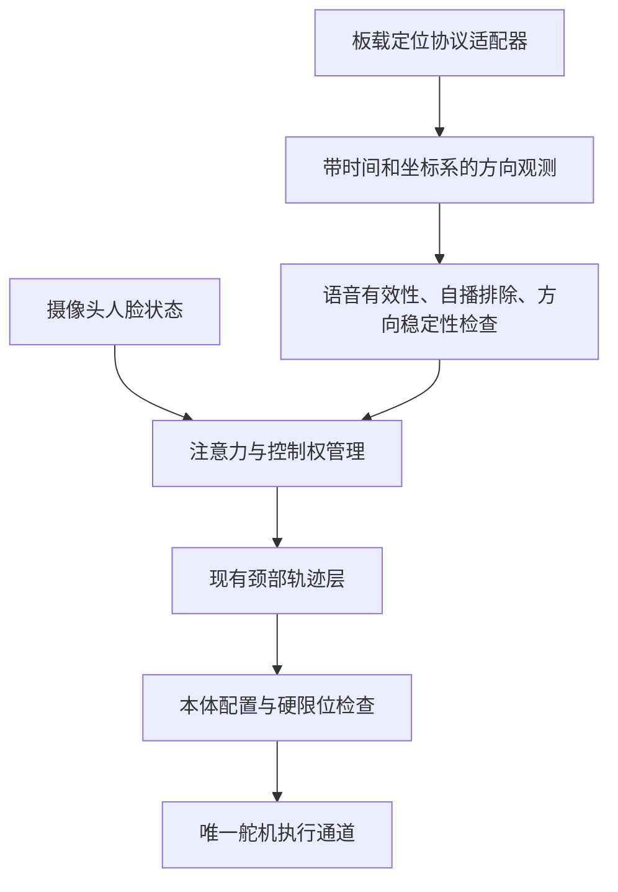

# HK-QXMIC-V3.0音频与声源定位接入核查

核查日期：2026-11-08。本文区分厂家公开资料、当前实测与后续设计。尚未实现板载参数控制或DOA驱动；没有修改固件、系统音量或机器人运动参数。

## 1. 当前结论

已使用板卡USB音频输出，但不能确认当前固件内AEC、NS、AGC各项开关。厂家列出的算法能力不等于当前接法下已生效。用户听到原始混音中自己声音大、机器人声小，不能单独证明AEC开启；声音比例也受距离、朝向、播放幅度和其他拾音处理影响。

主机所谓“原始录音”是板卡USB输出、Orin软件AEC之前的音频，不保证未经板载DSP。要验证某算法，优先读取明确的固件状态，并在相同摆位、输入、音量下做开／关或正确参考接通／断开对照；目前没有可靠的板卡控制协议，不能假造关闭状态。

## 2. 文档与版本差异

| 资料 | 定位输出描述 | 图纸／局限 |
| --- | --- | --- |
| 用户提供的[20250114 PDF](https://www.haokaisz.com/uploads/soft/20250114/1736845201.pdf) | 第1页写I²C | 第2页图纸标题HK-QXMIC-V1.0；6页规格资料，无控制协议 |
| [厂家当前产品页](https://www.haokaisz.com/proshow/1/HK-QXMIC-V1-0)链接的[20250625 PDF](https://www.haokaisz.com/uploads/soft/20250625/1750848854.pdf) | 第1页写串口TTL | 第2页图纸标题HK-QXMIC-V3.0，同时标有I²C与独立坐标输出口；无引脚／帧定义 |
| 用户提供的[英文产品页](https://haokaimic.com/products/qxmic-v3-0) | 写TTL及LED指向 | 产品介绍，不提供默认开关、命令或DOA协议；功放参数与上述PDF有差异，不能据此选电气参数 |

两份PDF第3页均列出AEC、NS、AGC及USB音频能力，但没有“默认开启”的明确声明，也没有算法参数名、范围、设置／读取命令。当前不能验证默认状态或提供可执行调参指令。本次公开资料检索只找到规格书和产品介绍，未找到完整用户／开发手册或可验证的型号专用Linux SDK；不代表厂家不存在内部资料。

完整V3.0接口图比网页V1.0配图多出独立坐标输出等标注。此前基于网页配图提出的版本疑问应按此区分，不能把V1.0图直接当作用户板卡的V3.0接线图。I²C与TTL可能涉及版本差别，也可能是多接口并存，暂不判定。

资料哈希与只读USB核查保存在本地忽略目录`outputs/diagnostics/20261108_realtime_echo/haokai/research_manifest.json`；交付阅读不依赖该目录。

## 3. USB端已经确认什么

| 项目 | 只读核查结果 | 不能推导的结论 |
| --- | --- | --- |
| 固件字符串 | CF-IC / DOV，VID:PID为ff00:0002 | 不代表操作系统认错型号；不能凭名称推断DSP芯片 |
| 音频端点 | 采集与播放均为48kHz、16bit、2通道 | 不说明每项板载算法状态 |
| 两路采集 | 录音中右路比左路晚1个48k采样，移位后约99.9998%样本相同 | 不是已确认的原始／处理通道，也不是可直接用于主机DOA的五路原始阵列 |
| ALSA控制 | Mic／PCM音量和开关 | 不能把普通音量当作AGC开关 |
| HID描述符 | Consumer媒体按键，8个单比特输入，无声明的角度或Feature报告 | 没发现经此HID直接读DOA的字段；不排除未公开的厂商USB请求 |
| 串口 | 当前板卡USB描述符未见CDC串口接口 | 不代表板卡独立TTL接口不存在 |

没有探测未知厂商命令、刷固件、读写未知I²C寄存器或占用舵机串口。

## 4. AEC参考接入

当前路径：

```text
声音 → 麦克风板（内部DSP状态未知）→ USB → Orin软件AEC候选 → 后续ASR／云端
                                           ↑
Orin → 独立USB音箱 ── 实际数字播放参考 ───────┘
```

板载AEC要有效处理机器人自播，必须有符合其实现要求的参考。V3.0规格书第2页明确标有3.5mm回采、4针回采、无功放喇叭输出、功放输出及坐标输出接口。这是有价值的接入线索，仍未给出回采允许电平、针脚、阻抗、通道及内部路由。

后续优先验证以下一种经厂家确认的方案：

1. 声音通过板卡USB播放，再由板卡音频输出到合适的音箱／功放，核实是否自动取得内部参考。
2. 保留独立音箱，把对应播放参考按规定电平送到板卡回采口，核实其外部参考路由。

上述是候选连接拓扑，不是接线指令。不能把功放喇叭端直接当作线路电平参考，也不能猜4针定义；确认资料后再实接。SDK可能用于切换参考或算法，但若固件已固定启用且线路正确，普通USB采音不必安装SDK。关键是厂家说明，不是先下载一个软件包。

现场A→B→A2测试曾尝试把同一数字参考送入板卡USB播放，未见明确的板卡输出回声衰减；只说明当前USB接法／时序／固件组合未证实有效，不证明板载AEC不存在或默认关闭。

用户试听主机软件AEC默认输出仍有约10%～20%主观人声损伤；双讲判定候选减轻损伤且该试听片段未听到机器人泄漏。记录为离线改善，不等于板载AEC生效、完全无损或实时云端通过。详见[语音试验记录](REALTIME_VOICE_TEST.md)。

## 5. DOA接入前必须补齐的协议

| 分类 | 必需资料 |
| --- | --- |
| 板卡身份 | 当前PCB版本、固件版本读取方法、与V1.0／V3.0资料的对应关系 |
| 物理接口 | 实物坐标输出口的引脚、电平；TTL／I²C是否同时支持；是否能通过USB读取 |
| TTL | 波特率、数据位／校验／停止位、输出是否主动推送、完整帧样例、校验及无效值 |
| I²C | 地址、寄存器、主从关系、频率、读取时序及无效值 |
| 角度 | 单位／分辨率、0度物理位置、顺逆时针、是否只是水平角 |
| 状态 | 语音有效标志、静音时角度行为、刷新率、时间戳、置信度（若有） |
| 自播／多人 | 自播时DOA是否抑制、AEC与定位的处理关系、双讲与多人时输出哪一声源 |
| 配置 | AEC／NS／AGC默认值、读写命令、重启保持性及Linux ARM64工具／源码 |

这些字段目前均未获得完整协议，不能假定115200、某个I²C地址或随意解析字节。可先观察LED验证大致方向，但LED正确不证明主机已经拿到角度。

## 6. 在Vivis中的后续设计（尚未实现）

DOA用于“先循声转向，再由视觉接管”，不直接在麦克风驱动里写舵机。优先只提供水平目标方向，不把未知的高度／距离伪装为观测值。



上游只接收标准方向观测，不知道HK-QXMIC协议或ID32。厂商协议放在硬件适配器，阵列安装位置、零点偏置、正方向及本体关节映射放在配置。既有视觉、表情、节目控制权和Ruckig逻辑继续复用。

必须先确认阵列安装坐标系：固定在桌面／底座与随头转动的阵列，角度换算不同；后者必须结合测得的当前头部姿态，前者不能反复叠加头部角度。若阵列与头部相距较远，还需评估位置偏差带来的近场指向误差。不能用DOA角度直接线性映射为舵机计数而跳过这些转换。

建议的行为与验收顺序：

1. 先只记录方向，不连接运动。用户在已知前／左／右／后方逐次说话，验证角度零点、正方向、静音无效值和数据延迟。
2. 机器人仅自播、用户双讲、两人轮流说话分别测试。不能只凭麦克风有音量就转头，防止追自己的音箱。
3. 相机无脸且发现有效用户语音时，由注意力层生成一次平顺的循声搜索；获得稳定人脸后交还视觉跟随。多个来源不得同时争写颈部。
4. 真正待机维持原有策略：不因任意声音持续跟随，可在有效唤醒后启用循声；节目状态和交互状态的具体权限单独配置。
5. 首次运动只验证水平方向、小范围、可取消，并保留既有回中与停止行为；通过后再按本体范围扩大。软件无效／过期数据不得转成随机运动。

## 7. 可转给厂家的资料请求

> 我们使用HK-QXMIC-V3.0五麦环形阵列，USB连接Jetson AGX Orin／Ubuntu，当前USB枚举为CF-IC DOV。请提供与实物PCB及固件对应的用户／开发手册：
>
> 1. AEC、NS、AGC出厂默认开关与参数，状态读取及设置方法；是否必须SDK，Linux ARM64工具／源码及固件版本读取方法。
> 2. AEC参考来源、内部USB播放参考路由，以及3.5mm／4针回采口的针脚和允许电平；独立USB音箱的推荐接法。
> 3. 声源定位究竟使用TTL、I²C还是均支持；提供引脚、电平、协议、实际数据帧／寄存器示例、角度零点正方向、无效值和刷新率。
> 4. 静音、自播、双讲及多人条件下的DOA行为，是否带语音有效标志／置信度。
>
> 我们拿到的两份官方PDF分别写I²C和TTL，且图纸型号有V1.0与V3.0，请确认应使用哪一版，不希望猜协议或错误接线。

厂家当前产品页列有技术／销售联系方式。尚未代用户发送任何邮件或消息。下一步需要核对实物正反面、主芯片与接口丝印照片，以及阵列最终固定位置；这些照片能帮助确认版本，但不能代替未公开的协议。

## 8. 2026-11-11实接复测与P1试运行

用户新提供的11页《HK-QXMI..V3声源定位阵列麦..格书.pdf》第9页标出耳机输出和回采，第10页给出耳机口连接有源音箱的方案，第11页给出主机模拟输出分两路送音箱与回采的方案。现场音箱只有USB，用户用3.5mm线连接阵列板耳机输出与回采输入。

本次按如下路径验证并接入P1。

```text
实际播放PCM ── USB音箱 ── 空气声 ── 阵列麦克风
     └────── DOV播放 ── 耳机输出 ── 3.5mm线 ── 回采输入
阵列板USB采音 ── 48kHz转16kHz ── Qwen
```

### 8.1 同一摆位的仅播放对照

`outputs/array_probe/20261111_084232_892981`中，USB音箱播放电平相同，依次关闭、开启、关闭DOV播放参考，板端USB采音RMS分别为−37.06、−77.90、−36.88dBFS。开启参考时自播段电平降低约41dB，撤掉参考后恢复。录音无削波和回调告警。

`20261111_085138_361308`继续采集单讲及两种双讲，导出同源板端直出和叠加当前`voice-preserve`软件处理的WAV。用户试听后选择板端直出。软件处理前后的文件来自同一段有回采的录音，跨天录音的说话响度有差异。

### 8.2 当前配置和播放实现

唯一开关位于`configs/interaction/p1.json`的`realtime_voice.board_reference_device`，本轮值为`"DOV:"`。P1实时语音绕过主机AEC及其附带降噪，保留采样转换。`voice-preserve`配置用于切回测试。

实时语音、预录歌曲、剧本和本地提示音的实际PCM共用`BoardReferenceOutput`复制到阵列板。立体声分别保留左右通道，单声道复制两路。使用各自PortAudio时钟映射和时间插值，把回采对齐到音箱DAC时间，音量和取消淡出均进入同一份复制数据。两路输出随扬声器租约一起释放，麦克风在切换过程中持续采集。

为使音箱PCM能及时到达回采回调，对话音箱使用至少120ms的缓冲，本机DOV回采为20ms。节目继续采用其200ms音箱缓冲。口型使用音箱自身DAC时间。设备打开失败、回采回调停止或连续缺帧时进入现有故障退出流程。

2026-11-11修正欠载判定：PortAudio的单次`output_underflow`表示输出曾出现数据缺口，不等于输入麦克风故障。原实现把任意回调状态直接升级为致命故障，导致15:19的P1会话退出。现在单次欠载记录告警，继续发送当前DAC时间对应的PCM；健康回调清零连续计数，连续5个回调欠载仍失败。`priming_output`是预填充状态，不作为故障。原有回采回调停止、连续3次PCM覆盖不足及设备打开失败处理保留；不补播过期参考数据，不自动切换主机AEC。

欠载次数、最大连续次数与阈值进入`board_reference`统计；常驻语音的`voice/cloud_events.jsonl`记录`board_reference_warning`及恢复事件，回调中不写日志或阻塞等待。依据见[sounddevice回调状态说明](https://python-sounddevice.readthedocs.io/en/0.5.3/api/misc.html#sounddevice.CallbackFlags.output_underflow)。隔离源码完成72项音频、管理器、口型同步与身份控制相关回归；含4项新增回采状态回归。该验证不等于真实长聊零欠载或双讲听感验收。

### 8.3 验证结果

- 新增3项回归覆盖立体声末帧复制与DAC时间、回采缺帧和启动失败清理。隔离源码运行完整交付自检，655项中652项通过、3项跳过。就绪事件中主机AEC状态的记录随后做了纠正，相关9项管理器测试通过。
- Orin本地音频实测完成实时语音→节目WAV→实时语音切换。3段回采均无缺帧，麦克风处理回调无告警，送出的采音PCM逐帧等于主机AEC之前的PCM。
- 正式P1会话`outputs/p1/20261111_092416_612473`完成回中、唤醒、聊天、表情跟随、宇飞剧本、白骨夫人及语音退出后回交互。剧本880次、歌曲947次回采回调均无缺帧。两首作品在播放途中退出，完整播完后的回接仍可在后续长测中观察。
- 现场用户确认人声完整、没有明显自说自话。首次普通问候出现漏唤醒，较长回复也曾因视觉判定访客离开而中断，日志已区分这两种情况。

### 8.4 切回主机软件处理

将`realtime_voice.board_reference_device`改为`null`，然后重启P1，恢复原`voice-preserve`主机处理。配置为`"DOV:"`时需保留本轮已验收的耳机输出到回采输入连接。正式运行可执行以下命令。

```bash
sudo systemctl restart vivis-p1.service
journalctl -u vivis-p1.service --since '1 minute ago' -f
```

启动日志会报告DOV回采和主机AEC关闭。WAV播放日志的`board_reference`记录回调、缺帧与故障，常驻语音的退出摘要记录实际`aec_backend`及回采统计。上述实测验证了当前接线的效果，板载NS／AGC各自的状态读取和参数设置仍需厂家提供对应固件说明。
