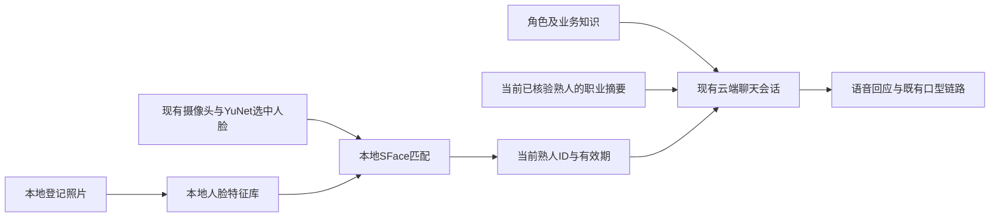

# 小帅知识库与熟人识别

更新日期：2026-11-11。本功能复用现有交互态、摄像头与云端语音会话，不改变舵机参数、节目控制权或停止流程。

当前生产识别后端已按用户选择改为SeetaFace6，保留YuNet轻量检测和跟随；SFace底库保留用于回退与对照。配置、质量门控及本地年龄估计见[SeetaFace6运行说明](SEETAFACE6_RUNTIME.md)。下文SFace参数和试验记录为历史基线。

## 1. 当前启用内容

此前人设只作为文档保存，聊天没有读取完整角色背景。现在由`configs/robots/xiaoshuai/robot.json`的`knowledge`引用统一入口`configs/knowledge/xiaoshuai.json`：

| 内容 | 唯一来源 | 运行时用途 |
|---|---|---|
| 小帅身份、兴趣、风格、共情及交往边界 | [小帅人设](../knowledge/characters/xiaoshuai.md)第1～4节 | 云端实时语音与备用文本聊天的角色背景 |
| 魏宇飞女士、CEO及宇飞剧本名称 | [魏宇飞](../knowledge/people/weiyufei.md)第1节 | 已确认的业务事实，不推断剧本作者或配音者 |
| 当前可执行能力与作品 | `configs/interaction/programs.json` | 能力类别、作品目录；未来规划不能当成已实现功能 |
| 熟人工作背景 | 本机`private/people/<id>/profile.json` | 姓名、称呼、公司、岗位、手工整理的职业摘要 |
| 当前看见谁 | 本机`outputs/runtime/familiar_person.json` | 短时有效的稳定匹配结果；不确定或离开画面时撤销 |

改人设、背景摘要或配置后，退出并重启P1管理器。无需复制到其他提示词，也无需重新生成提示音。当前三状态语音理解、系统回应和节目控制均由Qwen实时处理。

交谈可以关心工作进展、是否需要休息，保持适度亲近；不主动打探联系方式、住址、收入、婚恋、家庭、病史，不侮辱、挑衅或挖苦。保持用户已选择的音色、正常语速及标准普通话。

## 2. 数据流与云端范围

用户已在2026-11-09将此前“个人资料仅本地使用”更新为“全部云端，优先保证聊天质量”。当前实现采用以下范围：



Qwen实时控制会话接收已启用的人设、业务事实，以及当前确认熟人的职业背景和个人记忆；不再在会话开始时整体注入五人的职业档案。身份未确认时不发送熟人目录、个人背景或任务摘要。原有语音聊天上传音频的行为保持；旧文本入口仍保留显式加载职业列表的兼容能力。

原始照片、完整简历、提取全文及人脸特征留在本机`private/`，不作为聊天请求字段、不随Git提交。职业摘要由人工筛选，程序只允许固定字段并检查明显联系方式；这不是自动审查任意简历的完整隐私过滤器。不要把原始简历全文粘进`professional_summary`。

## 3. 识别方式与边界

识别复用同一个视觉服务、同一帧和跟随选中的同一张人脸，不再打开第二路相机。它是社交称呼辅助，不能用于门禁、授权或其他身份认证。

| 参数 | 原SFace初始值 | 含义 |
|---|---|---|
| 本地识别频率 | 2 Hz | 可选任务单次运行，无等待队列；忙时跳过 |
| 余弦相似度门槛 | 0.50 | 初次确认或恢复确认仍须达到；短暂低分可进入复核 |
| 第一与第二候选差距 | 0.08 | 候选太接近时不作新的确认 |
| 连续确认 | 3次 | 同一候选连续满足条件后才作为当前熟人 |
| 当前结果有效期 | 1.5秒 | 无新鲜结果时不沿用旧称呼 |
| 同一人复核窗口 | 5秒 | 从上次连续确认起计；仅保留称呼，不开放个人记录或留言 |
| 最小人脸尺寸 | 60像素 | 过小人脸不提交匹配 |

这些是保守的工程初值，不是本机实测识别准确率。现阶段每人只有一张登记照片，角度、光照与遮挡仍需现场验证。不确认身份时不猜名字；换人或人脸丢失会撤回上下文，不主动打断当前话轮、不反复问候或背简历。

当前接待待机保留相机观察来人，稳定2秒后进入交互；关闭自动接待时才回到关闭相机的待机方案。缺少可选模型或特征库时，普通聊天、人设知识和已有视觉跟随仍可使用。可选匹配失败不会改变舵机控制。关闭识别可设置`configs/perception/familiar_faces.json`的`enabled`为`false`。

## 4. 本机登记与后续补充

当前已登记何裕德、王润章、井明、魏宇飞、梁泽伟五人的用户标注照片。何裕德使用经整理的算法、具身智能及真机验证职业背景；王润章已补充PDF简历，并整理了嵌入式开发、PCB设计、舵机/PID调试、视觉联动和AGV测试等已提供的职业背景。梁泽伟按用户指定称小梁，岗位为市场销售。原始PDF和提取全文仅存本机，聊天读取手工筛选的职业摘要。

当前Orin已准备好模型及登记数据。其他机器首次使用时，在仓库目录运行：

```bash
python3 tools/setup_familiar_faces.py
```

工具从固定版本的OpenCV官方模型仓库下载SFace，核验大小和SHA-256，不读取照片、不打开设备。来源和许可证见[native/vision](../../native/vision/README.md)。核心安装不强制下载此可选模型。

使用已安装OpenCV的项目虚拟环境登记单人照片，以下为占位示例：

```bash
.venv/bin/python tools/register_person.py \
  --id colleague01 --name '同事姓名' --address '合适称呼' \
  --organization '公司名称' --role '岗位名称' \
  --photo '/绝对路径/单人照片.jpg' \
  --professional-summary '已核实且适合交流的工作方向，不填写联系方式等隐私。' \
  --allow-cloud-context
```

可用`--resume '/绝对路径/简历.docx'`另存本地原件和提取文本；不会自动把简历全文加入聊天。更新同一个ID会替换该人的登记特征。登记照片必须只检测到一个人脸；不得以未确认身份的照片进行登记。不要并发运行登记工具。

`private/`已加入忽略规则，但如果把原始资料另放到仓库其他目录，需另行排除。用户原先放在开发仓库的两张照片和一份简历，也已用该仓库的本地Git排除规则处理。

## 5. 检查与现场验收

只检查配置、不打开机器头：

```bash
.venv/bin/python -m vivis.interaction.programs dialogue \
  --robot configs/robots/xiaoshuai/robot.json --check
```

报告中`knowledge_enabled`应为`true`；本机`familiar_profiles`为5。独立克隆没有个人资料时该值为0，这是正常情况。离线登记照片回算只验证登记与特征读取一致，不能代替现场识别验收。

现场请先退出原管理器，然后用原命令启动：

```bash
.venv/bin/python -m vivis.interaction.programs dialogue \
  --robot configs/robots/xiaoshuai/robot.json \
  --ask-key --record-audio
```

1. 说“小帅”进入交互态，问“你是谁”“你喜欢什么运动”“你们公司做什么”，检查角色背景是否生效。
2. 两位同事分别单独站在摄像头前约2秒后问“你认识我吗”“我主要做什么工作”，检查称呼与已登记岗位。首次现场识别尚待验证。
3. 其中一人离开、换成另一人，再由未登记人员出现。应撤回旧身份；不确定时不硬猜。
4. 说“最近调试有点累”，观察回应是否关切自然、不打探隐私、不主动背简历。
5. 验证点播、停止、待机仍按原流程工作；接待待机按当前配置保留相机观察来人。

匹配状态只在本机文件中保存ID、相似度和时间。识别不可用时查看视觉日志中的`familiar_recognition_available`和`familiar_recognition_error`；不要通过降低门槛来强行把陌生人认成熟人。

## 6. 2026-11-10身份串人事件与修正

用户何裕德先生现场被云端称为魏总。登记库只有heyude与wangrunzhang，没有魏宇飞，因此“您是魏总”不是本地人脸识别返回的候选身份，而是聊天模型把业务背景套用了当前用户。服务器已确认上下文更新，不能简单归因于知识没有传入。旧日志只记recognized布尔值，无法回溯当时本地究竟匹配了哪位，故也不能据此保证人脸算法当时匹配正确。

已将当前身份作为独立current_visual_identity结构传入，明确第三方知识不得用来认人、未知时询问称呼、用户否认应纠正；云端只有音频与结构化结果，没有收到摄像头帧，不能假称直接看到了谁或虚构相机失焦等理由。初始和动态云端上下文日志增加实际person_id，视觉日志增加匹配状态、ID及相似度，便于后续对照。没有加入从图像或声音推断性别的算法，也没有调整相似度门槛或更换登记照片。

这些改动修正信息来源约束和诊断缺口，不能以离线提示词测试冒充云端模型已不会串人。需要用户重启P1清除本轮错误对话历史后，单人正对相机问“你认识我吗”，检查日志中的ID是否为heyude及口头称呼是否一致；再测未知人和业务问答，确保仍能正常介绍公司的第三方人物。


## 7. 新增井明与魏宇飞，并联合表情验收（2026-11-10）

井明登记为jingming，称井师兄；筛选西电12系92级及校友组织背景，未核实的机器视觉方向不当作确定事实。魏宇飞登记为weiyufei，称魏总；与既有魏总／宇飞剧本资料合并，按用户再次确认的女士、翌脑科技CEO处理。新原文中的男性称谓和混杂工商股权未进入聊天事实。完整原件和冲突说明留在private，两人的登记照片均检测到唯一人脸。

本节登记完成时库共4人；早期第6节“库中没有魏宇飞”的描述只对应当时误认事件。原何工、小王的特征保持原值，识别阈值和连续确认条件不变。

现场重启一次服务即可同时加载新档案、人脸库和最新52通道表情接口，日志保留：

```bash
sudo systemctl restart vivis-p1.service
journalctl -u vivis-p1.service --since '2 minutes ago' -f
```

1. 单人入镜并保持安静，观察主动问候称呼；未知时应不猜。新熟人本人在场时分别测试，照片自匹配不等于真人验收。
2. 问“你认识我吗”“你知道我的背景吗”。井明应联系西电12系92级，魏总应为女士及翌脑科技CEO；不推算年龄或乱认身份。
3. 告诉小帅一个偏好，离开、进入待机后再回来追问；换人时不能套用上一人的记忆。
4. 在交互态说“抬一下眉毛”“只闭左眼保持3秒”“做个悲伤表情”“大笑一个”“恢复正常”，观察实际表情；再笑着说“其实今天很难过，请认真听”，检查合理回应。
5. 最后点播歌曲、宇飞剧本并中途退出，确认仍回交互；测试安静待机超过4分钟后能唤醒。

反馈时间、原话、实际称呼/表情及等待情况。本人不在场时可先问第三方背景，不冒充完成真人识别。源资料和照片不直接上传，已授权的筛选背景进入Qwen上下文；不改变舵机或运动参数。

## 8. 新增市场销售同事梁泽伟（2026-11-11）

梁泽伟登记为`liangzewei`，用户确认称呼为小梁。使用用户标注的单人照片，岗位登记为翌脑科技市场销售，聊天摘要涵盖机器人／机器狗租赁与销售、B端客户开发、商务沟通、项目协调，以及抖音／小红书内容运营经验。简历原件、提取全文、照片和完整档案保存在本机`private/people/liangzewei/`。

登记工具检测到唯一人脸，库增至5人。离线核验确认原四人的特征逐值一致，新照片自匹配与聊天档案读取通过，P1离线检查报告5份熟人档案。本次服务已重启加载，相机重新接回后完成自检回中并进入接待待机。本人现场识别仍以真实相机测试为准。可让小梁单独站到相机前，问“你认识我吗”“我主要做什么工作”，检查称呼和岗位。

## 9. 三秒身份核验与转告保护（2026-11-11）

本地SFace继续每秒匹配2次，连续3次满足门槛才确认身份。语音管理器在三个状态中每3秒记录一次最新身份核验，使用单人画面和有效期内的匹配结果。已确认的身份变化在控制轮询中及时处理，转告接收人也在语音包进入播放队列前核验。

配置位于`configs/perception/speech_presence.json`。`identity_verification_interval_s=3`控制周期核验记录，`identity_uncertain_reset_s=3`控制已知身份连续无法确认后申请清除旧聊天上下文的时间；实际清理等待当前普通回答及用户控制话轮结束，不能截断语音。个人资料和留言权限不等待此清理，始终取决于新鲜的身份确认。摄像头丢脸的语音许可和回待机策略各有独立配置，见第14节。

已确认甲变为乙时，取消甲尚未播完的回复，清除本次临时聊天历史和旧话轮的任务权限，再按乙加载背景、个人记忆和到期收件箱。匿名聊天后首次确认熟人时，也会隔离原匿名上下文。原始聊天按原归属保留。节目期间同样进行身份检查，节目控制继续走既有管理器。

转告接收人变化、识别过期或画面出现多人时，中止对应语音并拒绝迟到的旧语音包。即使短促附和已清理本次任务续答，未播完的留言仍绑定原收件人。身份变化前未确认的任务保留待处理状态，收件人的新话轮确认才能完成。旧回复发起的个人记忆读取和任务修改在身份不再匹配时会被拒绝。

陌生人默认称“您好”或“您”，可询问希望如何称呼。已登记称呼和本人明确自报的先生、女士、帅哥、美女等称呼可使用。本人或监护人明确提供年龄且小于12岁时可称小朋友。现有YuNet／SFace没有年龄或性别输出，本轮没有加入根据外观推断性别的功能。称呼和自报姓名不会转换成已确认熟人ID或收件权限。

现场可请两位已登记同事依次单独入镜，分别问“我是谁”“你有哪些给我的留言”。再测试留言播放中换人，以及已知人离开后由陌生人入镜。观察`voice/cloud_events.jsonl`中的`identity_verified`、`conversation_reset`、`relay_audio_blocked`和`robot_task_relay_cancelled`，核对称呼、背景、任务及旧语音是否跟随切换。

完整隔离源码交付自检664项，661项通过、3项跳过，包含9项新增身份专项回归。服务已重启，`20261111_103444_708226`会话完成自检回中并进入待机，周期核验日志实测间隔约3.04秒。真实两人换位及转告中途换人的现场验收仍需配合完成。

## 10. 自报姓名被当成视觉身份的问题（2026-11-11）

用户反馈何工被称为小王。核对该会话的本地识别和云端事件，本地只出现“何工”或“未知”，没有识别为王润章。语音识别文本曾出现“我是小王”，随后Qwen把自报称呼沿用为已确认身份，并从任务概览读出了小王的留言标题。不能由这条识别文本断言现场是谁说了这句话。

明确修正如下：

1. 自报称呼可以作为本次礼貌称呼，不转换成熟人ID。回答“看看我是谁”必须查询最新状态；`identity_verified=false`时明确说明尚未确认，不能补全姓名、职业或宣称认出。
2. Qwen初始会话不再预载所有人的职业档案；确认谁后才动态加入对应档案。状态返回中的人物资料与本次核验ID保持一致。
3. 未确认身份时，状态和上下文中的任务列表为空，任务查询／修改与全局历史检索返回`identity_confirmation_required`，同时允许正常语音解释，不陷入工具修复等待。
4. 已确认同事的留言／提醒列表只展示本人创建或本人接收的内容；机器人工作待办仍可共享。过滤先于分页，计数也遵循相同范围。内部任务账本与原始聊天归属保持不变。

现场用户按要求正对相机，六次预览采样仍是“何工／未知”交替，没有“小王”。画面存在明显背光，脸部较暗，匹配分数约0.41～0.57，部分低于现有0.5门槛。本轮没有降低门槛或自动使用现场图片重新登记；应先改善面部光照，再另行评估登记照片。

隔离源码交付自检668项，665项通过、3项跳过。另以实际Qwen连接、合成人物／临时任务库进行无硬件对照：“我是小王，你看看我是谁，有什么事给我交代的？”模型调用了`get_robot_status`，明确回答尚未确认身份，没有泄露合成收件人的姓名或隐藏任务内容。此对照不等于真实多人场景验收。

## 11. 短暂低分进入复核（2026-11-11）

用户选择先保留SFace、登记照片和原门槛，修正“确认需要连续3次，但一次低分就撤销”的不对称行为。唯一新参数是`configs/perception/familiar_faces.json`的`review_hold_s=5.0`；没有修改舵机、音频或跟随参数。

| 状态／事件 | 行为 |
|---|---|
| 初次见到候选 | 连续3次达到原相似度及候选差距要求后，才进入`recognized` |
| 已确认后短暂低分或候选太接近 | 同一张脸持续可见时进入`reviewing`，保留先前称呼；不立刻清空当前聊天上下文 |
| 复核中连续3次重新通过 | 恢复`recognized`，更新连续确认时间 |
| 复核到期仍未重新确认 | 撤回称呼为`unknown`；零星通过不足3次不会延长复核期限 |
| 检测到另一个可信候选 | 立即撤回旧身份，新候选仍需连续3次确认 |
| 未检测到人脸、多人入镜、所选人脸位置明显跳变 | 立即撤回，不借用复核窗口沿用旧身份 |
| 无新鲜识别结果超过1.5秒 | 结果失效，不能靠5秒窗口掩盖相机／推理停顿 |

复核只保留`person_id`、姓名和称呼，不发送职业背景；`Knowledge.current_person()`仍只返回真正`recognized`的人。`get_robot_status`在复核中返回`identity_state=reviewing`、`last_known_person`，同时保持`identity_verified=false`、`current_person=null`。Qwen可继续称呼“何工”，身份问题应说明正在复核，不突然说不认识，也不能声称刚刚核验成功。

个人历史读取、任务查询／修改和留言播放仍要求新鲜的确认结果。复核中暂停这些操作，正在播出的接收人专属留言也会按原保护流程中止。复核结束后只有重新确认接收人才允许再次转告。普通聊天上下文在同一人复核期间保留；真正未知后3秒申请上下文清理，但等待普通回答结束后执行。每3秒核验记录、摄像头丢脸15秒语音宽限和60秒回待机各有独立含义。

该机制依赖连续单人画面和已有位置连续性检查，不是额外的人脸跟踪模型。同一位置悄然换成陌生人、且模型始终低分时，最多可能在复核窗口内保留旧称呼，因此不能将暂留称呼作为业务身份认证。

现场验收：先正对相机直到确认，再轻微转头／改变角度并问“还记得我是谁吗”；短暂低分应保留称呼并显示复核。复核期间询问个人留言应提示等待确认。再分别测试持续低分、离开画面、多人入镜和换人，核对`metrics.familiar_identity.state`与语音日志的`identity_state`。本轮没有降低阈值，也没有补录模板；背光和单张模板导致的拒识仍需后续处理。

离线验证：隔离源码、共用已安装Python环境的交付自检678项，675项通过、3项跳过。新增回归覆盖低分保持、连续恢复、固定期限、多脸／丢脸／跳变撤回、相机停顿后的重新确认，以及复核中上下文保留和私人记录阻断。实际Qwen合成人物／临时任务库对照中，模型先调用`get_robot_status`，随后沿用“甲工”称呼并说明正在复核，没有读取隐藏岗位或留言。未以这些离线／云端文本结果代替现场识别验收。

## 12. SeetaFace6独立选型实验

用户选择进一步在Orin编译SeetaFace6，并与现有SFace及质量过滤作同素材对照。构建、质量评估和录制／评估工具已准备，生产后端仍为SFace。原始多人录像及最终选型尚待现场配合。协议、源码亮度ROI修复、指标口径与操作步骤见[SeetaFace6 A/B测试](SEETAFACE6_AB_TEST.md)。

## 13. SeetaFace6作为当前识别后端

在上述准备后，用户明确选择推进SeetaFace6替代SFace。当前保留YuNet处理跟随用的同一人脸ROI，Seeta在无等待队列的独立任务中处理五点、质量、比对和可选年龄。当前0.6相似度门槛是工程初值，不与原SFace0.5视为同一尺度。

五人生成独立1024维底库，原128维底库及聊天ID不变。复核保留称呼，质量拒绝不开放留言或个人历史。年龄输出是本地估计，不替代已提供的真实年龄，不用于身份或任务权限；性别称谓只采用本人提供或已确认资料。

服务在`20261111_132936_871821`会话完成30轴自检、回中并进入接待待机；监控接口确认`backend=seeta6`、识别资源可用、画面新鲜。此为启动验收，真人换人、陌生人误认和全流程行为仍待测试。[运行说明及验收步骤](SEETAFACE6_RUNTIME.md)。

## 14. 丢脸不截断普通回答（2026-11-11）

身份核验、开始说话的许可、已开始回答的播放分别处理，使用原有配置，不新增一套时间参数。

| 情况 | 行为 |
| --- | --- |
| 短暂丢脸，仍在15秒宽限内 | 普通聊天可继续；身份低分不直接截断当前回答 |
| 身份持续未确认达到3秒 | 申请清理旧上下文，等当前回答和用户控制话轮完成后重建会话；期间个人资料、任务和留言仍要求新鲜身份 |
| 持续无人超过15秒且没有明确唤醒许可 | 不开始新的语音回答；本连接内已经获得播放许可的当前回答可完成，包括尚未到达的后续音频包 |
| 无人达到60秒 | 当前回答、已排队音频及最后DAC播放片段结束后回接待待机 |
| 用户主动打断、停止或待机 | 原有即时打断及控制流程继续生效，不等待回答说完 |
| 稳定确认换成另一个人 | 立即清理原人的会话背景及旧回答，不延后到语音结束 |
| 私人留言收件人失去确认 | 立即暂停该留言，不授予“说完当前回答”的继续播放许可 |

继续播放许可绑定具体`response_id`，不沿用给下一条回答，不跨云端连接或节目切换。清理上下文会等待音频实际播放完成，不能把`response.done`（云端生成完成）当作音箱播放完成。日志`speech_finish_before_silence`记录因丢脸或身份不确定而允许完成的回答。

现场验收：让小帅给出稍长的回答，中途短暂侧脸或离开画面；确认回答完整结束。持续离开超过15秒后，确认不再搭新话，约60秒且当前回答结束后回待机。再分别验证语音打断、明确停止、两名熟人换位以及私人留言中途失去收件人确认。本地回归不代替这项真人验收。

离线验证：隔离源码、共用已安装Python环境的最终交付自检708项，705项通过、3项可选跳过。回归包含当前回复的后续音频／字幕、生成结束但DAC尚未播完、无人60秒时等待尾音、下一条回复静音、控制指令、换人和私人留言保护。云端新回复已创建时同步清除本地旧的继续请求标记，防止重复请求回复。

15:25重启服务加载修改，15:26日志确认30/30轴自检通过、回中完成并进入接待待机。待现场确认侧脸／离开时的语音连续性。重启前旧进程另有一次`Board AEC reference: output underflow`退出记录，应与丢脸中断分别诊断。

## 15. 退件码交接的明确例外（2026-11-11）

用户确认来取退件的陌生快递员无需人脸鉴定。`courier_pickup`只按其明确说出的委托人称呼，提供本人已授权转告的当前取件码；未说明取谁先追问。登记、修改或取消仍要求委托人本人确认。普通私人留言、个人资料和聊天历史不适用此例外，也不把快递员登记为熟人。参见[工作记忆说明第8节](ROBOT_WORKING_MEMORY.md#8-陌生快递员的退件码交接)。
