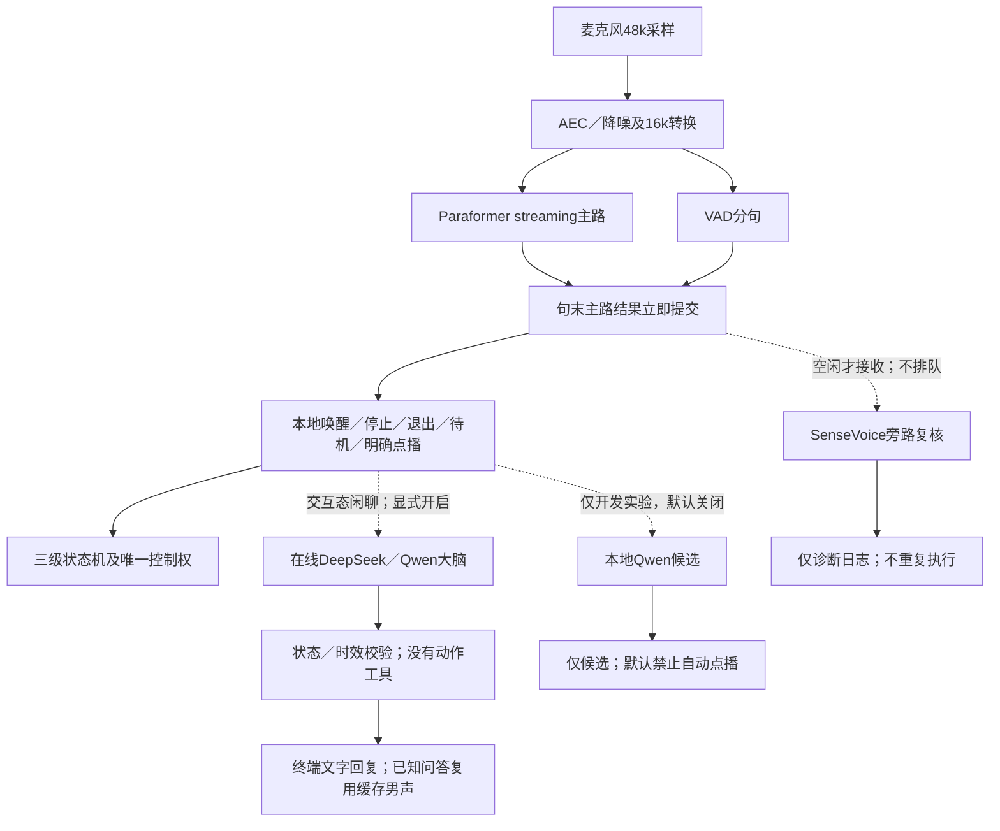

# P1主辅识别与双脑协同

## 1. 本轮处理的问题

现场会话`outputs/p1/20261108_115601_979016`运行约197.90秒，最终因`asr_overload / utterance_id=38`退出。这次日志证明的是复核容量耗尽，并不能据此说麦克风断连。此前DOV断连是另一故障，仍保留采音看门狗。

旧主路是Zipformer流式识别，句末另用SenseVoice复核：一个执行线程、最多两个已接收任务，主路文字也必须等复核后才交给管理器。第三句无法接收时发出`asr_overload`，管理器把它等同采音故障，取消节目。SenseVoice不是这个架构错误的根源。

另一个独立问题是“来一段白骨夫人吧”已经识别正确，意图规则却不接受“来一段”前缀；现已修复。更换ASR不能修复这类路由错误。

## 2. 当前链路及边界



- 主路`asr_final`不等待复核。复核最多一个正在运行，等待队列为零；忙时发出`asr_refinement_skipped`，复核失败仅诊断，不触发节目故障。
- `asr_refinement`只供比较识别假设，不修正已执行的指令；同一句话不会因迟到结果再次启动节目。旧的完整假设仲裁函数保留供离线比较，不再挡在实时控制前面。
- 流式中间文字`asr_partial`可以查看，但不直接执行。仍由VAD句末提交，配置静音门槛为300ms；不把中间的“停止”抢先当作完整的“停止是什么意思”。300ms是分句配置，不是已测总打断延迟，也不是保证在持续伴奏中300ms内识别。
- 原始JSON事件写入`asr_events.jsonl`。中间文字和复核不能挤掉控制队列中的最终指令、设备故障和就绪事件。`asr.log`记录进程诊断／错误，`events.jsonl`记录实际意图和状态转换。
- 真正待机不调用LLM。任务播放时也暂不把未匹配文字送给LLM，以免自播残响变成聊天／点播。在线闲聊仅用于②交互态。
- 本地控制不等待网络。在线聊天一个请求、零等待队列、HTTP超时8秒；新有效话语、本地退出或待机使旧结果作废。只有已被当前交互态接收的回答才加入最近4轮历史，待机清空历史。在线输出只作文本，任何JSON或工具建议都不解释为动作。网络失败不会冒充采音故障。
- 本地Qwen候选一个请求、零等待、4秒超时；实测质量尚未通过，默认关闭，默认禁止其选择节目。多节目澄清等本地明确结果不能交给LLM擅自覆盖。确定的停止／退出／待机／点播继续走本地规则。自然控制长句的本地模型后续另做质量验收。
- 系统仍使用已验收的七条Dylan普通话缓存。LLM一般聊天回复先显示在终端，**尚未接入任意回复的实时TTS／A2F口型**；身份／能力／澄清仍可播放原缓存。当前Qwen-TTS CPU合成明显慢于实时，不能把文字语义接通等同实时语音对话完成。
- AEC、近端采样及硬件保护参数均未调整。参考PCM覆盖不代表回声已消除；持续开麦也不等于全双工验收。

## 3. 模型选择及来源

| 部件 | 当前选择 | 原因与限制 |
|---|---|---|
| 主路 | Paraformer-streaming，中英双语INT8，CPU2线程 | 使用原生在线接口，沿用现有sherpa-onnx2.0.1；此接口不支持当前Zipformer热词参数，因此没有伪装启用热词 |
| 旁路 | SenseVoice INT8，CPU2线程 | 仅诊断复核，忙则跳过；其情绪／事件能力不等于能区分用户与自播音箱 |
| 本地语义候选 | Qwen3-4B，Q4_K_M，关闭思考 | 模型约2.50GB；两轮文本测试均12／15，默认关闭，禁止自动点播 |
| 在线聊天接口 | DeepSeek Flash／Qwen Plus，非思考模式 | 独立后台请求、无控制工具；当前默认关闭，待用户选择服务并在本机配置密钥 |
| 后续候选 | Fun-ASR-Nano及Qwen3.5-4B | 分别做识别质量和语义质量对照；先实测Orin吞吐／延迟，不凭模型名认定一定更好 |

用户随后确定“双脑协同”：本地小脑抓控制，在线大脑做高质量闲聊。当前可立即使用的小脑是本地Paraformer加明确控制规则；小模型辅助控制必须通过验收，不能因为推理跑得快就交出执行权。“不等网络”不等于零毫秒：实际仍含采样、VAD分句、解码及状态切换。

在线首版可选DeepSeek Flash，Qwen Plus作同接口对照，两者都关闭思考以先测交互延迟。DeepSeek当前官方模型标识为`deepseek-flash`；接口未实测，不给出哪家一定更好的结论。用户只需在本机配置密钥，不发到聊天或写入Git。没有调用付费API或创建账户。

文件和版本固定于`native/speech/sources.json`及`native/semantic/sources.json`；下载后核对大小和SHA256。模型／构建产物位于忽略的`outputs/`，不会随代码提交。旧主路配置保留在`configs/perception/asr/zipformer.json`，来源保留在`native/speech/zipformer_sources.json`。运行时仍只有`speech.json`决定主路，不同时启动两套主识别。

官方资料：

- [sherpa-onnx Paraformer在线模型及调用方法](https://k2-fsa.github.io/sherpa/onnx/pretrained_models/online-paraformer/paraformer-models.html)。
- [SenseVoice项目](https://github.com/FunAudioLLM/SenseVoice)。
- [Fun-ASR官方项目](https://github.com/QwenAudio/Fun-ASR)：后续应区分其在线实现与整句／累积重编码实现，分别测量。
- [Qwen3-4B官方GGUF模型](https://huggingface.co/Qwen/Qwen3-4B-GGUF)。
- [llama.cpp官方推理引擎](https://github.com/ggml-org/llama.cpp)。
- [DeepSeek官方API入口与模型标识](https://api-docs.deepseek.com/)、[非思考参数](https://api-docs.deepseek.com/api/create-chat-completion/)。
- [Qwen API说明](https://help.aliyun.com/zh/model-studio/qwen-api-reference/)、[开启／关闭思考](https://help.aliyun.com/zh/model-studio/deep-thinking)。

## 4. 本机离线证据

在Orin上，以相同VAD和CPU2线程回放9段音频；关闭旁路复核，模型加载不计入解码耗时，另保留加载时间。7条TTS短句为“小帅、停止、退出、不用播了、休息一下、播放白骨夫人、开始表情跟随”；另外为缓存菜单与官方中英测试音频。

| 指标 | Zipformer原主路 | Paraformer新主路 |
|---|---:|---:|
| 解码总耗时／原音频总时长 | 0.365 | 0.190 |
| 上述7条短句文字 | 7／7正确 | 7／7正确 |
| 菜单中“魏总” | 识别为“魏总” | 识别为“未总” |

RTF含既有1.5秒尾部补静音的处理耗时，但分母只取原音频时长；不包含模型加载或复核。这组小样本不能证明现场字错率、唤醒率或双讲稳定性。中英例句经300ms VAD切成多段，也存在错词。详细原文及每文件时间位于`outputs/diagnostics/20261108_asr_primary/comparison.json`。未保存此次现场原始PCM，因此无法把现场197.90秒故障录音重新跑出准确率对比。

原文、文件哈希和逐项测量也随代码保存在[回放记录](fixtures/asr_primary_20261108.json)。另在编译同时做64.261秒音频的加速压力回放，耗时17.190秒：25条主路文字全部正确，复核24次完成、1次忙时跳过，fatal事件为0。单次20ms输入处理最大357.4ms，说明平均吞吐充足仍会有解码突发；不能把平均RTF当成每帧延迟。此测试不经过真实采音／AEC，不代表双讲结果。

故障注入测试包括：卡住复核后仍送达5句主路结果；旁路4次忙时丢弃；关闭不等待复核；迟到点播不覆盖停止；200条复核事件及旧overload不挤掉待机；LLM超时、不合法JSON／节目、迟到结果均不执行。

### 4.1 本地Qwen实测与未通过项

固定模型及CUDA SM87引擎已在Orin运行；15条文本分类，第一轮12／15，中位1.637秒、最大2.556秒。明确意图定义及增加少量示例后仍12／15，中位0.993秒、最大1.651秒，仍把假设句当点播，还有单个语气词误选节目。速度可用不代表控制正确性可用，因此`semantic.enabled=false`，`allow_program_selection=false`。保留代码、模型和测量供后续比较，测试服务已关闭。

[测试句](fixtures/semantic_cases_20261108.json)与[两轮原始结果](fixtures/semantic_results_20261108.json)随代码保存；没有把运行时拦截后的安全结果当成模型准确率。当前本地规则会直接过滤单个语气词、保持多节目澄清；即便手动开启实验候选，默认也只能提出点播候选并提示使用明确命令。

## 5. 启动及验收

### 5.1 先验证本地控制

```bash
cd /home/james/project/Vivis-delivery
# 只打开麦克风和识别；不打开音箱、相机或舵机
.venv/bin/python -m vivis.interaction.programs dialogue --listen-only --seconds 120

# 真机：确认连接和支撑，退出设备占用程序后启动
.venv/bin/python -m vivis.interaction.programs dialogue \
  --robot configs/robots/xiaoshuai/robot.json
```

先说“小帅”，再说“来一段白骨夫人吧”“停止”“播放魏总剧本”“待机”。主路为Paraformer；SenseVoice忙时跳过。本地Qwen与在线聊天当前默认关闭，这个测试不需要启动模型服务器或配置API密钥。新环境执行`python3 tools/setup_p1.py`准备语音依赖及模型。

### 5.2 配置在线大脑

`configs/interaction/conversation.json`的`provider`可选`deepseek`或`qwen`，其余端点／模型／环境变量定义保留在同一文件。默认提供中国大陆Qwen公共兼容端点；若账号要求工作空间专属地址，按控制台给出的同地域地址替换，不能把不同地域的密钥和地址混用。

以DeepSeek为例，在自己的Orin终端输入密钥（不回显）：

```bash
read -rsp 'DeepSeek API Key: ' DEEPSEEK_API_KEY
printf '\n'
export DEEPSEEK_API_KEY

# 仅发一条文本请求；不驱动机器头，也不播放声音
.venv/bin/python -m vivis.interaction.conversation --text '给我讲个简短的笑话'

# 先不驱动机器头，唤醒后测试闲聊及随时待机
.venv/bin/python -m vivis.interaction.programs dialogue \
  --listen-only --cloud-chat on --seconds 120

# 完整管理器：本地控制＋交互态在线聊天
.venv/bin/python -m vivis.interaction.programs dialogue \
  --robot configs/robots/xiaoshuai/robot.json --cloud-chat on
```

Qwen使用`DASHSCOPE_API_KEY`，并把provider改为`qwen`。密钥只从进程环境读取，不保存进有效配置、结果日志或Git；不要粘贴给协作者。`--cloud-chat off`关闭在线聊天，本地控制照常工作。当前一般回复显示在终端；已知身份／功能问答仍可播放已选男声缓存，任意回复实时TTS及A2F待后续开发。

### 5.3 本地模型保留为开发候选

`python3 tools/setup_semantic.py`可在新环境下载校验模型并构建引擎；本机已经完成。仅实验时启动`.venv/bin/python -m vivis.interaction.semantic --serve`，另开终端用`--text`比较意图。普通用户无需此步骤，也不需要为在线闲聊下载本地Qwen。`--semantic on`只是开发开关，默认的自动点播禁用仍保留；不得把这版候选标记为控制验收通过。

### 5.4 现场验收

依次检查：①未唤醒不执行；②明确口令直接点播；③节目中停止／待机及时响应；④在线请求慢、失败或回答迟到时，本地指令仍有效，旧回答不启动节目、不写入新会话；⑤任务播放时分别测试仅自播、仅用户、双讲与噪声。记录原文、意图、参考覆盖和实际停止时刻。

“左转”等直接运动口令目前没有接入，不会因为模型说理解了就新增运动权限；若后续加入，应在本地建立有范围／速度／控制权约束的白名单动作，复用本体适配。需要同步采集近端／播放参考／AEC输出，才能分析声学质量；当前默认不保存麦克风PCM。

完整真机、在线API、真实双讲、任意回复的实时语音／口型均尚待验收；本轮不调整标定、硬限位、PID、扭矩、速度／加速度或轨迹规划。
