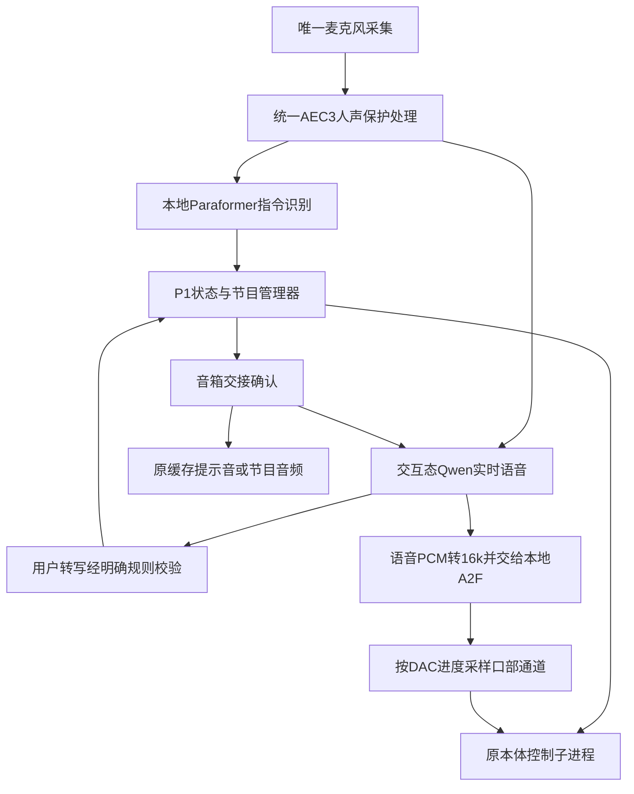

# P1交互态实时语音

当前默认方案（2026-11-10）：语音理解与节目控制已迁移到Qwen实时工具调用；前台接待待机保留相机观察，来人主动问候，并启用按人记忆。本文旧版本地ASR/关键词、固定提示音及待机关闭相机的描述属于历史方案；以[Qwen前台接待与记忆](QWEN_RECEPTION_AND_MEMORY.md)及当前配置为准。

本轮把已试听的Qwen实时语音接入三级状态管理器，复用现有表情回应、眼颈跟随和节目。交互态实时回复通过Orin本地A2F生成口型，按实际音箱播放进度同步；待机／欢迎等原缓存短播报暂不带口型。

## 1. 启动

当前开发Orin已安装语音依赖和人声保护扩展。在仓库根目录执行：

```bash
.venv/bin/python -m vivis.interaction.programs dialogue \
  --robot configs/robots/xiaoshuai/robot.json \
  --ask-key --record-audio
```

在终端输入已开通北京地域模型权限的百炼API Key，不回显、不写配置或Git。也可在本终端设置`DASHSCOPE_API_KEY`并省略`--ask-key`。`--record-audio`显式保存本机录音用于验收；不需要录音时省略。

本体仍执行既有自检、参数核验和回中。等待待机就绪，说“小帅”；交互态准备与欢迎语完成后，终端显示“实时语音已就绪”，即可自然聊天、插话。独立的`test_realtime_voice.sh`、P1或其他占用相机／串口的程序不能同时运行。

新设备还需按原P1说明准备本地ASR、视觉模型和提示音，再安装实时语音可选依赖：

```bash
./tools/setup_realtime_voice.sh --voice-preserve
./tools/check_delivery.sh
```

离线检查不打开设备、不连接云端，也不要求API Key；不能代替真机验收。

## 2. 三种状态

| 状态 | 语音 | 视觉与本体 |
| --- | --- | --- |
| ①真正待机 | 麦克风和本地唤醒／指令识别保持；不连接云端聊天 | 相机关闭，保留原低频眨眼等待机行为 |
| ②交互态 | Qwen实时语音，保留人声保护AEC和短回应暂停／恢复；本地指令并行 | 沿用既有眼颈跟随、自然注意力和微笑回应 |
| ③节目 | 云端聊天释放音箱，本地指令继续；歌曲／剧本沿用静态音频表情 | 白骨夫人、魏总剧本表演、表情跟随按原配置执行 |

“播放白骨夫人”“播放魏总剧本”“模仿我的表情”由本地规则选择节目。节目中“停止／退出／不用播了”回交互态；“待机／自己玩去吧”回真正待机。聊天中“停止”可本地停声，仍保持交互态。Ctrl+C退出整个管理器。

云端没有节目或硬件工具。控制指令优先由本地ASR产生；交互态云端返回的**用户语音转写**也通过同一套明确指令规则补充识别。本地误识别时，不必仅因它听错就丢掉另一条已正确识别的命令。机器人自己的回复、语义猜测、旧会话转写不能触发节目或待机。“你在播放魏总的剧本吗”等询问也不会当成点播。

可说“唱首歌吧”“播放白骨夫人”“播放魏总剧本”“模仿我的表情”；“停止停止”可停声／退出节目，“自己玩会儿吧”进入真正待机。仅说“来个节目”时应询问节目名称，不随机选择或用云端编造的故事替代已准备的作品。

## 3. 音频与控制权



常驻语音子进程只打开一次麦克风，处理后的同一份16k PCM分别送本地ASR和云端，不重复采音或再消一次回声。云端队列和本地ASR队列分开；网络忙不能阻塞本地采音／控制。

云端只在交互态、本体与视觉准备完成且缓存欢迎语结束后连接。进入待机或节目时，先淡出并释放云端音箱，收到对应版本的交接确认后，才允许缓存提示音／新节目取得音箱。音箱切换不关闭麦克风或重置AEC。暂停的音频仍受原缓冲上限约束。

云端故障只停云端语音，保留本地识别和视觉交互。终端会提示，用户可说“待机”后再次“小帅”重连；已在交互态时说“小帅”也可请求重连。不会循环重试或自动生成无意义回复来掩盖服务端空闲超时。物理采音丢失、自检或本体故障仍按原保护行为处理。

每次重新进入交互态建立新的云端会话，当前没有跨节目／跨待机的长期对话记忆。网络故障后的第一句话也不保证补发，重连就绪后再说；不声称具备离线自由聊天。

### 口型与控制权

送往音箱的云端24k语音转为16k送A2F，按名称适配52通道。嘴部只使用其中Mouth／Jaw／Tongue通道，默认增益1.0；眨眼和已接受的眼颈跟随保持原来源。讲话期间，标定中与口型共享的舵机由语音优先使用，微笑仍可作用于其余相关轴；说完后恢复完整微笑回应。

A2F在独立子进程推理，模型可复用，输入队列和帧缓存有界。首次口型准备好前保留待播音频，不跳过开头；之后按实际DAC样本进度线性采样，不按网络到包时间张嘴。临时暂停保留音频与样本进度，确认打断或状态切换则清除旧口型。只有原本体控制循环发送舵机位置，语音／A2F进程不打开串口。

`realtime_voice.lip_sync.enabled`可关闭实时口型。A2F异常只停实时口型、明确报警，语音和本地控制继续；真正采音或本体故障仍按原有保护退出。模型未就绪时口型预缓冲最多等待8秒，超时会报告，不无限阻塞声音。

## 4. 配置与回退

`configs/interaction/p1.json`的`realtime_voice`决定是否启用、共享语音配置路径、地域和AEC配置名；`configs/perception/realtime_voice.json`提供模型、音色、输出幅度与前端基础设置。不复制舵机参数到语音代码中。当前使用已测试的`voice-preserve`、男声音色、幅度1.0；角色身份来自`--robot`，节目名称来自节目清单。

当前开发Orin已重编译支持实时PCM输入的A2F程序。其他已部署设备更新源码后，应重新编译，再做离线检查：

```bash
cmake --build outputs/a2f/build --target a2f_chunk_probe --parallel 2
./tools/check_delivery.sh
```

这条编译命令适用于已按`tools/setup_p0.py`准备SDK、依赖和本机模型的设备；没有这些可选资源时先完成原P0依赖准备，不复制其他机器的二进制或TensorRT缓存。

临时回到原本地唤醒／缓存播报流程：

```bash
.venv/bin/python -m vivis.interaction.programs dialogue \
  --robot configs/robots/xiaoshuai/robot.json --realtime-voice off
```

实时语音与旧的文本LLM／文本在线聊天旁路不能同时开启，以免重复应答；本地停止和节目控制始终保留。`--text-input`、`--listen-only`或离线意图模拟不连接云端语音。

## 5. 验收与日志

按顺序验证：

1. 待机时相机关闭，说“小帅”后出现画面、跟随和实时语音就绪提示。
2. 问“你是谁”“你能帮我做什么”，再聊一个自由话题；核对自然语音、说话口型、微笑回应与跟随，没有重复缓存播报。
3. 机器人说话时作短促回应，再作明确插话；核对无效短回应能续播、有效插话能停声。
4. 点播白骨夫人，确认歌曲和原表情正常；中途停止后可恢复聊天。再点播魏总剧本及表情跟随，检查退出／直接待机。
5. 进入真正待机，确认相机关闭、云端释放音箱，麦克风继续工作；再次唤醒。

日志位于`outputs/p1/时间戳/`：父进程状态与意图在`events.jsonl`，本地识别／云端状态事件在`asr_events.jsonl`，云端事件在`voice/cloud_events.jsonl`，语音汇总在`voice/summary.json`。只有显式`--record-audio`才保存三份对齐16k WAV及ADC索引。API Key不进入这些文件。

`voice/mouth.json`是短时有效的口型交换文件，`voice/mouth.native.log`记录A2F诊断；语音汇总包含生成帧数、预缓冲回调数和错误，本体交互汇总包含实际采样到有效口型的控制周期数。生成帧数不代表舵机已经到位，最终皮肤表现仍须现场观察。

2026-11-08：495项全量离线检查通过（3项可选依赖跳过），新增相关测试在真实云端关闭的mock环境验证了状态切换与故障隔离。本机静音设备交接检查持续同一采音流、两次取得和释放音箱，152帧无回调告警；真实待机语音子进程只打开一次麦克风，105帧、0云端连接、无告警。机器头与真实云端的联合现场验收仍待用户执行，不能将上述检查称为已完成真机联调。

## 6. 首次现场反馈后的流程修复

用户随后确认眼颈跟随与微笑回应正确，但不能可靠待机或切换节目，最后异常退出。现场记录：`outputs/p1/20261108_192954_464404/`。

| 问题 | 日志证据 | 修复 |
|---|---|---|
| 本地识别错误、控制短句覆盖不足 | 本地把“待机”写成“该机”，另有“停止停止”“你自己玩会”等未匹配；云端有正确用户转写，却仅口头答应 | 保持本地快路；允许当前语音会话的用户转写通过同一明确规则补充识别，补充自然控制短句。回答、询问及旧会话仍不能执行 |
| ID34位置边界触发停止 | `measured position2301 outside safe range`，EEPROM上限2300 | 修复跟随反馈范围覆盖了已有5计数编码器容差的问题。只对设备反馈范围沿用本体已有容差，命令不越硬限位；其他特殊恢复范围仍保持原边界 |
| 有语音但没有实时口型 | 第一阶段明确未接入A2F | 新增上述有界语音口型链路，复用标定、控制循环和硬件配置 |

修复后完成504项全量离线检查（3项可选依赖跳过）；新增回归涵盖所有节目切换／退出、云端用户转写补充、回答不得控制本体、音箱交接、口型预缓冲不丢样本、DAC时钟、暂停恢复及取消。独立检出与其独立虚拟环境的4项口型检查通过。

另在本机执行了**无串口／相机／音箱、无云端**的真实GPU推理对照：两段缓存语音转为云端等规格24k PCM，经过新输入管道、模拟DAC播放和口型采样，生成376帧，308次采样取得有效权重，无错误。含冷模型加载的首次可渲染时间约1.42秒；这不是音箱或真机口型延迟测量。记录：`outputs/diagnostics/20261108_managed_mouth/1794138549212777997/report.json`。新增实时口型及本轮流程修复仍需用户现场验收。

### 小帅位置反馈容差更新

用户再次启动时，自检读到ID34位置2302、EEPROM上限2300。先前修复仅覆盖播放反馈，准备阶段另有严格边界检查，因此仍在自检退出。用户明确要求此类越界在50计数以内不停止。

当前小帅各轴的`position_feedback_tolerance_counts`统一为50，唯一配置在`configs/robots/xiaoshuai/hardware.json`。自检、回中反馈和播放共用该值：反馈超出对应边界不超过50计数时可继续，超过50仍停止；无效单圈编码值仍拒绝。回中从实测位置生成原有缓慢曲线，每条发送目标继续裁剪在原设备限位内。EEPROM限位、回中到位标准和其他设备保护不由此放宽；9／24仍不检查、不发送指令。

新增离线回归复现了已使能ID34=2302，以及两侧恰好越界50的完整准备／回中过程；51计数越界在首个写入前失败，并检查所有小帅活动轴的回中反馈范围。此项是软件反馈容差调整，不代表已测得真实编码误差为50计数。

## 7. 魏总剧本点播与晨煦系统播报

`20261108_202012_978652`现场记录显示：白骨夫人成功完整播放并返回交互态；“魏总的剧本”“表演一段剧本”没有生成本地`select`事件，更没有启动`wz2`子进程，因此该次失败发生在点播规则，没有证据表明剧本素材或舵机播放失败。节目清单现已补齐带“的”的名称及常用剧本点播说法；询问、否定、多节目歧义仍分别忽略或澄清。**修改节目清单后需重启P1**，运行中的管理器保留启动时加载的规则。

用户要求系统缓存播报由Dylan换为晨煦。[官方音色表](https://www.alibabacloud.com/help/tc/model-studio/qwen-tts-voice-list)中晨煦对应`Ethan`，支持普通话，男性、阳光温暖。它属于云端Qwen-TTS音色，当前本地Qwen3-TTS CustomVoice的Dylan不能通过改名字变成Ethan。

采用“一次生成、本地播放”：只需为7条固定提示音调用一次云端合成流程，保留原有相对作品响度、标准语速和文字，之后以验证过的WAV本地快速播放，不在唤醒或控制链路中请求TTS。生成使用[官方非实时HTTP接口](https://help.aliyun.com/en/model-studio/qwen-tts-api)，不需要新增大型本地模型。

```bash
cd ~/project/Vivis-delivery
# 在原P1终端先按Ctrl+C退出，再准备晨煦缓存。
./tools/prepare_prompt_voice.sh --ask-key --activate

# 出现“晨煦提示音已校验并启用”后，重新启动。
.venv/bin/python -m vivis.interaction.programs dialogue \
  --robot configs/robots/xiaoshuai/robot.json \
  --ask-key --record-audio
```

第一条命令不打开麦克风、音箱、相机或串口；API Key只在终端输入，不存文件。7条音频及元数据校验全部成功后，才更新`speech.json`的TTS来源与缓存路径；权限或网络失败时，原配置仍可运行。缓存目录是`assets/speech/xiaoshuai_ethan/`，包含SHA256、来源、文本和响度处理记录；不保存API授权或带签名的下载地址。其他设备部署时连同该缓存分发，播放不需要云端合成权限。

晨煦与当前云端聊天男声`longanyang_v3.1`属于不同音色，是否足够接近需要试听。如果仍有明显切换感，下一步可考虑用云端聊天同款音色预生成系统短句，同样缓存到本地；本次保持已接受的实时聊天音色不变。

首次现场生成遇到云端流式WAV文件头：实际99,885字节，头部声明2,147,483,591字节；这不代表下载或生成了2GB音频。解析已改为支持常见PCM／浮点位深、单／双声道，并对未知大长度头按实际有界样本解码；普通截断文件仍拒绝。原始下载在解码前以请求内容散列保存到`outputs/speech/cloud_prompt_sources/`，同时记录来源请求ID及SHA256，不记录密钥或签名URL；同一请求可直接复用源音频，格式修复无需再次合成。

程序切换已完成独立检出环境的513项完整离线检查（3项可选跳过）；随后新增的音频解析、流式头部精确字节数回归和原始下载复用等8项专项检查通过。晨煦缓存是否已生成、激活及其真实声音效果，以首次成功生成后的元数据检查和用户试听为准。

用户随后成功生成并启用了全部7条晨煦提示音。已核验`speech.json`启用`dashscope/qwen3-tts-flash/Ethan`，缓存目录为`assets/speech/xiaoshuai_ethan/`；7条SHA256全部匹配，成品均为24kHz单声道PCM16，P1离线检查无缺失依赖。实际响度相对基准约-3.0至-3.69LU，真峰值均不超过-1dBFS。源文件也确认为PCM16单声道，之前的失败源于未知长度流式文件头，而非实际下载2GB或实际位深不支持。云端聊天音色保持原配置；晨煦试听及新点播说法的现场验收仍待用户重启P1验证。

## 8. 剧本中途退出与连续点播修复

### 8.1 现场问题与证据

会话`outputs/p1/20261108_205535_819192/`中，魏总剧本已真实进入`wz2`播放并完整完成，但播放期间没有产生本地“停止／退出”意图，也没有`cancel_requested`事件。录音回放在原始和处理后音频中分别找到了退出／停止语音；主路完整分句没有正确识别，句末SenseVoice复核也未可靠输出控制词。不能将其写成“取消程序已收到指令却不退出”。

返回交互态后的白骨夫人请求，本地转写为“还国夫人”，云端用户转写为“排骨夫人”。模型回复理解了作品，但没有本地选择事件，仍是识别到控制路由之间的问题。之后的云端`response_idle_timeout`在连接清理等待期间被满队列提示掩盖，是另一项错误报告问题。

### 8.2 修改范围

1. **独立本地短指令**：增加小型中文关键词模型，监听停止、退出、结束、待机；与主路使用同一份处理后采音，同时检查实际播放参考。检出后有250ms上下文确认，已识别出的否定／询问和相近播放参考词会过滤。它不等待句末复核，不请求云端，不发送舵机指令。
2. **控制事件独立排序**：`asr_control`与`asr_final`分别计序，旧事件仍拒绝。关键词控制只在任务态执行；交互态的候选词不会取消任务或聊天。模型本身也有误检／漏检可能，过滤不等于声学准确率证明。
3. **节目名有限纠错**：仅交互态对完整名称或明确点播句，允许一次字符替换、至少4字、候选唯一的校正。例如本次“排骨夫人”可以匹配已有目录中的白骨夫人；不添加错听名称别名，不从询问／否定／转述里截取子串，不在播放态模糊重启作品。多个候选仍澄清。
4. **统一回声参考时钟**：歌曲、剧本和缓存播报的`AudioClock`使用与实时语音一致的PortAudio固定偏移校准，直接标记实际DAC时间，避免把Python回调调度抖动写入参考时间。原PCM、音量和音频／动作时序不变；真实消声改善仍需现场验证。
5. **云端失败报告**：断连／空闲超时后，在等待连接清理前就断开上行队列，保留真实错误，不再用“队列满”掩盖原因。继续保留本地识别；失败后可说“小帅”重连，不循环发送无意义请求。
6. **能力介绍**：当前能力来自节目配置的`capabilities`，统一为唱歌、演剧本、学表情；具体作品只在用户询问或选作品时介绍。历史人物、文旅和医院接待来自`planned_capabilities`，明确是未来规划。整机提示词也不再混入纯语音测试的“没有相机”说明。

短指令设置在`speech.json`的`control_keywords`；词表在`configs/perception/control_keywords.txt`，来源／SHA256在`native/speech/control_kws_sources.json`。当前Orin已校验模型。其他设备首次安装运行：

```bash
python3 tools/setup_control_keywords.py
```

正常运行不联网下载模型。`tools/setup_p1.py`也会准备该模型。需要对照关闭时，将`control_keywords.enabled`设为`false`，原主路ASR继续工作。

### 8.3 离线证据与边界

- 完整661.86秒录音回放，短指令链路检出任务中的“退出”，输出时间戳126273.625；原剧本在126279.686结束。若该链路当时启用，该事件可提前进入取消流程；这不是实际取消延迟测量。
- 同一回放中的一个“结束”候选发生在交互态，由任务态限制拒绝；状态回归覆盖此情况。
- 另一段包含成功白骨夫人播放的150秒录音对照，没有产生关键词控制事件。
- 38秒录音经主识别、关键词双流和可选复核共处理约10.82秒，RTF约0.285，单帧处理P99约87ms，最大约126ms。这是本机离线吞吐，不包括相机、音频回调和整机联合运行负载。
- 短截片的起点会影响关键词模型输出，不能只挑一次短截片宣称识别成功。本轮保留了完整会话回放和对照记录；噪声、距离及新的参考时钟下的表现仍须现场验证。

完整离线交付自检在独立检出环境通过525项测试（3项可选跳过）；最终修改后，短指令、控制事件排序、模拟节目切换、参考时钟、主路识别、云端清理及提示音缓存等56项专项回归全部通过。P1配置检查无缺失依赖。上述均不代表完成真机退出验收。

证据位于`outputs/diagnostics/p1_control_20261108/`。可用下列命令复现完整本地回放，不打开设备或云端：

```bash
PYTHONPATH=src outputs/speech/venv/bin/python tools/replay_control_keywords.py \
  outputs/p1/20261108_205535_819192 --seconds 900
```

### 8.4 次日现场测试

先更新本地两条能力介绍缓存。新文本已在晨煦预设中准备好，全部生成并验证后才切换；其他五条保持复用。夜间没有API Key，未代替用户调用云端生成。

```bash
cd ~/project/Vivis-delivery
./tools/prepare_prompt_voice.sh --ask-key --activate

.venv/bin/python -m vivis.interaction.programs dialogue \
  --robot configs/robots/xiaoshuai/robot.json \
  --ask-key --record-audio
```

1. 自检回中完成后说“小帅”，问“你会什么”，应先说唱歌、演剧本、学表情。
2. 点播剧本，开头播放几秒后说“停止”，观察终端是否识别／退出、音频是否停止、随后是否回交互态。
3. 再次点播剧本，中段说“退出”，确认管理器继续运行并恢复交互。
4. 回到交互态后点播白骨夫人，核对实际出现“选择白骨夫人”和任务执行，而非只有口头承诺。
5. 播放时说“不要停止，继续播”或问“停止是什么意思”，应继续播放；再明确说“停止”，应退出。此项用于检查新短指令链路的误触发。
6. 表情跟随里测试停止，再测试“待机”及重新唤醒。

分别观察语音识别／取消事件、音频停止及回中完成，不把回中耗时当作识别延迟。用户已将机器头断电，本轮没有真机动作验证；舵机标定、限位、速度、PID、扭矩及已接受的眼颈算法均未因此修改。

## 9. 宇飞剧本更名、重复点播与反馈调度（2026-11-09）

### 9.1 本次现场日志

会话`outputs/p1/20261109_091210_710882/`中，第一次`0003_wz2`已正常完成，返回码0。第二次请求的主路转写为“你表演演一种剧本”，云端用户转写为“你表演未等剧本吧”；未产生选择事件或第二个剧本进程。模型却回答“这就为您表演”，属于无执行结果的口头承诺，不能记成第二个剧本进程播放中崩溃。

其后的`0005_expression-follow`才是异常退出点：ID19有效反馈年龄1.001749秒，超过原有1秒看门狗；最后一次失败读取约在305.66ms之前。该轴只有一次记录到的坏包，但调度使用最近尝试时间排序，把较早到期的有效反馈期限排在其他轴之后。其他轴同期也有少量坏包，现有证据不足以判断物理通信故障来源。

返回交互时重新建立云端会话，没有传入已完成节目，导致模型两次否认刚刚发生的表演。

### 9.2 已修复范围

1. 节目正式显示名改为**宇飞剧本**；内部`wz2`及音频、表情文件不变，旧称保留为点播别名。姓名、女士称谓及翌脑科技CEO身份保存于[魏宇飞知识条目](../knowledge/people/weiyufei.md)，不推断剧本作者或配音者。
2. 只有实际节目进程退出后，控制器才记录`completed`或`interrupted`。下一次交互连接携带该结果，模型可以据实回答刚才播了什么。助手台词、用户请求及失败启动都不写成已完成节目；上下文仅在本次管理器生命周期内保留。
3. 在交互态说“再演一遍”“再来一次”“再播放一遍”，可重播最近实际运行的节目；没有记录时澄清，播放态不因这类词自动重启。否定、询问和转述不执行。
4. 云端提示词从节目配置读取名称，不再硬编码旧名；听不清名称时应确认，而非答应已播放。没有把“未等”等错听文本写成节目别名，语音识别本身仍可能出错。
5. 接近反馈截止时间的轴，按**最后有效反馈**最旧优先；近期重复失败在有其他紧迫轴时短暂让行，避免坏轴独占。默认50ms让行随更短看门狗窗口收缩。每帧读取预算、单次超时、1秒看门狗、传感器连续确认及设备保护均未放宽；坏包不刷新有效反馈时钟。

本地晨煦预设中的澄清文本改用“唱歌、演剧本、学我的表情”等类别，不再报旧作品名。现有已验证缓存继续可用；运行`./tools/prepare_prompt_voice.sh --ask-key --activate`后才更新实际WAV，未代用户调用付费生成。

### 9.3 现场复验

退出旧管理器，按第1节重新启动。依次验证：

1. “小帅”→“播放宇飞剧本”，完整播完后问“刚才播的是什么”。
2. “再演一遍”，应实际出现第二次任务准备及播放；中段说“停止”，回到交互态。
3. “表情跟随”，观察至少30秒后说“退出”，再点播白骨夫人。

终端的`start`／`worker_ready`／`worker_exit`及`program_result`才是程序执行证据，云端口头确认不算。调度回归涵盖单次失败后的最早截止时间，以及持续坏轴不饿死健康轴；现场通信稳定性仍需复验。本次修复未发送真实舵机指令。

本轮在独立检出环境完成530项完整离线测试（3项可选跳过），交付自检通过；专项112项回归通过。随后补测带“小帅”称呼的重播请求。未连接云端或驱动机器头，实际识别、两次连续播放和反馈稳定性待用户现场确认。

## 10. 预设节目误停与通用点播修复（2026-11-09）

本节取代第8节中“关键词可独立决定取消”的行为说明，历史录音及其结论不删除。

### 10.1 实际失败路径

会话`outputs/p1/20261109_094152_793730/`中，两次白骨夫人都已产生任务进程：第一次回中期间被`local_keyword_control`的“结束”取消，第二次刚进入播放被其“停止”取消。没有舵机异常或音频文件错误导致这两次退出。用户明确确认没有说过上述控制词。

第一处附近的主路文本是“解解决不了么多解决方”，复核文本是“解决不了问题怎么办”；关键词模型把相似发音当成“结束”。第二处主路文本为空，关键词却报告“停止”。它们均不能证明存在用户取消意图。此前仅靠提高关键词门槛、短时间上下文等待及播放参考过滤，未覆盖这两类误触发。

剧本请求另有规则缺口：主路已经识别出“呃播放剧本”，但只收录了一些“演剧本”表达，未触发任务；助手的口头确认不代表启动。该会话也出现过云端`InternalError`，它作为独立云端故障保留，不归因于预设素材或电机。

### 10.2 当前修复

1. **关键词不能单独取消节目**。候选仍可在本地提出，但必须与当前流式主路的完整控制意图一致：待机对应待机，停止／退出／结束对应返回交互。空文本、普通说话、否定／询问及不一致的候选仅记录`asr_control_suppressed`。不把旧话语保留到新空白段来确认候选。
2. 主路完整识别到停止／退出时仍直接执行；关键词辅助只加速已经明确的流式控制意图，不等待云端或SenseVoice。此更保守的方案排除本次误停，但不保证此前含噪、主路识别错误的退出样本现在可执行；音乐／双讲下的停止识别仍待继续迭代。
3. 节目配置增加`category`，区分歌曲、剧本、表情节目。“播放歌曲”“唱首歌”“播放剧本”等明确请求按类别匹配；只有一部时选择，多部时澄清。作品名称仍可精确点播，否定、询问及转述不截取执行。
4. 云端收到带类别的完整节目事实清单，并明确不能虚构流行歌曲或声称没有清单。官方[会话参数说明](https://help.aliyun.com/en/model-studio/fun-audiochat-client-events)将`instructions`定义为会话指令；实际任务仍由本地控制器校验执行，模型口头回答不能作为执行证据。
5. 准备期间取消、尚未就绪的任务不再记录成已表演的节目结果。实际音频、表情素材、机器人参数、回中及通信保护保持原设置。

### 10.3 录音实验与边界

证据在`outputs/diagnostics/p1_false_stop_20261109/`。为保留原始运行中的录音，先只读快照其前420秒，并为快照写入正确WAV头；没有修改原始采音。

旧关键词参数在420秒快照中产生3个候选，其中2个正是上述取消事件。较高阈值组合可使该段零候选，但在此前661.86秒正例录音中也失去真实退出，因此没有采用。单独短窗ASR的候选实验亦未同时通过正反例，未接入运行时，没有下载新模型或启用新的推理服务。

当前采用现有主路意图确认，保留原关键词参数，不声称关键词独立识别已经可靠。真正的完整播放及音乐中停止表现，仍以重启后的现场日志为准。

修复后的420秒完整快照回放，3个候选均记录为`unconfirmed_streaming_intent`并被拦截，没有`asr_control`取消事件。独立检出环境完整离线自检533项通过（3项可选跳过）；最后的本体唤醒名配置传递等25项专项回归通过。两项旧测试的提示音元数据样例已适配用户新启用的文本覆盖，实际晨煦缓存核验有效；不需要再次生成。上述不替代真机完整播放及含噪停止验收。

### 10.4 重启与现场验证

当前管理器在启动时读取配置及代码；修复需要先在原终端Ctrl+C退出，再重新运行：

```bash
cd ~/project/Vivis-delivery
.venv/bin/python -m vivis.interaction.programs dialogue \
  --robot configs/robots/xiaoshuai/robot.json \
  --ask-key --record-audio
```

先唤醒“小帅”，说“播放歌曲”，等待白骨夫人完整结束；再说“播放剧本”，核对宇飞剧本真实进入任务并播放。随后另测“停止／退出”。测试中普通聊天和安静不应自行取消任务；若仍异常，保留本轮`outputs/p1/`日志。Ctrl+C仍可直接停止管理器并保持原停止／扭矩策略。

## 本机密钥与开机服务

需要免重复输入API Key或无人登录开机运行时，见[密钥保存与开机自启动](P1_AUTOSTART.md)。使用持久密钥后省略`--ask-key`；开机服务默认不持续保存调试录音。
