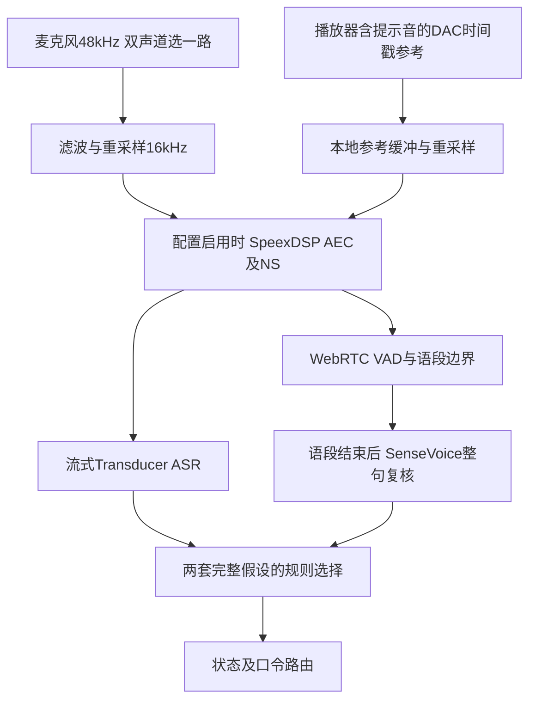

# P1现场反馈复盘与下一轮验收

> 音色选择已被2026-11-08的Qwen普通话版替代，当前配置和复现方式见[新复盘](P1_VOICE_AND_USB_20261108.md)。本页保留当日选择及测试记录。

## 1. 本轮范围

用户已将小帅断电。本轮仅检查既有日志、离线合成语音、运行模拟与回归测试；不打开舵机、摄像头、麦克风或播放音箱。小帅画像更新为：北京城市男青年，20岁，活泼、开朗、阳光、幽默风趣，保存在本体`identity`中。当前问答仍为固定规则和缓存提示，不代表已经接入LLM人格对话。

## 2. 待机为什么慢，改了什么

依据`outputs/p1/20261107_194523_344363/events.jsonl`及各子会话的`preparation.json`：

| 会话 | 开始准备至就绪（实测） | 回中过程（实测） | 轨迹计划时长 |
|---|---:|---:|---:|
| 首次待机 | 8.82秒 | 6.64秒 | 6.375秒 |
| 表情跟随后的待机 | 14.55秒 | 12.45秒 | 12.25秒 |

后一轮ID32起点距中位392计数。既有五次平滑曲线的峰值速度系数为1.875，因此`1.875×392÷60=12.25秒`；主要耗时是慢速回中，其次是自检／参数核验，而不是麦克风重启。

P1增加`warm_home_speed_counts_s=120`：只有本次管理器中至少一个运动会话已就绪，后续切换才使用该速度。首次启动仍用原60；切换速度还按本体运行速度最小值裁剪，禁用轴的特殊启动恢复仍可进一步降至60。正常节目、交互和待机都走原自检及回中流程，不复用过期硬件快照、不跳过到位检查。

同一392计数位移的新计划为6.125秒；这是离线计划值，**不是新版本真机耗时**。1秒的最短轨迹时间和两轮到位确认保留。更快回中是否仍柔和，待现场确认。没有修改EEPROM或任务运行速度、加速度、PID、扭矩。

## 3. 侧倾为什么不明显

侧倾链路已有真实输入和指令，不是漏接ID34。表情跟随会话中，YuNet眼线倾角约−6.8°～10.7°；最近600条控制记录的ID34目标约2043～2060，编码器反馈约2040～2054。目标和反馈来自不同采样时刻，不能把区间差直接当作定位误差。

原算法用“中位＋眼线角×幅度比例”作为绝对目标。但眉心相机会随机器头一起侧倾，眼线角是**相对剩余误差**，不是世界坐标中的用户头部倾角。头一动，剩余误差变小，绝对目标也向中位缩回，因此只能形成很小的侧倾。

小帅配置改为`independent_neck.roll_control_mode=visual_velocity`：相对眼线误差驱动侧倾速度，经原Ruckig速度／加速度／jerk约束输出位置。误差接近零时减速保持；用户头摆正产生反向误差；丢脸仍走原自然回中。保留原方向、0.25响应比例、150ms倾角滤波、运行速度和硬限位；缺失／非法倾角请求零速度并平滑制动。幅度比例现在调节误差响应强度，**不等于最终跟随角度比例**。

共享实现保留`position`模式兼容旧配置；墨甲的并联颈部不使用此独立关节算法。新增闭环测试假设一个200计数/弧度、编码器理想响应的模型，证明残差控制可跟随后回正；这个仿真假设不是小帅机构标定结果。实际方向、幅度及抖动仍须明天验收。

## 4. 男声与话术

原SID58／`zm_009`本身属于中文男声，并非误选了英文声线。[官方音色映射](https://k2-fsa.github.io/sherpa/onnx/tts/all/Chinese-English/kokoro-multi-lang-v1_1.html)将58～102归为中文男声，但没有公开各音色的年龄、籍贯或北京口音保证。

本轮离线生成9个同文候选，暂选SID66／`zm_020`，语速1.05；系统问候及身份介绍改为简短、轻松的表达，例如“在呢，你说！”“我是小帅，二十岁，北京男孩。”响度基准及句间停顿保留。此候选的粗估基频中位数约170Hz，原声约121Hz；本地SenseVoice对同文候选的识别无文字编辑差异。这些指标用于筛选，不能替代听感，也不能证明口音、年龄或幽默感。

本机试听文件在`outputs/speech/voice_audition_20261107/`，原声为`58_zm_009.wav`，当前候选为`66_zm_020.wav`。缓存提示保存在`outputs/speech/prompts/`。所有文件只合成、未现场播放。明天优先听新声音，若仍有明显口音或不符合画像，再选其他音色或换TTS模型，不通过强行变调冒充青年北京男声。

重新导出同文试听，不打开任何设备：

```bash
PYTHONPATH=src outputs/speech/venv/bin/python tools/audition_voices.py \
  --speaker 58 --speaker 66 --speaker 75 --speaker 83 \
  --output outputs/speech/my_voice_comparison
```

## 5. 口令知识与识别样本

`configs/interaction/programs.json`新增可维护的`questions`与`observed_asr_commands`：

| 表达 | 意图 |
|---|---|
| 干点啥、帮我干点啥、你们帮我干点啥、你有啥功能、你会做什么、嗯有什么功能 | 能力／节目菜单 |
| 你是谁 | 身份问答（原已支持） |
| 播放魏总剧本 | 魏总剧本（原已支持） |
| 播放魏什么剧版 | 精确匹配到魏总剧本，不改变ASR原文 |
| 模仿我的表情、模仿表情 | 表情跟随 |

语气前缀“嗯／呃”只在句首处理；保留唤醒门槛、否定和转述保护。①待机中没有唤醒词时，这些一般问话被忽略是预期行为。正确语义短语参与ASR热词；错误的“魏什么剧版”不加入ASR热词。节目对白和歌词不加入指令词典，也不强制改写成已知文本。

用户给出的全部指令及剧本误识别对照逐条保存于[现场样本](fixtures/p1_asr_20261107.json)。参考文本来自用户听写；未保存当次麦克风原始PCM，因此不能声称完成了原声音频复测，也不能只凭这几句确定是麦克风、ASR模型或AEC哪一个造成。

## 6. 修正语音链路与全双工结论

“暂未加入AEC”与这次记录不符：同一会话首条`speech_ready`明确记录`aec=true`，配置启用SpeexDSP回声处理，尾长200ms、显式参考延迟0ms。以“我原本活的好好的却被你毁了”为例，参考覆盖为1.0，输入／处理后RMS约0.03005／0.01201。但自播剧本仍被转成文字，说明当前处理尚不足以可靠区分用户和自播声音。

RMS下降不是ERLE测量；参考覆盖1.0只表示取到了参考样本，不证明声学延迟已对齐、回声已消除或双讲语音未受损。不能把“组件已启用”写成“全双工已通过”。

实际本地实时路径如下，VAD和流式识别是并行工作的，不是VAD先筛掉所有非语音再启动ASR：



`listen --transcribe 文件.wav`是离线识别回放，不经过麦克风或AEC，不能用其结果证明回声抑制效果。当前AEC与NS由同一个处理对象启用，尚未提供独立NS开关。VAD能检测语音活动，不知道说话者是否是机器人。

全双工后续按以下顺序迭代，本轮不调整DSP参数或更换ASR模型：

1. 经用户授权采集同步的原始近端、播放参考和处理后音频，保存设备／时钟／模型配置；对照仅播放、仅用户、双讲、环境噪声四种条件。
2. 测量USB音箱到麦克风的实际延迟及漂移，核对参考路径是否完整，再评估参考对齐、尾长和降噪。当前延迟0ms是未校准配置，不是实测物理延迟。
3. 分开评价文字正确率、口令准确率、误唤醒／误执行、打断成功率和端到端延迟。标点或“的／得”差异，与“朋友没了→好忘没了”等词义错误分组统计。
4. 测试持续播放中“停止／待机／唤醒”及真正双讲，保留流式、整句与最终路由原文。需要时再评估更好的AEC、说话者／自播判别、ASR与语义层，避免把剧本残响交给LLM当作用户发言。

## 7. 明天验收

```bash
cd /home/james/project/Vivis-delivery
.venv/bin/python -m vivis.interaction.programs dialogue \
  --robot configs/robots/xiaoshuai/robot.json
```

1. 首次仍慢速自检回中；喊“小帅”，听青年男声，再试上述能力问法。
2. 说“模仿我的表情”；保持人脸在画面内，向左右缓慢歪头并保持约2秒，再摆正，观察ID34是否自然跟随。若侧倾方向相反，停止并反馈，不能把离线仿真称作方向验收。
3. 说“待机”；对比进入待机耗时、回中柔和程度，确认相机关闭。再唤醒并试两份静态节目及退出。
4. 查看`HOME ... speed_cap=120`及`homing.max_speed_counts_s`；若进入受限启动恢复，仍可能为60。若有异常，保留本次`outputs/p1/`目录。

不改变口型增益、作品素材、标定或硬件保护。当前系统播报仍没有同步A2F口型，后续按②实时交互开发计划推进。

## 8. 离线验证结果

开发目录和独立克隆副本完整交付检查均通过418项测试，包含三态单麦克风切换、正常切换速度、口令及否定／唤醒保护、固定相机侧倾闭环、边界和缺失观测处理。新声线合成的“小帅”短句经流式及SenseVoice均识别为“小帅”，属于合成音频回放，不是现场唤醒率。当前提示音缓存与配置一致，P1离线检查`missing_dependencies=[]`。标定、硬件／保护／基础回中配置与两份已接受静态目标保持原字节；全部运动修改留待真机验收。
