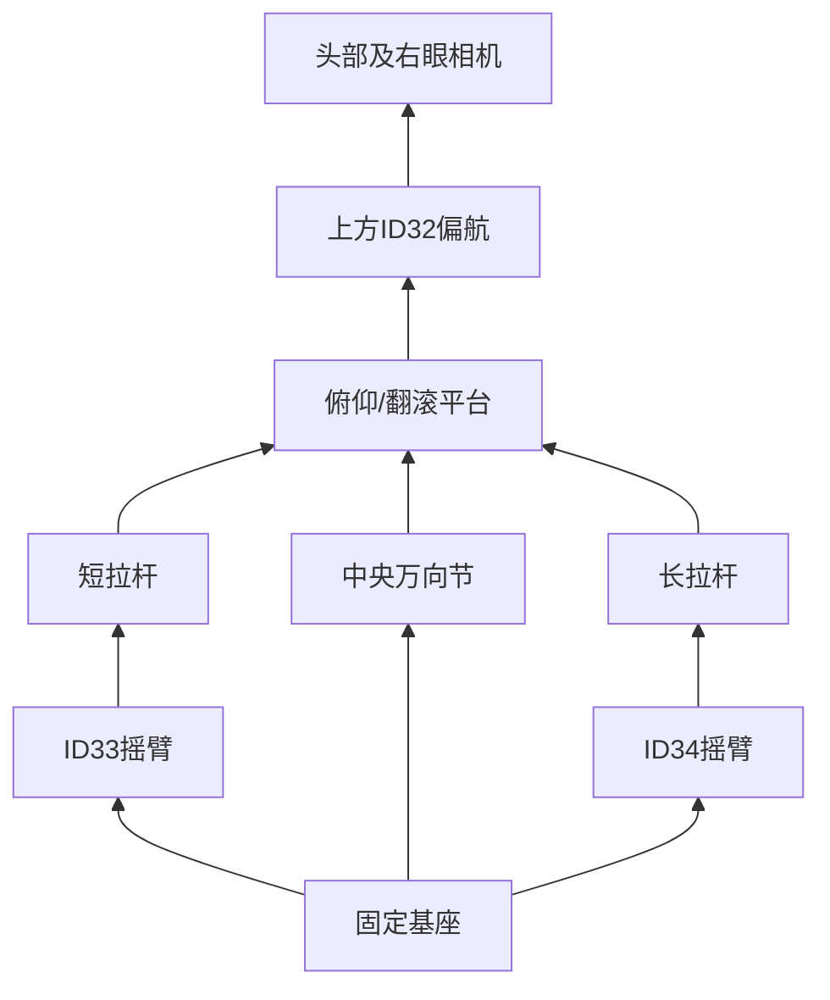

# 墨甲并联颈部俯仰与轻微侧倾

2026-10-27｜功能分支`feat/mojia-parallel-neck-tracking`。右眼视频、横向眼球与ID32的现有算法/参数保留。新增ID33/34的共同运动，头部形成偏航、俯仰、翻滚三个转动自由度。默认关闭新平台功能，用显式开关对照；方向已现场确认，已取消初测幅度限幅，新标定0001两遍整体效果获用户认可。

## 1. 启动与关闭

```bash
# 不访问硬件的配置/运动学检查
./examples/03_face_eye_neck_tracking/run.sh --work 0001 --parallel-neck on --check

# 完整作品1、原横向跟踪、新增俯仰与轻微侧倾
./examples/03_face_eye_neck_tracking/run.sh --work 0001 --repeat 1 --parallel-neck on

# Ctrl+C结束当前轮后，关闭新增33/34控制恢复原链路
./examples/03_face_eye_neck_tracking/run.sh --work 0001 --repeat 1 --parallel-neck off
```

`--parallel-neck`只用于示例3。默认配置`parallel_neck.json`的`enabled=false`，原指令仍保持33/34，不自动启用新动作。原`--upstream-trajectory`仍只控制ID32的规划器；新平台具有独立的双轴平滑，不改变该开关语义。两种开关均在启动时生效。

观察脸向上/向下移动、正对机器头歪头，再在32向左右转后重复上下移动，最后让脸离开画面看三轴回中。本轮使用用户确认已完成实物组合验证的硬件行程，不自动执行端点扫描。

## 2. 已确认的实物关系与CAD

用户提供`脖子整体3.STEP`并确认：33接短拉杆、34接长拉杆；装配姿态对应2047/2047及头部水平；实物长度、孔位和安装位置与文件一致；32在平台上方；33计数增加使其摇臂向上，34则计数减小向上。用户确认已设硬件限位，未发现特殊干涉位置。

原始CAD不作为运行依赖或默认随包素材，配置包含其SHA256和提取结果。读图使用独立临时环境中的OpenCASCADE，不向播放环境增加CAD/VTK依赖。运动学长度来自连接孔/销轴的位置及中位闭合，不取零件外形包络作为连杆支点。

| 项目 | CAD提取/配置 |
|---|---|
| 万向节共点，CAD坐标mm | 约(194.690262, -1.172996, -8.5) |
| 两侧摇臂有效半径 | 约21.6096mm |
| 短支链有效杆长 | 约55.7244mm，中位销轴间距 |
| 长支链有效杆长 | 约90.2504mm，中位销轴间距 |
| 中位 | 两轴2047 |
| 编码器相对摇臂抬高方向 | 33为正，34为负 |
| 运动边界来源 | `hardware.json`：33为1447～2647，34为1647～2647；启动读回核验，不写限位 |
| 额外角度限幅 | 已去掉初测俯仰±3°、侧倾目标±2°及模型±12°/±8°窗口 |
| 翻滚行为 | 目标人眼连线倾角的约25%，有范围限制 |

用户确认标定同事已事前试探俯仰、翻滚及组合工作空间，定下33的1447～2647、34的1647～2647硬件限位。现取消新增的±80计数窗口；运动学求解及目标合成从唯一硬件配置获取完整边界，不在几何文件重复保存。CAD模型另以这两组完整范围做17×17网格核对，289点正逆解与装配支路检查通过；这项离线数学核对与用户提供的实物验证分别记录。

## 3. 共同逆解与坐标链



参考文章描述中央万向节与两条驱动支链的两转动自由度拓扑，文中执行件为电动缸。本实现根据墨甲CAD使用旋转摇臂与固定连杆闭链。[参考文章](https://blog.csdn.net/panjinliang066333/article/details/148975764)

CAD模型坐标定义：x/y为模型水平轴、z向上（初版曾假定+y为实机朝前）；平台姿态`R=Rx(pitch)Ry(roll)`。第i支链的平台连接点`a_i`、电机轴点`b_i`、摇臂半径`r_i`、固定杆长`L_i`满足：

```text
P_i = pivot + R a_i
C_i(q_i) = b_i + r_i (u_i cos(q_i) + v_i sin(q_i))
||P_i - C_i(q_i)||² = L_i²
```

闭链展开成`A cos(q_i)+B sin(q_i)=C`，使用中位所确定的装配支路求解，再换算为舵机计数。雅可比共同连接平台角速度与两个电机速度；不是“33单独俯仰、34单独翻滚”。中位附近的计数/弧度关系约为：

```text
[d33]   [ +626.86  +957.99 ] [dpitch]
[d34] = [ -629.37  +957.99 ] [droll ]
```

两侧并不完全对称；大范围不能用固定同加/同减比例代替几何求解。逆解核对杆长闭合、命令范围和雅可比条件数；拒绝不可达、奇异或装配支路不一致的结果。

32在平台上方，相机姿态为`R_camera=R_platform Rz(yaw32) Rz(camera_mount_yaw_rad)`。用户首次现场反馈俯仰和翻滚均反向、左右正常；本轮将新平台的相机安装朝向设为π弧度，修正初版默认+y朝前的假设。该配置只服务33/34，保持原眼球与32的左右算法。速度转换与编码器估计的相机俯仰/侧倾使用同一变换，不能仅反转位置或图像误差而保留旧姿态反馈。控制器再通过支链雅可比转为33/34速度，转头后的抬头方向也随相机轴变化；用户随后确认俯仰、翻滚及左右方向正确。

## 4. 视觉控制与连续轨迹

俯仰使用原有人脸眼部中点的纵向误差；侧倾新增YuNet双眼连线图像倾角。原跟随比例25%保留，侧倾目标不再裁剪到±2°，俯仰不再在±3°附近减速；其他增益、滤波和图像误差死区保持。可靠眼线缺失时不丢弃原x/y人脸跟踪，侧倾缓慢趋向中位。两种控制任务不同，横向人脸偏差不被当成歪头指令。

相机本身会随头部侧倾，所以不能直接把图像眼线角当作世界姿态。控制器由33/34编码器正解估计平台姿态，并结合32偏航估计相机侧倾，得到小比例跟随目标。这里是运动学估计，不是IMU绝对姿态。右眼独立转角尚无单独外参标定，没有把23的舵机计数冒充眼球真实角度；透视和关键点误差也使眼线角不等于严格三维人脸姿态。扩大行程后继续观察这些近似的实际影响。

33/34共享一个两轴Ruckig参考，连续保留浮点位置、速度、加速度。新增参考速度上限100计数/秒、加速度400计数/秒²、jerk4000计数/秒³；这些仅作用于新平台参考，不修改硬件1000/0设置或ID32的800/8000规划参数。双轴共同预测制动；速度跟踪/制动采用Ruckig的`TimeIfNecessary`，非零目标按需同步，零速度端点允许各轴先停住再保持，避免强制极近停止时刻触发数值失败。两轴仍在同一时钟下计算与发送，位置回中保持严格`Time`同时到位。接近设备行程边界时共同决定制动，不分别截断两个电机位置。回中使用同步参考，至少3秒，模式切换保留状态，不累计16计数发送。完整行程可能需要更长时间，曲末按双轴当前位置/速度/加速度预测实际回中时间，必要时提前让33/34返回；不改变原眼球/32的回中触发时刻。

双轴目标仍由现有唯一串口拥有者发送，33/34在同一个同步写分组内；未变化的整数目标可沿用上次值。反馈复用原调度器，开启后将33/34加入与相机眼、32同类的优先反馈，不增加串口线程或改变总读取预算、波特率、60Hz节拍。反馈过期时平台先平滑制动，原全轴看门狗和设备保护继续生效。

## 5. 验证与记录

离线覆盖CAD中位、正逆解回环、数值雅可比、耦合限位、转头后的相机轴变换、上下跟随、小比例侧倾、反馈过期、丢脸回中、单一控制权和原横向输出一致性。保留图像源、视频预览、音频、表情素材及其标定哈希；新功能关闭时原发送分组和运动输出不变。

每帧`person_gaze.parallel_neck`记录测量姿态估计、32偏航、相机姿态估计、滤波后的纵向误差、侧倾目标、双轴参考p/v/a和平均jerk、反馈年龄及模式。结合`events.goals`、`transmitted_ids`和编码器反馈区分请求、实际发送和物理响应，不能用完成整曲代替运动品质验收。

当前现场只读记录位于`outputs/diagnostics/parallel_neck_cad/hardware_readonly.json`，CAD视图/提取记录同目录，不随源码分发。用户已进行首次现场观察，反馈俯仰/翻滚反向、左右正确。方向修正后用户确认正确，反馈幅度较小；日志表明34到过旧±80边界。本轮取消额外软件幅度窗口，未自动播放；后续新标定0001两遍完整结束，用户认可整体效果；详见[最新审查](DELIVERY_REVIEW.md)，定量精度与长期稳定性另行验收。

用户已确认ID32的1706～2388是新写入EPROM的左右限位，与三次独立读回一致。`hardware.json`的设备范围和跟踪范围均同步为1706～2388；启动仍严格核验，不改写或放宽限位。33/34实读限位与原记录一致。SRAM当前10/0由原启动流程按保存设置核验恢复，本功能没有额外修改硬件运动设置。

## 6. 现场制动数值边界修复

会话`20261027_173310_447763_eyes-neck`在约44.85秒、2692个已记录帧后因Ruckig0.19.4的速度模式Step2同步求解失败退出。错误输入为33/34约1847.35/2220.84计数，远离硬件端点；原`Time`策略可精确离线复现。改用速度模式`TimeIfNecessary`后同一状态成功生成连续、jerk受限的停止轨迹，不重置参考p/v/a或改写硬件设置。位置模式回中仍用`Time`和原最短3秒设置。

同步策略及零速度端点行为依据[官方同步枚举说明](https://docs.ruckig.com/namespaceruckig.html)与[固定版本0.19.4的求解器实现](https://github.com/pantor/ruckig/blob/v0.19.4/include/ruckig/calculator_target.hpp)。原221项模拟检查未覆盖这组接近制动切换面的状态，新增精确输入及128组邻近状态回归，并用该轮已记录参考状态重算制动与曲末回中时间；这些是离线验证，后续新标定0001两遍完整结束且未复现此异常；详见[最新审查](DELIVERY_REVIEW.md)。

## 7. 跟踪姿态的固定纵向偏置

用户调整初始姿态后反馈：看人时仍整体偏仰，仅在控制流一处加入固定偏差，并按现场观感相对调整，不要求精确角度。当前唯一参数为`configs/robots/mojia/parallel_neck.json`的`control.vertical_target_y=-0.45`。图像纵坐标按`2×像素行/画面高度−1`归一化，当前480行图像中期望点从240行移至132行，即累计上移108像素；目标留在画面上方，使头部整体向下偏。不把图像偏移量等同于已标定的物理角度。

唯一作用点为并联跟踪的纵向误差：`filtered_y−vertical_target_y`，之后仍使用原死区、速度增益、相机轴变换、支链雅可比与双轴Ruckig。不在舵机计数末端叠加固定值，以免被视觉闭环抵消；不修改检测器或送给眼球、ID32的原始目标，也不修改侧倾算法、运动参数、限位和回中目标。只在有效人脸跟踪时生效，丢脸/曲末回中仍遵循原流程。

设为0恢复原画面中心追踪；负值越小，期望人脸位置越高、头部趋向更低，实际幅度需现场观察。`person_gaze.parallel_neck.vertical_target_y`记录有效值，`filtered_vertical_error`继续记录未减偏置的滤波图像误差。离线回归覆盖下压方向、转头耦合、目标处静止、零偏置兼容和回中不变；现场效果待用户运行原命令观察。

首轮上移36像素（`-0.15`）的会话`20261029_145035_411583_eyes-neck`中，6439帧均记录有效偏置，其中5619帧处于有效人脸跟踪；滤波人脸纵坐标中位数约为第200.6行，接近当时第204行的设定点。按相同输入比较有无偏置，纵向俯仰速度请求的偏置增量均朝下；这些证明参数进入控制链路及图像闭环已响应，不等于测得真机下压角度。随后累计上移72像素（`-0.30`），用户反馈方向正确、效果改善，再按要求增加36像素至当前108像素；108像素的现场观感待确认。

边界保护保持原控制链路：`vertical_target_y`必须是有限数值且位于`[-0.5,0.5]`，480行画面对应最大上下偏移120像素、期望点位于第120～360行；108像素对应`-0.45`，不会把72或108直接当归一化坐标或舵机计数。不合法配置启动前即报错，不静默放宽边界。偏置只影响图像误差，双轴参考仍检查完整运动/制动轨迹的位置极值，并在接近设备限位时制动；最终位置、速度、加速度和jerk检查保留。ID33仍为1447～2647，ID34仍为1647～2647，不因期望点上移而扩大。新增持续图像误差的离线回归，验证108像素偏置下到达边界附近会制动，浮点目标及取整后的目标均不越界。
