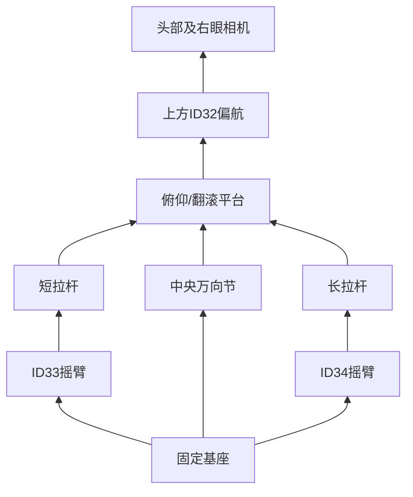

# 墨甲并联颈部俯仰与轻微侧倾

2026-10-27｜功能分支`feat/mojia-parallel-neck-tracking`。右眼视频、横向眼球与ID32的现有算法/参数保留。新增ID33/34的共同运动，头部形成偏航、俯仰、翻滚三个转动自由度。默认关闭新平台功能，首次现场用显式开关对照。

## 1. 启动与关闭

```bash
# 不访问硬件的配置/运动学检查
./examples/03_face_eye_neck_tracking/run.sh --work 0001 --parallel-neck on --check

# 完整作品1、原横向跟踪、新增俯仰与轻微侧倾
./examples/03_face_eye_neck_tracking/run.sh --work 0001 --repeat 1 --parallel-neck on

# Ctrl+C结束当前轮后，关闭新增33/34控制恢复原链路
./examples/03_face_eye_neck_tracking/run.sh --work 0001 --repeat 1 --parallel-neck off
```

`--parallel-neck`只用于示例3。默认配置`parallel_neck.json`的`enabled=false`，原指令仍保持33/34，不自动启用新动作。原`--upstream-trajectory`仍只控制ID32的规划器；新平台具有独立的双轴平滑，不改变该开关语义。两种开关均在启动时生效。

先从小范围观察：脸向上/向下移动、正对机器头轻微歪头，再在32向左右转后重复上下移动，最后让脸离开画面看三轴回中。先确认方向、平顺和耦合，再扩大新平台范围；不自动扫描完整硬件行程。

## 2. 已确认的实物关系与CAD

用户提供`脖子整体3.STEP`并确认：33接短拉杆、34接长拉杆；装配姿态对应2047/2047及头部水平；实物长度、孔位和安装位置与文件一致；32在平台上方；33计数增加使其摇臂向上，34则计数减小向上。用户确认已设硬件限位，未发现特殊干涉位置。

原始CAD不作为运行依赖或默认随包素材，配置包含其SHA256和提取结果。读图使用独立临时环境中的OpenCASCADE，不向播放环境增加CAD/VTK依赖。运动学长度来自连接孔/销轴的位置及中位闭合，不取零件外形包络作为连杆支点。

| 项目 | CAD提取/配置 |
|---|---|
| 万向节共点，CAD坐标mm | 约(194.690262, -1.172996, -8.5) |
| 两侧摇臂有效半径 | 约21.6096mm |
| 短支链有效杆长 | 约55.7244mm，中位销轴间距 |
| 长支链有效杆长 | 约90.2504mm，中位销轴间距 |
| 中位 | 两轴2047 |
| 编码器相对摇臂抬高方向 | 33为正，34为负 |
| 首次软件工作窗口 | 两轴1967～2127，±80计数；不写硬件限位 |
| 首次行为范围 | 相机俯仰约±3°，轻微侧倾目标±2° |
| 翻滚行为 | 目标人眼连线倾角的约25%，有范围限制 |

±80窗口已用CAD模型的17×17网格核对正逆解与装配支路，模型内对应的平台角度约俯仰-7.21°～7.39°、翻滚-4.78°～4.77°。这是运动学抽样，不是碰撞证书，也不是允许直接执行整块工作空间。行为范围另有更小约束；现场机械限位仍保留。

## 3. 共同逆解与坐标链



参考文章描述中央万向节与两条驱动支链的两转动自由度拓扑，文中执行件为电动缸。本实现根据墨甲CAD使用旋转摇臂与固定连杆闭链。[参考文章](https://blog.csdn.net/panjinliang066333/article/details/148975764)

坐标定义：x向右、y向前、z向上；平台姿态`R=Rx(pitch)Ry(roll)`。第i支链的平台连接点`a_i`、电机轴点`b_i`、摇臂半径`r_i`、固定杆长`L_i`满足：

```text
P_i = pivot + R a_i
C_i(q_i) = b_i + r_i (u_i cos(q_i) + v_i sin(q_i))
||P_i - C_i(q_i)||² = L_i²
```

闭链展开成`A cos(q_i)+B sin(q_i)=C`，使用中位所确定的装配支路求解，再换算为舵机计数。雅可比共同连接平台角速度与两个电机速度；不是“33单独俯仰、34单独翻滚”。中位附近的计数/弧度关系约为：

```text
[d33]   [ +626.86  +957.99 ] [dpitch]
[d34] = [ -629.37  +957.99 ] [droll ]
```

两侧并不完全对称；大范围不能用固定同加/同减比例代替几何求解。逆解核对杆长闭合、命令范围和雅可比条件数；拒绝不可达、奇异或装配支路不一致的结果。

32在平台上方，所以头部方向为`R_head=R_platform Rz(yaw32)`。控制器用32的实测偏航将相机局部的“向上看/轻微侧倾”转为平台角速度，再通过支链雅可比转为33/34速度。这使转头后的抬头方向不会继续机械地固定在基座正前方。

## 4. 视觉控制与连续轨迹

俯仰使用原有人脸眼部中点的纵向误差；侧倾新增YuNet双眼连线图像倾角。可靠眼线缺失时不丢弃原x/y人脸跟踪，侧倾缓慢趋向中位。两种控制任务不同，横向人脸偏差不被当成歪头指令。

相机本身会随头部侧倾，所以不能直接把图像眼线角当作世界姿态。控制器由33/34编码器正解估计平台姿态，并结合32偏航估计相机侧倾，得到小比例跟随目标。这里是运动学估计，不是IMU绝对姿态。右眼独立转角尚无单独外参标定，没有把23的舵机计数冒充眼球真实角度；透视和关键点误差也使眼线角不等于严格三维人脸姿态。先用小侧倾范围观察这些近似的实际影响。

33/34共享一个两轴Ruckig参考，连续保留浮点位置、速度、加速度。新增参考速度上限100计数/秒、加速度400计数/秒²、jerk4000计数/秒³；这些仅作用于新平台参考，不修改硬件1000/0设置或ID32的800/8000规划参数。双轴共同预测制动；触及工作窗口时一起制动，不分别截断两个电机位置。回中使用同步参考，至少3秒，模式切换保留状态，不累计16计数发送。

双轴目标仍由现有唯一串口拥有者发送，33/34在同一个同步写分组内；未变化的整数目标可沿用上次值。反馈复用原调度器，开启后将33/34加入与相机眼、32同类的优先反馈，不增加串口线程或改变总读取预算、波特率、60Hz节拍。反馈过期时平台先平滑制动，原全轴看门狗和设备保护继续生效。

## 5. 验证与记录

离线覆盖CAD中位、正逆解回环、数值雅可比、耦合限位、转头后的相机轴变换、上下跟随、小比例侧倾、反馈过期、丢脸回中、单一控制权和原横向输出一致性。保留图像源、视频预览、音频、表情素材及其标定哈希；新功能关闭时原发送分组和运动输出不变。

每帧`person_gaze.parallel_neck`记录测量姿态估计、32偏航、相机姿态估计、滤波后的纵向误差、侧倾目标、双轴参考p/v/a和平均jerk、反馈年龄及模式。结合`events.goals`、`transmitted_ids`和编码器反馈区分请求、实际发送和物理响应，不能用完成整曲代替运动品质验收。

当前现场只读记录位于`outputs/diagnostics/parallel_neck_cad/hardware_readonly.json`，CAD视图/提取记录同目录，不随源码分发。未对新平台执行位置动作。首次真机的方向、幅度、平顺性与嘴部联合效果仍待用户观察。

用户已确认ID32的1706～2388是新写入EPROM的左右限位，与三次独立读回一致。`hardware.json`的设备范围和跟踪范围均同步为1706～2388；启动仍严格核验，不改写或放宽限位。33/34实读限位与原记录一致。SRAM当前10/0由原启动流程按保存设置核验恢复，本功能没有额外修改硬件运动设置。
