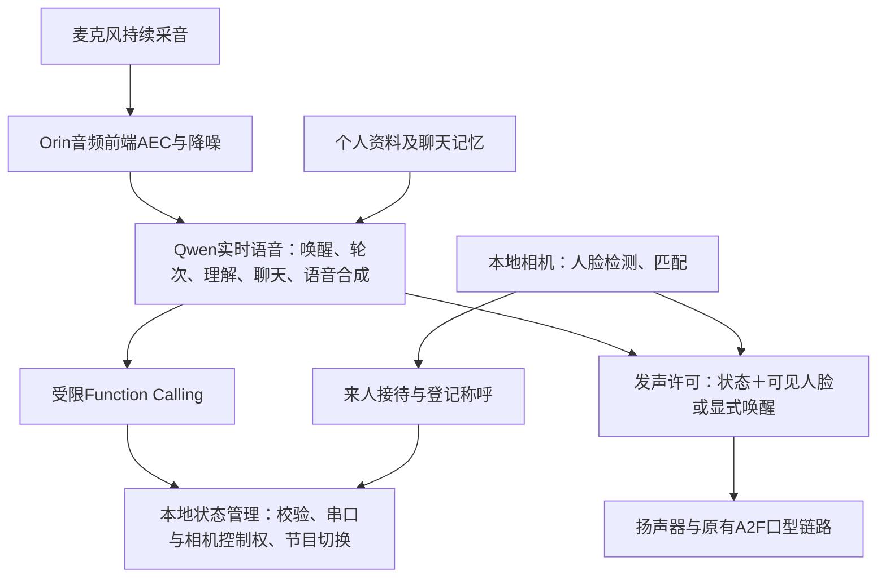

# Qwen语音接管、前台接待与个人记忆

更新：2026-11-10。适用于当前小帅P1，取代早期“本地ASR/关键词控制＋云端只闲聊”的默认运行方案。硬件控制、自检、回中、标定与运动参数不变。

## 1. 当前链路与职责



默认`configs/interaction/p1.json`中`realtime_voice.control_backend=qwen_realtime`。不启动本地Paraformer、SenseVoice、关键词识别器或本地语义模型，不再播放本地固定欢迎/菜单等提示音。语音理解与回复均由Qwen实时模型负责；本地有限状态机校验结构化操作，不做自然语言意图分类。历史本地路径保留用于显式诊断，不会在断网时自动替代。

Qwen语音服务在待机、准备、交互和节目阶段保持；正常切换复用连接，云端明确空闲超时则续接；切换时只交接扬声器控制权，麦克风不重开。节目音频由原有播放器输出，Qwen在节目阶段只监听控制意图，不叠加聊天声音。接待待机与交互态持续运行，取消原来每600秒结束会话、回中并重新开相机的周期；主动切换节目仍执行原有准备、自检和回中。停止信号、反馈看门狗与硬件保护保留。此修改减少不必要的相机开关，不代表此前USB相机开流超时已完成现场验证。明确的InternalError／ServiceUnavailable采用有限重连，见[服务端临时错误恢复](reports/VOICE_RESILIENCE_20261110.md#6-1946服务端internalerror与有限恢复)；恢复后等待新发声，不重放旧指令。其他未列明的云端／音频故障或恢复次数耗尽时，仍停止当前任务并退出管理器，不循环重启、不切回本地模型。

模型只可请求以下工具：

| 工具 | 权限 |
|---|---|
| `robot_program` | 唤醒、播放目录内节目、停止回交互、进入待机；无电机位置、寄存器、文件或Shell权限 |
| `set_expression` | 交互态微笑、收回笑容、认真中性、恢复自动回应；明确口令优先，复用已有标定 |
| `set_speech_dialect` | 交互态明确指定聊天方言、恢复普通话；不改变音色、设备或预录作品 |
| `get_robot_status` | 查询当前状态、可见人脸及已确认的个人资料 |
| `search_person_memory` | 只检索当前已确认熟人的过往聊天；没有任意person_id参数 |
| `search_robot_memory` | 小帅按工作需要跨人检索全部已存聊天，保留人物、时间、来源，不自动执行历史指令 |
| `manage_robot_task` | 持久记录待办、下一步、时间、状态及转告；收件人确认与实际工作完成分开 |

工具参数、节目ID、当前状态和会话版本都会再次校验。助手口头承诺不是执行结果；准备完成、开始播放等由本地状态回传。迟到或重复工具调用被拒绝，错误最多允许模型修正两次，不构建无限重试链。

方言选择、保留范围和现场验收见[实时方言切换](SPEECH_DIALECTS.md)。默认普通话；只在用户明确要求时切换，不因听到一句方言自动改变口音。

用户补充的“小帅自己的任务清单、可以关联所有聊天”已接入[工作记忆与任务清单](ROBOT_WORKING_MEMORY.md)。原始聊天继续按人归档；当前人的自动注入与机器人跨人检索是两条接口，不能混淆为互相不可见，也不能将跨人可检索说成可随意公开私聊。

## 2. 无脸静默与显式唤醒

唯一配置：`configs/perception/speech_presence.json`。人脸存在状态与“是否识别为熟人”分开：陌生人也可正常交流。

- 相机持续没有人脸时，默认不接普通话题；声音输出有本地许可检查，模型即使生成音频也不能绕过许可播放。
- 为容忍短暂检测丢失，当前人脸消失宽限为15秒（2026-11-10用户指定）；存在状态超过1秒没有刷新也视为不可用。
- 明确喊“小帅”等配置唤醒词后，允许无脸交流30秒；在此许可内继续说话会续期。重新看见人脸后回到按可见人脸决定的默认规则。
- 真正播放节目时，Qwen不抢扬声器，但仍能理解停止、退出和待机。停止任务不要求用户始终处于画面中。
- 不允许发声时，云端会话切成纯文字输出；允许交互时才启用语音输出，同时对每个音频块检查许可。麦克风仍持续向云端发送处理后音频以识别唤醒和控制。

## 3. 前台来人接待

唯一配置：`configs/interaction/reception.json`，默认开启。

前台接待待机保留相机观察、自然低频眨眼，不做眼颈跟随；这不同于旧版关闭相机的真正待机。有人脸稳定出现约2秒后进入交互，沿用原有自检与回中，准备完成后由Qwen查询当前身份、主动欢迎并适度关心。关切不等于询问隐私。

已稳定匹配且画面只有一人时使用登记`preferred_address`：何裕德为“何工”，王润章为“小王”。未知或多人场景使用“您好／欢迎”，不猜姓名、性别或身份。

每次来访只问候一次，检测短暂波动不重新问候；离开画面3秒后才认为上次来访结束。对同一已登记人员的重复问候间隔默认120秒，不限制不同熟人的接待；未登记来访按匿名场次区分。交互态持续无人且没有唤醒交流许可60秒后，自动回接待待机，便于后台整理记忆。识别到另一位熟人或确认上一位离开后，云端短期对话会话重新建立，避免沿用上一人的聊天历史；麦克风与状态管理进程保持运行。此前确认身份持续3秒无法重新确认时，也清除旧短期对话，转匿名交流，避免把旧人的内容带给当前未知对象。

关闭自动接待可将接待配置的`enabled`改为`false`。此时待机关闭相机，等待Qwen识别唤醒词；不需要修改硬件配置。

## 4. 人物资料与年龄

何裕德的原DOCX含“44岁”，用户也于2026-11-10确认。原职业资料读取白名单遗漏年龄，现增加经明确登记的`age_years`，范围0～120整数，不从面孔或声音推断年龄。

资料仍以本机`private/people/<id>/profile.json`为源。重启管理器加载更新；云端可通过身份状态工具读取当前已确认人员的年龄。没有年龄字段时应坦诚未知，不补猜。

## 5. 按人保存与下次回忆

唯一配置：`configs/interaction/memory.json`。默认SQLite数据库在`private/memory/conversations.sqlite3`，目录700、数据库600，`private/`已排除Git。

- 当前画面仅有一人且SFace稳定匹配登记ID时，按这个ID保存用户发言和实际开始播放的机器人回复。
- 发言开始时记录身份；机器人回复保留与该话轮的归属，不在句末随意换人。助手文本标注“开始播放、未保证完整播放”，不能冒充用户确认过的事实。
- 未识别或多人场景使用匿名场次，不将内容写到何工或小王名下，也不向匿名人员注入熟人的个人记忆。
- 下次稳定认出本人，注入其近期记录与已整理事实。想查更早内容，由Qwen调用记忆检索工具；询问上次聊什么时可用空关键词，读取上次场次记录。
- 从新版开始记录可靠归属；旧日志没有完整身份证据，不自动猜测归属并批量导入。

这里的人脸匹配不是身份认证，不能宣称无误认风险。先现场确认本体识人正确，再验收个人记忆归属；尤其要测试换人、多人及未知访客。

## 6. 512K预算与待机压缩

用户目标为512K上下文。当前Qwen实时接口的原生限制是最多50轮、累计300秒音频，并不是512K任意文本上下文。因此采用“本地完整档案＋工作记忆＋云端有限注入和检索”，不宣称单个实时会话装入了512K文本。

当前本地工作记忆预算为524288个**估计文本token**，超过80%时，在待机且准备完成后安排后台整理。由于没有该音频模型的精确tokenizer，使用UTF-8字节数作为聊天文本token的保守估计；不把它当真实计费token或音频token，可能比精确分词更早触发整理。

云端每次额外注入最多12000字符、近期12条消息及已整理事实；更早原文通过按人检索获取。512K是本地工作预算，不是注入窗口，也不是原始档案大小上限。

压缩使用同一个Qwen实时模型的独立纯文字请求，每批消息JSON最多16000字符（计入角色、时间等元数据；另附既有摘要）：

1. 只在待机启动，单次最多45秒；访客唤醒进入交互时取消后台请求，不能挡住实时语音。
2. 摘要可省略寒暄，事实表保留姓名关系、职业、偏好、项目、日期、约定、待办等有效内容，并要求引用原始用户消息ID。
3. 助手猜测不能作为用户事实入库；既有事实不因新一批摘要遗漏而整表清空。
4. 压缩仅将旧消息移出工作集，**不删除原始记录**。遗漏的实体仍保留原文、可检索追溯；摘要抽取质量仍需现场检查，不承诺LLM永不遗漏。
5. 超时、格式错误或调用失败时保留全部原文与待处理状态，延后再尝试，不停止前台交互。

## 7. 启动与现场验收

密钥和自启动沿用[开机服务](P1_AUTOSTART.md)。新版代码不会自行重启正在运行的机器头。准备好后手动执行：

```bash
sudo systemctl restart vivis-p1.service
journalctl -u vivis-p1.service --since '2 minutes ago' -f
```

依次测试：

1. 画面无人，不喊名字，在旁边说普通话题：机器人应不接话。再明确喊“小帅”：应能无脸交流。
2. 离开后等3秒，再进入画面；应主动欢迎。何工应叫“何工”，小王应叫“小王”；站在画面内不应反复打招呼。
3. 问“你知道我几岁吗”：只有当前正确识别何工时才应依据资料回答44岁，未知时不猜。
4. 自然点播歌曲、宇飞剧本和表情跟随，期间说“别演了，咱们聊聊”“自己玩去吧”等，检查Qwen工具请求与实际状态一致。
5. 何工说“我喜欢喝绿茶，下次可以聊聊机器人采集”，退出或离开后再次进入，问“你记得我喜欢喝什么吗”；小王出现时不应收到何工的记忆。
6. 连续待机或交互超过12分钟，确认没有定时回中、相机重开。重启服务后再认出何工，确认记忆仍在。真实512K阈值尚不要求现场造大量数据；已有阈值、原文保留及来源校验测试，纯文字云端压缩也已用合成数据实测。

日志中的`control_backend=qwen_realtime`、`local_asr_started=false`可核对未启动本地语音模型。`cloud_action`是Qwen或来访事件的结构化请求，实际执行看状态日志；`cloud_tool`、`cloud_context_updated`、`conversation_reset`、`memory_compacted`用于定位，不记录API Key。

## 8. 官方依据

- [Qwen-Audio实时语音：工具调用、输出模态与历史限制](https://help.aliyun.com/en/model-studio/qwen-audio-realtime-user-guides)。
- [Qwen-Audio客户端事件](https://help.aliyun.com/en/model-studio/fun-audiochat-client-events)。
- [Qwen-Audio服务端事件](https://help.aliyun.com/en/model-studio/qwen-audio-realtime-server-events)。

云端已经验证原三工具声明（本次扩为四工具）、显式唤醒点播、停止、身份查询、纯文字/语音模态切换及合成数据压缩。另一次合成数据往返，模型调用身份与记忆工具后正确回答44岁和绿茶偏好；关键词零命中回退只返回当前人的原文/事实，不转查其他人。上述探测没有打开麦克风、相机或串口，不能代替本节整机现场验收。

无设备云端诊断（会调用已配置Key的百炼API，不驱动机器头）：

```bash
outputs/speech/venv/bin/python tools/probe_cloud_control.py --scenario probe
outputs/speech/venv/bin/python tools/probe_cloud_control.py --scenario compact
outputs/speech/venv/bin/python tools/probe_person_memory.py
```

前两项分别核实工具配置与合成资料压缩，最后一项用临时SQLite和合成用户验证身份年龄、记忆工具及模型回答，不写入真实人员记忆。

2026-11-10最终离线回归：独立目录完整交付检查577项测试无失败、3项跳过，三示例离线检查通过。持续控制、操作员停止及记忆归属/压缩均有回归检查；现场服务尚未重启，实际接待和长期运行效果待验收。

最新表情意图、停止工具简化与空闲续接，见[统一表情意图与完整现场验收](EXPRESSION_INTENT.md)。2026-11-10此前577项测试记录属于上一阶段，本次结果另行记录。

当前15秒/60秒规则：短暂无脸时的发声宽限为15秒，连续无人约60秒回接待待机；不是15秒加60秒。离场清理必须等发声许可结束，不能被旧3秒来访重置提前切断。明确识别换人仍及时清除旧身份。来人自动唤醒仍为2秒。
