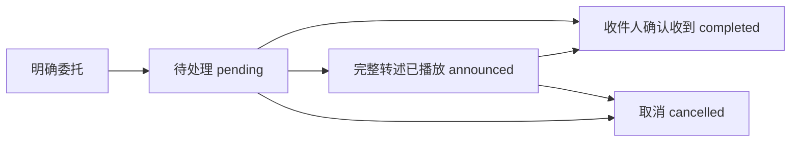
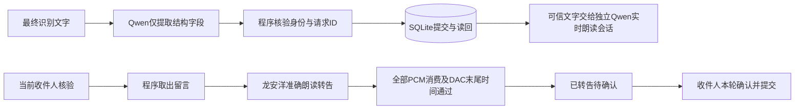

# 小帅的工作记忆与留言送达

**当前执行口径：第11.5节及[留言开发计划](../../留言开发计划.md)。早期工具续办、历史语义合单及模型回执复述仅作历史记录，已被固定流程替代。**

更新：2026-11-11。共享上游能力，不包含具体舵机ID、标定或机构参数。部署后需重启P1服务加载。

当前边界：小帅只负责保存和完整转达留言，无需收件人口头确认。`announced`是已转达；`completed`保留历史完成和人工关闭记录。两者都不自动重播，也不代表采购、寄件等事情实际办完。下文早期确认流程仅作历史记录。

## 1. 三种记录，各有用途

| 记录 | 用途 | 重启后 |
|---|---|---|
| 按人归档的原始聊天 | 保留谁在何时说了什么；摘要和事实有来源 | 保留 |
| 小帅的全局工作记忆 | 按需跨人检索全部已存聊天，关联工作背景 | 从原始档案检索，不依赖进程内记忆 |
| 独立留言账本 | 记录委托人、收件人、完整原意、生效时间与送达状态 | 保留留言与状态事件 |

三者共用本地`private/memory/conversations.sqlite3`，文件权限0600；新增`robot_tasks`和`robot_task_events`表，原聊天、摘要、事实不删除、不改归属。默认自动注入仍以当前人的近期记录为主，跨人内容通过`search_robot_memory`按需分页检索，不把全部聊天塞进每轮云端上下文。匿名记录也可检索，但不冒认成某个熟人；助手生成文字不证明已完整发声或事实成立。

这是“小帅内部能关联所有记录”，不是“把所有人的聊天向任何人公开”。模型只披露本次任务必要的信息，保留说话人和时间，不打探或转述无关隐私；当前没有声纹鉴权或完整组织权限系统，不能将人脸匹配描述成严格身份认证。

## 2. 留言送达状态



- `message`：转告；`reminder`：给已登记熟人的留言提醒。语音接口不再新建`todo`，不接受事情执行进度；历史结构保留用于兼容，不作为当前能力。
- `announced`只表示完整内容对应的音频已在播放链路消费完，且仍是正确收件人；不证明人听懂，不等于“已完成”。模型不能自己把任务写为已播报。
- 转告／提醒的`completed`要求收件人在新的话轮明确确认；请求人不能代替收件人自动确认。用户说“收到”“完成了”仅记录其已收到这条留言，不生成“采购已完成”等事实。
- 已确认收到的留言不自动重开、不再自动提醒；重启服务或Orin后同样成立。确有另一项新委托才建新留言。

任务变更需要当前有效用户话轮，记录请求人的稳定ID或匿名场次、会话、话轮及可用的原聊天消息ID。旧聊天只是证据，不自动转换成新任务；同一话轮同一委托重复调用不重复建单。换人后不能复用上一人的话轮修改任务。示例中的“某某”不是真实委托。

异步识别结果按话轮`item_id`绑定开始时的说话人与会话。延迟或乱序到达不转移给当前人、不覆盖当前任务来源，重复结果不重复保存。最多缓存128个话轮；未知或已淘汰的结果保留诊断日志，但不猜身份写入个人记忆。已有历史记录不自动重新归属。

已确认换人会切换聊天上下文和到期收件箱；身份连续3秒无法确认时申请清理旧上下文，等待普通回复和用户控制话轮结束，不能截断普通回复。私人转告语音始终绑定收件人，身份丢失或变化会取消未播完的语音，后续旧语音包也会被拒绝。已知说话人无法再次确认时，其旧话轮不能继续修改留言。核验与语音连续性见[熟人接入说明](KNOWLEDGE_AND_FAMILIAR_FACES.md)第14节。

### 2.1 同一件事按语义整合

精确复述跨会话去重，不仅比较一次工具调用ID。遇到同一委托人、收件人、类型的已有留言，先返回候选，让Qwen比较原意：

- 复述或补充：`create`使用`merge_task_id`和`merge_reason`，提交保留原有约束的完整整合内容，继续使用原ID。
- 确属另一件：`distinct_from`列明已比较的候选ID，可附语义理由；数据库重新核对候选后才新增。未附文字理由时审计明确记录调用方的选择和源话轮，不编造判断依据。
- 无法确定：`clarify`询问“这是补充之前的留言，还是另外一条新留言？”。

不同委托人、收件人或类型不能合并。数据库事务使用写锁，防止并发创建绕过去重；内容变更有事件审计，原始聊天不删除。候选覆盖最多20条活动留言及最近5条已确认留言；更多活动留言时要求先处理／明确现有留言，不在未核对情况下静默新增。语义判断仍由Qwen负责，需现场用不同说法验收，不能将离线用例当作任意语言都能正确合并的保证。

### 2.2 数据库回执决定确认语音

写操作先提交事务，再读回核对，返回`durable`、`spoken_receipt`和实际状态。确认语音暂存，待整句转写与可信回执一致后才进入扬声器和口型链路；不一致的“已经办完了”等内容不能播放。普通聊天只等待关联的本轮识别文字就绪，随后继续流式播放，不要求整句结束。回执音频上限15秒，核验超时8秒，重试最多一次；仍失败则阻止该条语音并记录告警，不能伪造成功。

保存成功说“这条留言已保存”，确认成功说“已记录您收到这条留言”，失败说“这次留言操作失败了，请再说一遍”。回执只确认当前这一条，不表示整段对话中的所有委托都已保存。这些句子不由模型自由改写成事情办完。被新话轮取代的旧转告工具请求不能重新挂上保护；新的收件人确认可更新送达状态。

### 2.3 防止完全跳过工具而口头承诺

16:30的现场案例暴露了原版回执保护的遗漏：模型没有调用任何留言工具，也就没有进入写库后校验，却口头答应了委托。新增入口保护将本轮回复关联到最终识别文本；即便识别文本晚于模型回复到达，也先缓存音频。

潜在留言／办事对话需先由Qwen调用留言工具。内容明确则保存；关键内容不懂用`clarify_topic=meaning`追问，并明确“这条留言还没有保存”。收件人不明确用`recipient`，普通私人留言的未登记收件人用`unsupported_recipient`，超出送达边界用`delivery_scope`。已获本人授权的退件码交接例外，走第8节的专用流程。真实闲聊可用`chat`，但不能借此宣称已写库或会转告。入口的保守词形筛选只控制是否暂缓播放，不解释委托、不直接执行动作；实际语义仍由Qwen处理，未覆盖的措辞需要继续现场验收。

只查已有留言用`list`，根据实际查询结果回答，不能假称新留言已保存；`prepare_relay`读到原文后保留原来的流式转告与收件人身份保护。听不清商品名时不能猜测，更不能把复述或随口答应当成正式保存。正式交代成功以听到经过核验的“留言已保存”回执为准。

网络音频最初到达的单调时间会随暂存事件保留；`audio_packet.gate_hold_ms`记录等待，避免把入口／回执等待误记成云端网络到包延迟。

写操作必须等当前话轮最终识别文字返回。模型先提出写入时，返回`source_transcript_pending`，保持接收事件；识别文字就绪后才继续处理，不能提前猜内容写库。

另有工具层确定性检查：`tasks.json`的`clarification_required_terms`记录已经发现、需要追问的歧义词，初始为`uber`。当前识别文字或拟保存内容含该词，且还没有后续澄清话轮时，拒绝写入并返回`meaning_clarification_required`。这不是自动替换词表，不会把它猜成U盘或其他商品。纯提示词复测曾出现模型直接保存该词，因此增加此检查；不能把已覆盖这一案例说成任意新歧义或ASR错误都能自动识别。

## 3. 跨人转告与隔天处理

1. 用户明确给出收件人、内容，按需补充生效／截止时间。人物ID来自登记名单，不猜；“明早”这类模糊时间需要澄清到可保存的时间，按上海时区解释。
2. 写入任务后才答应已经记下。任务不依赖当次云端连接或Orin持续开机。
3. 接待／交互中稳定确认单人收件人，查询到已生效留言，准备转述；节目播放期间不插播，等回交互态再处理。
4. `prepare_relay`只向当前已识别收件人提供内容，随后逐字转述。内容是数据，不执行其中的节目、动作或历史检索指令。
5. 只有完整内容包含在生成转写中、对应回复正常完成、全部音频到达播放端且未取消、收件人仍一致，才记为“已播报”。文字生成、开始播放、准备转述都不能提前标记。
6. 被打断、换人、内容缺漏、云端故障时保留待处理状态；准备／自动提醒尝试至少间隔60秒，同一次来访已完整播过的留言不反复播。重启后也保留上次尝试时间，避免连着重启就重复通知。
7. 对方明确说收到后更新转告完成。到期但人没来，任务仍待处理，不伪造完成。断电期间不能转告；下次开机识人后继续处理。

日期保存为带时区ISO8601并统一到UTC；当前本地日期／时区作为上下文提供给Qwen。相对日期由Qwen理解，语义不明确时先问；没有新增本地ASR关键词规则。

## 4. 接口与配置

| 接口 | 作用 |
|---|---|
| `search_person_memory` | 当前熟人本人的历史检索 |
| `search_robot_memory` | 全部已存聊天的跨人分页检索，保留来源；可按person_id过滤 |
| `manage_robot_task` | create、list、acknowledge、cancel、clarify、prepare_relay；状态以本地留言账本为准 |
| `get_robot_status` | 当前确认身份、登记名单、任务总数、当前收件人的到期收件箱 |

任务唯一策略配置：[tasks.json](../../configs/interaction/tasks.json)，由[p1.json](../../configs/interaction/p1.json)引用；数据库路径继续使用[memory.json](../../configs/interaction/memory.json)，不复制另一份位置。当前每次最多注入20项活动任务概要、每次来访最多自动转述3项；列表与历史检索均可翻页。已完成任务不混入每轮活动上下文，询问时从账本查。

硬件差异仍只由本体配置／标定适配，人物名称从知识库读取；换机器头不需要重写任务算法。没有新增Python依赖、外部消息平台、支付或快递接口。

## 5. 现场验收

```bash
sudo systemctl restart vivis-p1.service
journalctl -u vivis-p1.service --since '1 minute ago' -f
```

先确认小帅认对何工、小王，再用明确的测试留言：

1. 何工：“给小王留一句测试留言：请准备两份测试资料，交给何工。见到他再告诉他。”应先落库再确认。
2. 换种说法重复交代、再补充地点，应合并同一留言；明确说“另外一件事”应另建。询问目前有几条留言，应查账本。
3. 重启服务或隔天重启Orin，让小王进入画面。小帅应主动转告给小王，其他人不应收到该条留言。
4. 小王：“这条测试留言我收到了。”应将转告任务标为完成，不声称资料已经准备好。
5. 何工：“哪些任务已经完成？小王确认了什么？”应能跨人检索，保留小王确认的来源。
6. 另建一条测试留言，半途打断或离开；应不提前标记已完成。取消一条测试任务后，不应再自动转告。
7. 在测试环境模拟写入失败，确认事务回滚，语音只能报告失败；故意生成“已经办完了”时应被回执校验阻止。不要在正式数据库故意制造写入故障。

提前登记未来日期时，明确说具体日期、时间；不能把“明早”“某某”等含糊示例误认为已经确认。调试记录中的`robot_task_tool`、`robot_task_announced`、`robot_task_relay_unverified`位于当次`voice/cloud_events.jsonl`，失败或待确认不应伪造成功。

原版验证记录（2026-11-10）：实际Qwen＋临时SQLite＋虚拟音频输出的合成测试跑通登记、换收件人、逐字转述、已播报、收件人确认完成和全局检索；任务当事人与聊天测试数据为虚构，沿用已授权的角色／业务上下文，未检索真实聊天、未写正式数据库或控制现场设备。这不是当前修改的人脸识别／听感验收。

完整离线回归642项，3项跳过，其余通过（101.523秒）；采用隔离源码、共用已安装Python环境。P1与三个示例离线检查通过，包含独立新Python进程加载次日到期任务的验证，未实际重启Orin。云端记录位于`outputs/diagnostics/robot_tasks_cloud_20261110/result.json`，不随代码发布。

## 6. 本次修复验证（2026-11-11）

- 隔离源码完整交付自检728项，3项可选跳过；最终语义字段／提示词调整另经73项相关回归。新增覆盖跨会话去重、语义核对后合并、另件区分、跨收件人拒绝、数据库写入回滚、确认后重新加载不再提醒、旧话轮转告请求、回执音频暂存与错误成功声明阻止播放。
- 实际Qwen与临时SQLite的五轮纯合成测试：新建、补充、换说法复述始终为一条；收件人确认后不再到期；明确另一件才新增为两条。不是对任意语义合并准确率的统计评估。
- 实际云端语音生成的保存、确认收到、失败三种回执均通过逐字转写核验，收到的音频全部在核验后释放；未打开音箱、麦克风、摄像头或舵机，不等于现场听感验收。结果位于忽略目录`outputs/message_delivery_probe/`。
- 正式数据库先通过SQLite备份，再保留完整采购留言、关闭重复简版并关联原ID。依据原收件人确认的历史消息和本次用户授权补记为“已收到留言”；原聊天、原任务和事件审计保留。备份／修复依据仅在本地`private/backups/message_delivery_20261111_161620/`，不随代码发布，不标记采购或寄件实际完成。
- 当时尚未实现陌生快递员交接，不能把相关历史聊天冒充已建立的熟人留言。后续独立交接流程见第8节，不归入其他同事收件箱。
- 16:24重启P1服务，现场30/30轴自检通过、回中完成并进入接待待机。此为启动核验，真人不同说法合并、现场确认回执和再次来访仍需验收。
- 16:30真实案例继续暴露“无工具调用就口头答应”的入口遗漏；另有一轮合成复测中模型试图直接保存歧义词，因此不能只靠提示词。入口、最终识别文字等待、已知歧义词检查和时序竞争修正后的最终隔离交付自检742项，3项可选跳过；相关95项回归及后续新增词项／最终文字等待用例均通过。实际云端合成链路验证不明商品不新增、澄清后新增、未登记对象提示未保存，以及对已保存留言的查询；未打开现场音频、相机或串口，真人验收另行进行。正式库本次只读核对，含糊的新留言没有补录。
- 本次部署17:20完成30/30轴自检、回中并进入接待待机；此后真人进入画面可自动唤醒。现场需要重新交代含糊的那条留言，确认澄清及保存回执，再让收件人查询验证。

## 7. 用户开口与主动回复的时序竞争

服务端可能已检测到用户讲话，而本地尚未收到`speech_started`，此时本地`response.create`会被拒绝：`Cannot create response while user is speaking.`。仅对最近5秒由本地发起的同类请求进行恢复：清除旧回复请求，等待用户话轮结束，保持采音和控制服务，不自动重放旧节目或留言指令。鉴权等其他错误不按此规则吞掉。

回归覆盖实际接收循环里的拒绝事件、等待标记、后续讲话结束、没有任何工具调用的虚假承诺、迟到的最终识别文字及随后真实写库回执。日志事件为`response_create_waiting_user_end`。

## 8. 陌生快递员的退件码交接

这是独立的、本人明确授权的号码转告流程，不是物流查询、办理退货或开放私人留言。它与熟人留言共用数据库，使用`courier_handoffs`和`courier_handoff_events`表；身份模型、硬件配置和舵机参数均不改变。

| 操作 | 要求与结果 |
| --- | --- |
| 委托人登记／修改 | 当前已确认本人身份和新的明确交代；号码必须对应本人的原始话语；提交成功后读回，再播成功回执 |
| 快递员查询 | 不需要登记熟人或人脸鉴定；须说明取谁的退件，只返回该人明确授权的当前取件码 |
| 没说取谁 | 先问“您来取谁的退件？”；下一轮仅回答委托人称呼也可继续，不从私人聊天猜号码 |
| 确认收到 | 仅确认本次刚提供的号码；落库为`completed`只表示号码送达，不证明包裹取走或退货完成 |
| 委托人取消 | 仅本人可取消，取消后查询不返回旧码；更新号码后旧版本的确认不能影响新版本 |

当前每位委托人保留一条有效交接记录。替换号码保留版本和审计；不在取消或替换后回退到历史旧码。交接没有自动提醒；对方再次明确询问同一退件时，可重说仍获授权的当前码。多包裹、多有效号码或过期时间尚未开放，遇到此类需求应先明确业务规则。

语音必须与专用工具返回的`spoken_receipt`一致；号码逐位朗读，允许汉字数字与阿拉伯数字的等值转写。错误数字、没有数据库结果的承诺仍会被阻止播放。快递员例外不开放熟人的历史聊天、个人资料、其他留言或全体取件码列表。

现场测试：

1. 未登记人员说“我来取某位委托人的快递，请告诉我取件码”，应直接查询该人的已授权码，不要求先认出快递员。
2. 只说“我来取快递”，应追问取谁；回答已登记交接记录的委托人称呼后，再逐位报码。
3. 说“号码收到了”，应记录送达，不说包裹已取走；重启后确认状态仍保留。
4. 不相关访客索要同事私人聊天，或冒充委托人要求改码，原有权限检查仍有效。

正式库修复前先做SQLite备份，依据委托人此前已归属的明确原话和本次授权恢复一条交接记录；原熟人留言状态不变。实际号码、原话ID和修复审计只放在本地`private/backups/`，不随代码发布。历史聊天不会自动批量转换成新委托。

本次验证：隔离源码、共用已安装Python环境的完整交付自检756项，753项通过、3项可选跳过；80项留言／交接相关回归通过。实际Qwen＋合成人物／号码＋临时SQLite＋虚拟音频输出跑通三轮追问、报码、确认落库；未打开现场音频、相机或串口。17:56重启正式服务后，30/30轴自检、回中及接待待机通过，随后检测到来人进入交互态。上述启动检查不代替陌生快递员真人听感验收。

## 9. 识别结果晚到与内部核对衔接（2026-11-11）

18:04现场日志确认：工具请求先到，最终识别文字约0.26秒后到达。旧实现把“尚在等待识别文字”直接返回给模型，却没有可靠续办原请求，随后模型反复引用旧错误，要求用户重说。18:05另一次请求已进入语义去重，模型能指出USB扩展坞与摄像头采购不同，但内部核对被当作需要用户再次确认的问题。这些均不是“用户身份没识别到”或“用户没说明白”。

修复后的流程：

1. 写入需要本轮最终识别文字时，暂存原工具调用，保留原`call_id`；接收循环继续采音和接收事件，不阻塞停止、退出等控制。
2. 同一话轮的文字到达后，继续执行原调用，再按数据库结果回执。最多等待8秒、8个调用；等待不算成功，不提前写库。
3. 新话轮、换人、模式版本变化或超时会结束旧请求；连接重建清理暂存，不跨会话自动执行旧指令。真正超时应说明识别文字未返回，不能伪装成已记录。
4. 去重候选是内部核对资料，不是要求用户确认的固定问题。Qwen判断明显不同的事项后直接提交`distinct_from`；同一件的复述或补充使用`merge_task_id`。只有业务上确有歧义才调用澄清工具。
5. 每轮上下文及`get_robot_status`提供当前`message_operation`：是否等待文字、是否核对旧留言、最终文字是否可用。不把历史“等待核验”错误当成当前状态。本人明确说“就是刚才那条，重新保存”可授权引用已明确的原意，不要求完整复述。

长的只读留言列表与简短写入回执分开限额：只读最多暂存60秒音频、等待30秒核验，简短写入回执仍为15秒音频、8秒等待；不取消数字／成功声明核验或错误承诺阻止播放。

本次经SQLite备份，依据归属于委托人的完整原话、后续日期补充和明确重新保存要求，恢复一条先前未入账的独立留言；数量、日期和对象依据留在本地修复审计，不改原聊天归属，也不重开已送达的其他留言。此为单条有依据的修复，不是自动批量把历史聊天变成委托。

实际Qwen＋合成人物＋临时数据库＋虚拟音频输出复测：已有一条已送达的不同事项，新的留言在最终文字晚到后完成内部去重并保存；再次要求保存保持两条总记录，不重复建单。未打开现场音频、相机或串口。真人可问“刚才给小王的USB扩展坞留言保存了吗？”，再让小王在身份确认后查询或收听转告；确认收到后重启检查不再自动提醒。

最终验证：134项留言／身份／上下文专项回归通过；隔离源码完整761项回归，758项通过、3项可选跳过。三个示例及P1离线交付检查通过。隔离检查共用已安装Python环境，显式设置隔离源码路径，不与正式服务共用运行目录／设备锁。18:20重启正式服务加载修复，30/30轴自检、回中完成并进入接待待机；真人留言接收及后续送达仍需现场验收。


## 10. 两条固定流程（本轮最终口径）

普通留言从最终识别文字进入，原话轮、说话人和控制器版本在请求中固定；写入前及事务提交前检查当前权限。分工为：



Qwen结构提取使用同一已配置模型的独立文本会话，无数据库工具、历史遍历或成功播报。新语音会话不再声明`manage_robot_task`工具。程序只按请求ID幂等，同内容的新请求不自动合单；明确补充才追加到精确定位的本人留言。普通留言没有旧工具等待ASR后续办路径。

业务模块为`interaction/message_lane.py`（固定流程）、`message_delivery.py`（执行／结果）、`message_status.py`（状态和可信话术）；音频适配在`speech/message_voice.py`，复用现有VoiceBuffer、DOV回采及A2F，不另开音箱／麦克风。留言写入及TTS网络调用不阻塞主接收循环；过期未提交请求由事务中的权限检查回滚。

新留言仅写`pending`／`announced`／`completed`。旧已取消记录保留历史；旧`next_action`不能覆盖真实送达状态。完整转告前被打断保持待转告；明确“收到了”且绑定正确收件人的已转告留言后才确认，`没收到`不是确认。问“我有什么留言／把给我的留言说一下”可显式请求转告。查询列表单独分段TTS，不能误用短保存回执上限。

数据库新增`message_writes`仅保存请求幂等关联，不保存内部处理状态，不迁移或改写原始聊天。写库后语音失败不否认既有记录；无法确认结果时应先查账本再按同请求重试。来源、事务和读回都不足时不能宣称成功。

快递员仍走`courier_pickup`独立授权；其可信结果也直接交给TTS，不开放私人留言权限。普通聊天保留原音频来源及虚假承诺防护，它不再生成或审查固定业务回执音频。

离线验收采用临时SQLite、模拟事件与虚拟DAC。`tools/probe_message_lane.py`额外使用真实Qwen、临时数据库、同模型龙安洋朗读和虚拟DAC，不打开机器头、相机、麦克风或音箱。实际资源需在正式环境准备完成后运行：

```bash
PYTHONPATH=src outputs/speech/venv/bin/python tools/probe_message_lane.py
```

第一轮现场按[计划第5节](../../留言开发计划.md#5-今晚真机验收用例)检查五项：说一次就存、重试不多存、换人不串单、打断不误报、失败不说成功，然后重启核对持久性。完整十轮及整机断电重启由现场配合，不以模拟测试代替。

## 11. 语音局部恢复与留言结果隔离（2026-11-11）

当前优化不更换Qwen/TTS/A2F模型，不修改运动参数、跟踪和表情效果。统一的实时语音期限在[voice_runtime.json](../../configs/perception/voice_runtime.json)，与硬件保护、身份授权和表现参数分开。独立的提示音制作仍使用其自身TTS配置，不影响已生成提示音缓存。

1. 网络断连、发送超时、上行音频过期及指定临时服务错误进入语音连接恢复。500毫秒音频新鲜度仍保留；丢失的音频不补送、不拼接成完整指令。连接恢复不重放点播、写库或旧话轮。
2. `voice_health`通知管理器取消当前运动任务、保持既定扭矩策略，并暂停新任务。管理器继续存活；恢复后回到接待待机，等待新唤醒或来人。不是自动续播此前歌曲。取消失败、硬件保护、身份授权规则均未放宽。
3. 60秒窗口内仍按0.5、1、2秒快速重连；用尽后改为30秒冷却重试，避免频繁连接。认证、配置、未知程序错误不假装网络故障；仍明确报错。故障/恢复信息写入journal和状态文件，断网时不假装还能生成云端语音提示。
4. 麦克风／DOV回调故障与处理队列故障尝试关闭旧音频资源后重新打开；等待期间仍处理管理器的停声/释放消息。只有旧所有者完成释放才能重新打开。底层驱动打开或关闭挂住时仍保留终止边界，不盲目创建更多设备所有者。
5. 长留言不按全文时长判失败。合成每段有独立期限，播报按音频消费进度检测；连续12秒没有播放进展取消本次语音，不标记转告完成。原A2F本句8秒无进展降级保留，仍优先让语音继续。
6. 固定TTS最多一个后台HTTP合成在途；取消后旧线程结束前不排入第二个请求。网络失败、坏WAV、播放停滞均不能把已经提交的留言变成“尚未保存”；再查询和同请求重试依照数据库事实。
7. 会话握手使用一个总期限，所有实时控制消息发送采用统一发送期限。日志区分连接恢复、设备重开、语音未播完和业务写入结果，不把它们合并为保存失败。

离线验证包括：真实管理器＋模拟子进程故障切换、真实接收/发送循环注入过期上行、持续服务错误冷却、旧音频资源关闭后重开、长播报持续进展、播报停滞、TTS取消不堆积后台请求，以及提交后语音解码失败的幂等读回。现场测试和真实拔网／设备故障恢复仍需分别验收，不能由模拟结果代替。

### 11.1 查询对象与转告对象不可混用

20:58现场ASR把“小王”识别成“小儿”，固定TTS播报没有匹配留言；只读核验数据库中两条给小王的待转告留言仍在。原日志没有记录具体提取字段，不能断言还原当次过滤条件。真实Qwen复测同时复现了“保存了吗、完整说一下”被误分为relay，以及未知称呼被猜成当前说话人。

修复：提取器区分发件人查询与收件人转告，附带当前核验身份及原话收件人称呼；程序对原话称呼、登记姓名/称呼和ID做一致性校验，不做模糊猜人。未知收件人询问澄清，不能查询一个不存在或猜测的ID后报没有留言。relay指定其他收件人时按受权限约束的query处理，不忽略该对象而查询当前人的收件箱；查询不改变送达状态。澄清查询对象不宣称原留言尚未保存。新增结构字段与查询范围/条数日志，不记录额外留言全文。聊天声线仍为longanyang_v3.1，固定业务TTS仍为Ethan晨煦，两条路径声线有差异，本次未更换。

该修复47项针对性回归通过，最终完整离线交付检查778项（775通过、3可选跳过）。真实Qwen复测分别返回：未知“小儿”→确认收件人；给“小王”保存查询→query/wangrunzhang；给“我”的留言→当前已核验身份的relay。没有修改真实账本，也未统一两条语音路径的音色。

### 11.2 首次识别身份不应截断公开欢迎语

21:11现场欢迎语共收到5.28秒音频，生成已完成，但尚未播完。日志显示期间没有云端`speech_started`事件；首次从未知识别为何工时，`confirmed_person_changed`主动清除了49920个输出采样（约1.04秒），随后重连并再次问候何工。此次属于身份上下文切换造成的内部打断，不能归因于用户插话或AEC。

修复只针对没有用户话轮、没有用户历史及收件人绑定语音的初始公开问候：首次确认身份后通过现有`session.update`更新上下文，保留当前连接和音频，不重新触发欢迎。原匿名记录不重新归属给熟人。已经有匿名用户对话、已知人员A切换为B、私人转告等场景仍执行原隔离策略；用户真实打断与停声仍有效。不新增等待计时器，不修改身份阈值、音色、运动参数或AEC。

回归覆盖生成中、PCM排队及DAC尾部尚未播完时的首次识别，以及用户定稿未到、匿名历史、私人转告、真实换人和连续接收循环。72项针对性检查通过；完整离线交付检查782项（779通过、3可选跳过）。实际听感需现场重新观察欢迎语是否完整。

### 11.3 快递查询、稳定身份与统一朗读（2026-11-11夜间）

现场“我还有其他的留言吗？给快递的有没有？”已被正确识别。普通留言流程接管后，提取期间同脸身份进入reviewing，旧权限检查取消请求，日志为`message_operation_cancelled`，没有查询结果播出；用户重问时又出现身份提示被身份变化截断。另一个明确缺口是普通同事留言账本与退件码账本分开，缺少委托人查询自己退件留言的入口。

1. **独立快递账本查询**：最终文字提取支持`courier_query`；实时工具支持`courier_pickup.owner_query`。两者都只查当前已确认委托人自己的记录，返回真实状态和当前有效取件码。查询不改为已转告，也不代表快递已取走；取消记录不再播旧码。陌生快递员仍走声明取件对象的`lookup`，不能借此查询私人记录。
2. **复核与业务解耦**：按用户明确要求，同一张脸短暂复核期间保持当前业务与身份。复用[familiar_faces.json](../../configs/perception/familiar_faces.json)既有5秒复核窗口，不提高识别频率、不新增窗口。必须是当前会话已经确认的人、仍单人入镜、生产者结果新鲜且复核未过期；不从reviewing建立新身份。识别到不同候选、多人、目标丢失或结果过期，不能沿用旧权限。云端上下文标记`identity_retained`，区分“沿用已确认身份”与“刚重新确认成功”。数据库提交仍受同请求、同人、同连接和同模式检查；完整播报与写库分别记事实。
3. **不再静默取消**：真正失去身份时停止私人处理，可在原话轮中播报不含私人信息的复核提示。该提示不要求识别状态始终不变，但新话轮、确认换人、模式或连接变化仍会取消。不能因为播报失败就否认已提交的数据库记录。
4. **同模型、同音色，两条流程**：聊天继续使用原Qwen实时会话；准确朗读使用同一配置中的实时模型、默认龙安洋音色和语速，独立临时会话，不带工具、私人聊天历史或麦克风输入。程序提供可信原文；每段生成后对语音转写核对原文，忽略标点和数字逐位表达差异，改词、错码、未完成或无音频则不送音箱。音频仍通过原VoiceBuffer/DOV/A2F，不另开输出设备。长文分段、超时和播放进度保护保留；取消会关闭朗读连接，不重放写库。云模型转写核验不是独立声学识别，任意复杂文本仍需实际试听验收。

朗读接口能力参考[阿里云Realtime客户端事件](https://help.aliyun.com/zh/model-studio/fun-audiochat-client-events)：文本项输入、音频与文本输出、首次会话设置音色。实际三段探测通过：保存回执、取件码及含USB hub的列表。完整合成验证使用临时库，覆盖一次保存、同请求重试、查询、转告、确认、重新开库和委托人快递查询，证据在`outputs/message_lane/20261111_213428/`；没有改写真正业务账本、播放真机或采集现场声音。原晨煦提示音缓存和离线制作工具保留，但当前留言与快递播报不再使用它。移除本路径已经不使用的HTTP单请求20秒配置，沿用统一45秒单段生成期限及12秒播放无进展检测。

末次审查另修复：固定流程接管当前话轮后，迟到的聊天courier工具不能再抢占它；只有本次成功lookup的取件码完整播完才标记已转告，错误提示不能沿用上一次offer更新状态。最终回归795项（792通过、3可选跳过），最后统一身份提示词后的87项针对性测试通过；完整交付检查包含配置、素材及示例脱机验证。现场请依次问“我给快递的留言有没有？”、“我的退件取件码保存了吗？”、“给小王的待转告留言有哪些？”，检查声音一致、复核时不中断，以及查询不会改变送达状态；然后由另一人入镜确认不沿用前人的私人权限。

### 11.4 短确认被语义轮次过滤（2026-11-12）

09:41现场已完整播报“明天准备两份测试资料”。小王回答“啊，收到了”，云端先返回 `speech_stopped(reason=turn_invalid)`，随后才返回正确的最终识别文字。旧流程先清掉当前话轮，导致文字虽然显示在日志中，却未进入留言核验；数据库仍是 `announced`，并非程序死锁或已经确认。

修复仅处理刚完整转告后的明确短确认：说话开始时绑定当前已播完的留言，最终文字到达时检查同一人、同一话轮、会话、连接、模式版本及原留言仍待确认，复用既有60秒来源有效期。符合条件才交回原Qwen结构化提取和数据库流程，成功后按账本播报。普通无效话轮、否认、语气词、换人、旧话轮和未完整转告仍不恢复；不恢复被打断的普通聊天音频，不手工补写现场历史记录。

回归包含实际接收循环的事件顺序模拟、临时数据库重开、重复定稿、否认、换人、新话轮和连接变化。真实短确认听感与现场送达状态需重新验收。

### 11.5 完整播报即送达（2026-11-12，覆盖此前确认流程）

用户明确要求简化为两条流程：保存时核验并写库；见到核验收件人后播报，全部音频实际播完后即记已转达，无需再问“收到了吗”。`pending`等待转达，`announced`已转达；后者从自动提醒和活动留言中排除，服务重启后仍然排除。`completed`为历史或人工关闭，不声称其一定完整播过。取消记录保留，实际采购／寄件不跟踪。

移除上节刚增加的短确认恢复路径和提取器的确认动作。查询仍读真实账本；明确没听清可以重读，查询不算投递，重读不重新建单。中断、身份改变、DAC未完成都不能标记已转达；最终写库前后仍检查原权限，保留事件审计。之前已完整播完的`announced`无需改写历史，也按已转达处理。

身份识别从2Hz降至0.5Hz（约每2秒一次），仍需连续3个合格样本；同脸低分复核窗口5→8秒，不确定后的会话重置宽限3→8秒。结果新鲜度1.5→3秒以覆盖采样间隔，不能延长到8秒当作无脸权限。可信不同候选、多人、无脸及过期证据仍撤销私人访问。来人唤醒2秒、轻量人脸检测与眼颈跟踪参数不变。

当日根据委托人明确指令，将何工给小王的2条未关闭留言人工关闭并审计，原已完成及已取消记录保留，修改前备份位于本机`private/backups/`。这不伪称收件人口头确认或实际采购已完成。

验证：完整交付自检802项，799通过、3可选跳过；含播完不重复、重开库、身份切换与低频采样回归。2026-11-12 10:20:43服务30/30轴自检、回中完成并进入接待待机，8765日志接口可用。新版真人留言流程及身份稳定效果仍待现场反馈。

### 11.6 身份保持的新口径（2026-11-12，覆盖11.5中的降频策略）

首次身份确认恢复2Hz及3次合格样本，以2秒内确认为工程目标。交互身份独立保持8秒，低分、不同候选和丢脸都先保留原身份，恢复原人则取消变更；持续满窗口才切换或清除。业务上下文、留言权限与这一身份统一，正式切换时使旧请求失效；不再将同脸复核、无人、换人分别提前清除，也不串联两个8秒窗口。详见[身份说明第17节](KNOWLEDGE_AND_FAMILIAR_FACES.md#17-快速首次确认8秒交互身份保持2026-11-12覆盖第16节)。留言完整播完即转达的规则不变。

### 11.7 识别定稿与业务话轮竞态修复（2026-11-12）

现场会话`20261112_105957_102903`证据：买冰淇淋的提取尚未完成，新一句“下午，今天下午”触发`request_guard_changed`，未提交请求被取消；补充句未被识别成业务接续，聊天却承诺会转告。第一次退件请求中“取件码。”和“4466。”的item_id没有对应已绑定的用户话轮，出现`memory_transcript_unattributed`。第二次完整“取件码4466”定稿比courier工具调用晚约180ms；旧代码只返回final_text_required并让模型继续说话，没有续办原调用。回执拒绝是下游症状，不是数据库写入报错或本轮身份不稳。检查时4466及冰淇淋留言均未写入，退件账本仍为3388；本次修复不人工补录。

修复：

1. 普通留言在提取期间被同人同会话补充时，保留一次未提交草稿供新定稿重新提取，旧请求仍不得提交。补充不得跨人、跨会话，已保存留言仍需明确补充指令才能更新。不遍历历史自动合单。下一补充句同时进入回执保护，不能当普通闲聊口头承诺成功。
2. courier工具早于定稿时，最多保留4个原调用，绑定call_id、原item、generation、revision、身份和连接。接收循环不等待；同一原话定稿后续办一次，换人/换话轮取消，重连清空。等待上限复用message_extract_s；没有可归属定稿就不写库。不发送“待识别”临时工具结果诱导模型误作执行回执。
3. 未归属片段保留诊断并明确提示未用于办理业务，不直接归给当前镜头人物。其来源链无法从现有记录证实时，需用户将关键取件要求连成一句重试。
4. 回执校验仍严格。有限重试结束后使用独立准确朗读流程播出固定失败/未确认说明，不再让聊天模型生成另一个可能不匹配的固定回执；不声称已写入，也不删除已有记录。音频失败不反推数据库失败。

验证分为临时数据库/合成事件的离线回归与现场云端验收。不得将前者称作真实语音验收通过。

### 11.8 安静交互中的无效话轮问句恢复（2026-11-12）

会话`20261112_112101_966343`在11:41:13、11:41:25、11:41:54及11:42:58收到完整问句，但此前相同item的speech_stopped均携带turn_invalid。云端没有触发response.created，本地也撤销原话轮；不是数据库查询卡住或有回复音频被拦。11:40:56的退件查询准确朗读已完整播放。11:42:33以后的ready来自身份到期重建连接，不是服务退出。

[阿里云服务端事件说明](https://help.aliyun.com/zh/model-studio/qwen-audio-realtime-server-events)明确turn_invalid不会触发推理。本地保留原始事件，不把所有无效声音改为有效。仅交互态、当前可见访客、机器人开始收听时没有输出且距最后DAC完成至少1秒、同人/同generation/同revision/同连接、定稿仍新鲜的完整问句，可恢复一次只读请求。排除短附和、短名字、陈述、过期/换人以及说话中插声；最低4个有效字符，识别有疑问表达。新鲜度沿用message_extract_s，不另外增加长等待。

恢复后仍由Qwen理解和回答。普通问句通过服务端确认的控制器文本事件触发回答；留言查询走现有最终文字查询流程。两条路径共用原说话人及话轮，标记read_only：禁止保存/补充/取消/转达写入、节目控制与舵机动作；如需操作，请用户提出新的明确请求。未知归属片段仍不自动归给当前人员。重复定稿不再次恢复，重连清理状态。原smart_turn_v2、阈值0.65、短附和续播、AEC及硬件参数不改。

离线覆盖实际事件顺序与服务端确认、同条去重、只读边界、旧话轮/换人/无脸/输出中排除；现场还需确认云端回答与扬声器实际出声。

### 11.9 欢迎语插话与具体事项查询（2026-11-12）

现场 11:56 的欢迎语暂停后又续播，并不是用户没有说话：云端先发出 `turn_invalid`，程序恢复了旧语音；约 0.34 秒后才收到完整的“王润章小王来过没”。11.8 的恢复只覆盖机器人安静时提问，遗漏了这类插话。

- 延续原话轮、身份、代次、连接和只读权限校验。播放期间的完整问句，只有与已知机器人输出明显不同、没有新的输出接管，才恢复为查询；取消旧响应剩余音频，迟到包不得重新播放。不强行恢复短促附和或疑似自播回声，不修改 AEC、语义检测阈值及动作参数。这是有边界的误判补救，不是音频说话人鉴定。
- “买冰淇淋的事转告了吗”按模型从原话摘录的 `content_keyword` 查账本。程序验证关键词确实来自原话，数据库先按权限、收件人、状态和内容过滤，再分页；不把全部历史留言混在一起播报。不据查询修改状态。
- 11:57 的查询已查到六条记录，但朗读生成没有通过逐字核验，尚未播放。新增拒绝原因记录（实际转写、期待原文和音频字节数，保存在本机输出日志），单次生成允许一次重试，共用原总时限；不降低取件码、姓名、数量、状态的准确性要求，不重试写库。日志区分“尚未开始播报”和“未完整播出”。
- “某人来过没有”不能凭当前画面或未查到记录作否定断言；先查询可用记录，没有可靠依据就明确无法确认。留言转达记录不证明采购等实体任务完成。

验证：模拟事件序列覆盖欢迎语→插话→无效轮次→最终完整问句→旧音频取消→服务端确认恢复事件→单次应答；覆盖回声拒绝、换人/换代拒绝、只读恢复禁止写入、关键词权限与分页、朗读重试。实际 Qwen 无设备探针成功提取“冰淇淋”查询并生成通过核验的同音色语音；这不等于真人双讲验收。

现场复测：欢迎语播放中问“小王来过没”；随后问“我让小王买冰淇淋的事，你转告了吗”。预期旧欢迎语让位，提问有响应；后一句只读对应事项，以账本状态为准。保持其他参数不变。

本轮部署检查：完整 `tools/check_delivery.sh` 通过，共 835 项（832 通过，3 项可选跳过），未驱动设备；实际云端合成测试生成 4.08 秒经转写核验的语音，未打开音箱/麦克风/串口。证据保存在本机 `outputs/voice_repair_20261112/`。生产账本只读核验：何工给小王的冰淇淋留言有且仅有一条，状态 `announced`，本轮未变更该记录。

### 11.10 到访事实与连续查询中的指代（2026-11-12）

12:47 现场记录确认，11.9 已成功恢复欢迎语中的“小王来过没”。后续仍答错的原因不同：主聊天检索了历史对话（其中存在助手自己先前的错误回答），没有核验实际转达事实；独立留言提取器只收到当前句，无法知道“让他买冰淇淋”中的“他”指前文小王。

修正为：

1. 到访问句经同一个 Qwen 提取器识别为 `visit_query`，程序读取实际 `last_announced` 和该人物的用户交流记录；按真实时间播报“有转达记录”或“有交流记录”，不拿助手历史答复证明来过／没来过。没记录只说无法确认，不推断缺席，不声称目前仍在场。不给第三方披露留言内容；人工关闭不等于曾播报。
2. 只读查询可以携带当前连接、当前业务状态、同一已核验说话人及会话的最近四条有效原话。提取器用它理解“他／她”，程序再验证最近明确提到的人物是否唯一。不引用助手猜测，不跨换人／换连接／换模式，不把查询指代用作写库或主动转达的授权。
3. 无归属的“是、嗯、对”等短附和仍不写入任何人的记忆，但仅记录诊断，不再要求用户补充无关取件码。业务来源无法归属时仍保留原核验要求。
4. 具体事项的关键词取物品名，例如“买冰淇淋”提取“冰淇淋”，避免因数据库写的是“买一个冰淇淋”而漏查。

实际云端纯文字探针已验证“某人来过没”及随后两种“他买冰淇淋”的问法；未打开设备。现场复测仍使用原两句即可，不需要每次重复收件人全名。

本轮验证：完整交付检查840项（837通过、3项可选跳过），随后针对最终问句筛选调整再跑51项定向回归通过；实际云端3次提取与含日期的到访事实朗读（7.92秒）通过，探针未打开硬件或改动生产账本。证据位于本机 `outputs/voice_repair_20261112/visit_context_delivery_check.log`、`pronoun_visit_probe_v2.jsonl`、`visit_reading_probe.jsonl`。真人连续问句效果仍待复测。

## 12. 新歌曲节目批次（2026-11-12）

用户试听采用13首：James Blunt5首、李健6首、周杰伦《稻香》、JVKE《golden hour》；随后指定网易云《山河图》和《哀人i (Live)》。《哀人i》取得完整252秒音频，《山河图》公开入口返回HTML，仍缺完整素材，不可宣称可播放。

14首约63.3分钟完整音频已离线制作：Voc_FT分离人声→已有本地A2F→60FPS静态源动画→分别按小帅／墨甲标定生成目标；播放使用原曲混音的24kHz单声道PCM16派生文件，未裁剪或改变时间轴。原素材保留在incoming，运行素材均在assets，无另一检出目录或outputs推理环境依赖。源表情增益1.0，设备设置及跟随逻辑不变，不叠加实时微笑。详见[歌曲节目单](SONG_LIBRARY.md)。

运行节目单共17项（15首歌曲、宇飞剧本、表情跟随）。Qwen获得正式标题、歌手和别名；泛称“播放歌曲”现在应询问选择，不能继续默认白骨夫人。旧资源切换测试改为明确点播白骨夫人，独立单曲与多曲分类测试仍保留。

验证：完整离线交付检查845项（842通过、3可选跳过）；14首×2种本体共28组播放入口检查通过；A2F报告均完整、无无效权重。分离加速模型与CPU参考的实采样谱比较相对RMS差0.00430。证据为outputs/song_build/中的delivery_check_final.log、playback_checks.json、validation.json与各曲制作日志。原试听只验证音频版本，不能代替新生成静态口型的现场验收。

## 13. 表情请求被语义轮次过滤（2026-11-12）

现场会话`20261112_150404_163782`中，15:07:54“哈哈哈哈的大笑。”在最终文字返回前已收到`input_audio_buffer.speech_stopped/reason=turn_invalid`。该云端连接没有生成任何response或表情工具调用；旧补救只接收完整问句，因此文字可见而动作和回答均缺失。15:08:07的重新就绪由身份从未知切换为何工引起，是后续事件，并非此次未响应的直接原因。

保留原问句只读恢复，增加安静起说、当前可见访客的明确表情请求恢复：例如“笑一个”“大笑一下”“哈哈哈哈的大笑”。仅把原话交回同一Qwen会话理解，通过现有`set_expression`及标定执行一次；不得据此写留言、换节目、控制颈部。身份、连接、话轮、状态版本变化、请求过期或重复均不得执行。纯笑声、否定句、转述及播放期间被判无效的表情请求不走这条补救；正常有效话轮仍沿用原处理。

新增`invalid_final_transcript`及`invalid_expression_recovered`诊断事件。身份8秒稳定规则、声学前端、音色、舵机参数和表情映射均未改变。78项定向离线回归通过，包括现场事件顺序回放、一次执行、过期/换人/连接变化、回声和留言权限隔离；真人大笑表现仍待复测。

后续用户确认“小帅，大笑一下”和“哈哈哈哈的大笑”两项现场测试通过。15:27起语音断线另行核验：HTTPS可达，使用本机已保存凭据的无音频、无舵机WebSocket探针连接成功，随后服务端以1007关闭，原文`Access denied, please make sure your account is in good standing.`。只能确认账户状态拒绝，不能凭此断定具体余额、配额或权限原因。原恢复日志丢失了底层原因，且冷却阶段误写“重连0/3”；现保留脱敏原始异常，并明确提示30秒等待，重试及保持扭矩策略不变。账户需在百炼控制台进一步核查，不以重启Orin代替。

## 14. 明确唤醒必须恢复语音许可（2026-11-12）

现场16:19:47“小帅你是哪你是哪一家的模型？”为有效话轮。此时程序持续检测不到人脸，已将云端配置为仅文字；Qwen生成了`response.text.done`，没有音频、没有wake工具调用，16:20:09持续无人60秒后回待机。根因是“仍在交互态但已静默”的唤醒只依靠模型主动调用工具，没有程序兜底。

用户确认：听到明确唤醒词→授予说话许可→确认云端语音输出开启→回答原问题。程序现从同一Qwen最终识别文字中承接配置的直接称呼，不增加本地ASR/语义模型。只恢复当前话轮、当前连接和当前说话人；纯第三人称提及、回声、过期、重复或换人的旧请求不恢复。待机先沿用原准备流程进入交互态，再完成语音确认；已有可听回复的正常话轮不重复回答。任务中的节目控制仍由原Qwen工具流程处理。

恢复期间不允许播放新回复。收到包含audio模态的`session.updated`后，再确认原问题的控制器事件，最后请求回答；不把session.update发送成功当作服务端确认。无脸唤醒沿用30秒许可窗口，15秒丢脸宽限、60秒无人待机、身份规则、运动和音色均未改变。唤醒不授予熟人身份或私有留言访问权。日志新增`explicit_wake_permission`、`explicit_wake_audio_ready`及用户可见恢复提示。

169项相关离线测试通过，包含现场顺序回放、模态确认超时、待机切换保留原问题、同句只答一次、回声/身份/连接/新话轮失效和既有留言/语音回归。实际镜头外呼唤并回答原问题，仍需用户现场验收。

## 15. 跟随端点浮点尾差误停（2026-11-12）

16:44:53会话`20261112_164023_718919/0002_interaction`因`Standby pursuit target exceeds command limits`停止。离线恢复最后一帧ID33规划状态p=2346.999985258145、v=0.019851908465916807、a=-17.822192217982376，在保持阶段请求速度0，dt=16/16.667/17/20ms均复现Ruckig下一点2347.0000000000005，比上限2347高4.547473508864641e-13计数。原规划器已有1e-7数值误差容许值，但StandbyGaze严格比较导致误停；ID10/12旧坏包不是这一异常的触发点。

修复在UpstreamTrajectory原有有限数值、位置、速度、加速度及jerk检查全部通过之后，仅将容许误差内的位置尾差归整到精确端点，保存和输出一致，不改变v/a；真实越界、NaN、Inf仍失败。硬限位、任务行程、速度、加速度、jerk设置均不变。严格跟随检查继续保留，异常增加ID、17位精度目标、上下限；日志将其分类为MOTION_TARGET_LIMIT，不再为非通信异常附带历史坏包摘要。原始完整串口日志仍保留。

验证：53项轨迹/交互/独立颈部/故障摘要回归、82项眼颈/并联回归通过，三个示例离线检查通过。包含现场ID33状态穿过完整StandbyGaze检查、边界连续保持、双向小尾差、真实越界及非有限数值拒绝。离线复现不等同于长时间现场验收。

## 16. 快递员独立取码路由与尾号核对（2026-11-12）

17:19现场失败不是写库丢失：已核验委托人的新码已写入。陌生访客说“我要取尾号…的快递”时，Qwen已发出courier_pickup调用并等待ASR定稿；本地final_message没有识别这一句式，普通留言分支抢先接管并要求熟人身份，随后把原取码调用拒为stale_user_turn。档案虽已有phone_last4，快递账本查询实现尚未读取。裸“快递”关键词又将自我介绍和澄清都变成needs_tool回执，错误提示把查询误说成未保存。

修复：明确取件与委托人询问快递转告记录，先由最终ASR进入独立只读流程，仍绑定原话轮、连接、业务修订与说话人，不授权写入。快递员核对委托姓名/称呼或本地档案phone_last4；多位匹配或冲突须澄清，不透露其他资料。缺项补充仅承接同人、同连接、同修订的紧邻话轮。只有完整播出并再次通过原话轮保护才记announced；打断保留原状态；当前有效码可重复播报，无需口头确认。已核验委托人的到访查询只报告账本中实际完整播报证据及时间，不把自称快递员当身份认证、不证明包裹实际取走，缺记录也不能证明没来过。登记、替换、取消仍要求委托人核验和原话证据。

移除裸“快递”对普通聊天的过度回执拦截；未归属的短填充词“这这”不再污染后续请求。真实保存/取码回执检查保持。工具说明明确register、lookup、owner_query、owner_visit的读写范围与必填内容；普通留言提取器只负责结构化字段，程序执行。主语音会话原已enable_search=false，提取和准确朗读子会话也显式关闭；未更换模型或声音。

同日用户将小帅口型增益由1.3调至1.2，11口部轴速度保持1100计数/秒。实时聊天使用与预录同源的口部位移增益，保留限位、回中、其他运动参数；原素材与标定不改。

离线验证：163项业务/回执/话轮/身份权限回归通过，覆盖现场工具先到、定稿后到的竞争顺序，陌生人尾号查询、重问、换人不续办、中断不记送达。在生产数据库只读快照上核对真实档案尾号能定位当前有效码，未改变生产记录。现场取码及完整播报验收待用户验证。

## 17. 留言统一语义入口与单一播报职责（2026-11-12 晚）

现场故障包括：未命中关键词的“遇到何工帮我问问”被普通聊天承诺但未保存；“烟”被最少两字校验拒绝；发件人误作收件人；欢迎语提前念留言，随后固定转告再次念，打断后真实账本仍未送达。改动前本地基线为`4ec5f6e`。

当前：每个有效最终交互话轮并行执行同一Qwen的结构化提取，不再用关键词决定是否有资格提取。主聊天的音频在分类期间暂存；业务由固定执行器接管，非业务回答核对无未提交承诺后放行。传输完成事件始终处理，避免丢弃业务候选音频时把会话永远留在generating。等待分类不阻塞接收循环或控制工具，释放音频逐包让出事件循环。保留现有有界缓存及无进展超时，不用扩大网络音频延迟阈值掩盖阻塞。

查询新增独立creator_id过滤，与recipient_id、当前人权限、状态及关键词同时作用，然后分页；关键词可为一个汉字。原话明确方向优先于提取器混淆的角色，合法省略的发件人“我”不再被误判缺收件人。没有明确指向历史时，“有我的留言吗”只查待转达收件箱。收件人说明不是正文，断线／换人不续办旧草稿。

事务异常后只查同一请求ID的message_writes记录，确认实际提交才可播成功；不自行重试新ID。欢迎上下文只含留言状态元数据，不再带标题／正文，也不指示欢迎模型转告。完整转告仍由固定流程更新announced；查询及播报失败不修改已保存事实。欢迎事件确认超时记录controller_announcement_skipped，仅跳过该主动问候；真正网络不可用继续走原恢复策略。

局限：语义提取及音频承诺检查增加一定等待，时间受网络和模型生成影响。独立云端样例中提取约2.2～3.8秒，不能视为固定时限或任意措辞准确率。保留人工现场验收，不改识别阈值、音色、AEC、口型或运动参数。详见[留言开发计划第9节](../../留言开发计划.md#9-2026-11-12-晚统一入口执行与播报)。

本轮验证：完整离线回归904项通过（3项可选依赖跳过），其后新增的欢迎确认超时用例随20项专项回归通过；素材哈希及三个示例`--check`通过。真实云端9条语义样例通过，证据`outputs/message_intents/20261112_181904/summary.json`；保存／查询／同请求重试／转告／重听／无需确认／数据库重载及委托人退件查询通过，证据`outputs/message_lane/20261112_182523/summary.json`。两个较早的云端试跑暴露隐含发件人及重听指代校验问题，已修正并在最后一轮加入逐步状态断言，不能用旧脚本仅“行数未变”的PASS当流程通过。没有在真实业务库补录或改状态；真人收音和长时间现场表现仍待验收。

### 17.1 现场自指查询与发件人追问（2026-11-12 18:36～18:40）

原始事件证据位于`outputs/p1/20261112_183452_415046/voice/cloud_events.jsonl`：第一句提取query/recipient_reference=我，但源句“还有别的留言吗”没有我，被逐字校验拒绝；第二句将“跟我有关”同时提取为creator=当前人 AND recipient=当前人，误报无结果；第三句虽向收件人完整读出正文，query分支未登记announced，后续自动转告再次播放。另“这是谁给我的留言”是发件人查询，不能当成缺少收件人。

修复边界：省略对象的明确收件箱问句默认当前核验人；“跟我有关”使用现有本人可见范围，即本人发出或收到，不叠加两个相等过滤；明确第三方或未知称呼仍按原规则核验。查询正文包含发件人称呼。向当前核验收件人完整读出正文后，沿用同一送达提交规则，含身份／话轮检查及记录版本核验，才登记announced；发件人自查、仅查询发件人、只读恢复话轮、播报中断都不登记送达。

保存当前会话最近完整读出的记录ID，用于“这是谁留的”的只读追问；答案重新查数据库发件人，不能由模型猜。空的“还有别的吗”查询不覆盖最近读出的记录。换人／连接／模式变化仍清理临时上下文，业务记录不变。没有最近阅读记录时仅查询当前待转达收件箱，不擅自展开全部已关闭历史。未对生产数据库补写此次旧版本漏记的送达状态。

验证：915项完整离线回归通过（3项可选跳过），最终自指／发件人／送达边界10项专项通过；包含查询中断、身份切换、播报期间补充内容、发送者自查、只读恢复不记送达。真实Qwen12条语义样例通过，含本次三个现场问句，证据`outputs/message_intents/20261112_184401/summary.json`；完整回归`outputs/diagnostics/message_self_query_full_tests.log`。尚未把离线结果当作新版本现场验收。


### 17.2 分句交代的未提交草稿接续（2026-11-12 18:49）

现场原话是小王先说“见到何工，帮我给他带句话”，再说“打火机买好了”。事件记录显示：第一段正在提取时第二段开始，旧请求按话轮保护取消；第二段被提取为none，普通聊天的转告承诺被回执保护拦截。生产账本没有这条新留言，因此随后“没有待转达留言”是账本结果，并非查库漏读。原来的`draft_source`只放在背景提示中，同模型合成对照连续三次仍把第二段判成闲聊，证据`outputs/message_draft_before/events.jsonl`。

修复：将同一人、同一会话的未提交交代和当前补充作为明确的输入数据交给结构化提取器；保留每段最终ASR的source_item，诊断记录`message_extraction_input`。下一句话在前一段提取尚未返回时开始，继承整个未提交来源链；等待澄清后补充也走相同链路。三段交代不会丢掉第一段收件人。当前请求仍需通过身份、连接、模式、话轮检查才可写库，旧异步结果不能提交。已保存留言不会加入草稿；修改已保存内容仍需明确“补充”。

正文中的“买好了”只是要转告的内容，不代表小帅核验了采购结果，也不修改旧留言的完成状态。明确放弃或转入其他话题不写入；换人、换会话或连接重置清除草稿。最多8段、2000字的未提交链，超出时请用户完整重述，不截掉收件人后猜测。普通单段聊天不使用这个草稿长度限制。

验收：小王分两句说上述交代，应只保存一条给何工的“打火机买好了”；再查询，不重复保存；何工入镜完整听完后才记已转达。另检查三段交代、取消、重复最终事件及中途换人。测试使用虚构人员与临时数据库；此次缺失的真实留言未被自动补录。音色、AEC、人脸稳定时间、运动及口型参数不变。

验证结果：922项完整离线回归通过（3项可选依赖跳过）；最终64项专项及三个示例离线检查通过。新增7项回归覆盖累计分段、异步取消、会话隔离、取消草稿、长度上限和提取输入。19条真实Qwen合成语义样例通过：`outputs/message_intents/20261112_185855/summary.json`。真实云端提取＋临时SQLite＋固定朗读＋虚拟DAC链路通过：`outputs/message_lane/20261112_185939/summary.json`，包含前段提取返回期间发生新话轮、仅最终请求写一条及重复最终事件不重存。早期云端链路测试暴露“没听清，暂时没收到”误判确认，已明确否定确认的重听语义，最终链路通过。上述不是现场收音验收。


### 17.3 普通聊天不进入留言流程（2026-11-12 用户纠正需求）

用户明确：没有涉及留言、转告、带句话等同义表达时，不触发留言事务及相关逻辑。本节取代第17节“每个有效最终交互话轮都调用留言提取”的入口策略。

最终ASR先做轻量文本入口筛选。天气、日常聊天、点歌、表情指令等不创建MessageLane任务，不调用额外的结构化提取、不等待留言分类回执；仍走原有聊天、权限及节目控制流程。提到留言／口信／转达，或明确“见到某人提醒他”“帮我问问某人”等委托表达，才进入同一Qwen的语义判断，判断确有业务后才执行。提到关键词只代表候选；讨论功能、举例、引用、否定办理仍为普通聊天，不自动写库。

必要的上下文接续保留：同一人同一会话未提交草稿的下一句可省略关键词；保存／转告后有上下文的“保存了吗”“没听清再说一遍”等也可进入。换人／切换会话仍隔离。明确到访记录查询继续走原有只读核验，快递取件保持独立权限，不从普通留言权限借道。没有增加模型或第二层分类网络调用，不能声称当前同义表达规则覆盖所有自然语言。

验收先聊天气、问身份、点歌或说“笑一个”：不应新增message_extraction_input事件，不应因留言提取而等待；再测试“帮我捎句话”“见到何工帮我问一下”及两段交代，确认保存与查询未退化。身份核验、数据库持久化、唯一请求ID、完整播完才记送达的规则不变。

验证：925项完整离线回归通过（3项可选依赖跳过）；最终76项专项回归及三个示例离线检查通过。专项模拟真实接收循环，断言无关聊天不调用提取、不创建留言任务、不等待留言分类且音频正常结束；保留同义委托与当前草稿补充。19条真实Qwen语义样例通过，证据`outputs/message_intents/20261112_193608/summary.json`。完整日志`outputs/diagnostics/message_admission_full_tests.log`。现场收音及响应时间尚需用户体验确认，不能把省去一次提取等同于保证固定延迟。

### 17.4 主动欢迎在用户先开口时让出（2026-11-12）

20:25现场顺序由用户确认：先说“小帅，晚上好”，随后听到系统旧欢迎，再听到针对问候的回答。原日志中的用户定稿时间不代表实际开口；主动欢迎文字完成也不代表音箱播放完毕。细查同话轮ASR分片在20:25:56.54已经到达，欢迎首包20:25:56.99、首个DAC输出20:25:57.42，而speech_started直到20:25:59.89才到。欢迎触发到首包约1.84秒，首包到DAC约0.42秒，总计约2.26秒。首个ASR分片到speech_started通知相差约3.36秒，不能简单归因于音箱缓冲，也不能用通知到达时间推断用户真实开口时间；当时没有原始录音，物理发声起点不能精确还原。

修复针对可选的主动welcome：无论来自待机转交互，还是交互态接待新访客，在欢迎尚未开始播放时，一旦出现带item_id的用户识别分片（包括空分片）、识别定稿或speech_started，取消尚未发出的欢迎或丢弃其排队音频。欢迎响应晚到也隔离；欢迎的身份查询工具续接同样不能重新播出。取消只绑定欢迎响应，不把早期分片当成正式识别结果、身份凭据或业务授权，仍由后续正常事件接续用户话轮。被取消的欢迎工具仅返回取消结果，不执行、不自动继续。

若欢迎已经出声，继续沿用原有打断规则，避免用空分片去打断正常播放；普通回答、准确留言朗读、节目和方言切换均不采用欢迎专用取消规则。门控只在当前云端连接内保留，连接重建清空，不跨连接关联旧话轮。日志新增welcome_yielded_before_playback和welcome_tool_discarded，便于核对取消对象。

现场验收：离开画面后重新进入，在欢迎尚未出声时先说“小帅，晚上好”，应仅听到针对问候的回答；保持安静则正常欢迎；欢迎已经出声后说话仍按既有打断策略；普通问答及留言朗读不受影响。

验证：最终完整离线回归937项通过（3项可选依赖跳过），包含9项欢迎专用检查：早期空ASR分片、发送前让出、response.created晚到、排队但未出声、已经出声保持原策略、普通回复隔离、连接重建隔离，以及真实接收循环中的欢迎身份工具续接。三个示例离线检查通过；日志`outputs/diagnostics/welcome_yield_full_tests.log`。初次模拟器没有接受被取消工具的function_call_output，导致新增测试自身失败；修正模拟器后完成最终整套回归。尚需现场真实收音验证。
