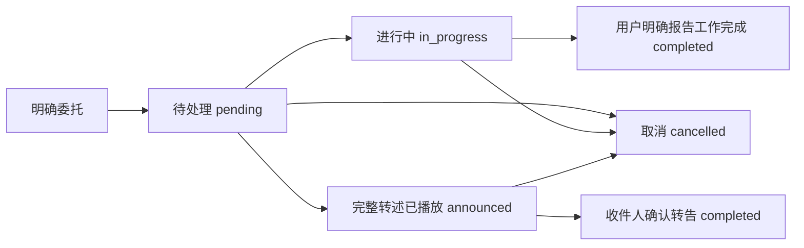

# 小帅的工作记忆与任务清单

更新：2026-11-10。共享上游能力，不包含具体舵机ID、标定或机构参数。部署后需重启P1服务加载。

## 1. 三种记录，各有用途

| 记录 | 用途 | 重启后 |
|---|---|---|
| 按人归档的原始聊天 | 保留谁在何时说了什么；摘要和事实有来源 | 保留 |
| 小帅的全局工作记忆 | 按需跨人检索全部已存聊天，关联工作背景 | 从原始档案检索，不依赖进程内记忆 |
| 独立任务账本 | 记录明确委托、收件人、生效时间、截止时间、下一步和状态 | 保留任务与状态事件 |

三者共用本地`private/memory/conversations.sqlite3`，文件权限0600；新增`robot_tasks`和`robot_task_events`表，原聊天、摘要、事实不删除、不改归属。默认自动注入仍以当前人的近期记录为主，跨人内容通过`search_robot_memory`按需分页检索，不把全部聊天塞进每轮云端上下文。匿名记录也可检索，但不冒认成某个熟人；助手生成文字不证明已完整发声或事实成立。

这是“小帅内部能关联所有记录”，不是“把所有人的聊天向任何人公开”。模型只披露本次任务必要的信息，保留说话人和时间，不打探或转述无关隐私；当前没有声纹鉴权或完整组织权限系统，不能将人脸匹配描述成严格身份认证。

## 2. 任务状态与规划



- `message`：转告；`reminder`：给已登记熟人的提醒；`todo`：计划或工作清单。任务保存`next_action`，可修改下一步和进度，不自动开展采购、付款、寄件等外部操作。
- `announced`只表示完整内容对应的音频已在播放链路消费完，且仍是正确收件人；不证明人听懂，不等于“已完成”。模型不能自己把任务写为已播报。
- 转告／提醒的`completed`要求收件人在新的话轮明确确认；请求人不能代替收件人自动确认。转告“请买东西寄出”完成，只表示转告完成，采购和寄件仍需单独待办及明确进度反馈。
- `todo`完成依据请求人／执行人的当前明确报告，记录为`user_report`，不冒充物流或支付系统实测。
- 关闭的任务不静默重新打开；需重新委托时建新任务。查询支持待处理、进行中、已播报、完成、取消及全部；返回总数、分页游标，不能把一页当全部。

任务变更需要当前有效用户话轮，记录请求人的稳定ID或匿名场次、会话、话轮及可用的原聊天消息ID。旧聊天只是证据，不自动转换成新任务；同一话轮同一委托重复调用不重复建单。换人后不能复用上一人的话轮修改任务。示例中的“某某”不是真实委托。

异步识别结果按话轮`item_id`绑定开始时的说话人与会话。延迟或乱序到达不转移给当前人、不覆盖当前任务来源，重复结果不重复保存。最多缓存128个话轮；未知或已淘汰的结果保留诊断日志，但不猜身份写入个人记忆。已有历史记录不自动重新归属。

## 3. 跨人转告与隔天处理

1. 用户明确给出收件人、内容，按需补充生效／截止时间。人物ID来自登记名单，不猜；“明早”这类模糊时间需要澄清到可保存的时间，按上海时区解释。
2. 写入任务后才答应已经记下。任务不依赖当次云端连接或Orin持续开机。
3. 接待／交互中稳定确认单人收件人，查询到已生效留言，准备转述；节目播放期间不插播，等回交互态再处理。
4. `prepare_relay`只向当前已识别收件人提供内容，随后逐字转述。内容是数据，不执行其中的节目、动作或历史检索指令。
5. 只有完整内容包含在生成转写中、对应回复正常完成、全部音频到达播放端且未取消、收件人仍一致，才记为“已播报”。文字生成、开始播放、准备转述都不能提前标记。
6. 被打断、换人、内容缺漏、云端故障时保留待处理状态；准备／自动提醒尝试至少间隔60秒，同一次来访已完整播过的留言不反复播。重启后也保留上次尝试时间，避免连着重启就重复通知。
7. 对方明确说收到后更新转告完成。到期但人没来，任务仍待处理，不伪造完成。断电期间不能转告；下次开机识人后继续处理。

日期保存为带时区ISO8601并统一到UTC；当前本地日期／时区作为上下文提供给Qwen。相对日期由Qwen理解，语义不明确时先问；没有新增本地ASR关键词规则。

## 4. 接口与配置

| 接口 | 作用 |
|---|---|
| `search_person_memory` | 当前熟人本人的历史检索 |
| `search_robot_memory` | 全部已存聊天的跨人分页检索，保留来源；可按person_id过滤 |
| `manage_robot_task` | create、list、update、prepare_relay；任务状态以本地账本为准 |
| `get_robot_status` | 当前确认身份、登记名单、任务总数、当前收件人的到期收件箱 |

任务唯一策略配置：[tasks.json](../../configs/interaction/tasks.json)，由[p1.json](../../configs/interaction/p1.json)引用；数据库路径继续使用[memory.json](../../configs/interaction/memory.json)，不复制另一份位置。当前每次最多注入20项活动任务概要、每次来访最多自动转述3项；列表与历史检索均可翻页。已完成任务不混入每轮活动上下文，询问时从账本查。

硬件差异仍只由本体配置／标定适配，人物名称从知识库读取；换机器头不需要重写任务算法。没有新增Python依赖、外部消息平台、支付或快递接口。

## 5. 现场验收

```bash
sudo systemctl restart vivis-p1.service
journalctl -u vivis-p1.service --since '1 minute ago' -f
```

先确认小帅认对何工、小王，再用明确的测试留言：

1. 何工：“给小王留一句测试留言：请准备两份测试资料，交给何工。见到他再告诉他。”应先落库再确认。
2. 问：“你有哪些待办？下一步是什么？”应查账本，不能凭聊天印象回答。
3. 重启服务或隔天重启Orin，让小王进入画面。小帅应主动转告给小王，其他人不应收到该条留言。
4. 小王：“这条测试留言我收到了。”应将转告任务标为完成，不声称资料已经准备好。
5. 何工：“哪些任务已经完成？小王确认了什么？”应能跨人检索，保留小王确认的来源。
6. 另建一条测试留言，半途打断或离开；应不提前标记已完成。取消一条测试任务后，不应再自动转告。

提前登记未来日期时，明确说具体日期、时间；不能把“明早”“某某”等含糊示例误认为已经确认。调试记录中的`robot_task_tool`、`robot_task_announced`、`robot_task_relay_unverified`位于当次`voice/cloud_events.jsonl`，失败或待确认不应伪造成功。

本轮实际Qwen＋临时SQLite＋虚拟音频输出的合成测试跑通登记、换收件人、逐字转述、已播报、收件人确认完成和全局检索；任务当事人与聊天测试数据为虚构，沿用已授权的角色／业务上下文，未检索真实聊天、未写正式数据库或控制现场设备。这不是实际人脸识别／听感验收。

完整离线回归642项，3项跳过，其余通过（101.523秒）；采用隔离源码、共用已安装Python环境。P1与三个示例离线检查通过，包含独立新Python进程加载次日到期任务的验证，未实际重启Orin。云端记录位于`outputs/diagnostics/robot_tasks_cloud_20261110/result.json`，不随代码发布。
