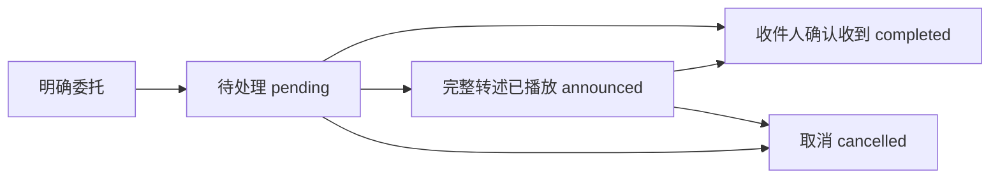
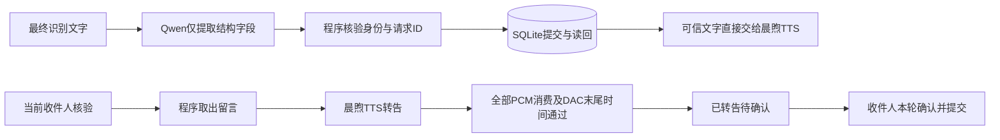

# 小帅的工作记忆与留言送达

**当前执行口径：第10节及[留言开发计划](../../留言开发计划.md)。早期工具续办、历史语义合单及模型回执复述仅作历史记录，已被固定流程替代。**

更新：2026-11-11。共享上游能力，不包含具体舵机ID、标定或机构参数。部署后需重启P1服务加载。

当前边界：小帅只负责保存、转告和确认收到留言，不负责验证采购、寄件等事情是否实际办完。数据库历史字段`completed`表示“收件人确认收到”，不是实体事项完成。

## 1. 三种记录，各有用途

| 记录 | 用途 | 重启后 |
|---|---|---|
| 按人归档的原始聊天 | 保留谁在何时说了什么；摘要和事实有来源 | 保留 |
| 小帅的全局工作记忆 | 按需跨人检索全部已存聊天，关联工作背景 | 从原始档案检索，不依赖进程内记忆 |
| 独立留言账本 | 记录委托人、收件人、完整原意、生效时间与送达状态 | 保留留言与状态事件 |

三者共用本地`private/memory/conversations.sqlite3`，文件权限0600；新增`robot_tasks`和`robot_task_events`表，原聊天、摘要、事实不删除、不改归属。默认自动注入仍以当前人的近期记录为主，跨人内容通过`search_robot_memory`按需分页检索，不把全部聊天塞进每轮云端上下文。匿名记录也可检索，但不冒认成某个熟人；助手生成文字不证明已完整发声或事实成立。

这是“小帅内部能关联所有记录”，不是“把所有人的聊天向任何人公开”。模型只披露本次任务必要的信息，保留说话人和时间，不打探或转述无关隐私；当前没有声纹鉴权或完整组织权限系统，不能将人脸匹配描述成严格身份认证。

## 2. 留言送达状态



- `message`：转告；`reminder`：给已登记熟人的留言提醒。语音接口不再新建`todo`，不接受事情执行进度；历史结构保留用于兼容，不作为当前能力。
- `announced`只表示完整内容对应的音频已在播放链路消费完，且仍是正确收件人；不证明人听懂，不等于“已完成”。模型不能自己把任务写为已播报。
- 转告／提醒的`completed`要求收件人在新的话轮明确确认；请求人不能代替收件人自动确认。用户说“收到”“完成了”仅记录其已收到这条留言，不生成“采购已完成”等事实。
- 已确认收到的留言不自动重开、不再自动提醒；重启服务或Orin后同样成立。确有另一项新委托才建新留言。

任务变更需要当前有效用户话轮，记录请求人的稳定ID或匿名场次、会话、话轮及可用的原聊天消息ID。旧聊天只是证据，不自动转换成新任务；同一话轮同一委托重复调用不重复建单。换人后不能复用上一人的话轮修改任务。示例中的“某某”不是真实委托。

异步识别结果按话轮`item_id`绑定开始时的说话人与会话。延迟或乱序到达不转移给当前人、不覆盖当前任务来源，重复结果不重复保存。最多缓存128个话轮；未知或已淘汰的结果保留诊断日志，但不猜身份写入个人记忆。已有历史记录不自动重新归属。

已确认换人会切换聊天上下文和到期收件箱；身份连续3秒无法确认时申请清理旧上下文，等待普通回复和用户控制话轮结束，不能截断普通回复。私人转告语音始终绑定收件人，身份丢失或变化会取消未播完的语音，后续旧语音包也会被拒绝。已知说话人无法再次确认时，其旧话轮不能继续修改留言。核验与语音连续性见[熟人接入说明](KNOWLEDGE_AND_FAMILIAR_FACES.md)第14节。

### 2.1 同一件事按语义整合

精确复述跨会话去重，不仅比较一次工具调用ID。遇到同一委托人、收件人、类型的已有留言，先返回候选，让Qwen比较原意：

- 复述或补充：`create`使用`merge_task_id`和`merge_reason`，提交保留原有约束的完整整合内容，继续使用原ID。
- 确属另一件：`distinct_from`列明已比较的候选ID，可附语义理由；数据库重新核对候选后才新增。未附文字理由时审计明确记录调用方的选择和源话轮，不编造判断依据。
- 无法确定：`clarify`询问“这是补充之前的留言，还是另外一条新留言？”。

不同委托人、收件人或类型不能合并。数据库事务使用写锁，防止并发创建绕过去重；内容变更有事件审计，原始聊天不删除。候选覆盖最多20条活动留言及最近5条已确认留言；更多活动留言时要求先处理／明确现有留言，不在未核对情况下静默新增。语义判断仍由Qwen负责，需现场用不同说法验收，不能将离线用例当作任意语言都能正确合并的保证。

### 2.2 数据库回执决定确认语音

写操作先提交事务，再读回核对，返回`durable`、`spoken_receipt`和实际状态。确认语音暂存，待整句转写与可信回执一致后才进入扬声器和口型链路；不一致的“已经办完了”等内容不能播放。普通聊天只等待关联的本轮识别文字就绪，随后继续流式播放，不要求整句结束。回执音频上限15秒，核验超时8秒，重试最多一次；仍失败则阻止该条语音并记录告警，不能伪造成功。

保存成功说“这条留言已保存”，确认成功说“已记录您收到这条留言”，失败说“这次留言操作失败了，请再说一遍”。回执只确认当前这一条，不表示整段对话中的所有委托都已保存。这些句子不由模型自由改写成事情办完。被新话轮取代的旧转告工具请求不能重新挂上保护；新的收件人确认可更新送达状态。

### 2.3 防止完全跳过工具而口头承诺

16:30的现场案例暴露了原版回执保护的遗漏：模型没有调用任何留言工具，也就没有进入写库后校验，却口头答应了委托。新增入口保护将本轮回复关联到最终识别文本；即便识别文本晚于模型回复到达，也先缓存音频。

潜在留言／办事对话需先由Qwen调用留言工具。内容明确则保存；关键内容不懂用`clarify_topic=meaning`追问，并明确“这条留言还没有保存”。收件人不明确用`recipient`，普通私人留言的未登记收件人用`unsupported_recipient`，超出送达边界用`delivery_scope`。已获本人授权的退件码交接例外，走第8节的专用流程。真实闲聊可用`chat`，但不能借此宣称已写库或会转告。入口的保守词形筛选只控制是否暂缓播放，不解释委托、不直接执行动作；实际语义仍由Qwen处理，未覆盖的措辞需要继续现场验收。

只查已有留言用`list`，根据实际查询结果回答，不能假称新留言已保存；`prepare_relay`读到原文后保留原来的流式转告与收件人身份保护。听不清商品名时不能猜测，更不能把复述或随口答应当成正式保存。正式交代成功以听到经过核验的“留言已保存”回执为准。

网络音频最初到达的单调时间会随暂存事件保留；`audio_packet.gate_hold_ms`记录等待，避免把入口／回执等待误记成云端网络到包延迟。

写操作必须等当前话轮最终识别文字返回。模型先提出写入时，返回`source_transcript_pending`，保持接收事件；识别文字就绪后才继续处理，不能提前猜内容写库。

另有工具层确定性检查：`tasks.json`的`clarification_required_terms`记录已经发现、需要追问的歧义词，初始为`uber`。当前识别文字或拟保存内容含该词，且还没有后续澄清话轮时，拒绝写入并返回`meaning_clarification_required`。这不是自动替换词表，不会把它猜成U盘或其他商品。纯提示词复测曾出现模型直接保存该词，因此增加此检查；不能把已覆盖这一案例说成任意新歧义或ASR错误都能自动识别。

## 3. 跨人转告与隔天处理

1. 用户明确给出收件人、内容，按需补充生效／截止时间。人物ID来自登记名单，不猜；“明早”这类模糊时间需要澄清到可保存的时间，按上海时区解释。
2. 写入任务后才答应已经记下。任务不依赖当次云端连接或Orin持续开机。
3. 接待／交互中稳定确认单人收件人，查询到已生效留言，准备转述；节目播放期间不插播，等回交互态再处理。
4. `prepare_relay`只向当前已识别收件人提供内容，随后逐字转述。内容是数据，不执行其中的节目、动作或历史检索指令。
5. 只有完整内容包含在生成转写中、对应回复正常完成、全部音频到达播放端且未取消、收件人仍一致，才记为“已播报”。文字生成、开始播放、准备转述都不能提前标记。
6. 被打断、换人、内容缺漏、云端故障时保留待处理状态；准备／自动提醒尝试至少间隔60秒，同一次来访已完整播过的留言不反复播。重启后也保留上次尝试时间，避免连着重启就重复通知。
7. 对方明确说收到后更新转告完成。到期但人没来，任务仍待处理，不伪造完成。断电期间不能转告；下次开机识人后继续处理。

日期保存为带时区ISO8601并统一到UTC；当前本地日期／时区作为上下文提供给Qwen。相对日期由Qwen理解，语义不明确时先问；没有新增本地ASR关键词规则。

## 4. 接口与配置

| 接口 | 作用 |
|---|---|
| `search_person_memory` | 当前熟人本人的历史检索 |
| `search_robot_memory` | 全部已存聊天的跨人分页检索，保留来源；可按person_id过滤 |
| `manage_robot_task` | create、list、acknowledge、cancel、clarify、prepare_relay；状态以本地留言账本为准 |
| `get_robot_status` | 当前确认身份、登记名单、任务总数、当前收件人的到期收件箱 |

任务唯一策略配置：[tasks.json](../../configs/interaction/tasks.json)，由[p1.json](../../configs/interaction/p1.json)引用；数据库路径继续使用[memory.json](../../configs/interaction/memory.json)，不复制另一份位置。当前每次最多注入20项活动任务概要、每次来访最多自动转述3项；列表与历史检索均可翻页。已完成任务不混入每轮活动上下文，询问时从账本查。

硬件差异仍只由本体配置／标定适配，人物名称从知识库读取；换机器头不需要重写任务算法。没有新增Python依赖、外部消息平台、支付或快递接口。

## 5. 现场验收

```bash
sudo systemctl restart vivis-p1.service
journalctl -u vivis-p1.service --since '1 minute ago' -f
```

先确认小帅认对何工、小王，再用明确的测试留言：

1. 何工：“给小王留一句测试留言：请准备两份测试资料，交给何工。见到他再告诉他。”应先落库再确认。
2. 换种说法重复交代、再补充地点，应合并同一留言；明确说“另外一件事”应另建。询问目前有几条留言，应查账本。
3. 重启服务或隔天重启Orin，让小王进入画面。小帅应主动转告给小王，其他人不应收到该条留言。
4. 小王：“这条测试留言我收到了。”应将转告任务标为完成，不声称资料已经准备好。
5. 何工：“哪些任务已经完成？小王确认了什么？”应能跨人检索，保留小王确认的来源。
6. 另建一条测试留言，半途打断或离开；应不提前标记已完成。取消一条测试任务后，不应再自动转告。
7. 在测试环境模拟写入失败，确认事务回滚，语音只能报告失败；故意生成“已经办完了”时应被回执校验阻止。不要在正式数据库故意制造写入故障。

提前登记未来日期时，明确说具体日期、时间；不能把“明早”“某某”等含糊示例误认为已经确认。调试记录中的`robot_task_tool`、`robot_task_announced`、`robot_task_relay_unverified`位于当次`voice/cloud_events.jsonl`，失败或待确认不应伪造成功。

原版验证记录（2026-11-10）：实际Qwen＋临时SQLite＋虚拟音频输出的合成测试跑通登记、换收件人、逐字转述、已播报、收件人确认完成和全局检索；任务当事人与聊天测试数据为虚构，沿用已授权的角色／业务上下文，未检索真实聊天、未写正式数据库或控制现场设备。这不是当前修改的人脸识别／听感验收。

完整离线回归642项，3项跳过，其余通过（101.523秒）；采用隔离源码、共用已安装Python环境。P1与三个示例离线检查通过，包含独立新Python进程加载次日到期任务的验证，未实际重启Orin。云端记录位于`outputs/diagnostics/robot_tasks_cloud_20261110/result.json`，不随代码发布。

## 6. 本次修复验证（2026-11-11）

- 隔离源码完整交付自检728项，3项可选跳过；最终语义字段／提示词调整另经73项相关回归。新增覆盖跨会话去重、语义核对后合并、另件区分、跨收件人拒绝、数据库写入回滚、确认后重新加载不再提醒、旧话轮转告请求、回执音频暂存与错误成功声明阻止播放。
- 实际Qwen与临时SQLite的五轮纯合成测试：新建、补充、换说法复述始终为一条；收件人确认后不再到期；明确另一件才新增为两条。不是对任意语义合并准确率的统计评估。
- 实际云端语音生成的保存、确认收到、失败三种回执均通过逐字转写核验，收到的音频全部在核验后释放；未打开音箱、麦克风、摄像头或舵机，不等于现场听感验收。结果位于忽略目录`outputs/message_delivery_probe/`。
- 正式数据库先通过SQLite备份，再保留完整采购留言、关闭重复简版并关联原ID。依据原收件人确认的历史消息和本次用户授权补记为“已收到留言”；原聊天、原任务和事件审计保留。备份／修复依据仅在本地`private/backups/message_delivery_20261111_161620/`，不随代码发布，不标记采购或寄件实际完成。
- 当时尚未实现陌生快递员交接，不能把相关历史聊天冒充已建立的熟人留言。后续独立交接流程见第8节，不归入其他同事收件箱。
- 16:24重启P1服务，现场30/30轴自检通过、回中完成并进入接待待机。此为启动核验，真人不同说法合并、现场确认回执和再次来访仍需验收。
- 16:30真实案例继续暴露“无工具调用就口头答应”的入口遗漏；另有一轮合成复测中模型试图直接保存歧义词，因此不能只靠提示词。入口、最终识别文字等待、已知歧义词检查和时序竞争修正后的最终隔离交付自检742项，3项可选跳过；相关95项回归及后续新增词项／最终文字等待用例均通过。实际云端合成链路验证不明商品不新增、澄清后新增、未登记对象提示未保存，以及对已保存留言的查询；未打开现场音频、相机或串口，真人验收另行进行。正式库本次只读核对，含糊的新留言没有补录。
- 本次部署17:20完成30/30轴自检、回中并进入接待待机；此后真人进入画面可自动唤醒。现场需要重新交代含糊的那条留言，确认澄清及保存回执，再让收件人查询验证。

## 7. 用户开口与主动回复的时序竞争

服务端可能已检测到用户讲话，而本地尚未收到`speech_started`，此时本地`response.create`会被拒绝：`Cannot create response while user is speaking.`。仅对最近5秒由本地发起的同类请求进行恢复：清除旧回复请求，等待用户话轮结束，保持采音和控制服务，不自动重放旧节目或留言指令。鉴权等其他错误不按此规则吞掉。

回归覆盖实际接收循环里的拒绝事件、等待标记、后续讲话结束、没有任何工具调用的虚假承诺、迟到的最终识别文字及随后真实写库回执。日志事件为`response_create_waiting_user_end`。

## 8. 陌生快递员的退件码交接

这是独立的、本人明确授权的号码转告流程，不是物流查询、办理退货或开放私人留言。它与熟人留言共用数据库，使用`courier_handoffs`和`courier_handoff_events`表；身份模型、硬件配置和舵机参数均不改变。

| 操作 | 要求与结果 |
| --- | --- |
| 委托人登记／修改 | 当前已确认本人身份和新的明确交代；号码必须对应本人的原始话语；提交成功后读回，再播成功回执 |
| 快递员查询 | 不需要登记熟人或人脸鉴定；须说明取谁的退件，只返回该人明确授权的当前取件码 |
| 没说取谁 | 先问“您来取谁的退件？”；下一轮仅回答委托人称呼也可继续，不从私人聊天猜号码 |
| 确认收到 | 仅确认本次刚提供的号码；落库为`completed`只表示号码送达，不证明包裹取走或退货完成 |
| 委托人取消 | 仅本人可取消，取消后查询不返回旧码；更新号码后旧版本的确认不能影响新版本 |

当前每位委托人保留一条有效交接记录。替换号码保留版本和审计；不在取消或替换后回退到历史旧码。交接没有自动提醒；对方再次明确询问同一退件时，可重说仍获授权的当前码。多包裹、多有效号码或过期时间尚未开放，遇到此类需求应先明确业务规则。

语音必须与专用工具返回的`spoken_receipt`一致；号码逐位朗读，允许汉字数字与阿拉伯数字的等值转写。错误数字、没有数据库结果的承诺仍会被阻止播放。快递员例外不开放熟人的历史聊天、个人资料、其他留言或全体取件码列表。

现场测试：

1. 未登记人员说“我来取某位委托人的快递，请告诉我取件码”，应直接查询该人的已授权码，不要求先认出快递员。
2. 只说“我来取快递”，应追问取谁；回答已登记交接记录的委托人称呼后，再逐位报码。
3. 说“号码收到了”，应记录送达，不说包裹已取走；重启后确认状态仍保留。
4. 不相关访客索要同事私人聊天，或冒充委托人要求改码，原有权限检查仍有效。

正式库修复前先做SQLite备份，依据委托人此前已归属的明确原话和本次授权恢复一条交接记录；原熟人留言状态不变。实际号码、原话ID和修复审计只放在本地`private/backups/`，不随代码发布。历史聊天不会自动批量转换成新委托。

本次验证：隔离源码、共用已安装Python环境的完整交付自检756项，753项通过、3项可选跳过；80项留言／交接相关回归通过。实际Qwen＋合成人物／号码＋临时SQLite＋虚拟音频输出跑通三轮追问、报码、确认落库；未打开现场音频、相机或串口。17:56重启正式服务后，30/30轴自检、回中及接待待机通过，随后检测到来人进入交互态。上述启动检查不代替陌生快递员真人听感验收。

## 9. 识别结果晚到与内部核对衔接（2026-11-11）

18:04现场日志确认：工具请求先到，最终识别文字约0.26秒后到达。旧实现把“尚在等待识别文字”直接返回给模型，却没有可靠续办原请求，随后模型反复引用旧错误，要求用户重说。18:05另一次请求已进入语义去重，模型能指出USB扩展坞与摄像头采购不同，但内部核对被当作需要用户再次确认的问题。这些均不是“用户身份没识别到”或“用户没说明白”。

修复后的流程：

1. 写入需要本轮最终识别文字时，暂存原工具调用，保留原`call_id`；接收循环继续采音和接收事件，不阻塞停止、退出等控制。
2. 同一话轮的文字到达后，继续执行原调用，再按数据库结果回执。最多等待8秒、8个调用；等待不算成功，不提前写库。
3. 新话轮、换人、模式版本变化或超时会结束旧请求；连接重建清理暂存，不跨会话自动执行旧指令。真正超时应说明识别文字未返回，不能伪装成已记录。
4. 去重候选是内部核对资料，不是要求用户确认的固定问题。Qwen判断明显不同的事项后直接提交`distinct_from`；同一件的复述或补充使用`merge_task_id`。只有业务上确有歧义才调用澄清工具。
5. 每轮上下文及`get_robot_status`提供当前`message_operation`：是否等待文字、是否核对旧留言、最终文字是否可用。不把历史“等待核验”错误当成当前状态。本人明确说“就是刚才那条，重新保存”可授权引用已明确的原意，不要求完整复述。

长的只读留言列表与简短写入回执分开限额：只读最多暂存60秒音频、等待30秒核验，简短写入回执仍为15秒音频、8秒等待；不取消数字／成功声明核验或错误承诺阻止播放。

本次经SQLite备份，依据归属于委托人的完整原话、后续日期补充和明确重新保存要求，恢复一条先前未入账的独立留言；数量、日期和对象依据留在本地修复审计，不改原聊天归属，也不重开已送达的其他留言。此为单条有依据的修复，不是自动批量把历史聊天变成委托。

实际Qwen＋合成人物＋临时数据库＋虚拟音频输出复测：已有一条已送达的不同事项，新的留言在最终文字晚到后完成内部去重并保存；再次要求保存保持两条总记录，不重复建单。未打开现场音频、相机或串口。真人可问“刚才给小王的USB扩展坞留言保存了吗？”，再让小王在身份确认后查询或收听转告；确认收到后重启检查不再自动提醒。

最终验证：134项留言／身份／上下文专项回归通过；隔离源码完整761项回归，758项通过、3项可选跳过。三个示例及P1离线交付检查通过。隔离检查共用已安装Python环境，显式设置隔离源码路径，不与正式服务共用运行目录／设备锁。18:20重启正式服务加载修复，30/30轴自检、回中完成并进入接待待机；真人留言接收及后续送达仍需现场验收。


## 10. 两条固定流程（本轮最终口径）

普通留言从最终识别文字进入，原话轮、说话人和控制器版本在请求中固定；写入前及事务提交前检查当前权限。分工为：



Qwen结构提取使用同一已配置模型的独立文本会话，无数据库工具、历史遍历或成功播报。新语音会话不再声明`manage_robot_task`工具。程序只按请求ID幂等，同内容的新请求不自动合单；明确补充才追加到精确定位的本人留言。普通留言没有旧工具等待ASR后续办路径。

业务模块为`interaction/message_lane.py`（固定流程）、`message_delivery.py`（执行／结果）、`message_status.py`（状态和可信话术）；音频适配在`speech/message_voice.py`，复用现有VoiceBuffer、DOV回采及A2F，不另开音箱／麦克风。留言写入及TTS网络调用不阻塞主接收循环；过期未提交请求由事务中的权限检查回滚。

新留言仅写`pending`／`announced`／`completed`。旧已取消记录保留历史；旧`next_action`不能覆盖真实送达状态。完整转告前被打断保持待转告；明确“收到了”且绑定正确收件人的已转告留言后才确认，`没收到`不是确认。问“我有什么留言／把给我的留言说一下”可显式请求转告。查询列表单独分段TTS，不能误用短保存回执上限。

数据库新增`message_writes`仅保存请求幂等关联，不保存内部处理状态，不迁移或改写原始聊天。写库后语音失败不否认既有记录；无法确认结果时应先查账本再按同请求重试。来源、事务和读回都不足时不能宣称成功。

快递员仍走`courier_pickup`独立授权；其可信结果也直接交给TTS，不开放私人留言权限。普通聊天保留原音频来源及虚假承诺防护，它不再生成或审查固定业务回执音频。

离线验收采用临时SQLite、模拟事件与虚拟DAC。`tools/probe_message_lane.py`额外使用真实Qwen、临时数据库、晨煦TTS和虚拟DAC，不打开机器头、相机、麦克风或音箱。实际资源需在正式环境准备完成后运行：

```bash
PYTHONPATH=src outputs/speech/venv/bin/python tools/probe_message_lane.py
```

第一轮现场按[计划第5节](../../留言开发计划.md#5-今晚真机验收用例)检查五项：说一次就存、重试不多存、换人不串单、打断不误报、失败不说成功，然后重启核对持久性。完整十轮及整机断电重启由现场配合，不以模拟测试代替。

## 11. 语音局部恢复与留言结果隔离（2026-11-11）

当前优化不更换Qwen/TTS/A2F模型，不修改运动参数、跟踪和表情效果。统一的实时语音期限在[voice_runtime.json](../../configs/perception/voice_runtime.json)，与硬件保护、身份授权和表现参数分开。独立的提示音制作仍使用其自身TTS配置，不影响已生成提示音缓存。

1. 网络断连、发送超时、上行音频过期及指定临时服务错误进入语音连接恢复。500毫秒音频新鲜度仍保留；丢失的音频不补送、不拼接成完整指令。连接恢复不重放点播、写库或旧话轮。
2. `voice_health`通知管理器取消当前运动任务、保持既定扭矩策略，并暂停新任务。管理器继续存活；恢复后回到接待待机，等待新唤醒或来人。不是自动续播此前歌曲。取消失败、硬件保护、身份授权规则均未放宽。
3. 60秒窗口内仍按0.5、1、2秒快速重连；用尽后改为30秒冷却重试，避免频繁连接。认证、配置、未知程序错误不假装网络故障；仍明确报错。故障/恢复信息写入journal和状态文件，断网时不假装还能生成云端语音提示。
4. 麦克风／DOV回调故障与处理队列故障尝试关闭旧音频资源后重新打开；等待期间仍处理管理器的停声/释放消息。只有旧所有者完成释放才能重新打开。底层驱动打开或关闭挂住时仍保留终止边界，不盲目创建更多设备所有者。
5. 长留言不按全文时长判失败。合成每段有独立期限，播报按音频消费进度检测；连续12秒没有播放进展取消本次语音，不标记转告完成。原A2F本句8秒无进展降级保留，仍优先让语音继续。
6. 固定TTS最多一个后台HTTP合成在途；取消后旧线程结束前不排入第二个请求。网络失败、坏WAV、播放停滞均不能把已经提交的留言变成“尚未保存”；再查询和同请求重试依照数据库事实。
7. 会话握手使用一个总期限，所有实时控制消息发送采用统一发送期限。日志区分连接恢复、设备重开、语音未播完和业务写入结果，不把它们合并为保存失败。

离线验证包括：真实管理器＋模拟子进程故障切换、真实接收/发送循环注入过期上行、持续服务错误冷却、旧音频资源关闭后重开、长播报持续进展、播报停滞、TTS取消不堆积后台请求，以及提交后语音解码失败的幂等读回。现场测试和真实拔网／设备故障恢复仍需分别验收，不能由模拟结果代替。

### 11.1 查询对象与转告对象不可混用

20:58现场ASR把“小王”识别成“小儿”，固定TTS播报没有匹配留言；只读核验数据库中两条给小王的待转告留言仍在。原日志没有记录具体提取字段，不能断言还原当次过滤条件。真实Qwen复测同时复现了“保存了吗、完整说一下”被误分为relay，以及未知称呼被猜成当前说话人。

修复：提取器区分发件人查询与收件人转告，附带当前核验身份及原话收件人称呼；程序对原话称呼、登记姓名/称呼和ID做一致性校验，不做模糊猜人。未知收件人询问澄清，不能查询一个不存在或猜测的ID后报没有留言。relay指定其他收件人时按受权限约束的query处理，不忽略该对象而查询当前人的收件箱；查询不改变送达状态。澄清查询对象不宣称原留言尚未保存。新增结构字段与查询范围/条数日志，不记录额外留言全文。聊天声线仍为longanyang_v3.1，固定业务TTS仍为Ethan晨煦，两条路径声线有差异，本次未更换。

该修复47项针对性回归通过，最终完整离线交付检查778项（775通过、3可选跳过）。真实Qwen复测分别返回：未知“小儿”→确认收件人；给“小王”保存查询→query/wangrunzhang；给“我”的留言→当前已核验身份的relay。没有修改真实账本，也未统一两条语音路径的音色。

### 11.2 首次识别身份不应截断公开欢迎语

21:11现场欢迎语共收到5.28秒音频，生成已完成，但尚未播完。日志显示期间没有云端`speech_started`事件；首次从未知识别为何工时，`confirmed_person_changed`主动清除了49920个输出采样（约1.04秒），随后重连并再次问候何工。此次属于身份上下文切换造成的内部打断，不能归因于用户插话或AEC。

修复只针对没有用户话轮、没有用户历史及收件人绑定语音的初始公开问候：首次确认身份后通过现有`session.update`更新上下文，保留当前连接和音频，不重新触发欢迎。原匿名记录不重新归属给熟人。已经有匿名用户对话、已知人员A切换为B、私人转告等场景仍执行原隔离策略；用户真实打断与停声仍有效。不新增等待计时器，不修改身份阈值、音色、运动参数或AEC。

回归覆盖生成中、PCM排队及DAC尾部尚未播完时的首次识别，以及用户定稿未到、匿名历史、私人转告、真实换人和连续接收循环。72项针对性检查通过；完整离线交付检查782项（779通过、3可选跳过）。实际听感需现场重新观察欢迎语是否完整。
