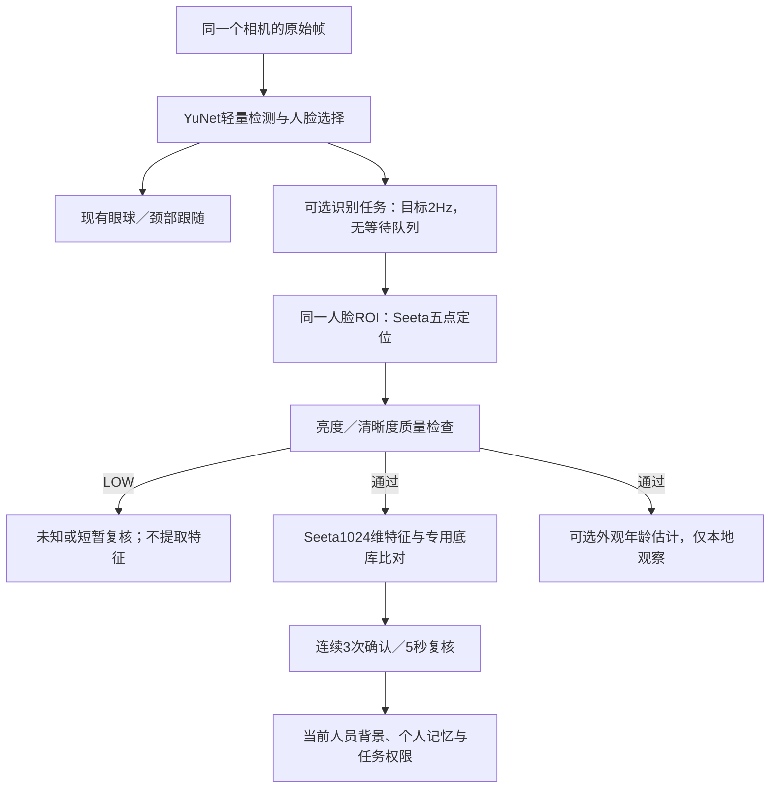

# SeetaFace6熟人识别运行说明

## 1. 当前结构与启用范围

用户于2026-11-11选择将熟人识别后端改为SeetaFace6，保留轻量检测与跟随。语音模型、A2F、舵机参数、控制权、节目与回中流程均沿用现有配置。



跟随循环不等待识别、年龄或质量评估结果。识别使用独立的`BestEffortJob`，同时最多一个任务，忙时跳过；ctypes原生调用不占用Python GIL。画面多人、丢脸、明显跳变、结果过期或可捕获的识别异常时沿用既有身份撤回流程；原生SDK进程崩溃仍会触发现有视觉服务退出保护，不能将线程任务隔离称为进程故障隔离。关闭视觉时，正在执行的原生任务结束后才释放其引擎，避免释放后继续访问。

**生产识别不会再次运行Seeta检测器选择另一张脸。** 它处理YuNet已经选择的同一个ROI，重新定位SDK所需五点。独立离线A/B中的`seeta6`组则使用Seeta自己的检测器，两条链路的测量不能混为一谈。

当前启用：Seeta识别、传统亮度／清晰度质量过滤、可选年龄估计。没有启用活体检测、口罩模型或深度LBN质量模型，不能把SDK完整能力表当作当前产品已实现功能。

## 2. 配置和底库

唯一入口是`configs/perception/familiar_faces.json`：

| 项目 | 当前值 |
|---|---|
| `backend` | `seeta6` |
| `backends.seeta6.score_threshold` | 0.6，待现场验证的工程初值 |
| `minimum_margin` | 0.08 |
| `backends.seeta6.quality_gate` | `true`，任一质量LOW就跳过特征提取 |
| `backends.seeta6.age_estimation` | `true` |
| `confirmation_samples` | 连续3次 |
| `review_hold_s` | 上次连续确认起最多5秒 |
| `max_result_age_s` | 1.5秒；复核不能掩盖相机或推理停顿 |
| `hz` | 识别目标2Hz，实际随忙闲跳帧 |

`backends.sface`保留原模型、0.5门槛和原底库，作为显式回退配置，不自动回退。两个后端各有独立模型、阈值与底库。Seeta评分经过SDK自己的相似度变换，不称为余弦概率；不能把128维SFace特征交给1024维Seeta模型。

本机五位已登记人员保持原ID：`heyude`、`wangrunzhang`、`jingming`、`weiyufei`、`liangzewei`。新的`private/people/gallery_seeta6.npz`由原照片生成；原`gallery.npz`未改动。新底库记录模型哈希、后端和`seeta6-yunet-roi-pts5-v1`对齐约定，加载时检查，避免混用不同模型／对齐结果。

复现构建与底库生成：

```bash
.venv/bin/python tools/setup_seetaface6.py --jobs 4
.venv/bin/python tools/build_familiar_gallery.py --backend seeta6
```

源码、模型、补丁出处见[来源说明](../../native/vision/seeta/NOTICE.md)。质量亮度ROI修复仍保留；SDK编译也包含年龄模块。**未构建或加载性别推断模块**；称呼采用本人提供或已确认的资料。年龄是外观估计，不用于身份比对、权限或收件确认，也不覆盖档案里的真实年龄；不依据估计值自动给陌生人添加年龄称谓。年龄观察不自动注入云端个人背景。

后续`tools/register_person.py`默认使用当前后端，也支持显式`--backend sface`或`--backend seeta6`。重新生成某个底库只操作该底库，并备份旧版本；不会把另一套模型的特征拼接进来。新增同事后需要分别更新希望使用的底库。

## 3. 回退与年龄开关

停服务后只修改`familiar_faces.json`的`backend`为`sface`，再重启，即回到保留的SFace模型和底库。若已新增同事且SFace库未更新，可先运行：

```bash
.venv/bin/python tools/build_familiar_gallery.py --backend sface
```

只关闭年龄推理时，将`backends.seeta6.age_estimation`设为`false`，重启后识别与质量过滤继续工作。年龄开关不影响已登记年龄资料。缺少SDK／模型或底库不匹配时只报告身份识别不可用，保持未知，不静默改用另一套后端；现有跟随仍可运行。

## 4. 已完成验证与范围

- Orin ARM64／CPU NEON构建及原生质量100次回归通过，年龄模型可加载。
- 原照片做链路自回测可正确确认人员，年龄输出带`estimated=true`、`not_identity_evidence=true`。这不等于年龄精度验收。
- 隔离源码、共用已装Python环境的交付自检697项，694项通过、3项跳过。新增后端测试覆盖1024／128维隔离、模型和对齐约定、低质量复核、候选换人、无排队及原生任务关闭时的生命周期。没有通过离线测试宣称实际舵机或多人身份场景已验收。
- 已有合格何工录像仅取10～19.9秒，约2Hz共19帧。独立A/B中SFace与Seeta未过滤组均匹配正确；Seeta质量组拒绝3帧。启用生产确认／复核层的顺序回放中，最初2帧未确认，随后17帧均保留`heyude`，其中12帧已确认、5帧复核；没有出现其他ID。
- 上述顺序回放含年龄时，正常提取任务约426～438ms，首轮约525ms；质量拒绝帧约10～12ms。它不是实际并发待机的耗时保证，生产忙时会跳过识别任务；跟随不等待它。实际并发响应需要现场观察。
- 现有录像只有何工，**无法验证陌生人误认率或何工／小王之间的真实串人率，也不能据此证明Seeta比SFace准确**。两段裁切不合格的背光录像保留诊断，排除正式统计。后续仍按[A/B计划](SEETAFACE6_AB_TEST.md)补充合格多人视频。

## 5. 真人全流程验收

重启`vivis-p1.service`后，先查看自检、回中及待机日志。监控页面为Orin本机`http://127.0.0.1:8765/`，页面可查看后端、已确认／复核／未确认状态及外观年龄估计；底层人员ID只是本地登记ID。

1. 何工单独入镜，稳定后问“你看看我是谁”；轻微转头，观察称呼是否保持，短暂低质量应进入复核。询问年龄时，已登记事实优先，不能把估计值说成确定事实。
2. 何工离开，小王单独入镜，同样询问身份与给自己的留言，确认背景和任务切换，不能读取前一人的留言。
3. 未登记同事单独入镜，应为未知，不猜熟人ID。口头自报“小王”不能取得小王的私人资料或收件权限。
4. 检查普通聊天、微笑回应、眼颈跟随，以及歌曲／剧本点播、中途停止回交互和“待机”回待机。相机连续看到人2秒仍按原接待规则唤醒，未修改这一策略。
5. 换人或复核中查询个人留言应暂停；重新确认后才能转告。年龄估计仅本地观察，不作为判断是不是同一个人的依据。

## 多照片登记（2026-11-12）

每个人可以有多个本地特征模板；运行时先取同一人各照片的最高相似度，再与其他人的最高分比较。两个相近的本人人像不会互相充当第二名，原来的识别阈值、分差及身份保持时间保持不变。

- `private/people/<id>/photo.*`：原始主要照片。
- `reference.*`：已有参考照片，同样纳入登记。
- `photos/`：追加照片，按原文件SHA256命名，保留原始字节。
- `gallery_seeta6.npz`：实际使用的图库；同一ID可有多个不同照片模板，重复照片不重复录入。

向已有人员追加照片，先检查再应用：

```bash
.venv/bin/python tools/add_familiar_photos.py --id PERSON_ID \
  --photo /path/to/photo1.jpg --photo /path/to/photo2.jpg --check
.venv/bin/python tools/add_familiar_photos.py --id PERSON_ID \
  --photo /path/to/photo1.jpg --photo /path/to/photo2.jpg
```

工具默认采用当前识别后端。提取要求单人照片，并记录亮度和清晰度；多模板时排除自身模板进行互认检查，检查通过后才更新图库。追加时保留其他人员及既有特征，自动备份原图库。`--check`不写图库和照片。全部重建工具`tools/build_familiar_gallery.py`同样读取主要、参考和追加照片，按文件哈希去重。资料和照片留在本机，不随代码提交。更新后需重启正在运行的视觉服务才能加载。

本次实际图库：魏宇飞4张（原1＋新增3）；戚宇凡2张（原证件照＋此前仅验证过的参考照）；其余4人各1张，共6人10个模板。原6个模板逐项校验未变。魏宇飞排除自身后的同人最高分约0.706～0.955，戚宇凡两张互比分数约0.688，均通过原阈值0.6及分差0.08。这是给定登记照片的离线互认结果，不能视为现场准确率或背光性能提升的统计证明。各人的本地`multiphoto_enrollment.json`记录来源哈希、质量与互认结果。

验证记录：50项识别／登记／身份稳定专项通过；三个示例离线检查通过。完整回归运行928项（3项可选依赖跳过），其中5项受中途重新运行的P1服务设备锁干扰；停止服务后这5项单独补测全部通过，保留两份日志，不放宽锁。证据`outputs/diagnostics/multiphoto_full_tests.log`及`multiphoto_lock_recheck.log`。真实运行时加载器已读取6人10模板；现场准确率提升尚待真人验证。
