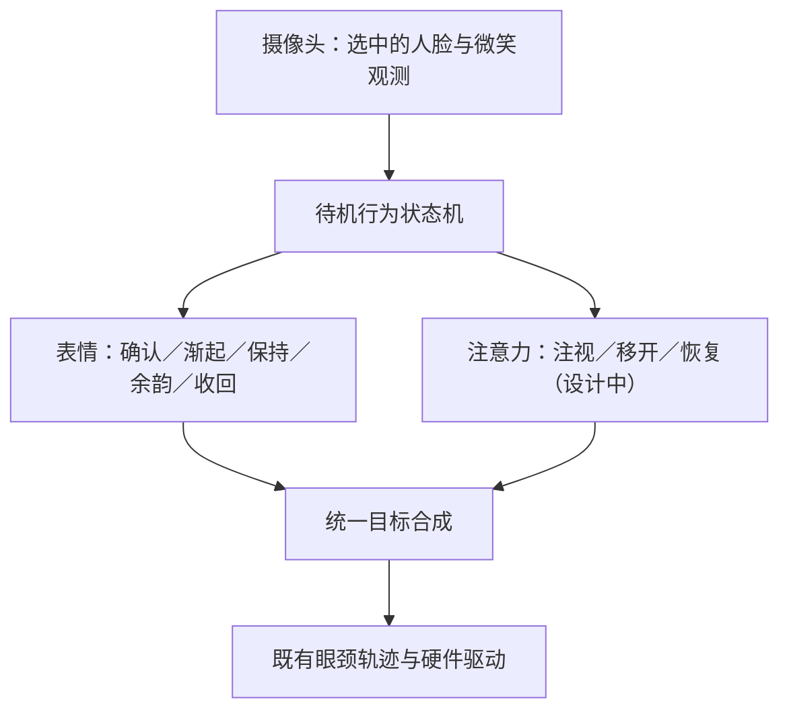

# 互动待机：持续微笑与注意力节律

## 1. 分层与当前范围

待机不需要LLM实时参与，也不等待全双工对话完成。摄像头和Face Landmarker提供可观察的人脸与微笑信号，轻量状态机决定回应时序；目标合成与现有眼颈轨迹层执行动作。待机不启动A2F、ASR或TTS；P1管理器另外负责语音选节目和退出。



表情状态机已实现；眼颈跟随、无脸回中和小幅游视已实现。**有人脸时周期性移开视线的注意力策略仍是设计方案，尚未接入。当前版本仍会持续跟随选中的人脸。** 不将设计目标写成已实现或已现场验收。

以后有全双工时，可把可靠的说话／打断活动作为状态机输入。LLM可提供“友好回应、认真倾听、切换节目”等语义意图，不进入60Hz运动线程，不直接发送舵机命令。

## 2. 已实现的持续微笑

参数在`configs/interaction/standby.json`，与歌曲显式微笑诊断分开配置；复用相同的检测、通道映射与控制实现。本体硬件配置、标定、速度和保护不变。

| 阶段 | 当前工程起点 | 行为 |
|---|---|---|
| 识别 | 双侧微笑系数取较小值，入阈0.45、出阈0.30，滤波0.10秒 | 保留迟滞，减少边界反复触发 |
| 确认 | 持续0.25秒 | 确认后才开始回应 |
| 渐起 | 0.40秒；通道最大增量0.50 | 平滑进入回应，叠加增量不是全舵机行程百分比 |
| 保持 | 微笑观测仍高于退出条件时保持 | 不再被固定脉冲时长强制收回 |
| 余韵 | 低于退出阈值持续约0.80秒 | 短暂放松或抖动不立即收回 |
| 收回 | 约1.0秒 | 渐回中性；重新确认微笑时可从当前强度恢复 |
| 观测短暂丢失 | 感知端约0.25秒容错；控制端保持约0.25秒后以0.8秒曲线淡出 | 不无限保持过期目标，也不因一个坏观测瞬间撤掉笑容 |

这些是待调试的工程参数，不是人类表情的生理标准。还存在视觉采样、滤波、传输和硬件响应时间，不能把配置秒数直接当作皮肤实际起止时刻。控制端原有0.08秒平滑保留。持续模式没有短笑脉冲的重复冷却；歌曲诊断缺省仍用旧脉冲模式，P1表演节目仍默认关闭实时微笑。

相机处理调用间隔超过当前视觉新鲜度上限时，旧保持状态失效。相机恢复后重新依据新观测确认，不把暂停前的笑容带到一张新的中性人脸上。

## 3. 避免盯视的建议方案（待实现）

表情持续与眼神交流是两条并行状态，不要求始终对视才能保持笑容。建议下一步先采用：

| 注意力状态 | 初始可调范围 | 动作意图 |
|---|---|---|
| 建立接触 | 新出现的目标／新微笑时优先看向对方 | 给出明确回应，短时间内不马上移开 |
| 自然注视 | 每段约4～7秒，区间内变化 | 保留现有眼颈协同，不按固定周期机械重复 |
| 短暂移开 | 每次约0.7～1.2秒 | 眼球先轻微朝侧下方移开，颈部减少追随，不大幅扭头 |
| 重新接触 | 从当前运动状态平滑恢复 | 返回同一有效目标，避免跳回中位再突然追上 |
| 无目标 | 使用已有丢失确认、回中与小幅游视 | 摄像头继续观察，有目标后重新建立接触 |

以上范围是拟议对照起点，还不是当前运行参数。新目标刚出现、微笑刚建立时可以推迟一次移开；用户一直笑也不能无限取消移开。将来可用可靠的说话活动调整注视占比，暂不凭一个人脸框推断其是否在注视机器人。

实现时，应向轨迹层提交显式“移开／保持／恢复”意图，并保持相机观测、舵机反馈和连续运动状态。不要通过伪造“无人”、篡改相机坐标、停止发位置指令或切断扭矩来实现移开。眼内相机和眉心固定相机的差别由本体适配处理，避免追踪器与移开意图相互抵消；速度、加速度和jerk约束继续由既有轨迹层负责。

## 4. 分步验收

先单独比较幅度与持续回应：

```bash
.venv/bin/python -m vivis.interaction.programs standby \
  --robot configs/robots/xiaoshuai/robot.json --seconds 180
```

1. 放松后微笑保持5～10秒：回应应渐起并保持，不在1秒多后自行消失。
2. 停止微笑：短暂余韵后自然收回；再次微笑能继续回应。
3. 短暂转脸／遮挡后恢复：检查是否闪断；彻底离开后应收回表情，眼颈按已有逻辑回中。
4. 先以0.50观察是否过强；`--smile-strength 0.3`可作单次幅度回退，不改默认文件。

当前不要求验收“周期性移开视线”，该功能尚未接入。先得到持续微笑的现场反馈，再增加注意力节律，便于区分效果变化。每次观察均区分模型观测、融合目标、编码器位置和皮肤效果；硬件反馈保护保留。
