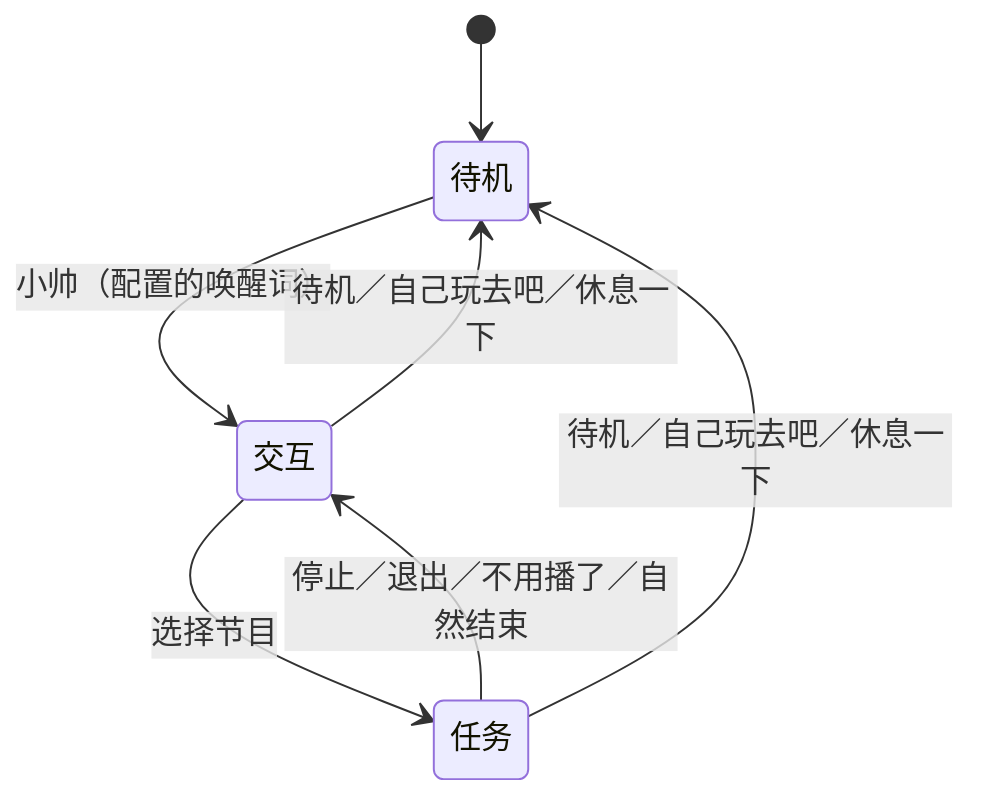

# P1三级状态：待机、交互、任务

## 1. 状态定义

原来的P1是语音节目管理器，“等待用户选节目”与后来丰富的“互动待机”混在一起。现在两者合并为交互态，并恢复真正待机。LLM不参与当前状态转换、表情时序或运动线程。

| 状态 | 摄像头 | 头部行为 | 语音行为 |
|---|---|---|---|
| ①待机 | 关闭采集并释放设备 | 回中后自然低频眨眼；不跟踪人脸，不做眼颈追随 | 管理器持续采音，等唤醒词 |
| ②交互 | 开启 | 持续微笑回应、自然眨眼、眼颈协同；约4～7秒注视后短暂移开视线，再平滑恢复 | 接受固定身份／能力问答和节目选择 |
| ③任务 | 按节目需要开启 | 白骨夫人／魏总剧本：预录表情与音频、眼颈跟随，无现场表情回应；表情跟随：实时模仿与眼颈跟随 | 持续采音，可随时取消或进入待机 |

P1正常运行期间只有一个麦克风／ASR进程，切换子任务不重启它。Ctrl+C退出整个管理器并释放麦克风。设备／识别故障仍按既有停止策略退出，不为了保持运行而忽略故障。

多脸场景沿用最大人脸选择，并不表示已识别或绑定唤醒者身份。

当前固定问答仅覆盖“你是谁”“你能帮我做什么”“有哪些节目”等；节目有白骨夫人、魏总剧本表演（wz2）和表情跟随。角色扮演、前台、文旅接待尚未实现，也未启用开放式LLM对话。

## 2. 转换规则



- 待机时普通节目名和问话不激活机器人。唤醒词可单独说，也可说“小帅，你是谁”“小帅，播放白骨夫人”。同句唤醒并选节目会直接准备所选任务，避免无用的中间重复回中。
- “停止、退出、不用播了、不用学了”等结束任务，回交互态；交互态仍可继续看人、回应微笑及听指令。
- “待机、自己玩、自己玩去吧、休息一下”等从交互／任务直接回真正待机，摄像头随后关闭。
- 支持末尾“吧、呀、哈、哟、啊、哦”等语气词及连续组合，允许礼貌称呼。否定句、转述和讨论命令含义不会仅凭包含关键词而执行。
- 节目正常结束自动回交互。待机／交互的单个运动会话到时则留在原状态，不自动启动歌曲。
- 切换请求按最新有效指令执行，先结束旧控制子进程并释放相机／串口，再启动下一实例；麦克风属于外层管理器，保持运行。

完整语音的近义表达仍以配置和规则覆盖为限，不宣称具备通用语义理解。停止与待机的区别依赖实际ASR结果，现场误识别须保留原始假设和路由日志分析。

## 3. 启动与测试

```bash
cd /home/james/project/Vivis-delivery
.venv/bin/python -m vivis.interaction.programs dialogue \
  --robot configs/robots/xiaoshuai/robot.json
```

等待“麦克风已就绪”。默认①待机，摄像头预览服务不启动；没有启动欢迎长句。按顺序测试：

1. 不唤醒，直接说“播放白骨夫人”或“你是谁”：保持①，无相机跟随。
2. 说“小帅”：准备②；自检／回中及视觉服务就绪后回答“在呢，你说！”。相机预览`http://127.0.0.1:8765/`可用。
3. 说“你是谁”“你能帮我做什么”：保持②，男声回答。对着相机微笑、移动，观察回应与短暂移开视线。
4. 说“播放白骨夫人”：进入③；说“停止吧”或“不用播了呀”：回②。再启动并完整播放，确认自然结束也回②。
5. 说“播放魏总剧本”：进入③，使用wz2静态表情及原音频；完整播放后自动回②。两份预录节目都不实时运行A2F、不叠加微笑回应。
6. 说“开始表情跟随”：观察模仿；说“不用学了”回②。
7. 在②说“自己玩去吧”，在③说“待机哟”：都回①，预览服务退出、脸部回中后仅低频眨眼。
8. 再说“小帅”重新进入②；确认麦克风无需重启。

短提示期间保留回声／轮次抑制，停止和待机口令优先处理。持续采音不等于已完成任意双讲下的开放式全双工验收；先等短提示结束再做节目选择，后续另测回声消除与打断。

只验证语音路由、不驱动机器头：

```bash
.venv/bin/python -m vivis.interaction.programs dialogue --listen-only --seconds 90
```

纯离线模拟，不打开设备或模型：

```bash
.venv/bin/python -m vivis.interaction.programs dialogue \
  --simulate-text 小帅 --simulate-text 你是谁 \
  --simulate-text 播放白骨夫人 --simulate-text 不用播了呀 \
  --simulate-text 自己玩去吧
```

独立视觉调试入口为`programs interaction`，独立真正待机入口为`programs standby`；两者本身不监听语音。持续麦克风与三级切换由`dialogue`入口负责。

## 4. 预录节目与实时交互的边界

白骨夫人沿用小帅已验证的静态舵机目标、原音频；wz2沿用原表情素材与音频，按小帅的标定和限位离线换算目标，不使用墨甲的舵机目标。源JSON和音频不改写，增益保持默认1.0；小帅wz2的真机表现仍需本轮现场确认。程序复用三个开发者示例的回中、播放与眼颈控制流程，保留音频回声参考、语音取消与停止保持扭矩。

②已实时生成视觉回应及眼颈动作，但身份／菜单回答目前仍为缓存男声提示，**尚无A2F同步口型**，目前增加可选在线DeepSeek／Qwen聊天文字接口，默认关闭；本地Qwen控制候选尚未通过，默认不执行点播。普通问答的任意回复还没有实时TTS，不能称为完整的LLM语音对话。详见[主路识别与语义旁路](P1_ASR_AND_SEMANTICS_20261108.md)。后续在②迭代“语音理解→内容生成→TTS→实时A2F”；角色扮演、前台及文旅接待由该链路扩展。③预录节目不依赖这条实时链路。可在制作阶段用LLM、TTS、A2F生成并挑选素材，运行时只回放选定版本。

独立播放预录节目（不启用语音管理器）：

```bash
.venv/bin/python -m vivis.interaction.programs baigufuren --robot configs/robots/xiaoshuai/robot.json
.venv/bin/python -m vivis.interaction.programs wz2 --robot configs/robots/xiaoshuai/robot.json
```

`programs singing`保留为实时A2F诊断入口，不在当前P1节目单中。

## 5. 配置、日志与保护

- `configs/interaction/standby.json`：①的低频眨眼，视觉关闭。
- `configs/interaction/interaction.json`：②的0.50持续微笑、眼颈跟随及注意力节律。注视时段4～7秒、移开0.7～1.2秒是工程起点，不是人类生理标准。
- `conversation.json`：可选在线聊天提供方、超时及有限历史，只有文字输出；密钥从环境读取。
- `semantic.json`：本地Qwen开发候选、默认关闭且禁止自动点播；本体身份读取选定robot.json，本地停止／待机不经过LLM。
- `p1.json`：外层会话时长及两种行为配置引用。唤醒词默认取本体`identity.display_name`，也可用`p1.json`的`wake_words`列表覆盖；有效列表会传给同一个ASR实例。
- `programs.json`：节目、结束任务短语、真正待机短语。两份预录节目`kind=prerecorded`且`realtime_response=false`，交互的笑容不会叠加到节目上。节目二为魏总剧本，节目三为表情跟随。
- 眼颈拓扑、相机安装、标定、运行参数、限位及保护只从`configs/robots/<robot>/`取值。原自检、慢速回中、舌／颌恢复顺序和停止保持扭矩逻辑保留。

交互态的视线移开是明确的动作意图，保持相机和编码器观测；期间眼球做小幅侧下方曲线，颈部以既有轨迹约束减速保持，再从连续运动状态恢复跟随。不伪造“无人”、不改原始人脸坐标、不停止发位置指令来冒充自然视线。

`outputs/runtime/program_status.json`记录`mode`、`desired_mode`、`phase`、`microphone_active`、`wake_words`及自检结果。`mode`对应当前子进程，`desired_mode`对应最新请求，切换中两者可以短暂不同。每个会话目录保留有效配置、子进程日志、准备／播放与表情统计；这些是软件及目标记录，不能替代现场皮肤动作验收。

2026-11-07更新：冷启动保持60计数/秒回中，已有会话就绪后的正常切换暂用120，按本体速度及启动恢复要求裁剪。小帅独立侧倾使用相机剩余倾角的速度控制，细节与验收见[本轮现场反馈复盘](P1_USER_FEEDBACK_20261107.md)。
