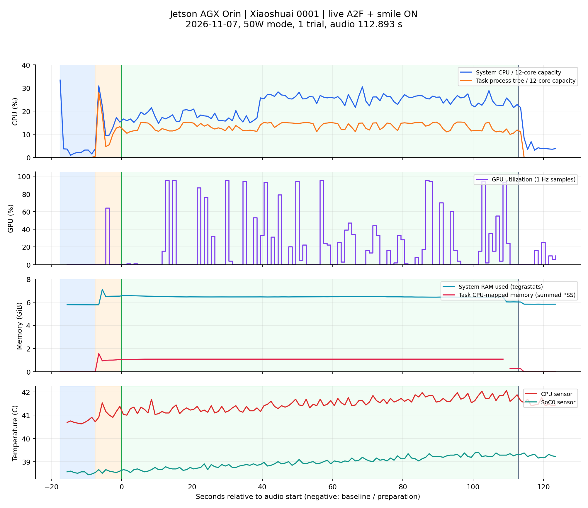

# Orin作品1实时A2F＋微笑回应资源实测报告（第二轮）

测试时间：2026-11-07 17:16:32—17:18:53（北京时间）。软件基线：`2b3626dfe6c8`，分支`feat/multimodal-p1`；与上一轮使用相同的只读采样工具；控制程序、素材、标定、运动参数、A2F模型引用及推理二进制哈希核对一致，运行配置快照也完全一致。

原始数据批次：`outputs/resource_bench/20261107_171632_smile_on_repeat/`。本轮在上一轮配置不变的前提下，增加现场用户主动微笑。

## 1. 结论与覆盖范围

小帅真机完整播放作品1《白骨夫人》一遍，音频112.893秒。Orin本地实时A2F生成6774帧，未读取旧表情JSON；A2F供帧断流计数为0，程序正常结束。正式播放阶段整机CPU平均22.65%、采样峰值30.48%；GPU平均19.65%、采样峰值95.00%；系统已用内存平均6.45 GiB，交换分区使用0。

本轮平均CPU和内存仍有余量，未观察到A2F供帧不足。GPU存在短时高负载，不能据均值估算可并发节目数，也不能据本轮推断长时间稳定性或真机口型精度。

`--smile on`已开启Face Landmarker微笑识别。整段视觉服务处理1633帧，全部检测到人脸，其中826帧得到有效微笑检测结果。**本轮微笑回应已实际触发：374个控制采样周期记录了回应，控制侧包络峰值0.9996，融合目标最大增量约191.0计数。**这些周期不是374次独立微笑事件，也不直接等于持续秒数；完整回应时段以原始包时间戳为准。回应目标增量是同一时刻“有微笑融合”与“仅歌曲映射”的差值，不是编码器误差或实测皮肤位移。眼球与独立三轴颈部跟随均开启；没有运行语音节目管理器、ASR、TTS、LLM或模型训练。

视觉输出日志中有6段非零回应包络，按相邻检测包时间估计累计约5.29秒；这受视觉采样间隔影响，不等于控制侧或皮肤实际持续时长，时段详见`analysis/smile_segments.json`。

## 2. 测试环境与执行链路

| 项目 | 本次条件 |
|---|---|
| 主机 | NVIDIA Jetson AGX Orin Developer Kit；12核Cortex-A78AE；可见内存61.40 GiB |
| 系统 | Ubuntu24.04.5 LTS；aarch64；L4T R39 revision2.1 |
| 推理环境 | TensorRT10.16.2.10；CUDA runtime13.2.86；GPU驱动595.78；本机已构建A2F模型 |
| 电源与时钟 | `MODE_50W`；保持现有动态频率，未锁频、未切换电源模式；50W为模式名称，不是实测功耗 |
| 机器头 | 小帅；30轴自检通过；按当前配置排除ID9、24，不驱动未映射ID29；标准缓慢回中后播放 |
| 控制 | 音频DAC时钟；60Hz目标控制；串口1Mbps；11个口部轴按既有配置900计数/秒 |
| 输入/输出 | A2F输入已分离且采样对齐的人声`inference_vocals.wav`；音箱播放原始混音`audio.wav`；均16kHz单声道 |
| 源信号增益 | 张嘴、圆唇及其他口部源通道均1.0；社交微笑增量0.30，按既有控制权规则融合 |
| 视觉 | 眉心固定相机；640×480、请求30fps；YuNet检测宽320、目标20Hz；Face Landmarker微笑检测；本机预览服务开启 |
| 日志 | 精简控制日志，未启用`--capture-animation`逐帧原始动画记录；视觉/A2F预热与回中并行 |

链路：对齐人声 → 本地A2F推理/求解 → 通道映射与标定 → 合并微笑及眼颈目标 → 60Hz串口控制；混音由音频时钟同步播放。A2F运行日志中的总墙钟时间包含队列背压等等待，**不能把其`real_time_factor`直接解释成纯推理耗时比**。

## 3. 测量方法与阶段结果

使用`tegrastats --interval 1000`采样GPU、系统RAM、交换分区和温度；同时每秒读取`/proc/stat`、`/proc/meminfo`及任务进程树的CPU计数、`smaps_rollup`内存。进程树覆盖控制程序、原生A2F与视觉服务；后台系统进程只计入整机指标。

开始前采集约10秒空闲基线，应用退出后继续约10秒，共142条采样记录。正式播放边界由保留的音频时间戳与单调时钟对应关系估计，时钟偏移范围3.84毫秒；统计剔除跨阶段的1秒CPU计数区间。GPU读数取距采样时刻不超过1.5秒的有效值，**所列峰值均为采样最大值，不能代表捕获了全部瞬态尖峰**。

CPU百分比统一以12核总容量为100%。进程CPU另以“核”表示，1核=一个CPU核心满负荷；原始进程百分比可超过100%。系统RAM使用tegrastats口径；任务内存采用进程PSS之和，避免直接相加RSS重复统计共享页。PSS只归属CPU可映射内存，不等于全部GPU分配。Orin是共享内存架构，`nvidia-smi`未提供独立显存容量，不能将任务PSS和系统RAM相加，也不能把二者差值当作GPU显存。

| 阶段 | 持续时间 | 有效CPU采样数 | 整机CPU均值/峰值 | GPU均值/峰值 | 系统RAM均值/峰值GiB |
|---|---:|---:|---:|---:|---:|
| 空闲基线 | 10.00秒 | 9 | 2.46% / 3.69% | 0.00% / 0.00% | 5.78 / 5.79 |
| 应用准备至音频起点 | 7.50秒 | 7 | 16.76% / 30.87% | 9.14% / 64.00% | 6.49 / 7.10 |
| 正式完整播放 | 112.90秒 | 112 | 22.65% / 30.48% | 19.65% / 95.00% | 6.45 / 6.57 |
| 退出后观察 | 10.00秒 | 9 | 4.01% / 6.79% | 7.44% / 25.00% | 5.83 / 5.83 |

应用启动到退出共121.43秒；正式播放结束后的清理约1.03秒，没有满足跨阶段剔除规则的完整采样区间，未单列统计。阶段是先后关系，不是独立压力测试；模型首次窗口就绪为1.818秒，仍须等待自检、回中及音频准备完成。

正式播放的进一步统计：

| 指标 | 平均 | P95 | 采样最大值 |
|---|---:|---:|---:|
| 整机CPU | 22.65% | 27.28% | 30.48% |
| 任务进程树CPU | 1.60核 | 1.82核 | 1.83核 |
| GPU | 19.65% | 94.00% | 95.00% |
| 系统已用RAM | 6.45 GiB | 6.53 GiB | 6.57 GiB |
| 任务进程树PSS | 1.07 GiB | 1.09 GiB | 1.09 GiB |
| CPU温度 | 41.49°C | 41.90°C | 42.06°C |
| SoC0温度 | 38.99°C | 39.34°C | 39.41°C |

正式播放时系统可用内存最低54.11 GiB；相比空闲基线，系统已用RAM均值增加约0.67 GiB。系统RAM和`MemAvailable`计算含义不同，不能直接互补；本次没有隔离后台桌面服务或清空文件缓存。

| 正式播放进程类别 | CPU均值/峰值（核） | PSS均值/峰值（GiB） |
|---|---:|---:|
| 原生A2F推理/求解 | 0.08 / 0.10 | 0.790 / 0.812 |
| 视觉检测/微笑识别/预览服务 | 0.94 / 1.15 | 0.171 / 0.172 |
| 目标映射/协调/串口/音频控制 | 0.58 / 0.63 | 0.106 / 0.106 |

按正式播放窗口求均值，包含各子进程提前完成、退出后的0值。峰值不必同时出现，不能简单相加。全程有1个进程采样在创建/退出边界未能读取PSS，整段内存统计只使用完整PSS样本；正式播放窗口PSS样本111条。采样器自身累计CPU约11.19秒，折合全程约0.079核，未计入任务进程树，包含在整机CPU中；tegrastats自身开销未另行分离。



图中蓝色背景为空闲基线，橙色为准备，绿色为正式播放；横轴0为音频开始。GPU为间歇性推理负载，采样值常为0但峰值较高。**不能将0读数解释为GPU未参与计算。**

## 4. 同步与运行质量

- 应用返回码0；播放完成标志为真；实际音频时钟结束于112.895727秒，完整音频目标112.893375秒。
- 实时生成6774帧，非法权重0；A2F供帧断流0次。没有以旧表情JSON代替实时推理。
- 摄像头实际处理频率约13.59Hz，单帧处理耗时中位数31.79毫秒；主机观测帧龄P95为206.79毫秒。相机请求30fps、检测目标20Hz不等于这些实测值；帧龄也不是人脸运动到皮肤动作的端到端延迟。
- 控制日志累计6774次控制迭代；`skipped_source_frames=655`记录名义时间格点跨越，实时源按音频时间插值取样，不能把此计数直接当作A2F丢帧率。精简日志只保留最后600条控制事件，未据此宣称全程每帧均严格满足16.67毫秒。
- 总线累计42582次读取请求，338次失败（0.794%）；统计覆盖同一总线会话中的准备与播放，不等于播放阶段独立错误率。本轮未触发停播保护；仍不能将已有坏包归因于CPU/GPU，也没有证明通信完全无误。
- 本轮微笑回应增量始终保持0.30，没有调高增益或改变触发阈值。回应记录为374个控制采样周期，融合目标相对歌曲原目标的最大变化为191.03计数；皮肤实际运动幅度仍由现场观察评估。

## 5. 与上一轮对比及0.30强度说明

两轮软件基线、素材、标定、运行配置快照、采样工具和统计方法相同，均保持50W模式及动态时钟。上一轮未主动微笑，本轮现场主动微笑；这是两次不同现场场景的观察对比，不是隔离全部变量的性能实验。

| 正式播放指标 | 上一轮16:49 | 本轮17:16 |
|---|---:|---:|
| 整机CPU平均 | 18.61% | 22.65% |
| 任务进程树CPU平均 | 1.72核 | 1.60核 |
| GPU平均 | 11.08% | 19.65% |
| GPU采样峰值 | 98.00% | 95.00% |
| 系统已用RAM平均 | 6.38 GiB | 6.45 GiB |
| 任务PSS峰值 | 1.09 GiB | 1.09 GiB |
| A2F生成帧数 / 断流计数 | 6774 / 0 | 6774 / 0 |
| 微笑回应控制采样周期 | 0 | 374 |

本轮整机CPU与GPU平均值升高，但任务进程树CPU平均值并未相应升高。桌面及后台负载、动态频率、用户姿态与视觉有效率、GPU突发负载被1秒采样捕获的时机均未隔离，因此不能将两轮差值全部归因于微笑回应；也不能据GPU均值推断并发容量。

0.30是社交表情通道的叠加增量，不表示电机全行程的30%。本轮包络峰值接近1，所以该增量确实接近完整施加；最终舵机变化还经过标定、表情融合、资源控制权和限位处理。运行日志记录的非零轴增量如下；各轴峰值不一定同时发生：

| 舵机ID | 微笑融合目标最大变化绝对值（计数） |
|---|---:|
| 6 | 46.41 |
| 11 | 180.83 |
| 12 | 138.55 |
| 21 | 59.63 |
| 26 | 191.03 |
| 27 | 135.85 |

这些数值说明当前0.30已生成了明显非零的目标变化；是否微笑看起来偏弱，应由现场皮肤动作评价，本轮没有改动强度、速度或标定来扩大表现。

## 6. 复测与资料

直接运行相同功能（请先退出占用串口/相机的其他节目）：

```bash
.venv/bin/python -m vivis.interaction.programs singing \
  --robot configs/robots/xiaoshuai/robot.json \
  --work 0001 --repeat 1 --smile on \
  --compact-logs --overlap-warmup
```

带资源记录的复测（显式执行真机动作，目录需为新目录）：

```bash
BENCH="outputs/resource_bench/$(date +%Y%m%d_%H%M%S)_smile_on"
.venv/bin/python tools/profile_runtime_resources.py \
  --output "$BENCH/capture" --baseline 10 --tail 10 --timeout 240 -- \
  .venv/bin/python -m vivis.interaction.programs singing \
  --robot configs/robots/xiaoshuai/robot.json \
  --work 0001 --repeat 1 --smile on \
  --compact-logs --overlap-warmup --output "$BENCH/performance"
```

原始采样为`capture/samples.jsonl`，GPU/RAM原始日志为`capture/tegrastats.log`，阶段事件为`capture/events.jsonl`，程序输出为`capture/application.log`；运行结果位于`performance/`。`analysis/resources.csv`是全部采样，`analysis/processes.csv`为逐进程记录，`analysis/summary.json`含分阶段指标和口径。统计与曲线复用上一轮相同的`analyze.py`，不参与真机控制；结论文字已按本轮实际日志重新编写，复核以原始数据和本轮`REPORT.md`/`REPORT.html`为准。

本报告仅为该软件基线、该功耗模式、该作品及一次现场场景下的测量。本轮确认了微笑识别与回应目标生成；未单独量化皮肤微笑效果，也未做并发容量、长时间热稳定性或ASR/TTS/LLM全链路压力测试。Orin资源余量不直接等同于皮肤口型表现。
