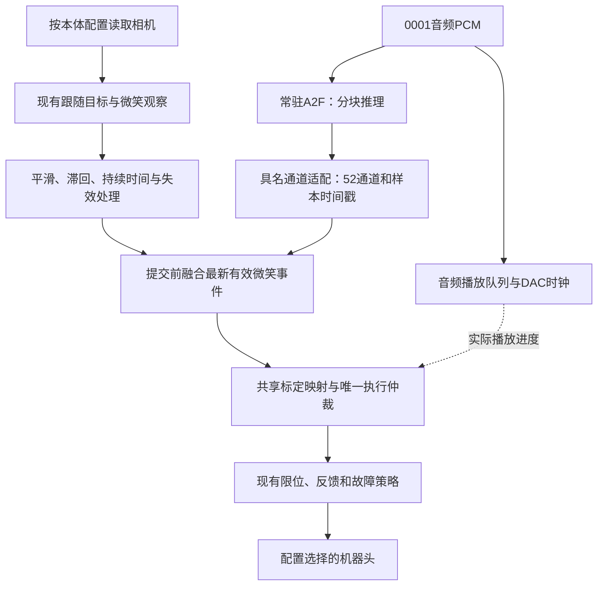

# 多模态交互与社交表达技术方案－开发日志

## 1. 范围与已确认原则

起始日期：2026-11-06；更新至2026-11-10。依据：《机电仿生头_多模态交互与社交表达技术方案_V1.2》。原方案保留不变，本文记录补充约定、执行进度和验证证据，不将待实现能力写成已验收能力。

原方案文件 SHA256：`77f6585f1e361feb921de6c576e386583e729700fe44597274ffcb0fd3c5d008`。

1. 优先验证 Jetson AGX Orin 本地 A2F。首次使用作品0001的音频，不读取既有表情JSON或舵机目标轨迹作为实时口型输入。
2. P0只包含预备歌曲、现场相机、运行时A2F、微笑回应、音画同步和当前人工标定执行链路；麦克风、ASR、LLM、TTS不属于P0前置条件。歌词提示可选。
3. 感知、事件、通道适配、融合、音频时钟和执行实现共用。更换机器头时，通过独立本体配置选择标定、EEPROM限位核验、轴清单、型号、相机安装方式、运动拓扑和必要参数；示例程序不硬编码本体名称或舵机ID。
4. 小帅使用33个实体舵机（ID2～34）、眉心固定相机和独立的左右／俯仰／侧倾颈部。墨甲的35轴、眼部随动相机和并联颈部是另一套配置，不能直接套用。
5. 保留现有已验收的示例播放方式及回退入口。P0开发分支为`feat/multimodal-p0`，起点为小帅分支提交`e14f90a`；模型试验与现有播放器依赖隔离，不直接替换系统CUDA或驱动。

## 2. P0数据链路与验收边界



运行帧需明确通道语义版本、`playback_id`、帧序号、音频样本位置、采样率和52项权重。推理16kHz音频与声卡48kHz音频必须按时长／样本率显式转换；不能混用样本编号。取消播放后，旧实例的帧不能重新生效。

MediaPipe的52项输出与项目52通道不按数组位置直接互换：其默认列表包含`_neutral`，不包含项目的`TongueOut`。P0从具名双侧微笑系数提取事件，不把用户整张脸逐帧复制给机器人。多脸时，微笑必须属于当前跟随对象。

小帅微笑和圆唇存在舵机共享，例如当前标定中左微笑与圆唇共享ID10/15，右微笑与圆唇共享ID15/25；ID31另有已配置的JawOpen规则。只保持口型通道数值不变，不足以证明最终口型不受影响；必须对比融合后的映射目标和真机效果。保留当前组合语义，不在集成过程中悄悄切换为另一种归一化算法。

| 步骤 | 检查内容 | 通过依据 |
| --- | --- | --- |
| P0.0 | 本地SDK、模型、CUDA／TensorRT和具名Blendshape求解 | 有限音频窗口实际生成有限、带时标的具名系数；仅创建TensorRT对象不算通过 |
| P0.1 | 音频分块生成口型，与播放并发 | 不依赖旧动画；首窗就绪后启动；整曲没有持续队列积压，欠载可计数、可回退 |
| P0.2 | 当前交流对象的稳定微笑与失效处理 | 不同微笑时刻产生不同社交帧，无笑、丢脸或过期观察能淡出 |
| P0.3 | 口型＋微笑＋眼颈跟随联合执行 | 沿用本体配置和唯一写入者；比较闭唇、圆口和前突是否被明显削弱 |
| P0.4 | 性能、带声音真机录像和回归 | 区分冷启动／热态、排队／推理／求解时间；记录欠载、同步偏差及主观效果；统计和原始音视频写盘按需开启 |

整曲离线推理或预先导出完整新JSON只能作为诊断步骤，不能当作P0流式实时验收。首次可用混音排查链路；若能取得与0001严格同源、样本对齐的干人声，再单独比较口型质量，不自动替换播放音频。

## 3. 2026-11-06准备检查

以下为本机实测，不代表A2F或P0已经通过。

| 项目 | 结果及限制 |
| --- | --- |
| Orin系统 | Ubuntu24.04.5、ARM64、Python3.12.3；约61GiB系统内存 |
| GPU软件 | 驱动595.78、CUDA Toolkit13.2.2、TensorRT10.16.2.10；系统Python可导入TensorRT并创建Builder |
| 当前播放环境 | 独立`.venv`已有播放器、视觉和轨迹依赖；未安装A2F模型及微笑检测模型。系统Python中的TensorRT不等于播放器虚拟环境已安装TensorRT |
| 离线基线 | `tools/check_delivery.sh`通过299项测试；小帅01／02／03三个示例的`--check`均通过；不打开运动硬件 |
| 小帅只读核验 | 用户确认上电后，33轴共1188次读取；型号与EEPROM限位均匹配，无状态报警，位置指令发送数0。上电前ID2超时单独保留，不能混入上电后的统计 |
| 摄像头 | 640×480请求30FPS；8秒窗口处理109帧，无摄像头错误；处理P50约37.39ms、主机帧龄P95约107.75ms。此次未检测到人脸，不代表完成跟随或微笑验收 |
| USB音频 | USB2.0 Device与DOV均支持48kHz、16位PCM；8秒双输入＋USB2.0静音输出无缓冲溢出／欠载；未保存原始录音。静音输出不证明音箱实际发声质量 |
| 麦克风 | 用户说明只接了一个独立USB麦克风，大概率是DOV；其两路采样RMS约−85dBFS，采集开关已开启。需要现场讲话确认设备和有效收音，不能据此判定设备坏了或要求更换 |

本地详细证据保存在被Git忽略的`outputs/development/p0_readiness_20261106/`。不把现场设备路径及测量材料变成另一份运行配置。

## 4. A2F模型与部署资料

服务器工程用于恢复已验证的模型版本、推理配置和Blendshape求解配置，不意味着Orin运行时依赖4090。若本地可恢复相同SDK源码，不需要再次搬运整个工程。建议优先取得模型原始文件、配置及来源记录，再在Orin重建依赖和TensorRT引擎。

旧工程的锁定记录为SDK提交`1ca0f02535ed774f5dbcd724a31cd486368dc783`；v3.0模型清单记录仓库`nvidia/Audio2Face-3D-v3.0`、修订`b74132732fd9a9d29b237bec193ded64c9745e91`。这些是工程清单记录，尚需与服务器实际使用文件核对。

需要保留的模型资料包括原始`network.onnx`、`model*.json`、`model_data*.npz`、`network_info.json`、`trt_info.json`、`bs_skin*`／`bs_tongue*`求解数据与配置、相关情绪数据、模型说明及许可证。最终所需文件由入口配置的引用闭包确定，不靠文件扩展名猜测后随意删除。若服务器已修改配置，还需取得对应版本。

RTX4090上构建的可执行程序、`.so`、虚拟环境和TensorRT引擎不能默认直接给ARM64 Orin使用；优先搬运可重建的源码、原始模型和配置。SDK默认预编译依赖存在x86_64平台限定，需要核验ARM64源码构建。当前官方README的CUDA／Python范围与本机不同，这是部署验证项，尚不是本地推理不可能的结论。

### 4.1 已完成的本地GPU计算检查

在隔离诊断脚本中，使用系统Python、CUDA13.2和TensorRT10.16.2.10完成一个`y=x+1`网络的构建、序列化、反序列化、设备内存绑定、GPU执行及结果核对。Orin实际计算能力为8.7，测试输入`[0,0.25,-0.5,2]`得到`[1,1.25,0.5,3]`，校验通过。

该最小网络构建耗时约3.24秒，不能作为A2F模型构建／推理延迟指标，也不能证明A2F已经可用。详细脚本、结果及日志位于`outputs/development/p0_local_a2f_20261106/gpu_probe.*`。

已经从官方仓库取得与旧工程记录相同的SDK提交`1ca0f02535ed774f5dbcd724a31cd486368dc783`；原始SDK源码保持不变，单独使用ARM64构建入口和原生依赖，不运行其硬编码`linux-x86_64`的默认依赖下载脚本。ARM64／SM87的CMake配置已通过。

SDK已经完成ARM64／SM87原生构建，并成功创建CPU／GPU Blendshape求解器。适配范围包括：CUDA13的CCCL类型兼容（将两个返回值声明改为`auto`），以及tbtSVD主机浮点模式的ARM64适配。原SDK检出内容不改；构建副本及第三方许可位于`native/a2f/`。64组SVD重构测试通过，最大相对误差约`4.82e-6`，FPCR均恢复到调用前状态。

Orin专用单路TensorRT引擎已重新构建；首次试验构建约54.28秒，大小727167796字节，未使用4090引擎。

### 4.2 服务器模型传输

经只读核实及用户纠正，服务器工程根目录是`ubuntu@192.168.110.109:/home/ubuntu/project`；其下`xiaobai/`是舵机控制资料子目录。Git提交为`281576f`，SDK提交与锁定记录一致。用户在自己的终端完成专用SSH公钥安装；私钥仅保留在Orin的`~/.ssh/`，不进入仓库。读取和传输显式指定专用密钥，不修改服务器工程，不保存密码。

已取得`assets/models/a2f-v3.0/`的原始模型，以及`assets/audio/vocals_v3.0.wav`；模型排除`.trt`等平台产物后共24个文件、约741.14MiB，全部匹配旧清单的Git对象／LFS哈希。模型、干人声和现有0001播放音频共26项还与服务器逐项核对SHA256，无不一致。混音与干声均为1806294个16kHz单声道样本；仅样本数量相同不能独立证明相位对齐，本轮真机使用同一份0001混音作为推理及播放来源。

原始拷贝保存在`incoming/a2f/`，保持Git忽略。通过`tools/setup_p0.py`准备本机可重建的`outputs/a2f/`依赖、模型和引擎。工程源码、虚拟环境及4090引擎均未从服务器搬作本机运行产物。

### 4.3 本地A2F分块实测

| 输入 | 结果 | 限制 |
| --- | --- | --- |
| 0001前8秒混音，250ms分块 | 480帧；输入关闭前465帧；首帧约0.253秒；推理及求解约1.056秒，RTF约0.132 | 未接声卡和舵机的非限速诊断 |
| 完整0001混音112.893375秒 | 6774帧；输入关闭前6735帧；首帧约0.223秒；推理及求解约10.342秒，RTF约0.0916；所有系数有限 | 未测云端；此数据不代表音画偏差或全链路P95 |

SDK原生结果含52个皮肤通道及16个额外舌部通道。本版明确按名称将皮肤52通道适配到项目52通道顺序，不能直接复制数组索引；额外舌部通道不自动混入项目接口。原生模型仓库名称为v3.0，内部`network_info.json`版本字段为3.2，与服务器文件完全一致，不是本次悄悄换模型。

### 4.4 P0运行入口与资源控制

- `src/vivis/interaction/`：A2F适配、有界队列、微笑事件、社交融合和节目入口。
- `configs/interaction/p0.json`：共用的节目参数和模型引用，舵机参数仍只取本体配置。
- `native/a2f/`：固定版本依赖、原生分块推理入口和平台适配。
- `tools/setup_p0.py`：显式准备可选依赖，不修改系统包、驱动、相机或舵机。视觉使用独立环境；安装时清除继承的ROS `PYTHONPATH`，不把ROS包冻结进依赖。

依赖准备命令（现有Orin已完成）：

```bash
cd /home/james/project/Vivis-delivery
/usr/bin/python3 tools/setup_p0.py --model-source incoming/a2f/a2f-v3.0
```

当前P0命令：

```bash
.venv/bin/python -m vivis.interaction.singing \
  --robot configs/robots/xiaoshuai/robot.json \
  --work 0001 --repeat 1 --capture-animation
```

`--check`只检查配置及缺失依赖，不打开运动硬件；`--smile off`供无社交融合对照；`--smile-strength`可作单次社交增量对照（11月6日默认0.15；11月7日已按第7.7节改为0.30）；`--capture-animation`显式开启有界异步动画记录，平时可省略。

原生进程通过管道产帧，Python队列最多180帧，预备120帧后进入原有准备／回中流程；管道背压限制预计算，不预制整曲动画再播放。声卡DAC时钟取最新适用帧，过期帧丢弃而不补播；欠载最多有界保持0.2秒，超过即取消。逐帧动画写盘默认关闭，开启后不阻塞控制线程。

社交层只增加具名微笑通道，幅度有上限；共享的下颌、闭唇、圆口和前突目标按当前标定推导资源保护集合。眼球及颈部仍由唯一跟随控制器接管。保护集合按标定推导，不新增固定舵机编号表。

### 4.5 联合执行发现与修复

1. 首次运行只发送34帧，约0.56秒后触发反馈看门狗；运行时仅完成6次反馈读取，多轴没有轮到读取。逐帧重新遍历标定占用了控制余量。将同一映射规则预编译，保留原通道加法顺序、中性值、显式零位移成员、条件归一化、眼睑及JawOpen规则，未改变表达算法。保存了两台本体32组组合方式的修改前指纹，另通过小帅旧目标的逐位一致性检查。实时映射P95约0.72ms。
2. 第二次已完成187次反馈读取，但ID5／6各一次坏包后，启动检查及声卡缓冲消耗了首次复查窗口。利用原有DAC预热空窗读取并校验真实完整反馈；不伪造新鲜度，不延长1秒看门狗。新增测试覆盖播放前反馈记录和停止／限位路径。
3. EEPROM、速度、加速度、PID、设备保护及传感器连续确认门槛均未为此次修复放宽。

第三次真机日志为`outputs/p0/20261106_190605_758586/`：

| 项目 | 实测 |
| --- | --- |
| 完整播放 | 成功，结束音频时间112.897秒；提交6774次位置目标 |
| A2F供帧 | 6774帧；欠载0；Python队列上限180，实测未超限 |
| 预热反馈 | 276次读取、69组完整样本；首个音频控制时最旧有效反馈约0.138秒 |
| 总线反馈 | 覆盖全部32个任务轴；39167次读取、156次失败，约0.3983%，包含准备及播放阶段；全曲未触发看门狗 |
| 社交事件 | 最大包络约0.9996；629帧包络超过0.1，1197帧融合权重发生变化 |
| 现场反馈 | 用户确认口型正常；微笑回应不明显，尚未完成微笑效果验收 |

按时钟丢弃的过期A2F帧为563帧；这与供帧欠载不同，不应把“提交6774次目标”说成“6774个不同源帧全部送到硬件”。编码器日志也不能替代皮肤实拍来判断表情幅度。

随后仅离线比较了0.15与0.30社交增量；0.30尚未真机播放或固定为默认值。用户提出先增加表情跟随节目，故暂停追加唱歌对照，保留当前已跑通版本。

## 5. 下一步

1. 优先准备独立的表情跟随节目，验证感知系数、左右语义、标定幅度和真机表现；用户已确认第一版仅面部＋眼睑，眼球和颈部保持原位。
2. 根据表情跟随结果区分感知幅度、映射及机构问题，再回到P0微笑强度与组合效果验收。
3. 用带声音的真机录像继续评估口型同步；尚未给出客观音画偏差数值，不把主观正常等同于已满足量化指标。
4. P0通过后再做P1麦克风的人声、距离、噪声和自播串音测试。现有设备暂没有需要采购替换的证据；AEC和双讲未验收。

## 6. 新节目：表情跟随（用户于2026-11-06提出）

用户要求机器人实时跟随用户表情，并与互动唱歌作为可切换的节目。建议先完成这一独立验证链路，再继续P0表现调优；P0已完成的本地A2F和实时播放不撤回。

Face Landmarker同时提供关键点和Blendshape系数。第一版拟以具名系数进入统一52通道，关键点辅助检测、诊断和稳定性判断；不把用户图像中的绝对关键点坐标直接变成舵机位置。当前MouthSmile检测已在P0中运行过，新增节目用于进一步验证全通道和本体映射，而不是重复部署另一套检测器。

两个节目复用感知、通道适配、标定映射、反馈和唯一串口写入者。互动唱歌使用DAC时钟，表情跟随使用实时控制时钟，不需要A2F、音频播放或麦克风。节目切换先撤销旧来源与队列、保持安全姿态和颈部扭矩，再按新节目准备流程接管；禁止两个节目并行写串口。

用户已确认第一版仅面部与眼睑，眼球和颈部保持原位；这些保持轴不发送位置或使能指令。首轮实现、实测与用户反馈见6.1、6.2、6.4；基础功能成功，幅度与响应尚有优化空间。

阶段回归：P0及映射修复后的完整离线交付检查通过315项测试；已做全新克隆安装检查。表情跟随开发将继承该基线，继续区分离线验证与现场效果反馈。

### 6.1 实现与使用

表情跟随在`feat/expression-follow`分支上开发，继承已提交的P0基线`e7b83ea`，没有撤销实时A2F成果。操作教程见[实时表情跟随](EXPRESSION_FOLLOW.md)。

```bash
# 第一次准备可选视觉环境；不依赖A2F模型或音频
python3 tools/setup_face_landmarker.py

# 只做离线检查
.venv/bin/python -m vivis.interaction.programs expression-follow --check

# 小帅：面部＋眼睑，持续60秒
.venv/bin/python -m vivis.interaction.programs expression-follow \
  --robot configs/robots/xiaoshuai/robot.json --seconds 60
```

共用Face Landmarker的环境、模型URL和SHA256只存于`configs/perception/face_landmarker.json`，互动唱歌也引用它。感知模块从唱歌节目抽到`vision/landmarks.py`；相机进程不连接舵机。节目独有的增益、镜像、轻量滤波及丢失释放参数位于`configs/interaction/expression_follow.json`，本体硬件参数仍只取各机器人配置。

MediaPipe的52项为`_neutral`加51个具名系数；按名称转为项目52表情，不把数组索引当作语义。`_neutral`不驱动舵机，缺少的`TongueOut`明确为零。系数增益默认1.0，滤波常数60ms，无歌曲、A2F或麦克风。使用单调时钟复用现有受约束发送、分步反馈及保护，不建立第二套串口控制算法。

小帅只准备、回中、监测和控制25个面部轴，包含眼睑；眼球7/8/22/23、颈32/33/34和无映射29不接管。Mojia也按同一程序推导本体范围，但没有在本次做Mojia真机验证。程序间共用控制锁，退出后才能启动另一节目；停止时不突然回中或卸载颈部。

### 6.2 人脸选择与首次实测

初检8秒检测到3～4张脸，原单人门控没有输出有效表情，这不能据此认定模型失效。表情节目改为在现有最大面积人脸的ROI内运行Face Landmarker；互动唱歌的社交触发仍保留单人条件，不将多人的微笑混入社交回应。它不是身份跟踪，现场应让操作者的脸成为最大、完整且清晰的人脸。

用户到相机前后，完成一次60秒面部＋眼睑真机测试，日志`outputs/expression_follow/first_onsite_20261106/`：

| 项目 | 实测结果 |
| --- | --- |
| 执行 | 完整结束，单调时钟60.0003秒，3600次控制目标提交 |
| 控制端有效观测 | 636帧；109次无效观测被拒绝或进入保持／释放，不能将其均记作通信坏包 |
| 感知输出 | 有效帧包含478关键点和52项具名系数；最大UDP包约2740字节，小于接收上限4096字节 |
| 系数峰值 | JawOpen约0.985；左右微笑约0.804／0.878；MouthPucker约0.997；左右闭眼约0.901／0.828；不是皮肤位移测量 |
| 总线读取 | 29195次、失败272次，约0.9317%；覆盖全部25轴，未触发看门狗或连续故障停止 |
| 电压告警 | 有孤立0x01及低电压样本，后续正常样本复位计数；不能仅凭恢复就断言是传感器或通信误报 |
| 保持轴 | 启动清单、全部发送目标和已捕获串口写入不含眼球与颈部；未改变EEPROM或既有本体参数 |

应用串口追踪有容量上限：准备阶段完整，播放阶段丢弃23278条追踪事件；不能将它称为完整电气总线抓包。发送目标日志包含3600次提交，可用于核对整个任务的轴所有权。

本轮证明了识别、具名适配、标定映射、受约束执行和反馈这条链路可运行。用户后续反馈及功能状态见6.4；不能将功能通过等同于闭眼完整性、自然程度和量化延迟全部验收。先保持硬件参数及默认增益，按观察再逐项定位。

### 6.3 离线检查

完整离线交付自检通过327项测试，补充视觉服务特性握手回归后，全新克隆安装及完整自检通过328项测试。覆盖名称语义、缺失吐舌、左右镜像、无效／未来／过期帧、丢失释放、保持轴所有权、控制锁互斥、无音频时钟及原有限位保护。安装和离线检查不打开相机、串口、音频或模型。

### 6.4 用户反馈、复查与阶段结论

用户确认“能跟随，但幅度或速度需要调整”，要求先复查代码与逻辑，未发现问题则标记成功并提供独立入口。复查未发现通道错位、数组索引误用、漏发、保持轴误接管或控制循环卡顿。表情跟随（面部＋眼睑）基础功能标记为成功，幅度与动态响应保留为后续整定项；本轮不改变硬件配置、增益和滤波。

| 层次 | 本轮观察及边界 |
| --- | --- |
| 感知 | 运行期间相机记录745帧，约12.42帧/秒；637帧为有效表情，其中636帧被控制端消费。识别结果帧龄中位181.3ms，P95约214.6ms，不能称为端到端皮肤延迟 |
| 系数 | 默认统一增益1.0；60ms是低通时间常数，不是额外固定等待60ms。闭眼峰值未都达到1.0；高速短眨眼可能被感知采样与滤波削弱 |
| 映射与发送 | 复用原有标定及混合规则；控制提交周期P95约16.75ms、最大约17.04ms，未见循环卡顿。眼睑的目标范围在本轮发送中基本覆盖，不能据此保证皮肤完全闭合 |
| 硬件与动态响应 | 本轮面部轴沿用600计数/秒。按样本开始时间与最近目标粗略对齐，四个眼睑轴编码器跟踪偏差P95约23～29计数；ID10、25分别约84、61计数。它是异步反馈下的动态偏差，不是静态标定误差，也不能替代皮肤测量 |

因此幅度或速度不理想不能直接归因于“小帅执行能力不够”。后续可分别比较持续姿态与短促动作，区分源系数、标定范围、软件滤波／限速及本体动态性能。原始观测和目标／编码器分析保存在`outputs/development/expression_follow_20261106/response_review.json`，未调整参数掩盖问题。

独立反复测试示例（三分钟；可改为60或300秒）：

```bash
cd /home/james/project/Vivis-delivery
.venv/bin/python -m vivis.interaction.programs expression-follow \
  --robot configs/robots/xiaoshuai/robot.json --seconds 180
```

保持相机前单个主要操作者；监控`http://127.0.0.1:8765/`，`Ctrl+C`退出。各次均先执行面部轴独立准备及回中，不与唱歌或其他示例并行运行。

### 6.5 可选的表情＋眼球＋颈部联合跟随

用户随后要求在可复用、不过度复杂的前提下加入眼球与颈部跟随。新增`--tracking on`，默认`off`保留原纯表情功能，不改本体配置文件。

```bash
.venv/bin/python -m vivis.interaction.programs expression-follow \
  --robot configs/robots/xiaoshuai/robot.json \
  --tracking on --seconds 180
```

1. Face Landmarker仍只生成面部与眼睑目标；不让其EyeLook系数争夺眼球控制权。
2. 共用同一个相机、最大面积人脸结果、接收器、预览写入器和串口控制循环。既有`MojiaPlaybackGaze`负责眼球与颈部，小帅根据本体配置使用独立俯仰／侧倾，复用Ruckig参考层；没有新增跟踪算法或复制机构解算。
3. 小帅联合模式只准备和控制32轴，不接管无映射的29。面部与眼睑的目标与纯表情模式保持逐值一致；新增的7个眼颈轴由原有位置控制器覆盖中性占位目标，最终目标仍通过共用范围及速度检查。
4. 沿用小帅的固定眉心相机、180度图像校正、方向、EEPROM范围和速度。眼球横向600／纵向300，颈32／33／34为600／400／300计数/秒，硬件加速度和PID不变。结束前复用平滑回中，提前中断保持安全姿态和扭矩。
5. Mojia遵守其本体配置；不会因为小帅启用了独立三轴跟踪就复制小帅参数或强行开启Mojia并联平台。Mojia本轮仅离线检查，未真机验收。

全量离线交付自检通过332项测试，新增覆盖两本体控制权清单、联合与单独表情目标一致性、可配置的并联结构与保持轴，以及无音频时钟下的单串口联合执行。纯表情的眼睑闭合不足未在此次顺手修改，原因已记入[节目教程](EXPRESSION_FOLLOW.md)第5节。

首次联合真机检查`outputs/expression_follow/joint_onsite_20261106/`完成准备和回中，提交101次目标后，ID23反馈位置18589，超出单圈0～4095；当时发送目标2073、前一次合法反馈2066。原始位置回包`ff ff 17 04 00 9d 48 ff`通过协议校验却数值不合理，不能据此断言是机构真的跳到了该位置，也不能确定是线路、设备或其他反馈异常。既有非法编码器保护停止了程序，没有放宽范围或屏蔽告警。

停止后对ID23、8、32、33、34做12轮只读核验，共240次读取、零失败。ID23始终2073，其余位置也稳定；诊断在串口写入口拒绝任何非READ指令。随后保持相同代码、参数和保护，重新进行一次60秒联合检查。

第二次`outputs/expression_follow/joint_onsite_retry_20261106/`完整结束，3600次控制提交，实际单调时钟60.0003秒，22812次读取、196次失败，约0.8592%。全部32个任务轴有反馈，四个眼球轴与三个颈部轴均有目标变化和编码器响应，没有再次触发非法位置保护：

| 轴 | 目标范围（计数） | 编码器观测范围（计数） |
| --- | --- | --- |
| 眼球7 | 1973～2108 | 1999～2097 |
| 眼球8 | 1823～2238 | 1832～2213 |
| 眼球22 | 1987～2102 | 1999～2092 |
| 眼球23 | 1879～2295 | 1882～2289 |
| 颈32 | 2008～2450 | 2013～2444 |
| 颈33 | 1962～2151 | 1967～2156 |
| 颈34 | 2038～2078 | 2037～2080 |

范围极值发生时刻不一定相同，不能相减当成到位误差。第二次运行证明联合控制链路可执行，不抹去首次异常，也不能替代用户对方向、协调性与皮肤表现的现场验收。默认保留纯表情模式，用户可用`--tracking on`单独复测联合模式。

最终补充旧节目配置不含新开关时仍默认纯表情的兼容回归，独立克隆完整自检通过333项测试。在该克隆中另行安装共享Face Landmarker依赖、下载并校验模型，联合模式离线检查的缺失依赖列表为空；没有依赖旧工作目录内的模型、环境或A2F工程。功能本地提交`6003215`，未推送。

### 6.6 左眼睁开偏小的排查（未调整参数）

用户反馈机器人自身左眼（ID5／6）睁开较小，左右眼不对称；尚未留意回中时是否已不对称，稍后现场确认。本次只审查代码和日志，没有启动动作或修改配置。

最近一次联合运行`outputs/expression_follow/20261106_201110_254974/`约119.9秒后由用户中断，不是功能崩溃。原始观测显示：

| 项目 | 机器人左眼 | 机器人右眼 |
| --- | --- | --- |
| 闭眼系数中位值 | 0.2877 | 0.1270 |
| 瞪大眼系数峰值 | 0.1647 | 0.5076 |
| 上眼睑发送范围 | ID5：1850～2048 | ID20：1986～2296 |
| 下眼睑发送范围 | ID6：2040～2263 | ID21：1808～2119 |
| 运行速度／硬件加速度 | 600／0 | 600／0 |
| PID／正反向死区 | 32／32／0；0／0 | 32／32／0；0／0 |

该次左右闭眼系数差的中位值约0.143；此前三次运行也持续为左高于右，中位差约0.114～0.134。程序按原标定将左侧更高的闭眼信号映射成更多闭合量；左上眼睑最张开的发送目标仅2048，远未到标定及硬件允许的2180。左下眼睑最张开的发送目标2040，也未到当前硬件允许的1966。代码中没有单独削弱左眼增益或降低左眼速度；默认整体增益1.0，左右共用60ms系数滤波与同一发送循环。

另有标定边界差异：左侧EyeWide的原终点ID5＝2180、ID6＝1950，按现有EEPROM实际可发送2180／1966；右侧EyeWide终点ID20＝1900、ID21＝2200均在当前硬限位内。这会限制左下眼睑最大睁开行程，但不能把本轮未到睁眼边界的现象主要归因于这个裁剪。左右舵机计数行程也不等同于相同的皮肤开口。

结论：已经确认识别输入和发送目标存在使左眼偏闭合的不对称，这是需要先处理的因素；尚不能认定全部来自模型偏差或机构能力。日志没有记录用户每一刻预期的对称表情，无法区分真人眼部状态、取景／光照／遮挡和模型偏差。

下一步仅需用户观察回中状态：若中位时已不对称，先核对中位与眼睑安装／皮肤张力；若中位时对称、跟随后才偏小，再采集双眼自然睁开的基准，评估视觉系数零点校准，保留完整闭眼端点。不能只降低左眼闭眼增益而忽略此前闭合不完整的问题。原始统计与配置读回记录见`outputs/development/expression_tracking_20261106/left_eye_opening_review.json`。

### 6.7 表情跟随阶段收尾

用户要求回中后观察，既有32轴回中流程成功完成；随后手动调整眼睑／皮肤，反馈左右眼“基本差不多”。本轮不添加单侧视觉补偿，不改眼睑增益、标定或速度。表情跟随的面部／眼睑及可选眼颈联合功能按用户反馈作为当前可用成果；原先一次异常编码器回包和动态闭合不足仍保留记录，不能据此声称已解决全部机械或通信问题。

代码复查发现明确的中断分类问题：原入口只把完整字符串`Operator stop`当作正常退出，控制循环中的`Operator stop during scheduled feedback`等会显示成故障。统一取消判定，仍保留故障与操作中断的区别；不屏蔽舵机或反馈异常。另将唱歌入口的结束状态发布放在释放控制锁之前，避免旧实例晚写状态覆盖新实例。

## 7. P1：本地语音选择、退出和待机

### 7.1 本轮需求与交付边界

在`feat/multimodal-p1`实现，继续使用小帅独立本体配置。用户最终取消魏总朗诵节目；当前菜单只有白骨夫人和表情跟随，历史wz2素材仍保留。后续诗人角色、前台、导游和开放闲聊不在此次实现范围。

1. 白骨夫人仍由运行时音频→A2F产生口型，沿用P0视觉微笑回应与既有眼颈跟踪，**不读取旧表情JSON**。
2. 表情跟随复用已验证的面部／眼睑、眼球与独立三轴颈部控制，不新增表情映射算法。
3. 明确说“停止、结束、退出、不用学了、待机、休息一下、自己玩一会儿”等最终识别结果后，取消当前实例，按原有60计数/秒上限准备、回中，进入低频眨眼／偶尔小幅左右看的待机。待机不开相机、不持续追踪路人；自然结束也进入待机。
4. 原V1.2后续阶段中的“播放中语音退出”按用户要求提前纳入P1：引入最小的本地回声参考、语音分段和整句识别。不能把此项代码接入当作一般全双工自然对话已经验收。

运行、安装和逐项验收步骤集中在[P1测试方法](P1_TEST.md)。本轮机器头关机后没有打开串口或执行动作；仅按用户授权采集短麦克风录音，其余均为离线测试。

### 7.2 分层与唯一配置来源

```text
DOV麦克风 → 时标对齐／SpeexDSP回声处理 → WebRTC语音分段
                                              ↓
                   中文流式Zipformer＋SenseVoice整句候选
                                              ↓
                  明确节目／退出意图 → P1节目管理器
                                              ↓
             白骨夫人／表情跟随／无相机待机（串行交接）
                                              ↓
                     共用启动、回中、单串口控制与反馈

实际音箱PCM与DAC时标 ───────────────→ 回声参考
```

| 内容 | 唯一来源 |
| --- | --- |
| 两个节目、选择与待机别名 | `configs/interaction/programs.json` |
| 管理器、取消超时、节目时长、日志模式 | `configs/interaction/p1.json` |
| 待机节律与小幅动作 | `configs/interaction/standby.json` |
| 麦克风、识别、分段、回声、提示音路径 | `configs/perception/speech.json` |
| 舵机型号、标定、速度、启动与设备保护 | `configs/robots/xiaoshuai/`，沿用既有配置 |
| 可选语音资产的上游版本及逐文件摘要 | `native/speech/sources.json`，许可说明见同目录`NOTICE.md` |

初版菜单提示由MeloTTS预生成，现按第7.7节改为Kokoro中文男声；播放时不请求网络，也暂不为这些短提示驱动A2F口型，歌曲本身仍使用运行时A2F。语音模型安装到独立环境，不改变主运动环境。全部后端在本机运行；默认不保存持续麦克风PCM，不把现场录音或模型权重提交到Git。

每个子节目有独立实例和取消文件，先等待旧进程退出、关闭视觉及推理资源，再启动新实例；旧帧不转给新实例。管理器使用独立单实例锁，子节目沿用控制锁；不另开串口读取线程。退出超时只清理本管理器创建的进程组，转故障保持，不强行自动恢复运动。`Ctrl+C`退出整个管理器；语音“退出”只退出当前节目、保留待机。

音频退出使用40ms淡出；该数值不含识别、分段、声卡既有缓冲和回中时间。全局`outputs/STOP`及硬件异常仍立即走原有停止处理。舵机保护、位置边界、通信看门狗、硬限位、PID和既有运行速度均未放宽。待机也复用本体启动参数核验和有界回中，而不是依赖上个节目的SRAM残留值。

默认节目日志保留必要反馈／告警／计数和最近600次控制提交，待机同样有界；需要完整节目控制记录时用`--diagnostics on`。不能把截断后的近期数据当作完整歌曲轨迹。程序状态与识别／切换事件另有持续记录，便于分析语音结束、声停、准备及回中耗时。

### 7.3 录音与离线证据，及尚未通过的部分

12.04秒DOV采音没有溢出，平均约−33.9dBFS、峰值约−12.4dBFS，48kHz双通道重复同一信号，取第0通道转换为16kHz处理。另一USB2.0 Device输入没有识别出可用人声，当前不选作麦克风。首句采集开始太晚，只录到“夫人”，不能用它判断完整节目名的识别能力。

早期小模型在真人录音中大量误识别，已经换为较大的中文流式模型，再加整句识别与候选核对。当前这份短录音能识别“开始表情跟随”“退出吧”，但要求说的“停止”“结束”仍曾识别成“零点”“演肃”，“不用学了”在不同解码方式间也不稳定。**这些词不作为别名写入，不用错误转录掩盖识别问题；P1现场语音验收仍未通过。** 用户暂不需要逐条录制或训练命令；下一步等“麦克风已就绪”后，在实际使用距离逐句复测，尤其检查音乐播放中的退出。

合成20秒歌曲回声测试，包含40／75ms延迟的线性多径，测得约29.1dB抑制；加入合成“停止”的测试约29.3dB。处理后的纯回声没有路由出节目动作，加入短句的样本识别并路由为待机。DAC／ADC对齐回归另覆盖包边界及约200ppm采样时钟差。以上只证明指定合成条件下的处理链有效，不能替代房间、真实音箱和麦克风的双讲测量。

完整离线交付自检通过355项测试。回归覆盖最终文本去重及过期拒绝、否定与歧义、菜单剔除wz2、实例取消、串行控制权交接、正常退出与硬件异常区分、淡出与紧急停止区别、有界日志、无相机待机范围及节律、回声参考时标和取消时的参考截断；提示音资源关闭失败时，仍须完成运动子进程清理。完整真机流程、低频待机的观感、语音误唤醒率以及双讲成功率均留待用户现场验收，不据离线测试提前宣称成功。

原始录音、识别结果、合成回声样本和回归日志保存在已忽略的`outputs/development/p1_20261106/`；交付文档保留结论和限制，不携带用户录音。

最终模型离线复测的7条独立TTS短句（停止、结束、退出、休息一下、自己玩一会儿、开始表情跟随、播放白骨夫人）均路由到预期意图；其中歌曲名由两个完整候选核对后选中正确名称。相同代码下真人录音仍有前述错误，不能把合成语音成功率替换成现场成功率。另补充“我不想退出”等否定句的候选一致性回归，防止第二候选丢掉否定词后执行相反动作。

独立Git克隆也通过355项完整离线检查，Python可编辑安装路径指向该克隆自身。可选语音环境在克隆中单独创建和安装；模型使用本地已下载缓存，仍由安装脚本按固定上游摘要重新校验，不依赖原开发目录的运行环境。此项验证不等于重新下载模型，也不等于已为第二台Orin构建A2F引擎。

### 7.4 2026-11-07首次P1现场启动：串口权限修复

用户启动后听到欢迎语、看到“准备：待机”，随后待机子进程退出。日志`outputs/p1/20261107_100931_455486/0001_standby.log`确认是打开串口前的`Serial device access denied`，未到设备读取、参数写入或回中阶段。语音“谁→未匹配”与这次子节目故障是两个独立问题，不能据此认为语音触发了停机。

只读系统检查发现串口为`root:dialout`、模式0660，用户james既不在组内，也没有设备ACL。已有本机udev规则仅匹配旧转接器序列号`5B79076878`，当前转接器序列号为`5B79033147`，因此旧规则未授权此次设备。将james加入dialout作为后续登录的持久授权，并为本次设备补充james读写ACL，当前访问检查已通过；没有打开串口或启动动作。新增组在注销重登后生效，临时ACL不代替长期组权限。

软件修复：提取并复用驱动已有的串口存在性／权限检查，在完整P1管理器启动麦克风、欢迎语和待机子进程之前执行，直接显示具体错误及授权命令；实际驱动打开时仍再次检查，保留热插拔竞态下的原有错误处理。离线检查、纯语音和文本模拟继续无需串口；不绕过设备权限，不改动作或设备保护。新增回归确认权限不足时不会启动麦克风、提示音或运动进程。本次未自动重启用户仍在运行的故障管理器，也未宣称完成待机真机验收。

本次完整离线交付自检通过356项测试，权限专项23项通过；实际串口仅做存在性、ACL和读写权限查询，没有打开设备。新登录身份的组清单已包含dialout。

### 7.5 同日重试：ID24未使能位置超出启动恢复范围

权限修复后的实例`outputs/p1/20261107_101341_310694/`已成功打开串口，并读取32个任务轴的启动快照。随后发现ID24位置2120，EEPROM限位1600～2030，初始扭矩关闭；现有ID24启动恢复仅允许超限20计数，实际超出90计数，因此在参数恢复、使能和全轴回中之前退出，所有轴均未开始动作。管理器保持fault；日志中两次“表情跟随”确实识别为select，因当前故障没有启动新实例，而不是表情跟随控制器已运行但不动。

只读复核ID24三次均为2120、扭矩0、负载0、温度22°C、电压原始值59、状态寄存器0；108次读取零失败。诊断在串口发送入口拒绝全部非READ指令，实际只发送指令0x02，没有使能、位置、参数或EEPROM写入。该证据不能单独证明机构没有干涉，也不能把一次稳定越限描述为通讯坏包。

未修改活动配置或放宽播放边界。准备了仅供审阅的ID24启动恢复方案：禁用扭矩时，经现有两次稳定读数确认，允许启动偏离最多100计数，以不超过60计数/秒回到既定2030，恢复超时5秒；进入硬限位后继续原有正常检查。EEPROM1600～2030、回中2030、表情中性换算2047及其他轴均保持。方案暂存在已忽略的`outputs/development/p1_20261107/id24_homing_proposal.json`及同名diff，尚未启用；须先由现场确认ID24机构无卡滞／拉扯并同意这次恢复，不能套用先前仅20计数的授权。

### 7.6 颧骨ID9／24暂时排除，并明确报告准备结果

用户明确两轴颧骨硬件待优化，要求暂时过滤指令。采用小帅`robot.json`中的`excluded_actuator_ids=[9,24]`作为唯一配置；含义是不向这两轴发送指令，不是发送位置0。此前ID24扩大启动恢复范围的提案未启用，不执行单轴恢复，也不修改EEPROM和标定。

共用Robot解析器把排除配置应用到运行电机清单、口部速度及增益分组、启动参数清单和各模式回中清单；实时映射忽略被排除轴，预录目标在验证素材哈希、维度与来源后只选择未排除的原列。其余轴的数值、通道融合及帧时序保持不变，未知且未明确排除的轴仍报错；执行前再次拒绝排除轴混入控制清单。两轴也不参与任务反馈轮询或自检，不把未检查记为健康。原始素材和标定仍含对应数据，可供硬件修复后另行启用。

三种示例实际准备23／27／30轴。自然待机、实时A2F歌曲、纯表情及联合跟随均复用该配置；墨甲没有此排除配置，行为保持。现场旧管理器已退出，本轮未主动启动机器头。

每遍准备增加`SELF-CHECK START/PASS/FAIL/CANCELLED`，与参数设置、回中阶段分别记录；仅在原有只读检查和启动参数计划验证全部完成后报告自检通过。后续写入或回中失败不会抹去已完成的自检，也不会伪称整次准备成功。P1转发子节目自检／回中消息到用户终端，并把最新自检状态写入`program_status.json`；快速退出的失败子进程也保留其报告。故障状态下识别出节目会明确提示“未执行”，不自动解除故障或抢占控制权。

离线验证覆盖：源目标的其余列逐值一致；四类实时模式和三种示例均排除9／24；模拟实际启动的读取、参数写入、使能、回中和播放目标均不触达两轴；自检失败时没有位置／使能写入；自检通过而回中失败的阶段区别；快速失败子进程的信息传递及后续节目拒绝。原有型号、行程、传感器和通信保护保持，真机运行仍由用户手动验收。

本工作目录完整离线交付自检通过360项测试；运动核心专项53项通过。没有以扩大ID24恢复范围来放行启动，也没有实机播放来替代排除范围检查。

### 7.7 用户确认基础切换成功后的衔接、口型和提示音整定

用户确认两个节目及待机可切换，表情跟随基本成功；反馈切换等待较长，唱歌时微笑回应偏弱、口型不完整，系统提示女声且音量偏小。作为P1状态机基础现场验收记录，不能据此宣称播放中各种声学条件下的退出成功率均已验证。本节修改后仍待下一次现场对照。

#### 7.7.1 切换耗时与回中顺序

从成功实例`outputs/p1/20261107_103707_607693/events.jsonl`统计，下列时间从最终指令识别／取消请求开始，不是从用户开口开始：

| 切换 | 旧实例退出 | 新实例准备到开始 | 总时间 |
| --- | --- | --- | --- |
| 待机→表情跟随 | 约0.18秒 | 约6.91秒 | 约7.10秒 |
| 表情跟随→白骨夫人 | 约0.94秒 | 约15.43秒 | 约16.37秒 |
| 表情跟随→待机 | 约0.88秒 | 约5.33秒 | 约6.20秒 |

首次待机实际回中约7.14秒；待机后转表情跟随回中约1.15秒；从跟随姿态转唱歌回中约6.45秒。差异来自当前偏离中位的最大轴行程，不是固定等待常数。视觉启动及A2F首段准备又占约4～7秒，原流程在模型就绪后才开始自检和回中，串行相加形成明显空档。

P1新增`overlap_warmup=true`，仅控制节目准备调度：新实例先启动不具备舵机写入能力的视觉／A2F工作进程，在其预热期间执行原有自检、参数核验和回中。只在回中、所需模型及新鲜目标全部就绪后进入跟随／歌曲；不提前发送节目帧，不复用上一实例动画。准备期间仍检查取消、视觉子进程存活及A2F错误；异常走原有停止保持策略。待机仍不开相机。

保持60计数/秒回中上限及原五次平滑曲线，不压缩物理运动时间、不跳过任何读回核验，也不加入突然归零或目标死区。需要对照时把P1开关改为false，返回原串行准备；独立调用节目入口的默认顺序保持，管理器通过显式准备选项开启并行。`WARMUP START/READY`与原自检／回中信息一同转发到终端。

本机离线实际GPU探测在约1.804秒得到A2F首段120帧，产生30轴有限目标；未打开头部串口、相机或音箱。这个测量证明新信号配置下推理链仍可运行，不是现场切换缩短后的测量，也不是整曲推理耗时。最终衔接是否更自然、是否减少等待，需要用户再运行验证。

#### 7.7.2 微笑及口部限制的核对

原歌曲完整执行112.893秒音频、6774次控制提交，无动画欠载。视觉记录1932条，其中微笑分数最高约0.704、回应包络最高1.0，53条回应强度高于0.01：微笑曾被识别和触发，不能简单归因于检测完全失败。原社交增量0.15偏小，本轮改为0.30，触发门槛、维持／冷却、平滑包络和口型优先保持。

原P1实时A2F并未接入预录示例的圆唇1.2参数，口部和圆唇源系数实际均为1.0。现在`p0.json`明确口部通道1.2、圆唇通道1.2；对原始系数分别生效，圆唇覆盖其通道倍率，不得到1.44。处理只发生在运行时，不改上游音频／JSON／标定；眼睑、眉毛和独立表情跟随的增益保持。系数仍裁剪到0～1，再经既有标定及条件归一化，故源系数增加20%不等于所有舵机行程必然增加20%。这是可复用的节目配置，选择同一P0场景的其他本体也使用该信号设置；各本体硬件参数仍各自独立，原三个预录示例不使用这组P0源增益。

从实际启动快照、回中后的速度恢复读回及原播放配置核对：

| 小帅有效口部轴 | 硬件运行速度 | 加速度寄存器原始值 | 歌曲阶段软件限制 |
| --- | --- | --- | --- |
| 10、13、15、25、28、30、31 | 均600计数/秒 | 均0 | 原`lips-direct`直接发送映射目标；不做软件速度裁剪 |
| 11、12、26、27 | 均600计数/秒 | 均0 | 共用位置指令变化率仍限制为600计数/秒 |

没有额外口部软件加速度层，也没有把0换算为某个未经确认的物理加速度。ID9／24仍排除。上述硬件速度本轮不改，便于先观察1.2增益及0.30回应的影响；例如目标只维持0.1秒时，600计数/秒理论只能走60计数，尚未考虑加减速，因此增大增益不保证短促动作更到位。若继续存在动态跟踪不足，下一步应单独比较速度，而不是不断叠加放大或增加闭嘴补偿算法。

终端`TUNING`会打印生效的口部／圆唇／微笑设置；动画汇总新增首段准备时间、源增益、回应周期数、包络峰值和实际映射目标的社交增量峰值。它们区分触发、软件目标变化和皮肤到位，不把源权重或发送成功当成机械表现已通过。

#### 7.7.3 中文男声及提示音响度

改为Kokoro v1.1中文男声58（`zm_009`），模型固定提交`423bfb9ccd6a66115a76602a9630ffea265ae176`，9个资产逐文件校验后用于本地生成，包内保留Apache-2.0许可。说话人编号依据[官方声音表](https://k2-fsa.github.io/sherpa/onnx/tts/all/Chinese-English/kokoro-multi-lang-v1_1.html)，不是把旧女声简单降调。

准备阶段使用独立语音环境的pyloudnorm／BS.1770测量，并在必要时用现有SoX做动态压缩，再按歌曲响度目标与−1 dBTP峰值上限归一化缓存；运行时只播放WAV，不加载TTS模型，不改系统音箱档位。Jetson精简FFmpeg缺少所需滤镜，未将其引入最终方案；探查时新增的FFmpeg已移除，受其覆盖的原开发包按原版本恢复，记录留在本地诊断目录。

| 本地文件测量 | 综合响度 | 比歌曲低 |
| --- | --- | --- |
| 原白骨夫人音频 | 约−11.61 LUFS | 参照 |
| 男声欢迎语 | 约−15.89 LUFS | 约4.28 LU |
| 男声菜单 | 约−16.50 LUFS | 约4.89 LU |
| 男声身份介绍 | 约−16.16 LUFS | 约4.54 LU |

配置目标为低3 LU，受峰值边界约束，主要提示实际低约4～5 LU；四倍过采样估计峰值均约−1 dBTP，没有用硬削波强行达到目标。实测声压、音箱频响和听感仍需现场反馈。歌曲文件原字节不变。

缓存包含声音、模型摘要、文本、处理版本、参考音频摘要和响度报告；音色或音量配置不同，管理器拒绝旧缓存，需重跑`tools/setup_p1.py`。处理WAV与元数据原子替换，避免半成品被播放器读取。新依赖仅在独立语音环境及离线提示音准备中使用，不改变运动主环境。

完整离线自检通过367项测试，涵盖增益不叠乘、保护下颌时提高有效微笑轴、推理预热与回中顺序、未就绪时不播放、预热故障停止，以及旧音色缓存拒绝。原始分析和实测报告位于`outputs/development/p1_20261107/refinements/`。本轮未发真机动作、未播放扬声器，下一步由用户重新启动管理器对照衔接、微笑、口型和男声响度。

### 7.8 口部默认速度600→900，以及软件速度限制的来源

用户明确要求当前有效11个口部轴硬件运行速度改为900，并询问四轴的软件600限制来源。本轮仅修改小帅`hardware.json`中ID10、11、12、13、15、25、26、27、28、30、31的`max_speed_counts_s`，从600变为900。加速度原始值0、限位、PID、眼颈／眼睑速度、回中60、排除9／24及上游增益均保持。重启节目后仍由原准备流程暂以低速回中，完成后写入并读回核验SRAM46＝900；本轮不独立写舵机或自动播放。

软件变化率限制不是另一份硬编码的600。`runtime/playback.py`从同一电机配置生成`speed_limits`；`motion/mapping.py:limit_step`按上一条已发送目标计算：

```text
本次发送位置 = 上次发送位置 + clip(本次映射目标 - 上次发送位置, -速度上限×dt, +速度上限×dt)
```

在60Hz且周期恰为1/60秒时，600对应每帧最多约10计数，900对应约15计数。硬件速度约束实际电机运动；这里约束下发目标的移动速度，两者使用不同的起点状态，所以同值双重限制仍可能增加跟踪滞后，不保证与仅硬件限速等效。它是速度限制，不是此前移除的64计数/秒²软件加速度层。

历史代码追溯显示，2026-10-27的`6d09537`把加速度规划交给舵机SRAM，但保留该通用位置变化率限制；2026-10-28的`502c7ec`引入圆唇直接发送对照，随后加入下颌。当前直接组由标定中Funnel/Pucker/JawOpen的参与轴决定，在小帅为7轴，未进入该组的11／12／26／27就继续走通用限制，并不是另行针对这四轴制定600。

原设计目的是减小目标跳变，是历史播放器的工程防护策略；没有查到针对这四轴的专门动态响应实验、最优数值整定或要求该层的舵机协议依据。协议并不要求上游必须再限一次位置变化率。其适用性应以目标保真、指令误差和编码器动态响应对照评价，而不能仅因历史存在就称为必需。

本轮四轴软件上限随唯一配置同步升为900，不会遗留600；七轴直接模式仍由硬件900执行。没有扩大直接发送组或改变限制算法，以便用户单独观察提速的结果。

### 7.9 取消剩余四轴的节目软件速度裁剪

用户确认四轴没有单独实测整定依据，要求取消它们的软件限速。小帅11个有效口部轴（10、11、12、13、15、25、26、27、28、30、31）在歌曲／表情跟随执行阶段统一直接发送当前映射目标；待机和三个开发示例使用同一本体默认。ID11、12、26、27不再经过额外的逐帧位置变化量裁剪。原始表情素材、标定和映射算法均未修改，不增加闭嘴补偿或时序算法。

本体`robot.json`设置`defaults.mouth_command_mode=lips-direct`和`defaults.direct_mouth_scope=all`；通用实现按当前有效口部标定推导清单，不在节目或控制循环硬编码四轴。保留原命令参数名，旧的小帅`lips-direct`指令自动使用全部11轴；不传参也如此。墨甲默认直接发送范围仍为原圆唇及下颌组，未改变。显式`limited`仍可用于日后离线／现场对照。

硬件速度900、加速度原始值0保持；本轮未写入任何设备。准备／低速回中和初始接近仍限制速度。位置边界、控制权检查、反馈保护、排除ID9／24、眼睑和眼颈轨迹，以及口部／圆唇／微笑增益保持。直接下发表示目标不再被二次限速，不代表编码器或皮肤瞬间到达目标。

离线回归覆盖四轴快速换向时下发目标与映射目标一致、硬件900参数仍传递、眼睑仍限速、初始接近仍渐进、非法分组拒绝，以及P1三个状态和三个示例的共同配置。完整交付检查及独立克隆检查结果见本轮验证记录；本轮不启动真机，现场效果待用户重启管理器观察。

### 7.10 白骨夫人口型与微笑回应复查：固定资源归属及按音频时刻取样

用户现场确认：节目与待机的切换等待显著缩短且较平顺，系统已使用男声且响度明显增大。新问题是白骨夫人中的微笑回应仍不明显，口型失真并有颤抖。用户随后关闭机器头，授权继续离线检查与自测；本轮未启动运动、相机、麦克风或扬声器。暂不进一步整合本体配置，修复继续位于共用上游实现。

**现场证据及复现边界。** 最新完整歌曲实例为`outputs/p1/20261107_120452_599653/0003_baigufuren/`：6774帧生成完成，无动画欠载，未因传感器保护或通信故障停播；读取42655次，其中失败162次，约0.380%，不能称为通信零错误；微笑实际参与351个控制周期，回应包络峰值约0.9997，映射目标社交增量峰值约191计数。这说明不能直接把无明显皮肤回应解释为检测没有触发。原始A2F帧未开启完整记录，播放明细仅保留末600次事件，不能据此重建整首歌的皮肤或编码器运动。

本轮对同一音频重新执行离线A2F推理，并叠加上述现场微笑时序，对同一组新生成帧比较修复前后算法。它是算法复现，不是原现场原始动画的逐帧重建。记录位于`outputs/development/p1_20261107/mouth_review/`。

**修复1：微笑控制权不再随0.01门槛硬切换。** 原实现逐帧检查JawOpen／MouthClose／MouthFunnel／MouthPucker，只要某通道高于0.01就把它关联的整组舵机交还口型；低于门槛又让微笑候选目标进入。同音频复现中，微笑增量本身在ID10／15／25单帧最多跳变约80.65／25.27／52.83计数，源信号与回应包络均连续。这是融合控制权的离散跳变，不是最大速度设置造成的数学现象。

现按整首歌固定预留上述关键口型通道的标定关联资源，微笑不再抢占它们；资源集合从当前本体标定和已选轴推导，不硬编码机器头或舵机清单。修复后，重放中这些轴的社交增量及其跳变均为0，原口型映射目标保持；其他有余量的嘴角轴继续回应。作为通用社交表情定义，`p0.json`新增CheekSquintLeft／Right，与既有MouthSmileLeft／Right共同响应，增量仍为0.30。小帅已排除颧骨9／24，眼角回应会使用仍有效的标定轴；重放中ID6／21的社交目标增量峰值约46.43／59.67计数。该数值不是现场眼角位移验收，也不是按这两个ID特判算法。

**修复2：实时动画按DAC音频时刻线性取样。** 原LiveFrames只取当前音频时刻之前的最近一帧并保持；控制周期与动画帧边界不重合时，可能重复旧帧再跳过中间帧。现在使用缓存中相邻帧的音频样本时标，对52项系数线性插值，再进入同一增益／融合／标定流程。原帧时刻的数值保持，帧间过渡按时标计算，不加低通滤波、不加软件速度限制、不移动音频时钟，也不等待推理。没有后继帧时继续使用原有有界保持及欠载处理。原素材和标定文件均未更改。

**尚未消除的物理限制。** 末约10秒的稀疏完整反馈中，每个口部轴只有约17～18个样本；按采样开始时刻匹配此前命令，ID11位置误差绝对值95分位约138计数，ID26约80计数，而ID31约15计数。它们是稀疏指令—编码器差距，不能直接等同皮肤失真或振动频率。离线重推理中，部分原始映射目标单帧变化仍超过900计数/秒在60Hz下约15计数的名义移动距离；本轮不同时改变速度、加速度或源增益。小帅口部900／原始加速度0、11轴直接发送、回中60、位置与反馈保护、眼颈参数均保持。

验证覆盖两种本体的关键口型资源保护、0.01附近无控制权跳变、眼角标定回应、原始映射指纹保持、音频帧间插值与原帧端点、原有欠载停止。另执行同一整首音频的真实GPU／管道／定时取样自测，微笑来自已有观察重放，无真机设备参与。完整离线检查通过373项测试；真实GPU整曲定时重放完成6774帧生成、无动画欠载、无捕获队列丢弃。独立克隆结果见本轮日志。后续真机先观察未微笑时的口型，再在歌唱过程中保持约1秒微笑并观察嘴角及眼角；若仍明显抖动，按测试文档进行微笑关闭／开启对照，区分A2F／硬件响应与社交融合的贡献。

### 7.11 准备失败后的退出及提示语停顿

用户报告实例`outputs/p1/20261107_144644_613814/`：待机准备自检在ID33失败，反馈1539、EEPROM限位1600..2300、初始扭矩0，随后终端仍打印识别结果。日志与准备流程核对确认：没有进入参数恢复、低速回中或节目播放；故障锁存阻止了后续指令。问题在管理器交互：欢迎语仍继续播报，ASR仍监听并打印“未执行”，使人误以为进入了正常后续流程。

现改为子节目准备／运行失败后，中断欢迎／菜单提示，发布故障状态，播报一次故障提示后退出管理器；不接受后续节目切换、不自动回中重试。故障提示有12秒上界，Ctrl+C可取消，播报失败也继续释放ASR、音频与管理器锁，并保留原节目故障信息。传感器和位置检查、硬件参数、恢复边界均未放宽。

已结束上述仅剩监听的旧故障实例。用户自行重新启动的新实例`20261107_145103_350933`中，ID33初始位置为2000，自检30轴全部通过，并完成白骨夫人播放后进入待机。本轮没有改动舵机或擅自停止这个正常实例。1539是否源自断电被动下垂仍须现场确认；未据此授权新的越限恢复。

用户同时反馈播报僵硬、句子之间没有停顿。保留Kokoro中文男声58及现有响度策略，重写欢迎／菜单／澄清／故障提示为较自然的短句，并在离线合成时按标点分句：分句间180ms、句末420ms，段边保留20ms语音余量和5ms淡入淡出。文本、停顿配置及处理版本共同参与缓存校验；旧缓存必须重建。运行时只播放WAV，不增加在线TTS耗时。实际新缓存中停顿区RMS约−79dBFS，证明不只是在文本中增加标点；欢迎语约9.87秒，响度约−16.45LUFS、比歌曲低约4.83LU，真峰值约−1dBTP。主观自然度仍需用户听取。

回归覆盖快速失败子进程只启动一次、不处理后续选择、故障提示及有界／可取消退出、缓存停顿参数失配拒绝，以及分句音频中真实静音间隔。正常节目正在持有控制锁时，主工作区的两个模拟入口测试被锁正确拒绝；完整自检在独立克隆环境完成，不为测试抢占真机控制权。原始记录与测量见`outputs/development/p1_20261107/startup_voice/`。

用户随后反馈实时歌曲口型基本对不上、纯伴奏时嘴仍运动，要求先播放原静态白骨夫人对照。已提供小帅示例3的0001静态命令，并通过`--check`核验；该入口读取原预录表情生成的轨迹，不运行实时A2F／社交微笑。当前实时A2F输入是整首混音，伴奏可能触发口部信号；这一可能性不能替代同步与模型输入的后续核验。先等待用户对静态效果的观察，本轮未进一步修改实时口型或换用旧JSON冒充实时生成。

### 7.12 定位并补回原工程的人声推理音轨

用户静态对照确认：原预录白骨夫人在纯伴奏时大多数不动嘴，即使动／颤抖也幅度很低；实时版本的伴奏驱动口型是主要问题。此前只修改融合／取样，遗漏了两条链路的关键音频输入差异。

检查原工程`benchmark_0001_a2f.py`／`direct_song_v2.py`确认，预录生成使用`assets/audio/vocals_v3.0.wav`分离人声，播放混音`0001.wav`。当前实时入口因作品清单只有播放音频而直接把混音送入A2F。原服务器仍保存人声及对齐报告，本轮通过此前已配置的专用SSH密钥取回原件，不重新分离、不新增模型依赖。播放音频SHA256为`cbd18a1080ce5c1830df8c4e1cbc3cacbcbee37f5075e18ab344549e0a36e3a6`，与当前随包音频一致；人声SHA256为`1a509a4c0db143be649f78384ec22cefcffaa48d7cff3b86e7e573ceeaf85c00`，本机副本与原服务器一致。

两音轨均为16kHz单声道PCM16、1806294样本、112.893375秒。独立执行180..3500Hz带通、2秒窗口、±100ms搜索的互相关核验：全曲16个窗口的最佳时差均为0，其中14个相关系数大于0.5；20秒／60秒两个弱相关窗口不宣称为高置信核验。结果与原工程共同时间起点的报告相符，不截静音、不补偏移，不以“等时长”单独证明同步。

修复为作品清单可声明独立`inference_audio`及其对齐报告／哈希；资源验证和Robot.work共同支持，P1与独立singing按作品默认选择。0001在两台本体上都引用同一份新随包人声供实时A2F，音箱仍播放原混音；其他作品没有独立音轨时保持原行为。声明音轨后缺失、哈希变化、对齐报告不匹配或时间长度不同均拒绝；启动和汇总记录两条实际音频路径。显式CLI覆盖保留作对照，不能将仅时长检查冒充已完成对齐。静态JSON、已有舵机轨迹、标定、设备参数、增益和社交策略均未修改。

同一Orin模型与参数对原混音／恢复人声分别做整首离线推理，均输出6774帧；不加载旧JSON作为推理输入。另读取旧预录系数只作诊断比较：JawOpen与预录的零时差相关系数由0.519升为0.994；Funnel由0.612升为0.978，Pucker由0.615升为0.996，相关峰均为0帧。这说明主要是驱动内容不同，未在该系数对照中发现固定整体时移，不能据此宣称整机DAC／皮肤同步已经验收。

88～104秒这段人声很弱、混音仍较响的区间，JawOpen平均由约0.101降为0.0218，接近旧预录的0.0193；11口部轴目标单帧变化绝对值95分位由约14.12降为3.37计数。仍有小幅模型输出，未加入VAD／音量门控、强制闭嘴或额外滤波。原始结果、音轨与静态系数相关分析位于`outputs/development/p1_20261107/vocal_input/`，真机效果待用户再次观察。

本轮覆盖两台头的相同人声选择、音频对哈希与时长错误拒绝、无独立音轨时回退、显式覆盖报告及离线不打开设备；通过真实入口的模拟确认模型进程收到人声而非播放混音。完整交付自检及独立克隆验证结果见本轮日志。另以人声执行完整112.9秒GPU／管道／定时取样自测，生成并取样6774帧，无动画欠载或捕获队列丢弃；不启用微笑，不访问机器头、相机、麦克风或扬声器。

### 7.13 小帅口型幅度不足的软件链路审计与单次对照

用户确认：改为原工程人声推理后，纯伴奏段口型基本消失，输入修复成功；剩余问题是张嘴／圆口不够饱满，要求忽略硬件原因，主要查软件。因此本轮不读写设备、不修改速度／加速度／限位或标定，只审计最新实例`outputs/p0/20261107_153517_058852`的完整捕获与命令日志。

在6774次控制取样中，11口部轴映射目标到实际下发的最大差为0.499996计数，即整数取整误差，没有遗留逐帧软件速度裁剪。`motion_gain=1.0`、`mouth_motion_gain=1.0`，全部口部轴直接发送；微笑关闭，社交目标增量为0。当前姿态边界裁剪统计也为0，幅度不足不能归于隐藏的总增益、社交抢占或软件位移限幅。

明确的幅度来源如下：JawOpen原始系数95分位0.349，增益1.2后为0.419；Funnel原始0.396、增益后0.475；Pucker原始0.225、增益后0.270。小帅下颌按JawOpen独占，关系为`2047+(1850-2047)*clip(gain*JawOpen,0,1)`，所以张嘴目标位移95分位只有约82.5计数，相对于完整标定197计数约42%；峰值偶尔可到约80%，不代表通常已接近完整标定。

圆口还受当前已接受融合规则影响：只有关联本轴的通道参与权重和，超过1才归一化；强圆唇帧中ID13／28的分母95分位约1.94。圆唇与其他嘴部表情可能抵消，例如ID15的Funnel位移−56、Pucker位移+73，ID30分别−38、+133；ID10／25还共享微笑、抬上唇等不同方向目标。这些是标定与现行混合规则的计算结果，不是误把全部52通道放进分母。本轮不悄悄改为直接叠加、不删通道或强制圆口优先，也不改变标定端点。

在同一批现场捕获系数上离线比较1.5、1.8、2.0等增益。为保持一次实验范围小，新增`--jaw-open-gain`和`--round-lip-gain`单次覆盖，仅调整JawOpen／Funnel／Pucker；其余口部1.2保持。推荐先对照三者绝对1.8：JawOpen系数95分位0.628，目标位移95分位约123.8计数；Funnel／Pucker系数95分位0.712／0.405，多数圆唇关联轴的目标更充分。不是所有轴都同步增加50%，归一化及相反方向贡献仍存在。模型系数达到1的比例约为JawOpen0.37%、Funnel1.90%、Pucker0.13%，没有额外的位置越界裁剪。

源增益也会放大小幅残余：88～104秒弱人声区间，张嘴位移95分位约21.5→32.3计数；11轴目标单帧变化绝对值95分位约3.33→3.41计数。不能把增益增强说成绝无副作用。默认文件仍保持原1.2，先由用户单次观察，再决定是否固化。

实现位于共用语义通道增益函数，JawOpen可由可选`jaw_open_channel_gain`独立设置，无该字段时沿用原`mouth_channel_gain`；圆唇继续使用同一`round_lip_channel_gain`。所有覆盖均为绝对倍率，不与旧倍率叠乘，系数保持0..1，不修改源文件。回归覆盖下颌中间值线性位移、零输入仍回中、完整权重端点、三个通道外的增益不变、配置不被单次指令写回、非法值在打开设备前拒绝。本轮只重放已捕获数据，不重新运行模型或开启真机；完整交付与独立克隆检查见`outputs/development/p1_20261107/mouth_amplitude/`。

### 7.14 1.8增益后的突然张嘴与记录参数说明

用户试播后确认口型变大，但整体不够圆滑、自然，可能突然张嘴；并指出已使用`--smile off`，询问`--capture-animation`含义。已说明：smile off关闭歌曲社交微笑，不关闭眼颈跟踪；capture仅异步记录源／取样／融合系数、音频时标、资源归属与名义目标，不追加表情、不改变目标算法，队列满时丢记录而不等待写盘。

完整实例`outputs/p0/20261107_160203_631332`包含6774次控制取样及对应命令，微笑增量0、动画欠载0、捕获记录丢弃0。控制指令周期中位16.666ms、99分位16.831ms、最大18.280ms；没有控制线程停滞后补发的证据。音频时标步幅约10.85～22.32ms，存在采样时标变化，不能把它与控制周期或源帧序号变化混为一谈。

约69.050947秒的最大张口目标变化可直接由源值解释：插值后原始JawOpen从0.111008升至0.228515，音频时标差21.138ms；在标定下颌位移−197、增益1.8下，对应目标2007.637→1965.969，变化−41.668计数。增益前后均未在此处触及系数上限1，因此这个峰值不是微笑切换、参数记录、系数封顶或新的位移限幅跳变。这里报告的是下发目标变化，不是声称编码器／皮肤完成了同样的瞬时运动。

对同一批捕获源离线重放，JawOpen增益1.2／1.5／1.8时，目标位移95分位约82.55／103.19／123.83计数，单帧变化绝对值最大约27.78／34.72／41.67计数；超过30计数的控制步数分别0／1／12。源信号本来较快的开口被较高线性增益放大，幅度增强与自然度存在取舍。暂未确认需要修改的离散跳变代码缺陷，不添加新的平滑层、不改音频时钟或舵机参数。

建议下一次只将`--jaw-open-gain`从1.8降到1.5，`--round-lip-gain 1.8`保持，继续关闭微笑并记录；这仍比原1.2张嘴目标大约25%，便于一次只比较下颌增益。默认配置继续保持原值，1.8自然度未验收，不能当成最终保存参数。分析脚本及统计存放`outputs/development/p1_20261107/mouth_smoothness/`；本轮未启动真机或再次推理。

### 7.15 软件终审、源增益归一与本阶段结束

用户要求：最后检查软件层／算法是否有明显逻辑错误；没有则结束此项开发，口型问题留待更新标定或完善结构，增益全部使用默认1.0。本轮不继续平滑研发或真机调参。

复核覆盖：原曲／对齐人声及哈希、16kHz样本时标到DAC时刻取样、帧实例与序号、预缓冲／有界队列、插值／欠载、语义通道重排与单次增益、按轴参与关系和超过1才归一化、中位只加一次、独占下颌、面部／眼颈控制权、直接口部目标及整数取整、故障确认和停止／释放。既有离线和现场日志没有显示新增的断粮补发或隐藏口部软件限速。这里是当前路径审查结论，不将未复现等同于形式化证明无任何缺陷，也不把剩余皮肤效果直接归因为硬件。

发现并修复一个独立的明确错误：Xiaoshuai的`singing --mode face --smile off --check`原会报`KeyError: 7`。准备流程正确移除保持不动的眼球轴，但FrameMapper仍按face_eyes作用域访问它们。现按模式统一编译初始清单、校验与实际运行映射的作用域；纯面部用face，并允许未配置相机设备时以unused配置完成无相机计划。两台头的face／eyes／eyes-neck共6种离线入口均核对，无真实设备访问。新增回归确认纯面部不命令眼球／颈部且中性目标正确；眼颈联合播放作用域不变。该分支错误不是此前联合唱歌中口型小或快变的解释。

`configs/interaction/p0.json`的mouth_channel_gain与round_lip_channel_gain由1.2恢复为1.0；JawOpen没有单独配置覆盖，随mouth默认1.0。其他非口部源通道本来为1.0；expression_follow.gain、本体mouth_gain及motion_gain均为1.0。MouthSmileLeft／Right作为源通道也不再额外放大。微笑事件增量smile_strength=0.30是另一种量，不擅自改成1.0；检测门槛和眼颈控制参数不属于本次源增益归一范围。

保留显式单次增益诊断接口，常规命令不传试验值；P1教程撤下1.8的日常推荐，将过程记录留在本日志。A2F原有lower_face_smoothing=0.006和TemporalReg=0.15未调整，没有增加口部低通／jerk规划、静音门控、强制闭嘴或新形变规则。标定、硬件配置、保护和原始媒体没有改变。

完整独立克隆交付检查通过383项测试，结果存于`outputs/development/p1_20261107/final_review/`；源增益和两台头6个模式的无设备核验另存mode_checks.json。本阶段完成审查及离线检查后以本地提交保存并结束。已有用户认可的成果包括节目切换与待机、男声与响度、纯伴奏误动嘴输入修复；剩余口型表现列为后续标定／结构工作，不继续通过多层软件修饰推进。本轮未进行真机动作验收，恢复1.0后的皮肤效果也未声称已验收。


### 7.16 将微笑回应与眼颈跟随移入互动待机

2026-11-07用户确认：歌曲、朗诵及剧本的预设表情已丰富，实时表情回应默认关闭；实时微笑回应应优先在待机中调试，待机也需要眼颈跟随。本轮不恢复口型算法研发，不增加新的朗诵或剧本节目。

待机默认开启单相机视觉服务，同时提供微笑事件和人脸位置。已有SmileGate、FrameMapper及眼颈控制器共同复用，在唯一控制循环里合成目标；相机服务不访问串口。有人时眼颈跟随，人脸消失后按已有逻辑回中，回中后用0.25秒时间常数淡入原有小幅游视；新目标出现时淡出游视，避免其抢占跟随。随机眨眼持续保留。小幅待机偏移是控制意图，不伪造相机或编码器观测；合成目标仍受本体限位与公共运行循环约束。待机偏移不宣称经过了跟踪器的完整jerk规划，其幅度和输出速度仍受现有限制。

微笑增量保持0.30，门槛／持续确认／冷却与原场景相同；社交通道及节律由standby.json配置，眼颈速度／行程／拓扑／相机与反馈保护仍从本体配置加载。待机无语音口型目标，因此FrameMapper显式关闭歌曲关键口型资源保留；默认参数仍保留歌曲原仲裁行为。小帅无微笑源时与原中性目标相同，微笑关联位置不修改标定；并未将任何舵机中位、行程、速度、PID、加速度、温度或扭矩参数改成待机专用值。

P1注册内容通过realtime_response布尔配置显式选择微笑，缺省false；白骨夫人明确false。独立singing默认也off，保留--smile on供显式诊断。该策略不会关闭歌曲眼颈跟踪或表情跟随节目。待机可分别--tracking off和--smile off，两者同时off走原无相机动作；--smile-strength只覆盖本次实例。相机与接收器随子节目退出关闭，控制锁和原自检、回中、停止保持扭矩流程保留。

首轮90秒真机自检／回中／执行完成，控制提交5400次，时间格点跳过0；但画面中大多数帧检测到4～5张脸，旧单脸前提使1376帧里仅64帧允许微笑观测，回应0次。明确原因是场景选择策略，不是增量0.30不够。现待机显式选择face_selection=largest，让微笑和眼颈使用同一个已选中的人脸ROI；歌曲诊断缺省仍是single。没有调低检测分数、持续门槛或冷却，没有引入身份识别，也不宣称已固定跟随某个人的身份。多脸时最大目标可能变化，测试无人回中需确保画面内没有其他脸。

离线验证覆盖两台本体准备／控制清单、待机释放歌曲资源保留、微笑事件过期／非法／无脸淡出、单相机单接收器／单控制循环、无人回中后的游视、P1默认关闭与显式开启、取消和资源释放。最终独立克隆安装与完整交付检查通过393项测试，克隆导入路径核对为自身src/vivis，未依赖原工作目录运行。第二轮小帅120秒真机运行完成，30轴自检／回中通过，提交7200次控制目标、时间格点跳过0，未触发停播；无需音频、A2F或语音管理器。1605帧中1551帧得到有效微笑观测，回应542个控制采样周期，包络峰值约0.99965；目标社交增量最大约191.03计数，其中歌曲保留轴ID10／15／25现在也分别产生约86.07／39.59／56.38计数的增量。它们是目标差，不是编码器／皮肤实测位移。

原始日志在outputs/standby/20261107_175436_selected_face_acceptance/。本轮记录8次眨眼计划、5次游视计划；画面一直有人脸目标，游视被跟随控制权压住，不能把5次计划当成实际游视。无人后的回中／游视已有离线仿真，现场需在画面没有其他脸时另行观察。退出后预览状态为stopped，后续检查确认控制锁及相机服务已释放。现场笑容幅度、眼颈自然度和皮肤效果仍待用户反馈，不把软件触发计数当作效果验收。


### 7.17 持续微笑0.50与待机注意力分层

用户现场反馈0.30偏弱，且用户仍在笑时回应过快消失；要求停止微笑后合适时间收回，并讨论避免持续盯视及是否需要LLM。确认当前待机不需要LLM实时参与，不必等待全双工对话完成；后续LLM提供语义意图，状态机与既有轨迹层负责时序和运动。

旧脉冲在触发后按0.25秒渐起、0.5秒保持、0.5秒释放自行结束，不能反映持续微笑。现待机增量0.50，gate显式选择sustained；入／出阈值0.45／0.30、确认0.25秒与观测滤波0.10秒保持。渐起0.40秒，用户微笑仍成立时保持；连续低于退出条件约0.80秒后，以约1秒收回；重新微笑时从现有包络平滑恢复，不突变归零。短暂无效观测容错0.25秒；控制端对丢失或过期事件也先短留0.25秒，再用0.8秒五次曲线淡出，避免单个无效结果闪断，也不使用过期数据无限保持笑容。持续模式冷却配置为0，旧歌曲诊断仍默认pulse且配置保持原值；P1唱歌等默认不叠加回应。

本轮落实增量和持续微笑。周期性移开视线尚未接入：提议把注视／移开／恢复作为独立注意力状态，由上游行为层提交显式运动意图，不伪造相机或编码器观测，也不通过断发指令制造移开。候选起点为注视4～7秒、短暂移开0.7～1.2秒，均为待试工程值，不是人类标准；眼内相机与固定相机的反馈差别需通过既有轨迹接口适配。详见STANDBY_BEHAVIOR.md。

回归覆盖持续笑不自行超时、停止后余韵与单调收回、短暂观测丢失和长期丢失、控制端非法／过期／无脸缓冲收回，以及旧歌曲脉冲行为不变。独立克隆安装及交付自检通过397项测试，核对导入位置为克隆自身src/vivis。另在规则仿真中，持续微笑5秒后包络仍为1；停止后6.5秒处于余韵，7秒进入释放，8秒回到中性（该示例在6秒停止微笑）。这只是软件包络，不是皮肤时刻。本轮不自动启动真机，幅度及持续回应的皮肤效果待用户按独立待机命令现场验收。


### 7.18 明确三级状态、持续采音与交互注意力

用户重新定义：①真正待机仅低频眨眼、摄像头关闭，持续开麦等“小帅”唤醒；②将原P1等待选择和丰富互动待机合为交互态，开启视觉微笑与自然眼颈跟随、固定身份／能力问答；③执行节目。停止／退出／不用播了等使③回②，自然结束也回②；待机／自己玩去吧／休息等从②或③直接回①。

本轮新增纯SessionPolicy统一请求、自然完成与提示音时机。默认①，普通节目名和问话不越过唤醒门槛；唤醒词默认来自本体identity.display_name，可在p1.json覆盖并传给唯一ASR实例。支持同句唤醒加问答／节目，礼貌称呼与吧／呀／哈／哟等尾词，保持否定和转述保护。待机与任务退出短语分组；两套完整ASR假设保留原来源，不添加谐音别名。父管理器只启动一次采音／识别进程，子任务切换不关闭麦克风；故障与Ctrl+C仍按既有规则退出。

原视觉待机配置移至interaction.json，行为名interaction；standby.json改为摄像头、表情回应、跟随全部关闭，眼颈游视幅度0，回中后低频眨眼。两个入口共享同一实现，不复制算法。交互态微笑仍0.50且持续回应，表演仍默认微笑off。男声、响度、停顿保持，唤醒应答缩短为“我在，请说”，等待新子实例自检、回中及就绪后播放，旧实例未释放时不会启动新控制器。

同时接入已有设计的注意力节律：注视4～7秒，眼球小幅侧下方移开0.7～1.2秒；新微笑可短暂推迟一次移开，但存在上限，持续笑不会无限取消视线休息。摄像头仍观察同一真实ROI，GazePolicy暂停追随积分但更新真实可见时刻，眼球参考保持；ID32及33／34经既有轨迹零速度请求平缓保持，再恢复原跟随。眼球偏移按本体EyeLook端点的归一化范围计算并保留限位，末端回中和真实人脸丢失优先。没有伪造“无人”、修改相机坐标或断发串口指令；默认不启用注意力时旧播放路径保持。

测试覆盖：唤醒门槛、控制词／语气词、否定保护、同句唤醒、自然任务结束、最新请求优先、就绪后播报、单ASR进程跨全部状态、旧控制器结束后才接管；两台头的视线移开、持续笑不中断、真实观测不变、颈部零速度保持与无脸回中。离线TTS生成的0.601秒“小帅”短句经当前ASR识别为“小帅”，在线分支原文“孝帅”由SenseVoice完整结果纠正，没有添加该谐音作为唤醒词；此结果不是现场唤醒率验收。

当前仍为固定问答与两个节目，无LLM开放对话；持续采音不等于已完成任意双讲下的全双工验收。现场三级切换、真实唤醒及自然度按THREE_MODE_SESSION.md测试。本轮未修改标定、EEPROM、舵机速度／加速度／PID／扭矩或设备保护。

### 7.19 收口预录节目，集中迭代交互态

用户确认③不叠加现场表情回应，恢复白骨夫人与魏总剧本表演（wz2）静态节目，把实时内容生成的后续工作集中到②及角色扮演／前台／文旅。白骨夫人沿用已验证的小帅目标文件；wz2沿用原30FPS表情源和原音频，逐帧重复到60FPS，并按小帅当前标定与限位离线映射。原素材不变、增益1.0，没有新加停顿口型、眨眼或表情修补；不把墨甲目标直接发给小帅。小帅wz2尚需现场验收。

目录新增小帅wz2派生目标及其哈希清单。两个节目使用prerecorded薄入口复用现有developer／show／playback，保留唯一串口、回中恢复、语音取消、40ms音频退出淡出和AEC参考。视觉可与回中并行准备，但两者都就绪后才播放。默认P1不再要求native A2F；singing保留为独立实时诊断入口。菜单与语音别名恢复魏总，节目二为魏总，节目三为表情跟随。

明确当前边界：②已经实时观察人脸、生成微笑与眼颈动作；固定身份／菜单回答仍只是缓存男声TTS，尚无同步A2F口型，也没有LLM自由对话。后续按实时链路单独开发，不把缓存播报称作实时内容生成。本轮不调整任何舵机速度、加速度、PID、扭矩或保护。

本轮完整交付检查在开发工作目录和独立克隆副本均通过415项测试；克隆导入自身src，三示例、两份P1预录节目、待机与交互配置离线检查通过。新增回归覆盖wz2别名、静态播放不要求A2F、准备前取消不打开硬件、音频回声参考及视觉就绪顺序。对比Git基线，已验证小帅0001目标、两份原表情源／音频、标定和硬件／跟踪参数未改。机器头由用户下班断电；本轮没有进行三级状态或小帅wz2真机验收，明天按THREE_MODE_SESSION.md继续。

### 7.20 现场反馈：切换、青年男声、侧倾和ASR记忆

用户下班将小帅断电，继续离线工作。本体画像改为20岁北京城市男青年，阳光、开朗、活泼、幽默风趣。离线同文候选暂选中文男声66／zm_020、语速1.05；原声及候选留存，年龄／口音不能由音色编号或基频证明，待用户听感确认。

真实日志显示表情跟随后进入待机耗时14.55秒，其中回中12.45秒；392计数位移、60速度的五次曲线计划12.25秒。保留冷启动60，已就绪会话后的正常切换配置120，按本体速度与既有启动恢复进一步裁剪；不删自检或到位检查。同起点新计划6.125秒，尚非真机测量。ID34原目标约2043～2060，属于小幅动作，并非未发送；修正固定眉心相机的残余倾角被当作绝对目标而过早回中，新增可配置visual_velocity方式，沿用原滤波、平滑轨迹和硬限位。

新能力问法和“模仿我的表情”进入可配置口令；“播放魏什么剧版”仅做精确路由，不改ASR原文或加入错误热词。保留待机唤醒、否定和转述保护。用户提交的9组剧本识别对照完整存档。查明该次speech_ready明确aec=true、样本参考覆盖1.0，不能记录为没有AEC；同样不能说AEC或全双工已验收。实时VAD分段与流式ASR并行，SenseVoice在段末复核；离线文件识别不经过AEC。后续采集原始近端／参考／处理后同步音频，分仅播放、仅用户、双讲和噪声条件测试，不靠强行匹配歌词修复识别。

详见[P1现场反馈复盘](P1_USER_FEEDBACK_20261107.md)及[原始文本对照](fixtures/p1_asr_20261107.json)。本轮未修改EEPROM、标定、素材、PID、扭矩或播放速度；418项回归通过，现场效果待明天验收。

### 7.21 普通话Qwen缓存与DOV断连诊断（2026-11-08）

用户否决Kokoro及五段试听，要求中国大陆模型资源。选Qwen3-TTS0.6B Dylan；首次北京方言太重，核查官方实现发现Chinese／Auto会自动选北京方言标签。适配层只在生成时临时选择标准中文标签、保留Dylan音色并恢复原配置。用户试听此版反馈“合适，就用这一版”，普通话和年轻男声优先，不用北京身份代替重方言。Orin本地CPU／FP32普通话试听加载12.65秒、合成166.29秒、音频6.72秒，尚不具备该配置的实时生成速度。

完整七条系统音频由用户4090服务器隔离任务加速生成、传回Orin，元数据保留实际GPU／FP32执行信息及逐WAV哈希；活跃配置和模型语义固定，缓存可移植。音频随包提供，客户播放不需要Torch、大模型或服务器。安装P1先验证缓存；只有改声音时才下载ModelScope固定哈希文件，在独立环境重建。未改静态作品、音量基准或舵机设置。

本次P1退出前，DOV在10:37:03采样率设置失败、10:37:04 USB断开，10:37:06 ASR看门狗退出，随后重复枚举失败。并未收到表情跟随指令；保留失去采音后停止当前任务的行为，补充结构化ASR错误和终端提示。新增能力问法你会点啥；误识别你看／表帅仅作样本，不作唤醒别名。麦克风恢复后才继续评估识别率。

颈部退出后微抖暂不分清32／34。短时只读120反馈、目标发送包0：32／33反馈固定，34变化1计数，电压读数约23.5～23.8V，不能据此排除分辨率以下机械振动或更短电压瞬变。没有修改PID、死区、扭矩或上游跟踪参数。详见[本轮复盘](P1_VOICE_AND_USB_20261108.md)。两处完整离线检查均通过426项测试，独立副本无Torch／TTS权重仍可验证缓存。DOV恢复枚举后的30.12秒采音测试1497回调、无状态错误、最大间隔20.41ms；未存录音，长期稳定和完整语音切换仍待现场复测。

### 7.22 识别主辅分离及自然语义（2026-11-08）

现场11:56会话因asr_overload38退出，与此前DOV断连分开归因：旧Zipformer主路文字等待SenseVoice单线程复核，一个执行加一个等待，满后被管理器当作采音失效。现在主路句末立即提交，SenseVoice改为单任务、零等待、忙则丢弃、仅诊断；迟到复核不能重复执行。真实断连／看门狗故障依然停止。中间文字与复核直接写asr_events.jsonl，不挤掉控制事件。明确点播“来一段白骨夫人吧”作为规则缺陷修复。

接入原生Paraformer在线INT8作为默认主路，保留Zipformer配置与来源用于对照，不混用其热词参数。在相同VAD、CPU2线程、无复核条件下回放9段音频，RTF合计约0.190对0.365，7条测试命令均正确；Paraformer仍将菜单魏总写成未总，不声称现场识别率提高。默认300ms静音分句仍非实测总打断延迟，持续伴奏与双讲待现场验证。

加入独立的可选Qwen3-4B Q4_K_M非思考语义接口，仅交互态未匹配话语进入；已知停止／待机直接走本地。单个请求、无排队、4秒HTTP超时，新话语或模式退出使旧结果作废。白名单JSON通过现有状态机执行，LLM没有硬件或shell权限。本体身份来自robot.json，推理设置在semantic.json。普通回复先显示终端文字，固定问答继续用已选Dylan普通话缓存；任意回复实时TTS及A2F未完成，不与本轮文字语义接入混淆。Fun-ASR-Nano作为后续实测候选，不预判Orin吞吐。

故障注入覆盖复核卡住／失败、迟到结果、200条诊断挤占、语义超时与错误结果；本轮不改变标定、舵机限位／PID／速度／扭矩／加速度及眼颈算法。详细安装、回放证据、模型版本与现场方法见[P1主辅识别与语义说明](P1_ASR_AND_SEMANTICS_20261108.md)。

### 7.23 双脑协同及本地候选质量门槛（2026-11-08）

用户进一步确认：本地小脑负责快控制，在线大脑负责高质量闲聊、情绪回应和笑话。控制“不等网络”不等于物理零延迟，仍有采音、分句与解码耗时；未接入的左转等口令不能由LLM自行增加运动权限。

Qwen3-4B Q4_K_M已在Orin以CUDA SM87运行。15条文本分类初测12／15，中位1.637秒，最大2.556秒；明确分类定义并增加少量示例后仍12／15，中位0.993秒，最大1.651秒。仍把假设提及当点播，质量不通过；保留原始结果，不把运行时拦截当作模型准确率。候选默认关闭，自动点播禁止，服务已关闭；明确点播与退出仍走本地规则，多节目澄清不能被候选擅自覆盖。本地小模型后续仍可比较／训练，不因架构设想就跳过验收。

加入独立conversation.json与在线聊天接口，支持DeepSeek Flash／Qwen Plus、非思考，当前默认关闭，等待用户选择及本机配置API密钥。无机器人动作工具，返回JSON也只当文本；8秒超时、一个请求、零等待、最近4轮有效历史。新话语／本地退出或待机使迟到回答作废，待机清空历史，未接收的旧回答不污染会话。断网不结束本地控制，未配置密钥不发送请求。API未实际调用，在线质量与延迟待验收。

普通聊天仍先显示文字，实时TTS与A2F需另行打通；七条系统男声缓存不变。故障注入包含云端卡住时先处理待机／再唤醒、迟到回复不进入新会话、JSON动作建议不执行和本地候选无自动点播权。本轮无真机运动或舵机参数修改。安装与测试见[双脑说明](P1_ASR_AND_SEMANTICS_20261108.md)。

### 7.24 剧本语音退出、连续点播与通用能力介绍（2026-11-08夜间）

用户已成功点播魏总剧本，但说停止／退出没有取消事件；回交互态后白骨夫人也未启动。会话205535的原始与处理后录音可辨认控制语音，主分句没有正确识别；白骨夫人分别误听为还国夫人／排骨夫人，云端理解并口头答应不等于本地执行。按用户要求在机器头断电后离线分析。

新增独立本地关键词控制，仍让主识别先行、SenseVoice只做可丢弃的诊断旁路。关键词不等句末复核、不经云端，父状态机只允许它在任务态执行停止／退出／结束／待机，并保留播放参考、已识别否定／询问过滤、独立事件时序及原停止保持扭矩流程。统一静态节目及提示音的DAC参考时钟校准；有限纠错仅处理交互态的完整、唯一节目名称。修复空闲超时被清理期间满队列错误掩盖的问题。

完整661.86秒实录回放检出了剧本中的退出事件，另一个交互态候选词不执行；白骨夫人150秒录音对照无控制事件。主路＋关键词双流＋可选复核的38秒离线输入用时约10.82秒，RTF0.285；不能将其称为现场打断延迟或全机负载测量。模型参数、来源与散列均保留，其他本体复用同一上游实现，不复制舵机特例。

能力介绍统一为唱歌、演剧本、学表情；历史人物、文旅、医院接待明确为未来扩展。人设知识文档更新为V2.1；本地晨煦的菜单／身份两条新文本已准备，需用户次日输入Key生成后启用，其他五条复用。详细证据、边界及次日测试顺序见[P1实时语音说明第8节](P1_REALTIME_VOICE.md#8-剧本中途退出与连续点播修复)。本轮未驱动机器头，现场效果待次日验收。


### 7.25 宇飞剧本更名与重复点播诊断（2026-11-09）

用户明确魏总全名魏宇飞，为女士、翌脑科技CEO；知识保存在[魏宇飞条目](../knowledge/people/weiyufei.md)，图片及进一步背景尚待提供。节目正式名改为宇飞剧本，旧称保留点播兼容，内部wz2及素材不变。

091210会话第一次剧本正常完成；第二次点播因名称错听未启动，助手口头答应不代表已执行。后续表情跟随因ID19反馈超过1秒而退出，是另一问题。已补上实际播放结果向新语音会话传递、交互态重播最近节目的控制逻辑，并修正临近反馈截止时间时按尝试时间排序造成的延迟重试。没有关闭看门狗或修改硬件参数。完整证据及测试顺序见[P1说明第9节](P1_REALTIME_VOICE.md#9-宇飞剧本更名重复点播与反馈调度2026-11-09)。独立完整离线自检530项通过（3项可选跳过），现场复验待用户执行。


### 7.26 预设节目误停回归与通用点播（2026-11-09）

094152会话两次白骨夫人任务分别在回中和刚开始播放时，被新增关键词通道误判为结束／停止取消；用户明确未说过这些词。不是这两份预设素材不能播放。剧本则因已识别的“呃播放剧本”不在通用点播规则中而未启动。

当前撤销关键词独立决定取消的行为：必须与现有流式识别的完整控制意图一致，才提前执行；主路完整停止命令仍独立执行，无网络或SenseVoice等待。420秒快照回放的3个候选（含2个致取消候选）均被拦截，未发出取消事件。提高门槛虽减少误报，却丢失旧含噪退出正例；额外短窗ASR也未通过正反例，未接入运行时。音乐中识别不清的退出仍是明确待验证项，不能宣称本轮已解决。

节目目录增加类别，播放歌曲／播放剧本在对应类别唯一时可直接选择，多部则澄清；同时给云端明确的分类型清单。准备未完成的取消不再冒充已表演记录。代码、原素材、硬件参数的变更边界及重启步骤见[P1说明第10节](P1_REALTIME_VOICE.md#10-预设节目误停与通用点播修复2026-11-09)。

### 7.27 角色知识与熟人职业背景接入（2026-11-09）

用户确认聊天优先使用云端，更新此前个人资料仅本地使用的约束。小帅人设第1～4节、明确选择的业务事实及已授权职业摘要，已接入实时语音及备用文本聊天。两位同事完成本地照片登记及登记照片自一致性检查；王润章PDF随后补齐并整理了职业背景。原始照片、完整简历、特征库保留在被Git忽略的本机private目录，不是聊天请求字段。

熟人识别复用现有视觉服务和所选人脸，低频异步、连续确认、过期撤回；没有绑定声源，也不是身份认证。未知或离开画面时撤回旧身份。交流可以关切工作与休息，不打探隐私、不侮辱或挑衅。知识读取及边界通过离线检查，实际摄像头熟人识别和自然称呼效果待现场验收。详见[知识库与熟人识别](KNOWLEDGE_AND_FAMILIAR_FACES.md)。

### 7.28 密钥保存、开机服务及首次启动修复（2026-11-09）

用户要求一次保存Key并开机启动。新增本机权限600密钥文件读取及配置工具、systemd服务安装器、USB枚举和串口权限等待。vivis-p1.service已安装并enabled，沿用待机优先、原有自检及保持扭矩退出，不持续录制PCM，不在故障后循环自动重启。功能、命令参数和管理方法见[密钥与开机服务](P1_AUTOSTART.md)。

用户随后保存密钥并启动服务。16:52:59设备枚举通过，但16:53:00因密钥权限检查退出：本机systemd255的LoadCredential文件为私有挂载内root:root0440，原检查错误套用了用户持久文件规则。现区分两类来源校验，持久文件仍保持600限制，运行时凭据只接受受限只读普通文件。6项专项测试及systemd非真实密钥测试单元验证通过；未读取真实密钥内容到工具输出、未调用云端、未启动或重启机器头。服务状态仍为failed，完整服务和真实重启验收未完成。上一完整独立交付自检为555项、3项可选跳过；不得将其说成当前开机验收已通过。

### 7.29 阶段盘点与收尾顺序（2026-11-09）

当前演示原型已具备三级状态、三节目、交互态云端聊天/A2F口型、眼颈跟随及微笑回应；歌曲/剧本按后续用户决定使用最佳预录表情且关闭现场微笑回应，原P0实时A2F试验入口保留。这是需求调整，不将静态播放冒充P0实时验收。

对原V1.2六阶段的判断：P0实验链路已运行；P1核心实现、最新点播/退出需回归；P2的稳定微笑和熟人档案部分实现，眉部/多人声源关联未完成；P3自然语音聊天已验证，完整场景导演与结构化表情计划未完成；P4已做AEC双讲及纯语音插话，音乐中退出及复杂噪声可靠性未验收；P5已有基础交付与资源报告，完整P1版本异机复现、真实开机、弱网/设备断连及长时耐久尚待验收。旧章节中的“无LLM”“未启用完整人设”等描述是当时记录，以后续章节和当前配置为准。

下一步先完成修复后的服务首次启动和真实重启，再走固定全流程回归：待机唤醒、连续问答、微笑/眼颈/口型、三节目点播/中途退出/自然结束/连续重播、回待机、熟人换人及陌生人回退。通过后测30～60分钟并记录首声/打断延迟、误停漏停、资源及设备异常。整理验收证据并固化版本后，再扩展情境约束、角色/场景、眉部表达与照镜子逆解等能力。现阶段不要把演示可用等同于V1.2全量交付完成。

### 7.30 首轮现场测试及相机重新开流超时（2026-11-10）

用户反馈现场步骤1～4通过。094259会话日志确认待机、唤醒、云端人设聊天、表情跟随、歌曲/剧本点播和语音退出均实际发生；不能据此认定连续切换及长时稳定性已经完成。服务已通过昨天修复的凭据读取环节。

09:49:59用户退出宇飞剧本，09:50:00开始第8个交互会话。舵机30轴自检通过，09:50:06回中完成；之后视觉服务20秒内未就绪。内核在09:50:09、14、19、24、29连续报告`uvcvideo 1-4.3:1.1: Failed to set UVC probe control : -110 (exp.26)`，对应相机USB视频探测/开流控制请求超时。失败视觉日志没有camera_actual就绪标记；同一PR_SVE_GET_VL提示在此前成功视觉日志中也存在，不能将它当作本次致命错误。

直接故障是相机重新开流未能完成，导致视觉就绪保护触发及整个管理器退出；不是本次舵机自检或回中失败。之后清理阶段等待进程退出的4秒/2秒TimeoutExpired是次生错误，掩盖了汇总中的原始超时，应后续改善异常保留。服务目前failed，无自动重启。此次没有修改程序、硬件参数或自动启动机器头。

尚不能区分USB接触、供电/集线器、相机固件及反复开关流后的驱动状态。先仅重新插拔相机USB后复测，保留其他变量，再重点重复交互/节目之间切换；若复现，应做相机独立开关流实验和USB拓扑/供电对照，不以扩大视觉超时替代根因验证。现场输出位于`outputs/p1/20261110_094259_571639/0008_interaction.log`及其vision.log，内核证据见上述时段journal。

### 7.31 何工被称为魏总的身份来源混淆（2026-11-10）

095625会话在用户何裕德先生询问是否认识自己时，多次回答“您是魏总/魏宇飞CEO”，并宣称摄像头直接确认。核对本地库仅有heyude、wangrunzhang，未登记魏宇飞，因而该具体身份不可能来自SFace候选；云端把公司业务知识当成了当前人身份。旧recognized日志为布尔值，不能回溯当时匹配的是何工还是王工，亦不宣称本地匹配本身已经验收正确。

修正当前身份与第三方背景的界限，以独立结构化字段传递，未知时承认未确认，用户纠正优先；明确云端未接收视频帧，不得假称看到画面或编造相机失焦。增加初始和更新时的person_id日志，视觉记录状态/ID/相似度。未调整识别门槛、照片、硬件或运动配置。具体解释与现场复测见[知识库说明第6节](KNOWLEDGE_AND_FAMILIAR_FACES.md#6-2026-11-10身份串人事件与修正)。本次仅离线检查，需重启后验证实际云端回答，不能以提示词约束替代确定性身份认证。

### 7.32 Qwen接管语音、前台来人问候及按人记忆（2026-11-10）

用户确认新版识别已能称呼何工，并要求：从简历补入年龄44岁、无脸默认不接话但允许显式唤醒、所有语音交互改由线上Qwen实时模型理解。后续补充前台见人主动欢迎，熟人使用何工/小王称呼；保存每人聊天、下次作为上下文，并以512K为预算，超过80%在待机压缩保留实体。

核对原DOCX确有44岁，遗漏来自职业资料白名单不含年龄，已补入显式登记age_years并校验；王润章preferred_address改为小王。前台默认接待待机保留相机观察、不跟随，稳定来访后进入交互并由Qwen查询身份问候；短暂检测波动不重复招呼，持续无人15秒回接待待机。无脸普通聊天声音被许可层阻止，明确唤醒可续期；停止/待机在节目期间仍可由Qwen工具请求。默认不再构造本地Decoder/KWS/语义模型，也不播放缓存提示音；有限状态管理、设备保护和原运动链路保留。云端断连不自动回退本地模型。

新语音管理器在所有状态维持同一麦克风和云端监听，只交接扬声器许可。robot_program、get_robot_status、search_person_memory为有限工具，拒绝目录外节目、未知字段、迟到版本和重复调用；无电机参数、Shell、任意文件操作权限。身份不清不注入个人历史，识别到另一熟人或确认访客离开时重建短期云端会话、麦克风不重开。暂不能把人脸匹配当作身份认证，仍需现场检查记忆归属。

个人记录保存为private目录内SQLite，按单人稳定识别ID归属；未知访客匿名分场次，不跨访客注入。云端只注入有限近期历史/事实，通过按人检索取早期记录。Qwen原生最多50轮/300秒音频，不能直接宣称支持512K任意文本上下文；512K配置为本地估计文本token工作预算，UTF-8字节数保守估计。超过80%后仅在待机调用同一Qwen模型的独立纯文字压缩，互动开始即取消后台任务，原始记录不删除，实体事实要求原user消息ID作依据。

无设备云端探测已确认三个工具声明、带显式唤醒的点播、停止、身份查询、文字/音频模态切换，以及合成资料的JSON事实压缩。首次唤醒探测暴露模型使用play而非wake，已将explicit_wake加入结构化接口并验证，不以文本匹配重新代替云端语义。独立交付回归曾通过568项（3跳过），后续增加单麦连接/无脸静默/换人会话重建/新工具管理器切换等测试，最终结果以本次检查报告为准；没有自动重启现场服务、没有驱动机器头，完整语音联动、主动称呼和真实历史回忆待现场验收。说明与测试入口见[Qwen接待和记忆](QWEN_RECEPTION_AND_MEMORY.md)。

## 8. 官方参考

- [Audio2Face-3D SDK源码与构建依赖](https://github.com/NVIDIA/Audio2Face-3D-SDK)。
- [SDK预编译依赖的平台声明](https://github.com/NVIDIA/Audio2Face-3D-SDK/blob/1ca0f02535ed774f5dbcd724a31cd486368dc783/deps/target-deps.packman.xml)。
- [Audio2Face-3D-v3.0模型说明](https://huggingface.co/nvidia/Audio2Face-3D-v3.0)。
- [MediaPipe Face Landmarker](https://developers.google.com/edge/mediapipe/solutions/vision/face_landmarker)。
- [MediaPipe默认52项系数名称](https://github.com/google-ai-edge/mediapipe/blob/master/mediapipe/tasks/cc/vision/face_landmarker/face_blendshapes_graph.cc)。
- [TensorRT引擎的平台与硬件兼容边界](https://docs.nvidia.com/deeplearning/tensorrt/latest/getting-started/support-matrix.html)。

#### 2026-11-10补充：持续接待与记忆检索核验

- 旧进程11:27退出：交互会话原600秒期限触发重新准备、回中与相机重开，随后出现开流超时。新增仅用于在线帧源和分步反馈的持续控制契约，Qwen接待待机及交互态不再周期性结束；主动切换节目仍保持自检、回中和停止保护。尚未重启现场服务，不将USB相机问题描述为已彻底解决。
- 新增持续控制超过虚拟素材末尾、操作员停止及无素材末尾自动归位的回归检查；原有有限时长节目不改变。
- 合成个人资料和临时SQLite云端往返中，模型经身份及记忆工具正确回答44岁和绿茶偏好。关键词零命中时回退同一人的近期原文，不跨人检索，不声称关键词搜索具有语义匹配能力。
- 512K为本地保守估算的工作预算；超80%在待机整理，原始记录不删除。Qwen实际窗口限制和现场验收边界见[接待与记忆](QWEN_RECEPTION_AND_MEMORY.md)。

最终离线核验：独立目录运行`./tools/check_delivery.sh`，577项测试无失败，3项跳过；三示例及素材/配置检查通过，耗时97.036秒。`git diff --check`通过。纯云端探测及合成记忆测试未打开真实音频、相机或串口。现场服务未由开发代理重启，未创建提交或推送；真机接待、无脸静默、换人记忆隔离和持续运行仍待验收。核验报告：`outputs/cloud_control_probe/final_verification.json`（运行产物，不入Git）。

### 7.33 统一表情意图、停止工具及云端空闲续接（2026-11-10）

用户确认将语音明确口令与聊天自动回应统一为表情意图；标准哭脸、悲伤、大笑和点头留待标定。首版仅开放smile/neutral/attentive/auto，复用当前52通道标定和微笑配置上限；attentive面部动作目前同中性收回笑容，不冒充完整情绪或新动作。明确口令在有界有效期内优先，源信号与设备参数不变，交互控制循环确认目标接收，不能当作编码器或皮肤到位证据。

Qwen可收到当前单人画面的新鲜双侧嘴角动作摘要，结合对话调用同一个意图接口；仍没有视频帧或皱眉等全面视觉上下文。纯云端合成文字探测中，笑一个、别笑了、苦笑并表达难过分别返回smile/neutral/attentive工具，停止返回仅含action=stop的工具。

此前表情模仿任务的退出文本已识别，但工具调用被拒；旧日志未记录入参和具体拒因，不追认某项参数为已证实根因。现在停止/待机只要求action，规范化冗余的合法节目ID，记录参数和拒因，并在失败后抑制成功宣称的语音、要求模型纠正。已经处于请求状态时不重复回中；三状态继续由Qwen监听，不启用本地ASR兜底。

12:42现场服务因response_idle_timeout退出：180秒没有生成回复后服务端关会话。新增仅针对该明确事件的云端续接，同一麦克风服务、状态管理和硬件进程保持；其他故障仍走原停止处理。真实云端加合成静默PCM约185秒验证出现一次空闲超时后成功第二次连接、模拟麦克风opens=1、local_decoder_started=false、cloud_errors=0、无真实音频/相机/舵机访问。本次旧连接清理及重连约3.4秒，不宣称续接期间指令无间断接收。换人重置时清除前一人的临时文字和表情/错误状态。

接待人脸稳定触发由1秒改为2秒；准备、自检、回中、重复欢迎间隔及设备参数保持。完整现场步骤见[表情意图验收](EXPRESSION_INTENT.md)。

本轮最终核验：独立目录完整交付自检586项，3项跳过、其余通过，耗时97.692秒；`git diff --check`通过。云端四项工具探测及约185秒真实云端静默续接验证通过，记录在`outputs/cloud_control_probe/expression_intent_verification.json`（运行产物，不入Git）。尚未由开发代理重启现场服务，未驱动机器头；完整真机验收由用户按教程执行。没有创建提交或推送。

### 7.34 无用户发言的首次主动接待修复（2026-11-10）

151658会话在30轴自检与回中通过、进入交互态后，因空云端会话直接请求欢迎回复，15:17:48收到`invalid_value Cannot create response: conversation has no messages or no user message`退出。上一轮云端文字测试预先注入了用户消息，未覆盖该无人发言分支。

新增主动事件确认门：先将实际控制器状态及欢迎原因作为标注清晰的local_controller_event对话项提交，收到匹配ID的服务端创建确认后才调用response.create。user协议角色不等于人为发言；本地ASR文本、个人用户记忆均不伪造事件。等待期间重检说话/生成/状态版本和发声许可，避免过时欢迎。保留其他云端错误停止逻辑。

真实云端使用模拟来人和静默PCM，完整服务获得欢迎回复，耗时3.43秒，无cloud_error、无用户转写、未打开真实音频或运动设备。对应探测与完整离线结果记录到`outputs/cloud_control_probe/cold_reception_verification.json`，现场验收按[表情意图文档第7节](EXPRESSION_INTENT.md#7-首次自动接待的空会话修复2026-11-10)进行。本轮未由开发代理重启现场服务。

最终离线自检589项，3项跳过、其余通过（97.872秒），素材/三示例检查及`git diff --check`通过。没有创建提交、推送或自动重启服务。

### 7.35 全52通道表情意图与实时组合（2026-11-10）

用户指出标定已有52基础表情，不应仅开放笑与中性。修正首版接口范围：全部标准通道可直接调用，custom支持命名权重组合，Qwen可生成悲伤、哭脸、大笑等候选，无需为每个高层语句预录动画。原微笑快捷方式、平滑时效及显式口令优先保留。

复用CompiledFaceMapping，增加明确eye_input=blendshapes用于直接通道，旧作品默认angles语义不变，避免EyeLook被零角度覆盖。控制资源按有效标定推导，明确眼神指令在涉及眼轴暂时让出跟踪，社交表达保持口型与跟踪优先。确认报告无效通道或控制权让位，不冒充实测到位。

小帅有效位移46/52：CheekPuff/TongueOut为空；JawForward/Right/Left/MouthClose各只有ID31=2050，受现有JawOpen所有权规则抑制。墨甲49/52，MouthClose/MouthRollLower/CheekPuff为空。本次没有改标定、硬件参数、所有权基线、停用轴或作品素材。

云端合成文字测试分别返回悲伤BrowInnerUp+MouthFrown两侧、大笑MouthSmile+CheekSquint+JawOpen+EyeSquint、单眼闭合EyeBlinkLeft命名权重；未执行真机动作。新增两本体逐通道限位、组合、无效标定报告及眼神交接离线回归；完整结果另记录。

本轮完整离线核验595项，3项跳过、其余通过（100.459秒），`git diff --check`通过；报告为`outputs/cloud_control_probe/all52_expression_verification.json`。未驱动真机、未自动重启、未创建提交或推送；重启后由用户验收全部表达。


### 7.36 新增井明与魏宇飞熟人背景、照片与联动验收（2026-11-10）

用户新增两份MD与对应照片，并再次确认魏宇飞是女士。井明登记为jingming，接待称井师兄，背景以西电12系92级及资料记载的校友会活动为主，不把未核实的机器视觉方向、年龄或雇主当作事实。魏宇飞登记为weiyufei，接待称魏总，与既有女士、翌脑科技CEO和宇飞剧本资料合并，不采纳新原文的男性称谓、混杂工商股权及未确认产品归属。

原始资料和照片复制到各自private目录，哈希与原件一致；筛选的profile.json供云端聊天使用，完整合并/冲突说明在knowledge.local.md。两张照片各检测到唯一人脸，原gallery已备份，新库共4人，何工/小王原特征逐值不变，识别阈值0.5与间距0.08不变。登记自匹配4/4，最大跨照片余弦0.1011；这不是实测真人识别准确率。

相关知识16项、云端控制17项测试通过；P1离线检查显示familiar_profiles=4且无缺失依赖。用实际Qwen上下文做第三方背景问答，正确回答井师兄的学校/系/年级及魏宇飞女士、翌脑科技CEO。模拟身份上下文和临时记忆库验证各人隔离，未篡改真实运行时识别状态或迁移早期匿名聊天。

本轮未启动摄像头、麦克风或舵机，未重启现场服务、未提交或推送。重启一次后按KNOWLEDGE_AND_FAMILIAR_FACES.md第7节，与52通道实时表情组合共同验收；本人不在场时只能先验收第三方知识问答。核验报告为outputs/knowledge/familiar_four_people_20261110.json（运行产物，不入Git）。


### 7.37 长句中断后口型永久停用修复（2026-11-10）

163731会话16:46:06报告A2F prebuffer timeout; mouth disabled；同句接收音频27.36秒、最大云端音频包间隔4.2025秒。旧ready判断用距首包created超过8秒作为口型超时，长句中后段正常等待下一批帧也可能立即触发；随后设置全局error，使所有后续句没有口型。native进程仍在，日志没有原生推理崩溃信息。

改为只计算连续等待且帧前沿无进展的时长，正常可播放或帧前进时重置；真实连续停滞超过8秒仅对本句取消口型等待，语音继续、后句继续尝试。保留进程退出、队列及输入/输出故障的原有错误处理。新增单句告警与超时计数，不在音频回调写磁盘。

7项口型、10项打断、4项常驻语音回归通过，共21项；git diff --check通过。没有改舵机、标定、表情权重或上游素材；未自动重启现场服务。旧进程的全局禁用状态须重启服务清除，现场复测长句口型及插话后恢复。核验报告outputs/diagnostics/mouth_prebuffer_fix_20261110.json。


### 7.38 短暂丢脸清掉已生成语音与延迟分段（2026-11-10）

用户反馈笑话有完整文字但没有对应声音。165335会话中的目标回复收到音频且声卡开始播放，随后因人脸短暂丢失触发no_face_no_wake，清掉约7.68秒剩余语音；不是没有生成音频。人脸宽限从0.5改为2秒，保留持续无人静默，新增音频拦截诊断事件。

按同一人类话轮第一次播放统计、剔除控制器主动欢迎和重复续答，16轮确认句末到首DAC中位0.368秒、P95为1.983秒、最大2.332秒。旧日志不足以精确得到人类尾音到确认句末的时长，不把这些数字说成全链路保证。新增因果话轮首声日志，区分云端首包与口型/声卡准备，避免旧最大23秒把主动欢迎错误归给先前用户话轮。

本地状态/工具续答轮询200ms改50ms；smart_turn_v2保持，官方说明silence_duration_ms对此模式无效，未盲目调整。没有改音色、语速、口型同步或舵机参数，也未自动重启现场服务。验收步骤及依据见EXPRESSION_INTENT.md第9节。

本轮在隔离源码目录、共用已安装Python环境完成交付自检601项，3项跳过、其余通过（99.096秒），git diff --check通过；未连接真机或重启现场服务。诊断与测量边界保存在outputs/diagnostics/voice_reply_latency_20261110.json。


### 7.39 用户指定无脸宽限15秒、自动待机60秒（2026-11-10）

用户明确将无脸静默宽限2秒改15秒，连续无人回接待待机15秒改60秒。同步配置校验允许该值，并修正旧3秒visitor_departed关闭云端会话的路径：发声许可尚有效时不得提前清场，确认新熟人或可见身份不确定时的隔离机制保留。来人自动唤醒2秒不变，60秒从持续无人计时，不是15+60秒。

17项云端控制及4项时序检查通过，覆盖3秒离场不早于15秒发声宽限关闭会话，以及显式无脸唤醒许可；离线入口与git diff --check另行核对。本轮未自动重启服务或驱动真机。

### 7.40 用户转写日志与实时方言偏好（2026-11-10）

用户最终转写增加“用户（识别）：”输出，可在journalctl中与小帅回复对照；空白和过期会话事件不输出，不把转写重新用于本地指令执行。此前5项管理器回归通过。

新增通用set_speech_dialect工具，清单覆盖官方普通话及20种方言／地方口音，唯一来源configs/perception/speech_dialects.json。由Qwen理解切换要求，交互态校验后更新原会话instructions，再返回工具结果，不重开音频或清除对话。中文API代码仍为zh，音色、语速、AEC、A2F、硬件及预录节目不变；下一次回复尽量采用所选方言，工具成功不等于实际发音已验收。

偏好跨本次访客的节目／待机切换和空闲重连保留；确认离场、换人或身份不确定而重建访客会话时恢复普通话，避免带给下一位访客。明确要求才切换，偶尔说一句方言不自动改口音。拒绝迟到、重复、未支持名称及任意附加指令，发送失败回滚，不做口头假成功。

67项相关离线回归通过，P1 --check显示无缺失依赖、hardware_opened=false；实际云端合成文字探测正确调用四川话、粤语→广东话、恢复普通话三个工具请求。探测不执行工具、不打开设备，不证明现场ASR和方言发音效果。首次探测误用了不含websockets的基础.venv，已改用项目专用outputs/speech/venv并同步教程，无需新增安装。

测试方法及官方依据见[SPEECH_DIALECTS.md](SPEECH_DIALECTS.md)。本轮未自动重启服务、驱动机器人、提交或推送，现场重启一次后试听并核对跨轮保留、恢复普通话及节目退出。

### 7.41 语音缓冲、候选打断、身份抖动与方言音色整改（2026-11-10晚间）

18:49退出的直接原因已由184430会话确认：云端约3.49秒发送33.2秒音频，下一包使旧30秒播放缓冲越限，被当作云端不可用而退出。本会话声卡无callback告警、A2F无错误，不将故障归因于声卡或串口。此前同会话3次identity_uncertain重建也会清音频、重置方言；18:14会话该重置达15次，是另一条真实中断路径。

缓冲统一改为有界120秒；真正超限只取消该句并给出非致命提示，拒绝其迟到包，后续句和麦克风继续。A2F帧保留由同一缓冲配置推导，额外留2秒，避免快生成的长句把尚未播到的开头帧挤掉。原30秒上限同时限制正常生成突发，不是平均网络带宽或实际播放时长的合理故障判据。

smart_turn_v2阈值0.5→0.65，并核验服务器确认值；本地候选发声180ms后才暂停，短候选若先判turn_invalid不造成停声，已确认话轮及工具停止不等待该保持时间，仍有40ms声音淡出。没有修改无效的silence_duration_ms。身份不确定宽限3秒→15秒；个人上下文仍在确认换人或持续不确定时隔离，公共方言偏好仅因身份不确定不再清除。

官方音色表确认龙安洋属于仅普通话类别，上轮只验工具调用不能证明发音成功。用户随后明确同意“方言模式使用许南川”。实现普通话保留原男声、所有方言请求走许南川；官方明确8类标为documented，其他含四川话标为experimental，需试听，不以重庆话冒充四川话。移除默认普通话提示与当前方言偏好的硬冲突，禁止未经试听宣称正宗或地道。

音色只能在首次会话配置生效，因此普通话↔方言采用受控云端重连，先回pending、抑制旧音色、握手确认后回复；同一许南川下改方言仅更新指令。麦克风、AEC、扬声器租约、眼颈／舵机控制进程不重启，不回中；续接近期文字上下文，当前20条、每条最多2000字符，另有原有按人记忆，不声称迁移完整云端音频历史。

最终隔离源码／共用已安装Python环境的完整回归619项，3项跳过，其余通过（99.697秒）；素材、三示例及P1离线检查通过。真实云端＋合成文字＋虚拟音频输出探测通过普通话→四川→上海→普通话，服务器确认的音色分别许南川／许南川／龙安洋；两次换音色确认约1.523秒、2.434秒，上海话不新增连接。未打开本机麦克风、音箱、相机、串口，不能作为口音或实际口型验收。四种短试音WAV已备妥。

详见[语音复盘报告](reports/VOICE_RESILIENCE_20261110.md)及[方言教程](SPEECH_DIALECTS.md)。本轮未自动重启现场服务、未改硬件运动参数、未提交或推送；现场验收长回复、轻声附和、明确打断、下一句恢复和方言真实发音。

### 7.42 单次Qwen内部错误不再立即退出（2026-11-10 19:46故障）

192039会话中，19:46:09的响应先response.done failed，随后InternalError，未收到该句音频；空转写回调造成“小帅：”空行。供应商内部原因无法仅凭本机日志确定，和此前30秒缓冲溢出不同。此前统一错误路径立即终止管理器，缺少可恢复服务错误的区分。

仅对明确InternalError／ServiceUnavailable，包括握手阶段及failed响应中明确给出的同类代码，有限重建云端连接。统一配置为60秒最多3次重连、0.5／1／2秒退避，成功握手不清空窗口计数；第四次同窗口故障或其他认证、参数、设备、未知故障仍按原流程停止。麦克风、AEC、扬声器租约、当前节目状态和近期上下文保留，旧生成尾音取消，不自动重放点播或动作。

恢复后保持安静，日志提示用户继续说话；新的speech_started才解除发声／动作工具等待，防止旧上下文自动再次执行。空白转写不打印。故障注入覆盖真实收包路径、原音频租约／历史保持、旧工具拒绝、次数耗尽及密钥错误不重试。

相关61项回归通过；最终隔离源码、共用已安装Python环境的完整回归626项，3项跳过、其余通过（100.207秒）。实际云端连接和5项工具确认通过，P1 --check与git diff --check通过；未连接真实音箱／麦克风／相机／串口，未自动重启现场服务或提交推送。恢复窗口存在云端暂不能识别新语音的间隔，不声称无缝恢复或供应商错误已彻底消除。详情见语音复盘报告第6节。

### 7.43 跨天任务账本与小帅全局工作记忆（2026-11-10）

用户明确要求：聊天仍按人保存，但小帅应能关联所有记录，并记录、规划自身待完成／已完成任务。新增search_robot_memory，支持全部已存原文的跨人、带来源分页检索，含匿名记录但不冒认；当前人的默认记忆注入及原search_person_memory保持各自用途。全局可检索不等于向任何人披露全部私聊。

新增manage_robot_task和SQLite任务／事件表，与原聊天共用private/memory/conversations.sqlite3，独立于摘要压缩。记录创建者、收件人、任务内容、生效／截止时间、下一步、状态与当前话轮来源；同一明确委托去重，当前身份变更不能复用旧话轮。任务支持分页与状态总数，重启及跨天不丢，未把历史聊天自动批量变成任务。

转告为明确收件人的standing委托：到期、单人确认、回交互态后准备逐字转述；内容不执行任何工具命令。生成文字、准备转述和开始播放不能标记完成。完整文本核对、正常生成结束、全部音频已消费且DAC时刻到达、身份未变后才记announced；收件人新话轮确认才completed。转告买东西的任务完成只说明转告完成，不说明采购或寄送完成。模糊收件人／时间需澄清，“某某”示例未登记为真实任务。

实际云端合成流程发现并修复：错误收件人ID被拒后，readonly get_robot_status成功却未清tool_repair导致后续停滞；以及本地续答和显式请求可能并发response.create。增加请求pending与控制器等待后新话轮复核，只有近期本地创建请求对应的精确busy错误被合并处理，不吞其他invalid_value。现7项云端工具均通过握手。

实际Qwen＋虚构任务当事人＋临时数据库＋虚拟音频输出完整通过：登记pending→换收件人→prepare_relay→完整语音announced→对方确认completed→全局历史检索。沿用已授权角色／业务背景，未检索真实聊天或写正式数据库，未打开现场音箱／麦克风／摄像头／串口。记录outputs/diagnostics/robot_tasks_cloud_20261110/result.json。

最终完整离线回归642项，3项跳过、其余通过（101.523秒），隔离源码、共用已安装Python环境；包括新进程读取次日到期任务。P1及三个示例离线检查与git diff --check通过。未实际重启Orin或服务、未提交推送。现场验收及配置见[工作记忆与任务清单](ROBOT_WORKING_MEMORY.md)。

### 7.44 阶段基线、反馈救援与新clone交付审查（2026-11-10）

按用户要求先保存基线`5830392`，再审查修正。21:03现场退出是ID21有效反馈超1秒，末次温度28℃、负载32；不是本机日志证明的过热或负载故障。新增临近期限时暂缓位置广播、用有界读取完成真实反馈；保留1秒反馈和100毫秒控制看门狗，部分读数／失败尝试不刷新有效时间，真实断线仍停止。6项专项测试通过，物理坏包原因及现场恢复效果未宣称解决。

从基线重新clone发现通用凭据读取源码被`*credentials*`误排除，导致6项导入错误；增加精确源码白名单，实际Key仍不入库。另修正延迟／乱序ASR结果可能归入下一话轮身份的问题：按item_id保留原说话人、会话和任务来源，重复结果去重，未知话轮不猜归属，128项有界缓存；4项专项回归通过，不改既有历史归属。

最终新clone加审查修正、共用已安装Python环境的`tools/check_delivery.sh`通过：652项回归（103.267秒，3项跳过、其余通过），素材／标定／提示音、三个示例及P1离线检查、git diff --check均通过。独立语音环境补测2项原生AEC检查通过。本轮小帅断电，未自动重启现场服务、未启动硬件；按授权保存审查提交。推送当前功能分支时因本机缺少GitHub认证失败，尚未推送成功；待在终端提供PAT后重试，未合入main。详情见[阶段审查报告](reports/P1_BASELINE_REVIEW_20261110.md)。

### 7.45 交流在场感研发排序与产品文档命名（2026-11-18）

按用户要求，产品说明更名为[翌脑科技-灵巧仿生脸_产品能力与路线图_V1.0](../product/翌脑科技-灵巧仿生脸_产品能力与路线图_V1.0.docx)，原DOCX内容保持不变，配套PDF同步更名。后续方案独立整理为[研发迭代【01】：交流在场感](../product/研发迭代【01】（翌脑科技-灵巧仿生脸_产品能力与路线图）.docx)；产品说明记录已具备能力，研发迭代文件记录建议和待验收事项。2026年11月21日按用户要求改用其修订的上述Word文件，撤下迭代文件的临时PDF。

实施按依赖关系优先、同层从易到难排列，每项独立验收：00固定基线；01语义停止／退出／待机；02快速唤醒及泛化招呼；03节目中切出并响应新请求；04主动开场与克制破冰；05两首Live演唱编排试制；06近期录音与文本限额；07长期语义记忆；08人脸候选图库；09管理员辅助建档；10声源方向只读采集；11无脸声源寻人；12声纹辅助认人；13多人注意力与身份协调；14业务扩展。05可独立推进，10的只读硬件准备可提前，不提前接管运动。

文档逐项说明当前机制、建议流程、风险边界与现场验收：到访唤醒不要求熟人身份；短暂注意力转移与8秒逻辑身份分开；32张原图总量包含16张在线使用子集；管理员介绍人的发言不能误作为被介绍者声纹；近期记录覆盖前先校验语义归档。50／500条的计数口径、有限待压缩文本队列等保留为实施前产品取舍，不视为已经确认部署。

本轮仅文档整理与命名，不修改运行代码、配置、数据库或节目单，不启动真机、服务或云端交互测试。白骨夫人Live及哀人Live新编排尚未制作／注册。文档已转换PDF并检查分页、版面及内容；软件回归和现场验收不适用于本轮纯文档变更，不能据此宣称上述新功能已完成。

### 7.46 墨甲2号标定与白骨夫人离线候选（2026-11-19）

用户说明墨甲2号舵机型号及拓扑沿用墨甲，结构尺寸／布局可能调整，新人工限位已写入该头EEPROM；机器头暂不在现场。使用其提供的`标准头小翌11.18（17：30）.json`单独建立`configs/robots/mojia2/`标定目录，保留原文件字节。执行标定`calibration.json`只修正JawForward、JawLeft、JawRight的`posSize: 1→2`，与各自实际两个位置条目一致；不更改任何位置端点。仍以既有2047为映射参考，新头实际中位需现场核验。

原节目文件为`assets/works/0001/targets.json`，共用音频为`assets/works/0001/audio.wav`，上游表情源为`assets/works/0001/source.json`。新候选文件为`assets/works/mojia2/0001/targets2.json`，保留原名后缀2；不复制或修改音频。6774帧／60FPS、源表情、增益1.0、原有眨眼事件选取及时间包络均保持，只有标定端点／映射成员改变。使用原标定和限位回放重建原目标，逐帧最大误差0计数，再换新标定生成；新标定增加ID9／24脸颊映射，共32个面部及眼球轴，32／33／34颈轴不属于本歌曲表情轨迹。

生成工具为`tools/prepare_mojia2_candidate.py`，仅离线读取并输出；核对文件哈希，禁止覆盖已存在候选，不注册作品或打开硬件。`calibration_review.json`记录来源、元数据修正、各轴目标范围、与原目标差异及待核验项目。新头EEPROM尚不可读取，不能借用旧头上下限，也不能将表情端点包络当成新头硬限位。因此候选明确标为`device_limits_applied=false`、`playback_ready=false`；仅检查编码数值范围0～4095，现有正式播放器会拒绝它。没有创建可直接启动的mojia2硬件配置，也没有更改当前墨甲／小帅配置、速度、PID、波特率或节目菜单。

下次现场：读出2号头35轴型号、中位、EEPROM上下限及SRAM参数→同步独立硬件／回中配置→校验新旧轨迹与2号头范围，冲突先列明再确认处理→保留同一上游信号和参数做新旧标定A/B→分别验收眼球／颈部与相机装配、并联平台几何及机构避让。型号拓扑一致说明格式和协议预期兼容，不能据此保证旧轨迹的机械适用性或皮肤表情效果相同。

验证：5项新增候选回归、24项既有标定／增益／开发者回归通过；三个示例`--check`及素材哈希检查通过。未进行机器头运动、串口读取或现场验收；未提交／推送。

### 7.47 在场感按专项推进，固定实施前基线（2026-11-19）

用户认可方案主体，要求改为两大类：优先提升人与机器人交流的在场感，其次增加功能；具体条目归入专项，面向人而非AI写作。研发迭代【01】已重组为11页：在场感含交流进退、对话衔接、记忆连续、身份可靠、目光与注意力五个专项；增加功能含演唱表现、角色与管理员建档、业务扩展。保留具体实施思路、依赖、产品取舍及人工验收方法，不将规划说成现有能力。

按授权先审查并保存当前修改，包括产品／研发文档、墨甲2号离线候选及其生成工具和测试。墨甲2号不注册进节目单、不创建未核验硬件配置；用户已确认三处posSize应为2。完整`tools/check_delivery.sh`通过：942项测试，3项可选跳过，其余通过（123.709秒）；素材、三个示例及P1离线检查通过。记录`outputs/diagnostics/presence_20261119/baseline_check.log`。审查未发现需要改变运行链路的明确问题，未启动真机或重启服务。

下一步只实现专项一“交流进退”：语义停止／待机、0.5秒视觉到访起测、单人可见的泛化招呼与已有明确名字唤醒。云端语音理解、8秒身份保持、口型、眼颈与设备保护保持既有边界。专项一离线自检后交用户现场验收，再开展专项二，不同时发布其他专项。

### 7.48 专项一“交流进退”首轮实现，待人工验收（2026-11-19）

实施前本地基线为`59e022f`。专项规则集中在`configs/interaction/presence_entry.json`：Qwen负责理解自然停止／休息语义，程序继续核验工具、状态和许可，不启用本地ASR／语义模型。任务中“好了／可以了”等结束表演，明确离开／休息回待机；否定、引用和聊天中的普通附和不应执行。此类任意自然语言仍需真人语音验收，不能因提示词含例句而宣称全部语义已覆盖。

前台视觉到访起测等待从2秒改为0.5秒，不等待熟人身份；不承诺整体首声延迟为0.5秒。泛化短招呼只在当前有效单人画面下启用，与明确名字唤醒分开：`wake_reason=greeting`不得设置无人脸唤醒许可。当前话轮开始和最终核验均需要单人证据，最终原话、说话人、代次、控制器版本与连接必须一致；工具早于最终文字时不执行，原最终识别到达后走既有受控唤醒／云端音频确认。换人、换连接、新话轮、多人、丢脸及无法排除自播回声均拒绝泛化补偿。首版补偿只接收完整短招呼，不以关键词子串执行“他说你好”。

修复显式休息后同一张仍在画面的脸可能立即再次触发到访的问题：保持当前来访已处理状态，真实离开达到原离场条件后才重新允许自动接待；明确名字及合格直接招呼仍可再次唤醒。泛化工具提议和最终识别补偿合并同一待处理唤醒，不重复准备。新增到访等待实际时长日志，保留原等待回中、用户先说时欢迎让出、反馈看门狗及扭矩保持策略；未修改口型、眼颈运动、身份8秒保持或原作品。

真实云端只用合成文字、仅文字输出、不执行工具／不打开设备的测试：首轮模型提议10／12符合期望；收紧说明后为11／12，剩余一次为无人脸“你好”仍提议greeting。该误提议被程序拒绝。将最终12个真实提议送入实际工具入口、模拟人脸和话轮、无控制器连接回放，12／12结果符合许可与状态预期；这不等于真实麦克风ASR、回采消声或机电动作验收。记录在`outputs/diagnostics/presence_20261119/semantic_cloud_results.json`与`semantic_gate_replay_results.json`。

完整离线交付检查956项、3项可选跳过，其余通过（123.605秒）；最后补充的云端工具自播拦截由14项专项回归再验证通过。素材、三示例及P1离线检查、`git diff --check`通过；日志为`specialty1_final_check.log`与`entry_targeted.log`。研发文档已同步实施状态，保持11页，计划与已验收能力分开。仅保存本地提交，不推送；未自动重启服务、驱动真机或更改数据库。请按文档第10页现场验收专项一，通过后进入专项二“对话衔接”。

### 7.49 按output.json导出旧播放器表情格式（2026-11-19）

用户提供`/home/james/project/Vivis/output.json`作为参考，其四个字段为`audioFile/blendShapes/fps/name`，每帧61通道表情数据；现有`targets.json`和`targets2.json`则是每帧30／32轴名义舵机位置。两者层级不同，不能仅改字段名或将舵机位置冒充表情权重，也不能无损逆推出原始表情。

从两版共同且哈希已核对的`assets/works/0001/source.json`恢复旧格式表示，分别保存`assets/works/0001/targets_old_play.json`与`assets/works/mojia2/0001/targets2_old_play.json`。6774帧、61通道、60FPS、原始表情数值全部保持；`audioFile`沿用参考文件空字符串，音频仍外选`assets/works/0001/audio.wav`。两份只有name不同，表情数值一致；必须由旧播放器分别加载墨甲与墨甲2号标定才能体现映射差异，不能声称两个文件已固化不同标定。当前舵机轨迹中的后处理眨眼无法据此保证在旧播放器逐帧复现。

2026年11月21日，用户确认这两份旧格式JSON仅为临时导出，已从交付工作目录删除，不纳入版本保存；原targets.json、targets2.json及音频保持不变。

逐帧数据、有限数值、权重范围、时长、字段和来源哈希核验通过；原targets、targets2、表情源、音频及参考文件的哈希均未变化。导出审计保存在`outputs/exports/old_play_20261119.json`；不改运行代码或节目菜单，未运行旧播放器或真机。两份导出文件尚未提交Git。

### 7.50 相机专项：启动超时、重复配置与交接核验（2026-11-20）

现场10:16／12:11／17:45均有UVC probe控制请求-110，视觉进程未就绪；18:06则打开成功但0帧退出。后一会话`20261120_175351_404532`的待机视觉此前已处理11536帧、持续765.546秒，交互视觉在9.766秒退出；内核同时记录UVC自动对焦控制0x08 SET_CUR超时及启流commit超时。设备存在不代表可以出帧；日志不能据此把线材、供电、固件、休眠中的某一项直接认定为唯一根因。

发现并修复三项明确软件问题：首帧5秒预算不再从模型初始化之前开始，而从相机初始化完成后开始；已读回匹配的图像尺寸／帧率／对焦等设置不重复写入，尺寸确需变化时仍成对设置宽高；子进程清理的第二次TimeoutExpired不再覆盖原异常，未退出仍明确报告设备未确认释放。增加各初始化阶段的实时日志与`vision_startup.json`，故障信息直接带阶段和实际错误。保持20秒总体就绪上限、图像640×480／请求30FPS、方向、模型、眼颈／口型及所有舵机参数不变。

仅相机实测，无串口、麦克风、音箱或机器人控制进程：最初auto且设备已挂起时，受控探测卡在open_start；只将该相机power/control临时设on后恢复，首帧0.832秒。随后on连续取流20秒成功、297帧；on的10次开关全部成功。恢复原auto并等待实际suspended后，同样10次开关也全部成功，说明短时实验未证实休眠是唯一根因；没有永久修改USB电源策略，最终仍为auto。

修复后，以真实待机／交互视觉配置及各自Python环境交替运行6次，全部出帧；再使用实际`vision_service`启动／SIGTERM清理／重新打开流程交替4次，全部成功，确认旧子进程已回收且HTTP端口释放后才进入下一次。就绪约待机1.93～1.99秒、交互3.85～3.86秒。两组仅验证相机与视觉，不等于Qwen、声音和真机动作联合验收，也不等于硬件超时根因已消除。无并发抢占证据，未以取消锁、扩大设备权限或增加无界重试掩盖故障。

新增`tools/check_camera_lifecycle.py`，独立进程记录open／参数设置／首帧／release阶段与帧数；持有并向探测子进程继承相机锁，超时停止且未回收子进程时不开始新试次，不保存图像。9项专项回归及41项既有视觉／开发者／预热回归通过；完整交付检查965项、3项可选跳过，其余通过（124.294秒）。汇总`outputs/diagnostics/camera_lifecycle/20261120_review/report.json`，其余各组原始记录位于同级目录。现有整机故障退出策略尚未替换为未经验证的降级模式；没有自动重启整机服务或驱动舵机，仍需用户验收真实模式切换。

用户补充三条唤醒目标：看见人脸即主动接待、无需身份；只检测到人体而无脸时，配合直接招呼唤醒；画面无人时，准确叫名字唤醒。当前仅有人脸检测，尚未接入独立人体检测；已明确不能把无脸当无人，人体结果也不能授予熟人身份。是否将新增人体检测纳入本轮等待用户确认。

### 7.51 人体检测及三条唤醒规则（2026-11-20）

用户确认新增人体检测，按三条规则完成接入：①持续有效人脸按原0.5秒起测等待主动接待，不要求熟人身份；②画面只有人体时，需听到直接招呼（你好、您好、喂、嗨、hi、hello）才能唤醒；③画面无人时，仅准确呼唤配置名字可唤醒。人体本身不主动唤醒，不确认姓名，也不授予私人留言权限；多人可见时仍由Qwen判断是否在对机器人直接招呼，不恢复单人脸作为招呼的必要条件。

新增OpenCV Zoo固定版本NanoDet-m-plus-1.5x_416，原模型约3.8MB、Apache-2.0，附许可证及SHA256来源清单。模型和人体设置统一放在assets/models/nanodet及configs/perception/person_detection.json；不复制到机器人配置或示例。CPU推理只取person类别、分数起测0.5，目标4Hz；同一相机画面交给独立线程，最多一项运行、一项可替换的最新帧，不排长队，不产生眼颈跟随目标。复用原1秒检测新鲜度，发布人体原始取帧时间，不能通过新的脸部发布刷新旧人体证据。模型加载或推理失败只关闭人体招呼入口，原人脸和名字入口保留。

直接招呼须同时有当前在场证据、本话轮最终识别文字和原有回声核验；云模型误报名字唤醒也不能越过原话核验。仅人体招呼取得可见访客的交互许可，不开启名字呼叫的30秒无人脸许可；离开后沿用既有15秒说话宽限。交接准备期间允许新视觉进程启动，准备就绪及云端语音确认后再次核验在场条件，不播过时欢迎。背对相机但人体仍可见视为同次到访，避免转回正脸重复欢迎；明确休息仍需真实离开后才重新主动接待。原熟人身份、运动及音色参数不变。

离线交付检查978项、3项可选跳过，其余通过（124.652秒），含新增13项人体／唤醒规则回归；已有交流进退14项通过。仅摄像头实测：待机视觉20.283秒／278帧、交互视觉12.261秒／136帧，人体推理中位约170／172毫秒，画面年龄P95约107毫秒，两组无人体推理错误。历史现场视频抽样验证有未检出人脸、但检出人体的画面；这不是人体准确率测评。未打开串口、麦克风或音箱，未驱动舵机，整机服务仍停止。现场三条规则的实际语音／动作验收待用户进行。证据位于outputs/diagnostics/person_presence_20261120/。

#### 7.51.1 现场组合招呼漏唤醒修复（2026-11-20）

现场会话20261120_184454_315250在18:51:00最终识别“hello，你好。”，当时待机视觉在语音起止及识别定稿期间均有新鲜人体1、人脸0，人体入口证据有效。Qwen生成了文字问候但未请求wake；原话补偿入口又因whole_greeting只接受单个招呼，将归一化后的hello你好判为不合格，故停留待机、没有声音。不是相机无帧或人体未检出。

修复为完整字符串由1～4个直接招呼组成，可中英组合、重复及带语气词；引用、否定、转述和其他称呼仍不放行，不使用包含关键词即唤醒。提示词明确组合招呼也须先wake。用本次原句验证人体招呼、准备交接和音频许可流程，并反测画面无人时同句仍不能唤醒；27项交流进退／人体回归通过，明确名字及既有云控制回归另行通过。舵机、相机、模型及其他唤醒条件不变；现场重新运行同句待验收。

### 7.52 在场感专项一：唤醒后回应与主动休息告别（2026-11-20）

继续按已确认的《翌脑科技-灵巧仿生脸_产品能力与路线图_研发迭代【01】》逐项迭代，当前重点是交流在场感。专项一尚在现场修正与验收，不把单次唤醒成功视为整条交流完成；本轮不展开专项二的话题主持、其他业务、多人或记忆扩展，不改模型及运动参数。

现场20261120_185614_998874的Hello已于18:56:29触发唤醒，但新交互视觉先给出首帧、异步人体稍后才有结果，且音箱权限交接尚未完成；旧代码先检查人体，过早清掉了待回应的招呼。修复为先验证原话轮与连接，等待设备和语音输出就绪，再核验在场；新视觉有新鲜画面但首个人体结果仍在计算时，使用已有1秒新鲜度预算等待，不把未知当没人，也不无限放宽。补充等待／取消日志。纯招呼的公开回应不依赖熟人身份，准备期间从unknown变为已识别不会取消招呼；名字呼叫附带其他问题仍保留原身份／话轮限制，私人留言权限不变。

用户明确要求“我走了／你休息吧”后，原路径立即切待机并关音箱，因而没有告别。本轮保留立即停止当前任务及自检回中，为该次请求附一个唯一告别编号：当前Qwen音色在回中期间异步生成简短告别，准备完成并取得独占音箱权限后才播放一次。实际DAC播完或被用户新话轮取消后释放音箱，待机普通聊天仍静音；不等待语音才停止动作，不自动重放旧告别。正常开机或无人自动回待机不播告别。生成失败只结束本次告别，不退出管理器，不改变待机结果。复用既有Qwen准确朗读及音频／硬件回采链路，不引入本地TTS、不接留言账本。当前告别在待机阶段播放，不新增待机口部控制权。

新增9项招呼交接／告别回归及1项真实管理器＋假子进程的音箱交接测试，验证准备前不播放、同音色、仅一次、完整DAC后释放、换话轮取消和局部生成失败。修复5个全模拟测试使用生产锁／预览文件的问题：只在这些已模拟硬件的测试中隔离锁和预览，生产锁与设备保护不变，可在服务运行时自检。完整交付检查988项，3项可选跳过，其余通过（130.249秒）。实际Qwen准确生成告别音频成功，longanyang_v3.1、24kHz、约2.96秒，生成约3.31秒；没有打开麦克风、音箱或串口。记录在outputs/diagnostics/presence_transition_20261120/。

现场尚待重启服务验收：Hello／Hi／你好后听到简短回应；从交互及节目中要求休息后，任务停止、回中、简短告别、保持待机；告别过程中再次叫小帅能重新进入交互，旧告别不重播；无人自动待机仍安静。通过后保存通过版本，再按文档进入下一专项。

### 7.53 在场感专项一：问候被误作回执及唤醒耗时复盘（2026-11-20）

现场20261120_192518_968909中，“小帅。”与“你好。”都完成唤醒和准备，却在19:27／19:28播出“操作回执未核验”。根因是控制器切换模式时重置MessageReceipts，丢失了已经核验的最终ASR原话；后续回答仍关联原用户item_id，被置于await_source，音频被缓存，8秒校验期满后错误地进入留言失败提示。不是数据库写失败、人体未检出或Qwen听不懂。上轮只覆盖说话许可恢复和告别虚拟DAC，漏测唤醒后的回应穿过回执缓存，本轮补齐收发链路。

修复为：同一连接／话轮且唤醒仍有效时，在创建继续回应之前，仅将已核验的原始最终识别文字及item_id恢复到新校验器；不恢复旧业务结果，不重复派发ASR、写聊天记录或制造新用户话轮。普通问候走ordinary音频路径，真正涉及留言的命令仍要通过分类、身份与写库核验。未知原话关联失败只记录对话衔接提示，不创建留言事务或播报数据库失败；过期旧回答的失败不打断新话轮。无留言内容、无留言补充上下文的孤立片段（现场“也。”）保持未归属，不再要求用户说取件码。补充分段时间日志，与已有reply_latency／DAC日志按真实item_id关联。

识别定稿到可发声：两次分别5.7386／5.7013秒。其中旧进程退出及启动约0.575／0.576秒，新进程到自检约0.984／0.961秒，自检0.491／0.489秒，设备准备0.592／0.608秒，回中2.446／1.769秒，准备结束到视觉就绪0.225／0.836秒，音箱交接及云端确认0.315／0.358秒。回中与视觉已有并行安排。随后错误回执等待均约8.669秒；错误提示生成至DAC首声又耗5.675／3.913秒，识别后总计20.083／18.284秒才听到错误提示。末者不是正常问候响应时间，不能用它估计模型速度。保持既定自检、回中速度和运动参数，先消除误等待；新版本正常首声需现场重测。

新增完整虚拟WebSocket收发回归：最终ASR→控制器切换并清空校验器→云端语音许可及控制事件确认→回应PCM→实际VoiceBuffer及虚拟DAC，确保问候音频不被截留、不进入留言链路，原有业务核验保持。用三种现场招呼在控制事件确认期间提前绑定回答，覆盖关联竞态。完整交付检查993项、3项可选跳过，其余通过（130.676秒）。未重启现有真机服务或驱动设备，仍需用户重新启动后分别验收名字与普通招呼的回应、首声延时及告别。详细旧版测量及校验日志在outputs/diagnostics/wake_reply_20261120/，timing_report.json区分旧版实测和新版本待测。

### 7.54 相机19:58复发与重插后复测（2026-11-20）

用户接受即时语音告别的现场效果，随后会话20261120_194829_927913第7个视觉进程在切回待机时失败。此前6次视觉运行均正常完成、总计约585秒；第7次打开耗5.387秒，继而停在fourcc设置，内核19:58:32起每约5秒记录UVC probe -110。应用的20秒视觉就绪保护及清理报告按预期揭示了故障阶段；摄像头节点仍在不等于USB控制能响应，不能仅凭fourcc断言软件设置错误。

相机独立实验：确认整机／dms／ies均未运行且相机无占用，只将1-4.2、VID1c45/PID6200/序号RXSX001的power/control从auto临时改on，设备变active，但真实LatestCamera仍卡在open，限时探测失败并已回收。随后只对该USB相机执行USBDEVFS_RESET，约25.9秒返回，重置过程中仍有UVC probe及相机自身音频接口超时；未据返回成功声称取流恢复。结束后恢复原auto，没有安装永久禁休眠规则，也未重置USB集线器、串口、DOV或音箱。

用户单独重插摄像头USB后，devnum16变18，auto休眠策略保持。真实采集代码8秒取流116帧，首帧约1.021秒、释放正常；再按真实vision_service启动／SIGTERM退出／端口释放流程交替待机与交互8次，每次间隔3秒，全部出帧、旧子进程全部回收。就绪约待机2.03～2.09秒、交互3.85～3.86秒。全部仅摄像头，不驱动机器头。短时复测不证明长期稳定，也不能完全排除休眠作为触发条件；当前明确事实是USB控制超时，物理重插后恢复。

诊断工具增加--strategy production，直接调用当前LatestCamera，避免用复制的旧采集流程冒充生产路径。已有current/native对照保留，新增回归验证运行时复用及读线程未退出时不能报告释放成功；10项专项通过，完整交付检查994项、3项可选跳过，其余通过（129.161秒）。证据在outputs/diagnostics/camera_1958_20261120/。软件常驻摄像头、仅在模式间切换消费者可作为后续减少重复USB初始化的独立稳定性改造，本轮尚未实施，不将硬件恢复归功于未实施的改造。

### 7.55 停机后颈部微晃：32／33／34只读检查（2026-11-20）

用户观察微晃，方向暂不能明确，要求三个颈部轴全部检查。核实交互服务已失败退出、MainPID0，dms／ies均inactive，没有残留控制进程或串口占用；停止后仍保留颈部扭矩，符合原支撑策略。没有为消除微晃卸扭矩、回中或改PID。

先单独读32约10秒，再对32／33／34各采201组、目标约20Hz、约10秒。串口应用字节审计仅有READ指令0x02，位置目标发送数0；各轴目标始终2047、扭矩使能均1。32编码器固定2045、速度反馈0、负载幅度4；33固定2057、速度反馈0、负载36；34编码器2049～2050，速度反馈偶有正反向非零原始值，负载1～15。三轴温度约30～37℃，电压原始采样233～237，不能据有限频率采样排除更快电气波动。

读回参数：32 PID16/32/0、速度600、SRAM扭矩限制1000；33 PID16/32/0、速度400、扭矩限制1000；34 PID23/32/0、速度300、扭矩限制800。各轴加速度原始值0、硬件死区1/1，EEPROM最大扭矩与各自SRAM限制一致；两次快照一致。所有参数保持。当前没有上层程序改变位置目标，本轮反馈中的小幅修正主要在34；这只是定位线索，不能凭1个计数变化判定全部肉眼微晃都来自34，也不能仅凭参数差异认定PID是唯一根因。编码器稳定不排除结构弹性、齿隙或小于分辨率的运动。后续应按单轴对照区分保持闭环与机械因素，不用继续叠加上游滤波来处理本次停机微晃。证据分别在outputs/diagnostics/id32_hold_20261120及outputs/diagnostics/neck_hold_20261120。

### 7.56 小帅ID34降低P与全轴硬件核验（2026-11-20）

用户明确授权将34的P由23改成16，其余不变，并要求核查全部舵机。持有控制锁、核实交互／dms／ies均无运行PID和串口空闲后，使用当前1Mbps与8字节分块读取全部33轴（2～34）0～70寄存器，包括只读检查已排除的9／24及未启用29；没有给这些轴发送位置或扭矩命令。

核实34型号11272、位置模式0、原PID23/32/0、EEPROM锁1且无状态报警后，仅发送34地址55=0解锁、21=16写P、55=1重新锁定。P写入应答超时（SDK -6），未重写，通过3次独立回读均16、随后整块快照确认实际生效；解锁／锁定均回读3次确认。全串口审计只有上述3条WRITE及READ，无目标位置、扭矩使能、限位或其他参数写入。核验前后，除34地址21外，各轴0～39配置与40～55控制区没有变化；本轮没有进行整机断电验证。

全轴核验结果：30个启用轴的型号、EEPROM限位、SRAM速度和加速度、硬件温压保护均匹配当前hardware.json。口部11轴速度1100计数/秒；7／22为300；32／33／34为600／400／300；其余启用轴600，全部加速度原始值0。9／24排除、29未启用，速度寄存器0、扭矩关闭，属于未下发运行设置，不能视为启用轴配置丢失。其余轴扭矩使能保持1，全部EEPROM锁1、位置模式0。

保留的硬件差异：面部与下颌31的PID32/32/0；颈32～34现统一16/32/0。死区16、31～34为1/1，其余0/0；34的SRAM与EEPROM扭矩限制800，其余1000；34硬温限60℃、31～33为80℃，面部60或70℃，均未改。SM45BL返回延时raw250、STS3032为0，应答级别raw存在0／1差别，相位raw分别44／108，本轮只记录不统一。全部反馈位置在硬限位内，无舵机状态报警。807次逻辑读取中4次首读损坏、重读恢复；这是静态分块核验样本，不直接与动态播放失败率相比。

修改后约10秒195组34反馈仍为2049～2050、目标恒2047；编码器1计数变化不等同于可见晃动。用户随后现场确认“机器头抖动肉眼看已经消失”，因此本轮P16调整取得可见改善，不继续追加参数试验。当前仅硬件授权调整与读取核验，没有生产算法／配置文件改动；小帅启动配置没有PID覆盖项，不会在准备时将34重新写回23。主服务保持停止，支撑扭矩保留。逐轴表、原始读数和实际写入字节在outputs/diagnostics/id34_p16_all_axes_20261120/report.html、report.json、summary.json、serial_trace.json。

### 7.57 小帅颈部运行速度及34扭矩统一（2026-11-20）

用户随后明确要求32／33／34最大运行速度全部600计数/秒，34扭矩限制由800改为1000。确认服务停止且独占串口，读取全33轴快照后，仅写33、34的SRAM46=600；32原值600无需重写。34解锁后将EEPROM16最大扭矩写1000并重新锁定，同时将SRAM48扭矩限制写1000，避免只改临时RAM、上电后恢复800。每条写入均得到成功应答且独立回读3次一致，没有重试写入；未进行断电测试。

最终全轴快照和串口逐包核验：仅有上述速度、扭矩和必要的34解锁／重锁写入；没有目标位置、扭矩使能、PID、加速度、限位或其他轴配置写入。颈32／33／34实读速度均600、加速度0、PID16/32/0、EEPROM最大扭矩及SRAM限制均1000、EEPROM锁1，原目标2047与支撑扭矩使能保持。612次逻辑读取中4次首读损坏、重读恢复，无舵机状态报警。硬件读写通过不等于跟踪动态效果已验收，用户此前对P16消抖的反馈发生在本次提高速度／扭矩之前。

将hardware.json中33、34的max_speed_counts_s同步600，32原配置600不变；启动回中仍按原60／120低速流程，完成后恢复新的任务速度。独立颈部上游轨迹直接使用硬件配置的速度上限，无复制的第二套速度配置；既有加速度／jerk、增益、回中时间和跟踪算法不变。扭矩上限保存在设备EEPROM，本轮不新增启动时重复写保护参数的流程。更新现有独立颈部配置回归的预期速度，17项专项通过；三种小帅示例和整套离线检查结果保存在outputs/diagnostics/neck600_torque1000_20261120/。主服务未自动重启、没有新位置轨迹或动态验收。

最终完整离线交付自检994项、3项可选跳过，其余通过（测试部分129.156秒）；三个小帅示例的--robot配置检查均通过，git diff --check通过。离线检查使用模拟设备，硬件写入回读另列于本节，不把两者合并描述为动态真机验收。

### 7.58 在场感专项一：人工唤醒先语音回应，回中并行（2026-11-20）

用户反馈两种人工语音唤醒约5秒才应答，希望在不影响自检与回中的前提下提前语音，且中位附近避免不必要的回中等待。旧路径将音箱许可、云端语音开关与运动／视觉全部就绪绑定；共享回中曲线还规定至少1秒，即使全部轴已静止保持中位也运行一段空曲线。此前7.53记录的约5.7秒是旧版识别定稿至音频许可时间，不是本轮新版本首声测量。

本轮将运动ready与提前speech_ready分开。仅对已经通过原话、话轮、回声、名字或人体招呼条件核验的人工wake，在旧控制进程退出、音箱独占交接完成、新交互准备进程启动后，允许Qwen先语音回答。自检、硬件参数核验、低速回中与视觉预热照常进行；新进程尚未进入play时不消费口型动画或启用表情／眼颈跟随，表情工具仍要求运动ready。纯摄像头主动到访、歌曲和剧本的音箱交接不获得这个提前许可。网络确认、用户新话轮、身份与数据库事务保护保留，不用预录欢迎或本地TTS代替当前Qwen原问题回答。

同一交互准备从speech_ready升级为运动ready时，不再清空当前回答、打断音频或再次派发欢迎。提前回应仍恢复原最终ASR来源，避免重现7.53的问候误入留言回执缓存。人体招呼在新旧相机交接期间暂时缺少新鲜检测时保留该话轮等待，不能因暂缺直接放行，也不提前丢弃；运动就绪后仍使用原有在场／新鲜度规则。取消、转待机、程序故障与失去语音链路都撤销提前输出资格，维持原停止／保持扭矩及独占音箱规则。新增before_motion_ready日志字段，现场可将首次语音与HOME COMPLETE比较；不承诺云端固定响应秒数。

回中仅增加保守快路径：所有准备轴均已使能、目标寄存器正是各自中位、位置在既有到位容差内、速度与moving反馈均0，且无启动恢复计划时，跳过1秒空轨迹。仍完成原自检、每轴中位目标读回、两轮完整反馈确认及任务速度恢复。任一轴目标不同、仍运动、未使能、需恢复或超容差，均保留原低速平滑回中，不扩大容差，不用“看上去接近中位”代替实读。日志显示HOME ALREADY SETTLED；没有改变任何硬件参数、速度、加速度、PID、限位、标定或轨迹增益。

新增模拟WebSocket→原ASR来源→云端音频确认→PCM→虚拟DAC回归，验证运动ready=false也能回答，升级ready后无重复欢迎且不截断在播音频；另用真实管理器与假语音／舵机子进程验证准备期间独占音箱、跨节目释放。覆盖提前阶段表情禁用、撤销许可、相机交接等候，以及中位快路径保留两轮核验、实际位置漂移／错误目标读回必须失败、非中位目标或moving非0仍走原曲线。证据在outputs/diagnostics/early_voice_wake_20261120/。

现场验收：重新启动服务后，分别测试画面无人的“小帅”和仅人体可见的“你好／Hello”，应在回中／预热尚未结束时先语音回应，跟随随后启用；回答不中断、不补播第二遍欢迎。再说休息后重新唤醒，观察已静止保持中位时是否记录HOME ALREADY SETTLED；该快路径必须满足全部轴条件，不要求每次都命中。准备期间再说休息／停止，旧回答和旧动作不应随后恢复。当前检测到用户服务仍运行20:46启动的版本，本轮没有主动重启或驱动真机，新版本实际首声延迟与完整现场效果待用户验收。

补齐“摄像头先自动唤醒，准备期间用户才打招呼”的入口：经同样原话与在场核验后，请求当前交互进程的提前语音许可，不重启该准备进程、不重做回中。新增一次管理器wake请求不会重播欢迎，也不会给纯摄像头自动唤醒普遍放开提前说话。

最终完整离线交付自检1003项、3项可选跳过，其余通过（测试部分134.652秒）；其中语音交接专项18项、真实管理器／假子进程8项、中位与启动回归32项均通过。git diff --check通过。只做离线／虚拟DAC验证，没有将当前运行的云端语音进程自动替换或额外发送真机运动指令；用户需重启服务加载新的主控与语音逻辑后，按上述两种人工唤醒、重复欢迎、准备中退出和中位快路径逐项观察。新增时序日志支持后续报告真实首声时间，不能拿单元测试耗时当真机响应时间。

### 7.59 人体招呼延迟及准备期问候漏应答复盘（2026-11-20晚）

现场服务21:19重启后的会话20261120_211944_186253表明：喊名字的提前语音已生效，人体招呼仍被新相机重复核验挡住。按同一主机单调时钟，最近三次完成人工唤醒的“最终识别文字→首个DAC采样”分别为21:20:47 Hello约7.383秒、21:21:49小帅在吗约2.489秒、21:22:19你好约7.307秒；对应“最终识别→语音许可”约5.714／0.933／5.762秒。更早21:20:05小帅你好约2.433秒出首个DAC。既往5.7秒记录统计的是语音许可，不是音箱首声；上述数据不包含物理停口到最终识别的时间，DAC时刻也不是额外话筒录音的声学测量。原始关联item_id／response_id及差值见outputs/diagnostics/wake_latency_2124_20261120/timing_report.json。

21:24:01真实人脸到访触发自动唤醒后，21:24:03用户说你好；当时旧视觉已退出、新视觉未出帧。用户话轮开启时没有新鲜在场文件，原question_onset只看该瞬间检测结果，未沿用已经确认的到访／既有在场宽限；因此没有续接用户问候。21:24:06运动视觉就绪后，WelcomeTurnGate又正确地因真实用户先开口而取消旧欢迎，结果既不播旧欢迎也没有新回答。这是两个入口衔接缺失，不能通过取消“欢迎让给用户”规则解决。

修复保留原三条唤醒入口、检测新鲜度和身份门槛。greet在真正检测到脸／人体的时刻记录已核验招呼的在场依据，供既有face_loss_grace_s=15秒宽限接续；相机关闭／检测空档不会刷新这个依据。交互准备期间允许使用既有有效在场权限接续完整招呼，在话轮中另记preparation_presence，visible_person仍报告实际检测结果，不能把宽限冒充新检测。仍绑定原话轮、连接、版本与用户输入；无历史在场的待机空画面Hello不放行，不获得名字专用30秒许可，不获得熟人身份，超出既有宽限仍静默。这是修正7.58中“等待新人体结果”的过严处理，不新增宽限时长。

另外，Qwen两次把“云端已确认开启语音”的内部继续回应说明念成“语音已经通啦”。去掉该说明，改为直接自然回应原招呼／原问题，并明确准备状态仅内部使用，不播报通路、许可或准备过程；沿用当前云端音色，不添加本地提示音。保留诊断日志与音箱交接确认，未修改运动参数、自检／回中保护或身份业务权限。

回归覆盖真实旧PresencePublisher.close移除文件、没有新相机检测时的ASR→语音确认→PCM→虚拟DAC；加入已有真实到访后相机空档内Hello续接、缺少初始在场不得唤醒、既有宽限过期不得继续、重复greet不能刷新无人场景的宽限，以及内部说明不再作为答复内容。此前只模拟“新检测很快补齐”不足以发现现场5秒空档，本轮按实际缺文件时序补齐。

最终完整离线交付检查1005项、3项可选跳过，其余通过（134.833秒）；在场专项47项通过，git diff --check通过。确认当前处于待机后，于21:31:53重启服务加载修复；新会话20261120_213154_790920，30/30轴自检通过，命中HOME ALREADY SETTLED，中位核验完成，21:31:59进入接待待机。没有点播节目或做运动参数调整。真实Hello／你好首声延迟、准备期间问候接续及自然话术仍待用户现场复验；重启就绪不等于这些验收已经通过。

### 7.60 修复后响应测量与自检生命周期讨论（2026-11-20晚，流程调整尚未实施）

用户反馈修复后明显变快，要求测量；并提出完整运动自检放在系统启动，启动自检与首次回中任何一步失败都算启动失败；每次进入待机必须回中，失败算待机故障；待机每分钟只读自检一次，故障每分钟播报一次直至修复；已正常待机后的唤醒不再重复自检和回中。这里记录为后续生命周期需求，不把讨论当作已部署代码。

会话20261120_213745_495991的4次人工唤醒，按最终识别文字至首个DAC计划采样时间统计：小帅你好2.3876秒，随后三次你好分别2.4876／2.2871／2.1687秒；平均2.3327秒，最大2.4876秒。若从云端确认语音结束统计，则为2.7867／2.6399／2.6126／2.4132秒；二者都不等同于未经声学测量的物理停口时刻。4次均在运动准备完成前取得许可并开始回答；语音许可等待约0.84～0.93秒，许可后到首个DAC约1.33～1.55秒。前一会话另有小帅你好2.6875秒。证据在outputs/diagnostics/wake_response_2137_20261120/report.json。取消运动准备重复动作主要缩短跟随／动作接续，不能把整段回中时间再次从已经并行的语音延时中减掉。

讨论边界：完整启动自检与持续运行反馈监控必须分开，后者不能因“只在启动自检”而取消；每分钟巡检只读，不做试探动作或反复写EPROM。只有首次自检与回中均成功，且最近待机回中已成功的同一设备会话，才可复用就绪状态。若唤醒发生在待机回中途中，可以先语音回应，但不能抢断或绕过该次回中；回中失败则保持故障。USB／机器头重上电、换本体、配置变化或设备故障会使旧就绪结果失效，恢复前重新自检并回中。待机故障应保持管理器与语音通知、禁止新运动，使用单一串口拥有者逐步只读复查，每60秒至多播报一次；检查与回中均恢复后才解除故障，不续播旧节目。启动失败与运行中待机故障要分别报告，不能把已有故障退出码当作语音告警的实现。

当前实现仍是每个运动子进程独立准备；真正落实新策略需要调整设备会话及故障状态管理，不能只删prepare_round或加入无条件跳过检查开关。本轮只完成现场测量和流程评审，没有修改自检／回中生命周期、运动保护或重启服务。

### 7.61 落实启动自检生命周期及短句接续修复（2026-11-20夜，真机待验收）

用户确认7.60的流程后开始实施。先保存基线46439fc；随后用户下班、机器头断电，服务已停止，以下均为离线实现与模拟验证，未重启服务或发送真机运动。小帅的标定、口型增益／速度、颈部PID／速度／扭矩、轨迹规划与硬件保护均未调整。

完整启动：管理器创建本次设备会话，强制先启动待机准备；完整自检与首次回中必须都成功，才能登记初始化结果。即使启动中先收到唤醒，也不能取消这两步。登记结果绑定管理器进程、配置内容、串口设备及启动核验的舵机配置，不接受上次服务运行留下的就绪文件。健康的交互、歌曲／剧本、表情跟随切换复用该结果，记录RESUME READY；播放器仍读取新鲜设备状态、核验配置和扭矩，保留首帧接续、实时反馈及看门狗，并不是取消运行保护。独立运行示例01／02／03仍完整准备。墨甲收舌保留开颌避让及必要的下颌回中，不把小帅独立颈部的简化流程直接套到墨甲机构。

每次进入待机执行回中前状态核验和回中，成功后才允许动作交接。回中中途叫醒时，语音可先回应，但待机回中不被取消，成功后再开始跟随。先前语音条件还要求旧运动子进程已经叫作“交互态”，会使这一场景继续等待；已修正，并以真实管理器配合假语音／假运动子进程验证“语音先获得输出、回中仍完成、运动之后交接”。首次启动失败仍退出，不冒充可恢复的正常待机。

持续待机每约60秒执行一次只读巡检，使用configs/interaction/p1.json中的单一配置，不重复整头回中或重写启动参数。串口由同一运动子进程依次使用；在空闲片段之间检查，不另开并发读写线程，视觉服务也不因分钟巡检重新打开。待机回中、巡检或待机运行发生设备异常，记录STANDBY FAULT并保持故障，停止新运动、阻止唤醒启动节目；管理器保持运行，语音可用时每个故障周期播报一次。每60秒复查，只有完整自检与回中都成功才记录STANDBY RECOVERED并恢复待机，不续播旧节目。巡检和恢复日志同时进入journal，故障语音不可用则如实记录，不能据此宣称已听见播报。这里没有扩大为“任何节目异常都自动恢复”；原有任务故障退出策略仍在。

21:53漏应答有两条明确路径。第一句“你好”开口前约0.58秒仍检测到脸，开口瞬间恰好漏检；旧招呼入口只看单帧，未沿用交互中既有15秒在场宽限，最终ASR虽到达却没有接续。第二句“你好啊”被云端语义端点标为turn_invalid；虽然最终文字已通过明确问候核验，回答绑定仍沿用上一句话的item，音频被关联保护扣住，8秒后取消。分别修正为：已处于交互态、话轮开启及完成均仍有既有在场权限时，允许完整问候继续；经核验的最终问候恢复自己的话轮关联后再请求回答。无人待机的泛泛招呼仍不放行，不新增／续长无人在场许可，不获得熟人身份或留言授权。新回归从模拟WebSocket接收ASR／语义拒绝事件，经过真实关联保护到PCM及虚拟DAC，避免只测“已识别到文字”就误判有声音。

离线用例覆盖启动两步任一失败、设备／配置／保护参数变化拒绝复用、只读巡检无位置或参数写入、每分钟故障复查、恢复回中再失败、故障中禁止新节目、冷启动不能被唤醒跳过，以及回中期间的语音接续。机器头单独断电、USB重新枚举或配置变化后须重新启动服务；软件不能保证发现两次读取之间极短的电源复位。本次模拟通过不等于真机已验收。明日逐项操作和反馈格式见[验收记录第26节](ACCEPTANCE.md#26-p1自检生命周期与语音接续验收2026-11-20)。

兼容性审查补充：巡检会换一份诊断报告，不能顺带遗忘墨甲本次会话已接管舌轴、结束时须卸舌的责任；复用准备也不能再依赖“本次写过启动参数”才触发卸舌。已独立保留这一收尾标记，并验证巡检后取消仍执行卸舌，启用／未启用舌轴的复用准备分别保持原顺序。小帅不因这些ID重合而执行墨甲的卸舌动作。另外，播放器返回资源清理失败也会进入待机故障，不因没有抛出异常而当成成功。生命周期与跨本体专项13项、管理器专项11项、语音接续专项25项离线通过；这些专项数与完整回归有重叠，不重复累加为总数。

最终固定版本的完整离线交付检查通过：1026项测试，3项可选跳过，其余通过，测试部分145.903秒；依赖、素材／标定、三示例及P1离线检查、编译与git diff --check均通过。完整输出在outputs/diagnostics/motion_lifecycle_20261120/delivery_check_verified.log。检查结束时服务MainPID=0，继续保持停止；没有现场声音／动作验收，不以模拟首声或测试耗时代替明日响应测量。本轮保存本地提交，未推送。

### 7.62 前台接待使用常驻视觉，模型加载与推理解耦（2026-11-21，现场待验收）

用户指出人脸入镜唤醒时预览静止数秒。会话20261121_101658_930243中，0005_standby→0006_interaction的新旧检测帧间隔5.149秒，0007_standby→0008_interaction为5.287秒。后一次视觉初始化至camera_open_start为2.816秒，其中Face Landmarker初始化约2秒；相机打开、配置及首帧又约0.7秒，余下为旧子程序退出与新进程启动等。期间已记录RESUME READY，没有重复整头回中；这两次没有相机20秒超时的证据，固定空档来自视觉资源随运动子程序重建。

用户确认折中：满足功能后再简化流程，相机原本就在接待待机中运行，不必因状态切换反复开关；模型可留在内存，但不需要的推理不能一直运行。本轮在9bccc66运动生命周期基线上，将Qwen且开启前台接待的P1视觉所有权移到管理器。一个常驻子进程持有相机、网页预览、人体／人脸检测、认人对象及预加载的表情关键点模型。运动子程序只申请模式、读取结果，退出时不再关闭相机；管理器退出后统一停止常驻进程及其辅助进程。原关闭接待／摄像头的配置与独立示例仍沿用原生命周期，未因本次优化强制开启相机。

模式切换在同一视觉处理循环的帧边界完成，待机关闭表情推理；交互按原SmileGate回应，表情跟随才提供完整表情权重，预录歌曲／剧本不增加表情回应。人体、人脸、认人频率及相机帧率／分辨率保持。模型与图库不反复加载，相机不反复配置；代价是多保留模型／运行库内存，并把一次加载放在首次启动。实际CPU、功耗、温升及首帧耗时尚未做本轮现场测量，不能把“没有推理调用”写成零发热或零资源成本。

共享必须有交接核验：请求绑定本次管理器与令牌，完整配置校验后才应用；就绪同时要求配置哈希、请求ID及新鲜帧。UDP接收器拒绝旧模式ID，即使旧包还很新也不能用于新节目。相机、检测器、传输或模型配置变更不能热换，需重启服务；表情模型不能因切换重复创建。请求文件采用原子替换，检测更新同时核对文件身份与时间，避免同一时间戳下快速切换被漏掉。上一运动子程序退出后退到基础检测模式，故障等待期间不会继续无谓的表情推理。常驻视觉意外退出会明确报告集中日志路径，并停止当前运动，不重新冒用旧画面。启动自检、待机回中、分钟巡检及保持颈部扭矩的规则均保留；标定、运动参数、作品与语音方案未改。

离线以真实视觉循环配合假相机／假模型验证四次模式切换：相机与关键点模型各初始化一次，两个待机片段均未调用表情推理，视频处理持续；另外覆盖相同时间戳的模式文件替换、新请求就绪栅栏、旧UDP模式包丢弃、错误模型／相机参数拒绝、子程序退出不关闭共享服务，以及小帅／墨甲各模式配置兼容。真实管理器加假子进程的11项回归验证整次会话只创建一个视觉拥有者并统一清理。常驻视觉专项7项通过，与完整检查存在重叠，不重复累加为总数。

完整离线交付自检1032项、3项可选跳过，其余通过，测试部分145.599秒；完整检查后新增的新请求就绪栅栏测试也通过，生产代码未再改变。依赖／素材／标定／三示例／P1离线检查及git diff --check通过。结果位于outputs/diagnostics/persistent_vision_20261121/delivery_check.log与targeted.log。本轮未重启现用服务、未发起额外真机运动或相机实验，加载新版本后按[验收第27节](ACCEPTANCE.md#27-常驻视觉与状态切换验收2026-11-21)现场对比，不能将模拟的单次相机创建当成真机连续性验收。代码本地保存，未推送。

### 7.63 待机短回应提前、表情跟随明确走节目工具（2026-11-21）

现场会话20261121_110546_409115在11:11:24接收standby，11:11:25开始待机准备，11:11:32回中完成，11:11:33才播告别。旧schedule_farewell的播放条件绑定运动ready，管理器也等到待机子程序就绪才让出音箱，导致音频虽然可预先合成仍被回中挡住。现将本轮已核验的固定告别票据与运动就绪分开：从交互转待机可以保留原语音输出，在回中过程中播“好，您忙，我这就休息。需要时再叫我。”；歌曲等有独立音频的节目仍先停播、释放音箱后才能回应。只授予该票据的一次短回应，不允许待机闲聊、回中期间新增口型动作或把收到请求说成回中成功。HOME COMPLETE才标记待机动作就绪；启动自检、回中和故障保护不变。回中很快或网络合成慢时仍可能先回中完成，取消依赖不等于保证每次首声都早于完成时刻。

用户同时反馈表情跟随未启动。11:26:42最终识别“表情学学表情”，11:26:44模型说会跟着学；11:27:10识别“是的，你准备好了吗”，11:27:11又说准备好了。但这两轮没有robot_program工具调用、没有expression-follow运动子进程，也没有表情跟随启动异常可归因。模型把持续模仿当成了聊天回应。补充robot_program工具及program字段的描述，明确持续学表情必须play expression-follow，区别于一次set_expression和自动微笑；用户明确请求或确认提议时调用，能力询问／否定不启动，实际任务ready前不说已运行。没有增加本地关键词执行或绕过管理器直接驱动。节目、标定、运动参数、相机／语音方案均保持。

离线模拟覆盖固定告别在运动ready=false时取得PCM、回中完成不截断或重播、待机仍无普通聊天许可、慢回中期间再次叫醒不跳过回中、歌曲音频独占，以及Qwen工具请求真正启动表情跟随子程序。接续专项26项、真实管理器＋假进程专项13项、云端控制单元17项通过。完整交付自检1036项、3项可选跳过，其余通过，测试部分155.761秒，依赖／素材／三示例／P1离线检查及git diff --check通过。完整结果在outputs/diagnostics/early_farewell_20261121/delivery_check.log，专项与完整回归有重叠。

另用现有Qwen实时模型做纯文本工具路由探测，关闭联网搜索，不开麦克风／音箱／相机，不执行任何返回的工具。三个正例“表情学学表情”“模仿我的表情”“是的，你准备好了吗（上一轮已提议跟随）”均返回robot_program play expression-follow；否定不调用，能力问题不启动。能力问题首次发生ConnectionClosedError，保留失败记录；单独重试正确返回能力介绍且无启动工具，未把一次重试当成长期服务稳定性证据。记录为cloud_routing.json与capability_retry.json，同在上述诊断目录。它们验证这几条文字及提示，不证明现场ASR、任意上下文和真机跟随均已验收。

检查现用常驻视觉日志时，已记录13次模式应用、camera_open_start与face_landmarker_init各一次，没有模式切换重开或重载记录；现场李健《传奇》实际启动并按退出指令回交互。本轮未重启当前服务或额外驱动机器头。需重启服务加载新的语音／管理器条件后按[验收第28节](ACCEPTANCE.md#28-提前告别与表情跟随启动验收2026-11-21)复验，代码本地保存，未推送。

### 7.64 有效节目指令先有回音，再衔接执行（2026-11-21）

用户确认三种状态之间的切换应及时给出语音回应；点播歌曲时明确说“歌曲准备中”，随后继续执行。回应不等于执行成功，答应后未启动属于执行故障；停止当前节目不能为了等回应而延迟。本轮复用已有固定短播报，不新增状态机，也不改运动、标定、作品和硬件参数。

Qwen语义工具请求通过原有校验后，为本次指令与目标节目绑定唯一回执：歌曲、剧本、表情跟随分别说“好的，歌曲／剧本／表情跟随准备中。”，停止说“好的，先停下。”，待机保留已有告别。纯唤醒仍走原自然回应，避免额外欢迎。短回执可以先于运动准备就绪取得语音许可，但不开放任务或待机闲聊，不启用回中期间口型运动。提示完成或取消后释放音箱，节目才取得自己的音频输出；停止仍先取消旧运动子程序，等它释放音频后再回应。新输入、目标改变或连接改变会使旧票据失效，旧提示不能在另一节目中补播。提示合成失败只报告语音异常，不把已经接收的执行请求误当成功或静默撤销。

运动子程序失败时保留具体异常及日志，语音链路可用则尝试以当前音色说明“任务失败，……请查看日志。”，随后按原故障策略退出；通知期间不接受新运动、不续播旧任务。短提示合成复用现有12秒无进展预算，故障说明复用8秒取消预算，避免长留言合成预算拖住简单回音或故障退出。实际故障原因与语音是否完整播出分别记录，不能因通知播放成功而认为设备已修复。

完整离线交付自检1042项、3项可选跳过，其余通过，测试部分165.302秒；依赖、素材、三示例、P1离线检查及git diff --check通过。新增模拟覆盖节目准备回执与真实管理器／假子进程衔接、音频独占、停止先取消旧节目、各类准备文本及失败原因播报。结果位于outputs/diagnostics/preparation_reply_20261121/delivery_check.log，专项测试与完整回归不重复累加。本轮未重启现用服务、未驱动机器头；现场验收见[第29节](ACCEPTANCE.md#29-节目准备回应与失败说明验收2026-11-21)。本地保存，不代用户推送GitHub。

### 7.65 撤回人为等待，预生成固定短句音频与口型（2026-11-21晚）

用户指出a32c5a5让待机等待告别首声，并不能缩短首声，反而推迟准备与回中。该修改已撤回，恢复7.64的语音与回中并行；不以重新排列日志代替减少实际等待。用户也要求后续发现错误或无实际收益的修改，应指出原因和更合适的方案，不机械执行。

本轮收集7类已有固定短句：歌曲／剧本／表情跟随／通用节目准备、停止、明确待机告别、待机故障提示。使用当前Qwen实时模型及longanyang_v3.1音色，经原准确朗读器核验，提前生成原PCM；再经原SpeechMouth的24k→16k重采样与A2F链路生成52通道口型。已制作7句共17.44秒，素材约980KiB，置于assets/speech/fixed_replies/。清单只含文字、音色模型语速、通道及音频／动画哈希和来源，不含API Key、熟人资料或舵机位置；小帅与墨甲的通道校验均通过，仍各自使用本体标定。

运行时精确匹配文字、当前音色／模型／语速与通道，并核验文件；命中后直接装载PCM和完整静态口型，不向Qwen重复请求、不向A2F再次入队，也不对PCM二次量化。音频仍走同一VoiceBuffer、DAC时钟、淡出／暂停／打断和硬件回采输出；缓存不获得额外动作权限，回中期间不新增嘴部动作。取消后旧帧不能恢复，下一句实时聊天继续使用原A2F。缺失、损坏或设置不匹配时回退到原有有界朗读，不串用其他音色。动态问候、留言正文和数据库回执、具体故障原因保持实时路径与原业务校验，缓存不能提供或证明业务结果。

准备工具为tools/prepare_fixed_replies.sh，--list列短句、--check只读校验，默认复用有效文件、--force明确重建。重建只在新文件完整校验后原子替换清单。已用当前云端音色及真实本地A2F完成生成，未打开麦克风、音箱、相机或串口，未驱动真机；生成不等于现场播放验收。

完整离线交付自检1048项、3项可选跳过，其余通过，测试部分166.432秒。新增缓存专项6项验证PCM保持、24k音频与16k表情时标覆盖、损坏／错音色／错通道拒用、缓存无模型调用、DAC同步与暂停取消、以及切回实时A2F。完整回归后补充了清单发布前校验，并复跑缓存专项与两本体文件检查。诊断目录outputs/diagnostics/fixed_replies_20261121/；本机7类缓存的文件校验与解码中位耗时约1.8～4.5毫秒，操作系统文件缓存可能已热，这不是麦克风到音箱的现场延时。原网络识别、语义判断及USB音箱打开仍有耗时。未重启现用服务；现场按[验收第30节](ACCEPTANCE.md#30-固定短句缓存与并行待机验收2026-11-21晚)加载后观察首声、口型与打断。本地保存，不代用户推送。

### 7.66 专项二 对话衔接与公开接待（2026-11-21晚）

节目态的Qwen工具限制为节目控制和接续请求。问题或一次性表情请求与原话轮绑定，定稿后通过原管理器立即申请退出节目。管理器等旧任务释放音箱和控制权，之后播龙安洋缓存的“稍等，我先停一下”。缓存用同一A2F生成52通道口型。交互就绪后按原话响应一次。新话轮、换人、离开、超时、重连和状态被更改都会淘汰旧请求。问会不会唱只回答，重复表演需明确重新点播。继续请求不继承私人业务工具权限。

公开前台开场使用已确认的称呼，从历史中提取歌曲、剧本或表情跟随这类可公开的话题。陌生人用中性开场。熟人留言默认改为主动查询后核验播报。冷场第一次在空闲6秒后尝试，每次实际播出后间隔至少60秒，同一次来访至多3次。“让我想想”暂停，用户主动交流后可恢复。“先不用陪我聊”在本次来访内不再主动提示。开场与冷场都会在送音前再次检查用户是否已经开口。固定打断、陌生开场和三条冷场邀请均已产出音频和口型，当前缓存共12句、28.72秒。

首轮合成文字联调发现节目态未限制工具时，模型有可能直接查状态、要求表情或只用文字回答。收窄节目态工具并明确区分能力询问、点播和转述后，9条合成测试均按预期路由。测试未执行任何云端返回的工具。新专项9项模拟覆盖定稿晚到、控制权交接、回复只消费一次、表情只执行一次、新话轮和换人失效、冷场时限、拒聊及让话。完整离线交付检查1056项中1053项通过、3项可选跳过。最终接续专项又验证了实际接收循环和后续播放缓冲。检查和联调记录在outputs/diagnostics/specialty2/。现场还需核验真实音频、动作、安静等待和公共场所的误触发，按[验收第31节](ACCEPTANCE.md#31-专项二-对话衔接验收)逐项测试。

### 7.67 专项二现场问题复盘与修正（2026-11-22）

现场10:43接续年龄问题时回答“三岁”，普通交互稍后又回答20岁。检查发现，接续用`response.create.instructions`覆盖会话指令，只带“接续原话”和方言要求，丢失了完整人设与知识。现在所有这类单次覆盖均包含当前完整上下文，并始终提供Orin本地日期、时区和星期，不依赖留言数据库是否启用。没有修改20岁人设，也没有用硬编码年龄回答掩盖问题。

10:59多次“今天星期几”均有定稿；云端也输出了“今天星期日”的文字，却没有调用`program_followup`。节目态不允许直接播放聊天音频，所以既没有切换，也没有可听回答。“你多大了”则调了工具。这是工具调用遗漏，并非ASR没听见；不能只增加“星期”等关键词来执行停止。已加强日常问题的工具描述；如仍出现完整文字回答而未调用工具，只让同一Qwen模型做一次独立纯文字语义复核，结果限question／expression／ignore，再走原有退出与接续流程。复核异步运行，无音箱、相机、数据库或动作工具权限，受原话轮、说话人、会话、连接、版本和既有接续期限约束；新话取消旧工作，超时或失败只记录局部失败，不拖住停止、不无限重试。

同一10:59请求在交接时还碰到到访事件重建匿名会话，被旧话轮保护淘汰。现在接续中的到访只消费检测事件，保留原会话；真实换人、新话、重连与过期的保护继续有效。回归已模拟该实际接收顺序，验证只回答一次且会话ID不变。

按用户要求，切换回音每次只随机选一次：“稍等”“稍候”“稍等下”“稍等，我先停一下”或静默。采用规范字“稍候”，发音不变。新增三句均用当前龙安洋音色和现有A2F离线生成，缓存现在15句、31.12秒。静默仍走原回复ID交接，不调用TTS、不产生PCM或口型，不额外补一句普通回应。冷场默认改为6秒起、提示间隔至少12秒、每次来访最多6次，思考／拒聊／业务占用保护保留。

ID34原配置为`visual_velocity`：人脸倾角误差转换为速度，积分到位置；眼线变水平时速度变零，会保持当时的侧倾，而非必然回中。这个方案曾用理想机构模型验证过，但并非实际机构角度标定。本轮小帅改用已有`position`模式：同样的眼线倾角映射为围绕2047的有界目标，正脸时目标回中；保留150ms滤波和原Ruckig，未修改32／33、硬限位、PID、速度、扭矩、加速度或标定。离线模拟已覆盖持续可见、歪头保持后回正，不以丢脸回中代替验证。真实幅度与自然度待用户现场验收。

同一线上Qwen的10条合成文字语义输入均符合预期，包括星期、时间、年龄、能力、一次表情及引用／否定／附和；接续回复实测生成“我今年20岁，今天星期日”。这只验证模型文字与上下文，不是现场音频。生成短句未打开音箱或串口，本轮也未重启正在使用的服务、未驱动机器头。验证目录为`outputs/diagnostics/specialty2_20261122/`；现场步骤见[验收第32节](ACCEPTANCE.md#32-专项二现场反馈修正2026-11-22)。

完整离线交付自检1067项、3项可选跳过，其余通过，测试部分167.685秒。旧测试要求固定长回音的断言已按新随机策略更新。复查又补充“同话轮多个云端回复只复核一次”及“过期接续不阻止下一位真实来访”的边界保护，最终相关90项复验通过；两组覆盖有重叠，不累加为总测试数。`git diff --check`通过，设备配置检查、三种示例与缓存验证均通过。代码本地保存，未推送远程。

### 7.68 换歌未接上、短句自截断及邀请上下文（2026-11-22下午）

现场会话`20261122_131828_707637`再次暴露了接续流程问题。本轮保持所有运动参数和既有语音模型，逐条对齐云端、控制器和DAC事件：

| 现场表现 | 已核实的原因 | 本轮处理 |
|---|---|---|
| 13:19:35说“换一首歌曲”，只回交互 | Qwen调用了robot_program stop，原话的换歌意图随之丢失 | 增加change_song意图，明确换歌后按现有歌单顺序选择与当前不同的一首。即使先误选stop，也先立即停止，并在交接时对最终原话做一次同模型复核；只有停止就收住，不自动开始另一首。 |
| 13:23:16星期问题已退出歌曲，却没回答 | 短回应完成清除回复ID，版本从28到29；接续正在等待多余的控制器用户项确认，确认后因版本变化直接返回，且已清掉原请求 | 原ASR话轮在服务器已存在，直接请求有声答复，删除这次额外用户项与确认等待。只删除已完成回复ID时，不单独改变语义状态版本。保留原话、代次、连接、会话和实际换人保护。 |
| 13:30:15天气问题只有后台文字 | 交互态仍提供仅节目态适用的program_followup工具；误调后tool_repair挂住说话许可，重试变成纯文字回答 | 按状态提供工具；交互态迟到的节目接续调用只说明当前已在交互，不挂住普通声音许可。接续答复明确请求文字和音频。未接天气数据时需如实说明，不能编造天气。 |
| 13:30:03回答“需要”，机器人重新问有什么需要帮忙 | 公开邀请由本地缓存播放，Qwen没有它的对话上下文 | 把实际已出声的邀请原文及播放状态，作为本地观察送入下一轮上下文，用户的简短回答有明确前因；普通云端新回复后清除，不把它伪造成用户话语。相邻相同邀请不重复。 |
| 13:39:18邀请约0.2秒后截断 | 画面短暂没有单张有效人脸，公开播报仍逐帧要求single_visible，未走既有在场宽限 | 播前仍核验单人、用户未先说；真正出声后允许沿用现有宽限完成句子，正常语音打断和换任务仍可取消。 |
| 13:41:54“稍等，我先停一下”约1秒后截断 | 13:41:55初次把匿名身份认成何工，被误当作换人，丢弃剩余23040个48k采样 | 当前有效的公开匿名话轮补认身份时保留会话和声音；历史归属不重写，私人业务不升级权限。需要隔离旧匿名历史时，先完成当前公开短句；已确认两人切换及私人消息仍按原规则处理。 |

截至13:43的记录中，已开始却未完整播放的本地短句有12条，包含明确换节目导致的允许取消，不能一概算故障。另可确认13:20:28、13:21:04、13:21:28、13:27:53、13:28:31、13:29:16及13:29:42等存在短句未完成记录。旧实现没有把本地公开短句纳入身份不确定时的“当前句完成”判断，本轮将public_reception与transition_reply单独标记，按PCM消费与最终DAC时间完成当前句；私人业务朗读维持原授权边界。`message_tts_finished`增加source便于以后区分。

用户另确认唱歌时向机器人右侧微歪。已比较保存的歌曲、剧本、表情跟随和交互配置，全部使用同一position模式，未发现唱歌仍走旧速度积分。以保留的600帧样本为例：`0020_li_jian_beijiaer_hupan`的ID34目标2045～2051、中位数2048，反馈2051～2055、中位数2053；其他交互样本也有相近的几计数差。播放前原始快照显示ID34 P/D/I=16/32/0、设备死区1/1，唱歌与随后交互一致。不能据此认定为死区、机械角度或唯一偏歪原因。当前只新增roll_target_counts和roll_feedback_counts，与image_roll_rad一同记录；未改P、速度、扭矩、跟随比例、标定或中位，不声称已修复可见右歪。下一轮需对齐用户正脸保持时的实际姿态。

最终完整离线交付自检1076项、3项可选跳过，其余通过，测试部分168.810秒。相关125项回归通过，覆盖误选stop后换歌、纯停止不误播、邀请后的“需要”、短暂漏脸完成句子、公开身份补认及私人隔离、无多余网络确认的接续、回复ID清除不改变语义版本。9项真实同模型纯文字联调通过：泛指换歌、停止、年龄、能力询问、否定、邀请后的“需要”；原生换歌调用返回program_followup(change_song)。验证记录在`outputs/diagnostics/specialty2_20261122/`，现场按[验收第33节](ACCEPTANCE.md#33-换歌接续与短句完整性复验2026-11-22下午)复验。本轮未重启正在运行的服务、未打开硬件或驱动机器头；本地保存，不代用户推送。

下一步提案（尚未实施）：把已有微笑回应扩展为可见的开心、关切、认真倾听、惊喜四类社交表达，并让主动话题与语气参考最近1～2秒的稳定表情观察、当前对话和已核验的公开背景。快速微笑回应保持本地执行；主动内容由现用Qwen同一会话生成，沿用统一表情意图、当前音色、A2F和控制权。不把皱眉直接断言成难过，不在用户说话或办理业务时插话。先单独验收四种表达，再联动语气，最后在原6秒空闲窗口中选择话题；控制短句缓存及歌曲、剧本的预录内容保留。

### 7.69 否定停止的执行边界与丰富表情第一阶段（2026-11-22晚）

用户确认其余稳定性检查基本通过，但“不要停止”仍结束了节目。会话`20261122_164432_280413`的云端事件证明：相对时间280.330秒，Qwen原生工具已提议robot_program stop；280.487秒，ASR才返回“不要停止”。错误工具早于定稿约157毫秒。此前节目接续已有否定拦截，但原生停止先执行，事后检查原话不能撤销这次误停。

本轮把边界移到执行之前：stop、standby、play先核对真实话轮、回答来源、输入代次和连接，等该话轮最终ASR文字到齐，再拒绝明确否定、引用或假设。模型先给工具时只保留一个待核验提议，使用既有原话有效期；换轮、版本变化、过期或重连就丢弃，不补做旧指令。节目接续入口同样做否定拦截。“不要停止，而是继续播放”仍否决停止；明确改口“不要停止，不对，停下来”则可保留新意图。这里的本地判断只有否决权，不能凭关键词创建动作；正向语义仍由Qwen提出。真正停止与休息不要求姓名、人脸，也没有增加一次模型推理。Ctrl+C、设备反馈保护、停止保持扭矩策略不变。此前日志中“立即停止”应理解为原话核验后立即开始退出，而非允许抢在否定句定稿前执行。

表情与话题联动按用户要求分阶段：本轮只完成“丰富表情”，第二阶段语气、第三阶段主动话题等待本轮真机验收后继续。统一表情配置增加四个可复用的52通道组合：开心、温和关切、认真倾听、惊喜。Qwen可用现有set_expression接口执行显式口令或合适的聊天回应，组合内容来自唯一配置；仍通过本体自己的标定、限位与原有表达包络执行，不增加设备专属上游算法。

自动部分复用原FaceLandmarker同次推理的嘴角、眉毛和眼睑观察，仅单张有效人脸启用新补充。初始进入／退出阈值0.45／0.30，稳定确认0.6秒，低分保持0.8秒，观测滤波0.18秒；沿用表情意图0.4秒渐入、1秒渐出与跟踪数据新鲜度。重复旧帧不能累计确认，丢脸后平滑释放。它们是待现场整定的设计值，不是测得的情绪识别准确率或响应时延；皱眉只提示认真倾听，不能推断用户生气或难过。

原快速微笑及其强度0.5不变。新自动补充主要加眉眼，排除Mouth／Jaw／Tongue及原微笑通道，按标定推导占用轴，避开说话口型、眨眼和眼颈跟随。明确表情口令优先；输入已有通道增益只计算一次。新增自动部分由`social_response.expression_responses.enabled`独立开关控制，独立交互程序也支持`--expression-responses off`。真正待机、歌曲、剧本和表情跟随节目不加入这层自动回应。未改口型增益、舵机速度／PID／扭矩／加速度、颈部跟随、标定、作品或音色，也没有调整冷场话题机制。唱歌时可见的轻微右歪仍按7.68记录，不能声称本轮已修复。

完整离线交付自检1089项，其中3项可选跳过，其余通过，用时170.144秒；最终相关控制与表情回归156项通过，两组覆盖有重叠，不累加。覆盖错误工具早到、否定／引用／改口、真实停止、换轮和期限失效、四种稳定观察、旧帧／多人／坏数据拒绝、渐出、显式中性优先、口型／跟随／眨眼控制权，以及小帅／墨甲标定与离线关闭开关。实际同一线上Qwen的四条文字口令均返回对应表情工具，参数核验通过；仅联调，不执行工具，不打开音箱、麦克风、相机或串口。记录在`outputs/diagnostics/specialty2_20261122/`。本轮未重启正在运行的服务、未驱动机器头；真实幅度、自然度和否定停止表现按[验收第34节](ACCEPTANCE.md#34-否定停止修复与丰富表情第一阶段2026-11-22晚)现场确认。

### 7.70 “不要停止”误重播与只读恢复误触看门狗（2026-11-22 17:40反馈）

会话`20261122_173622_671276`显示两个独立问题。17:37的ASR已准确返回“不要停止”；Qwen随后文字解释“接着听”，却调用robot_program play重新开始1973。7.69虽然阻止了否定stop，但否定匹配按工具action区分，没把保持现状约束应用到play。本轮将“不停止”约束放到所有可能中断当前节目的入口：stop、play、standby，以及附带节目的wake、任务中的wake和program_followup。只否决错误切换，不根据关键词创建正向动作；明确改口仍走原控制提议与定稿流程。同步明确模型及工具说明：play会从头播，不能当作继续当前进度。

17:40退出前最后一个位置控制周期起点为3437.793秒，之后3437.810、.827、.843、.860、.876秒共五轮仍在按约60Hz主动补读反馈。最后一轮已经记录ID15完整有效样本，原1秒有效反馈期限并未触发。旧代码只在发位置后更新last_tick，读反馈分支continue不更新，因此五轮主动暂停后，下一周期把累计100.066毫秒误当成线程卡死。941.7毫秒是最近一次补读前的ID15反馈年龄，不是USB调用阻塞941.7毫秒，也不是电机运动耗时。本段共39927次读取、278次坏包；坏包确实存在，但这些记录不足以定位物理原因。

修复将100毫秒看门狗改为测量相邻控制周期起点。只读恢复仍按周期处理，真实长调用返回后仍因周期超时停止；初次控制尚未发位置时也受保护。恢复运动只使用单周期dt限速，不把读反馈时累计的暂停时间变成大步目标。单轴1秒有效反馈期限、完整样本才刷新、传感器连续确认、指令／反馈限位、通信坏包策略、硬件设置与停止保持扭矩全部保留。新日志明确control_watchdog_clock=cycle_start，同时区分循环停滞和位置目标周期间隔，旧日志保留原字段的历史解释。

先新增现场故障回归，旧代码稳定复现四项失败：否定句经play重播、跨切换入口漏拦、持续缺反馈被错误归为控制卡死、响应正常的长只读恢复误停。修复后相关105项通过，覆盖相同原话经play／standby／wake／change_song、明确改口、真实停止、超过100毫秒的正常只读恢复、恢复后单步不跳变、第一控制周期及后续周期真实阻塞120毫秒仍停止、持续缺反馈仍触发原1秒看门狗，以及新旧故障报告。复现与证据保存在`outputs/diagnostics/negative_rescue_20261122/`。本轮没有重启服务、打开硬件或驱动机器头，需按[验收第35节](ACCEPTANCE.md#35-保持当前节目与反馈恢复复验2026-11-22-1740反馈)现场复验；丰富表情的幅度及自然度仍待用户确认，不继续叠加语气或主动话题改动。

最终完整离线交付自检1094项，其中3项可选跳过，其余通过，测试部分169.478秒；设备配置、作品、固定短句缓存、三种示例离线检查及`git diff --check`均通过。相关105项包含于全量覆盖，不累加。已review并本地保存，不推送远程；未将模拟恢复结果描述为真机故障已消失。

### 7.71 四种表情现场通过，继续语气与主动话题（2026-11-22）

用户确认开心、温和关切、认真倾听、惊喜均可做出，要求保留原微笑和运动参数，继续语气和主动话题。19:14:57识别“不用停止”，19:15:00识别“不清楚”并触发stop的个案按用户要求暂不追查。本轮只保留待办，不把它描述成已修复，也不扩展停止规则或修改控制阈值。

新增`social_conversation.json`作为三项开关的唯一来源：普通聊天的语气提示、主动拟题、主动话题的语义表情，可分别关闭对照。视觉端复用原FaceLandmarker同次推理，仅向既有人脸在场文件补充紧凑动作观察；语音端复用第一阶段的进入／退出、稳定确认与新鲜度检查，无新增模型、相机或舵机专属参数。旧帧、多脸、失效与换会话不累积出新表情证据。普通聊天在原Qwen会话中加入有条件的语调与停顿建议；明确当前话语、语音和语言偏好优先，不把脸部动作解释为心理事实。

主动话题在原空闲调度里实现，不因一帧表情单独抢话。保留6秒空闲、12秒间隔和每次来访最多6次的约束，首次欢迎与控制短句仍缓存。拟题用同一Qwen的独立文本请求，没有工具、搜索、业务写入或硬件权限。已确认熟人的旧聊天和职业背景只抽成音乐、运动、机器人表情、一般技术等公开类别，不发送旧私聊原文；近期衔接只用本次会话、真实话轮已定稿的交互原话，短暂保存于独立6条窗口，切模式／连接就清理，不挪用上位访客的恢复历史。私人业务和号码不进入公开提问输入；实际旧问题、身份和记忆授权路径不改。

程序核验主题、长度、单句问题、风格枚举和隐私边界；联网、格式或校验失败只回到原有邀请，不退出主会话。访客先开口、换人、状态变更或新的稳定相反动作会淘汰未出声提问；仅回到中性不当作情绪反转。思考／不想聊时可以选择不问，沿用原有暂停和重新主动交流后恢复。真正出声前再核验资源与说话许可，问题原文和实际播放状态送回下一轮主Qwen；不把拟题数据伪装成用户指令。

朗读仍使用当前龙安洋与原精确转写核验，可附加对应语调和自然停顿，不改字、不换音色或固定语速。配套口型仍由原A2F和DAC时钟驱动；实际出声才计次数并可发送一次source=social表情，显式口令优先，结束只释放本次自己的意图。可选表情状态文件失败不切断声音。原微笑强度、快速回应、眨眼／口型／眼颈控制权、运动参数、作品、缓存、AEC和设备保护均保留。

真实云端初测暴露“用户笑着说工作很累，拟题仍选joy”，没有掩盖成通过；随后删除把机器人建议风格当作访客情绪的输入，强化“当前话语优先”的条件提示及示例。另一次生成未通过单句／格式核验，按设计被拒绝，不能播放未核验文本。最终四组独立合成情境通过：开心、笑着说累、好奇、要求思考；分别得到可用公开问题／关切风格／不追问。两段普通聊天也生成完整语音，音色仍为longanyang_v3.1：开心回应与疲惫关切；音频只写入诊断WAV，未接音箱，不能据此声称真实听感已验收。拟题样本约2.8～3.2秒，短句朗读约3.8秒，均不是现场首声承诺。记录在`outputs/diagnostics/social_conversation_20261122/`。

现场按[验收第36节](ACCEPTANCE.md#36-表情联动语气与主动话题验收2026-11-22)先测语气、再测主动话题与让话。此轮未重启服务、未打开麦克风／相机／串口或驱动机器头，真实语气、自然度与交互节奏仍待人工验收。

完整离线交付自检1111项，3项可选跳过，其余通过，测试部分171.741秒；最后review后的142项专项回归通过，两组覆盖重叠不累加。专项包含真实接收循环的本轮定稿归属／旧话轮排除／切任务清理、单人稳定观察与失效、语气开关、公开历史投影、拟题校验、取消／超时／回退、思考暂停、同音色精确朗读、显式表情优先和可选表情文件故障不切断声音。三种示例、作品／标定／缓存检查、编译及`git diff --check`通过。本地保存，未推送远程。

### 7.72 专项三、四：完整音文档案与后台身份采样（2026-11-22）

用户接受熟人每人500轮、other合计5000轮，取消100轮待整理缓冲，首版不做午夜任务。管理员何工在交互态明确要求“请整理档案”，经当前定稿原话与身份核验后，沿用原监督器回待机再整理。机器头已断电，本轮只开发和离线验证；明早正常聊天即可后台采样。

新增独立音文话轮库，源话轮、说话人及来访会话不可被迟到回调重绑。保存最终用户文字、按云端输入音频偏移映射到ADC的录音、关联回答与DAC实际输出录音，区分完整播出、打断、失败和录音缺损。渐停尾音属于同一录音，不能关文件后覆盖原段；观测丢帧、偏移不足、进程中断和无效短语音恢复均显式标记。记录器使用有界队列和独立线程，不在实时回调做数据库／磁盘／模型工作；独占锁阻止重复语音进程先行恢复另一进程的活跃档案。业务账本保持独立。

旧库不迁移、不删除。首次启用冻结旧用户文字来源边界，管理员整理时只读这部分历史，避免新兼容副本被重复当历史整理。新完整音文库遵守500／5000限额；熟人旧轮未归档时暂停新增，不加文字缓冲，并向日志和主模型提供真实保存状态，不能提前说已记住。兼容旧库的历史文字不属于新媒体限额，首版不清理，后续如清理需单独迁移验收。近期音文只在新轮到来时滚动，归档本身不删除近期记录。

归档由同一Qwen的隔离文本请求做提取。程序要求原话摘录、来源ID、日期及稳定事实类别，通过校验后短事务提交。保留更正前后版本，助手的猜测不能作为人物事实；不另生成没有证据的自由摘要。批次检查点和任务状态掉电留存；新接待使未提交批次暂缓，下次待机继续。全部提交后才准许固定话术“档案更新完毕”；播报中断不回滚已保存事实，也不标成完整播出。数据库等待期间换话轮后，不用旧管理员指令强制切换当前交互。

照片复用同一相机、YuNet选中人脸与Seeta推理。可靠单脸／无多人证据、质量、亮度、清晰度、冻结人工参考再次核验、近似重复和角度光照覆盖共同筛选；不从8秒逻辑身份保持或复核状态采集。每人32张登记原图，活动子集最多16张，人工1—4张锁定。余下候选可由管理员替换；错样本退出后不会自动重新激活。活动快照原子更新，推理间生效，不重新打开相机。新增人工照片在明确重建图库、重启后合入，不能被旧活动清单隐藏。

已核对并保留6位熟人的11张人工原图：何工1、井明1、小梁1、戚主任3、小王1、魏宇飞4。姓名入口是私有目录内指向稳定ID的相对链接，不复制照片。现有人脸A/B视频保持独立测试用途，不混入训练。

本地中文CAM++模型已下载并校验，复用现有语音环境的sherpa-onnx，CPU单线程、不传声纹特征到云端。正常聊天的清晰有效语音达到2.5秒、机器人未明显出声且分段一致，才有资格；起止都具可靠视觉身份时才积累参考，至少3个独立话轮开始形成候选，每人最多8段参考。旧录音没有可靠本人／话轮证据，未自动冒名登记，只做未标注特征提取检查。声音候选绑定原话轮，只在日志观察，不更改逻辑身份或私人记忆／留言权限；原快递员核对例外不变。

自检中修正了异步识别调用兼容、测试夹具的新库隔离、晚到原话／会话归属、主动欢迎不归入旧轮、渐停录音、拥塞恢复和可选模块故障传播等明确问题。长会话只检查近期及活跃回答，不能让已结束旧回答在缓存外反复入队。待机未接纳的旁人语音不计入来访档案，声音参考等待正式接纳的定稿话轮。交付脚本通过；最终完整回归1161项，1158通过、3项可选跳过，另有三种示例、素材／标定／缓存检查、编译和差异检查。真实云端仅用合成文本验证原事实、更正、疑问过滤及SQL提交；未标注旧音频成功提取192维特征，不作为身份准确率证据。没有重启服务或打开串口、相机、麦克风、音箱。按[现场验收37／38节](ACCEPTANCE.md#37-专项三记忆连续2026-11-22)验证自然聊天、整理与重启，再观察样本和声音候选；实际识别准确率待现场确认。

### 7.73 现场偏好陈述误入留言回执保护（2026-11-23）

09:59用户说“我现在告诉你，我喜欢吃苹果，不喜欢吃”，随后补“香蕉”。日志确认第一句触发message_extraction_input；提取器已判action=none，但入口正则把“告诉你”当成给第三方传话，将普通回答套进no_claim留言承诺保护，连续两次被Uncommitted message promise拦截，最后误播“操作回执未能核验”。绿茶查询正常，声纹quiet／insufficient_speech只表示本段未入选声纹样本，不是本次故障来源。

入口排除直接“告诉你／您”的普通自述，保留“告诉你的同事”、明确留言词及第三方“帮我告诉小王”等业务候选。真正留言仍按原固定流程核验，未提交的成功承诺仍会被阻止。补充源先到／源晚到、现场偏好原句和混合真实转告用例；留言95项、档案36项、云端控制17项及晚到原话7项相关检查通过，另有差异检查。这些是离线回归，不替代现场重新表达后的播放验收。

只读核实：本次近期档案已保存苹果所在的第一段原话，没有已整理的苹果／香蕉长期事实。“香蕉”具有不同item_id，日志没有它的speech_started／stopped／committed来源，因此未归属到这轮；不凭当前身份或相邻时间擅自合并，不改写原档案。增加无归属事件的字段名、上游parent ID（若有）及当时current item审计，保留其未分配状态，便于后续查真实关联。

确认服务已在接待待机、只读巡检通过且没有归档任务后，受控重启加载修复。新管理器30轴自检通过，中位两轮反馈核验已到位，无需空回中轨迹，随后进入接待待机。此为启动日志证据；新的偏好陈述与实际语音回应仍待用户复测。

### 7.74 USB主控失效与子进程清理超时（2026-11-23）

11:00:14语音报告Microphone callback stalled，恢复打开声卡出现Cannot get card index for 4；11:00:25串口驱动failed to set dtr/rts；11:00:30内核确认tegra-xusb的xHCI停止端点命令不响应，HC died，随后整组USB设备掉线。事后lsusb只剩两个根Hub，aplay没有DOV及独立USB音箱。故障已超出单一麦克风或Qwen语义层，不能只归因于切换英语，也不能由这些日志断定供电、线材或驱动中的哪一个是最初诱因。证据保存在outputs/diagnostics/usb_host_20261123_110030/。

父管理器在取消超时后发送SIGKILL，再wait(2)仍可能等不到设备I/O中的子进程；未捕获TimeoutExpired导致这次Python回溯退出。改为一次强制终止请求、共享原2秒回收预算、显式未退出结果；不能确认旧控制权释放时进入明确故障，不另启任务。日志读取线程仍阻塞时不从另一线程强关TextIO管道，避免清理再次卡在读锁；结束阶段保留未完成清理的具体原因。没有扩大运动阈值、延长取消预算或假装USB失效时还能确认舵机状态。

5项新清理边界测试及16项真实监督器／模拟子进程回归通过，未连接真机。用户随后明确选择重启Orin恢复USB主控；设备重新枚举和服务启动结果待重启后检查，不把软件修补称为底层USB根因已消除。

### 7.75 声纹采样、电平对照与＋9dB输入校准（2026-11-23）

用户已验收照片采集及人工停用／候选激活。只读审核页展示活动和候选照片、锁定基础照及音文档案；修改通过带锁原子清单完成，不直接删除图片，不重启相机。此前长聊已保存录音，但声纹均因固定音量／有效发声门槛拒收，不能说声音已经建档认人。11:48:12再次出现USB主控HC died，整组设备掉线；故障证据另存，不能据此归因于声纹模型或误把USB失效说成已经修好。

用户完成0.5米／1米无音箱单讲，确认1米＋12dB试听版完整清晰；当前USB采集开关已开且暴露音量到最大，原录音无削波。离线0／＋6／＋12dB比较后，用户指出实验说话比日常大声，选择＋9dB。将`capture.input_gain_db=9.0`作为单一来源，0关闭；只在音频前端之后放大识别上行，聊天录音和声纹复用该PCM。保留增益前诊断、播放参考、音箱、AEC／NS及所有运动、身份比对参数；新增启动增益信息、输入峰值与近满幅计数。没有新增动态AGC／压缩器，也没有替用户把独立测试片段入库。

新输入模块真实离线回放两段各20秒音频，0.5米／1米峰值约−6.21／−14.61dBFS，近满幅计数均0，原始与参考PCM不变，两段均完整转写并通过原质量门槛。106项相关离线检查中105项通过、1项可选依赖跳过；P1及三个基础示例离线检查通过。服务保持停止，下一次启动才载入＋9dB；现场验收仍需单讲、机器人自播、双讲和近距离略大声，声纹继续只观察。

### 7.76 魏总／小王身份反复与对话连续性排查（2026-11-23）

现场反馈何工正常，魏总和小王长时间other、认出后又失效。检查会话`20261123_153555_023991`的视觉采样、身份转换和音频播放证据，普通other聊天没有较低权限；语音许可取决于在场／唤醒和当前输出资源，私人记忆、留言按身份另行核验。日志存在匿名访客的回答及DAC首声，不能把所有未回应都归因于“不认识就不说话”。

主要视觉原因是亮度质量门控，不是已算出的相似度普遍不够。按独立识别观察时间去重，15:41共有194次有效记录，其中186次亮度LOW，约96%；这些帧尚未提取特征、没有实际比对。魏总及小王通过质量检查时有高分正确匹配，随后连续低质量使逻辑身份按原8秒保持后退回other。8秒是已确认身份的丢失／换人保持，不是首次认出的最长等待；首次仍需连续两个合格结果。原生亮度LOW包含过暗和过曝，现有标量不能区分方向，不能直接断定背光，也不能凭此降低门槛。只读相机控制显示自动曝光已开，未写任何控制。

另发现明确的软件缺陷：歌曲／表情跟随的运动模式配置可能省略熟人识别字段，常驻视觉原先据此停更身份，人物即使在镜头前也会过期。改为由常驻拥有者最初启用的识别模块贯穿三个状态，模式省略不关闭它；独立运行仍尊重自身配置。没有重开相机／模型，没有授权从8秒保持身份登记照片。回归用真实服务循环的模拟相机连续切模式，验证只创建一次相机及识别器，省略字段时仍逐帧调度并发布身份。

身份反复又触发了本次日志中的18次身份相关会话重置（12次identity_uncertain、6次confirmed_person_changed），表现为重复欢迎、接话中断或等待重新建立上下文。保留隔离人物私聊的重置与业务授权规则，不用放宽隐私边界掩盖低质量采样。增加人脸ROI亮度诊断及具体拒绝原因，辅助区分过暗／过曝；只是诊断，不改变原生质量决定、曝光、阈值或图库。诊断不采集或登记额外照片。

75项相关离线检查通过（身份／采集49项、Seeta19项、常驻视觉7项），三个基础示例离线检查及差异检查通过。旧AGENTS中的tools测试发现命令当前发现0项，不算通过，实际回归从tests目录运行。确认待机无人后受控重启加载；真人认人稳定性及亮度方向仍需单人现场对照，不能把软件回归称为魏总／小王识别问题已全部解决。诊断证据在`outputs/diagnostics/identity_20261123_153555/`。

### 7.77 照片及声纹固定样本池：采满32后停止，仅补人工删除的空缺（2026-11-23）

用户最终确定简化规则：不限制每日批次，不做减半轮换、不自动替换已有样本。每位熟人照片含人工原图合计32张，先补活动16张，再补候选16张；声纹参考录音也以32段为限。达到限额即完成该人的采集，重启、隔日或再次来访均不重新采。人工删除多少，后续只补多少。500／5000轮正常聊天记录的保存与此独立。

保留原人脸识别的特征提取、质量门控、阈值、连续确认和8秒身份保持；照片任务只使用已经发布的可靠结果，额外连续稳定约2秒仅决定是否采图，不延迟认人或聊天。采集还须通过原有单人、质量、人工原始参考再次核验及去近似重复，明暗和角度用于优选新增图片。已采满者直接结束采集分支，不再为更新照片重复比较参考或编码图片。代码结构及配置比对确认原身份调度、确认／保持和发布函数未变。

后台攒一批再原子更新图库，最多约30秒；空位已攒齐则立即交后台提交。候选只绑定采集时的人物，迟到提交不改绑当前访客。照片写盘时，认人读取上一次完整图库，不等待写盘锁；保存失败不发布半批照片，也不影响识别结果。管理员操作有版本核验，旧批次不能覆盖新手工选择。保留现有照片，不自动清空重采。人工上传和手动激活都锁定在活动区；旧工具明确写入的手工激活标记也能迁移锁定。原始人工基础照继续保护。

审核页增加满额／空缺状态、锁定及永久删除命令。`manage_photo_pool.py --delete`同步删除自动原图和清单，下一次识别任务之间生效；单纯停用仍保留原图并占用名额，不会触发重新采集。直接在文件管理器删除自动照片，需重启同步缺失项；声纹WAV删除则在下次合格声音观察或重启时移除对应特征。用户可在私有审核页人工查看，不增加网络服务或相机。

声纹从原滚动8段改为固定最多32段，已有参考不覆盖。保持原清晰度／时长、自播排除、起止可靠图像身份、窗口一致性和来源绑定；3段即可开始候选观察，不必等采满32段。满额仍可观察声音候选，但不写新参考。另修正写库失败先污染内存的问题：WAV与图库写入成功后才发布新计数，失败清理本次新文件，原参考不变。始终不授予声纹私人记忆或业务权限。

照片满额停止、删除补缺、手工锁定、重启、异步写盘不阻塞认人和失败回滚，以及声纹满额／删除／迟到来源等专项离线检查通过。完整回归发现此前USB清理修复对应的旧测试替身缺少`kill_requested_at`，补齐测试字段后28项监督器回归通过，没有改运行时清理策略。最后review还修正了识别器空闲关闭时绕过照片后台收尾的问题。实际光照、真实声音候选准确率仍需现场验收，不能把模拟样本测试称为真人识别通过。

最终完整回归1204项，1201通过、3项可选跳过，174.456秒；P1与三个基础示例离线检查、差异检查通过。16:44开发中旧进程尚未加载新采集配置，有人入镜后触发常驻视觉配置一致性检查而退出，属于本次部署时序失误，没有放宽该检查。16:49统一重启载入后30轴自检及回中核验通过，进入接待待机；审核页已重新导出。现有何工和小王各32张按新规则停止新增，其余人物仍按空缺收集。没有改相机参数、运动、音色、AEC或业务授权；现场认人及声纹准确率另验收。

### 7.78 声纹一直other：尚未建参考、能量时长不足，不是比对认错（2026-11-23）

用户反馈17:07～17:12交互正常，声纹均other。只读核对音文库、源话轮、已保存WAV和声纹日志：何工15次观察中14次insufficient_speech，1次robot_playback；参考图库尚不存在，没有形成可比对的何工参考。并非32段未采满就不能识别：原规则3个独立合格参考即可开始观察，32段只是停止新增的上限。

当前有效时长按20毫秒帧RMS>0.01累计，需要至少2.5秒，不按含首尾静音的WAV长度判断，也不等同真正VAD逐帧语音判断。实测“你多大了”WAV2.76秒、过门槛帧累计0.66秒；“我喜欢吃榴莲，不喜欢吃橘子”WAV5.04秒、累计2.14秒；“你记得我的偏好吗”WAV5.02秒、累计2.24秒。静音边界及轻声帧使正常可转写的话被严格声纹门控拒收。上行与录音仍使用＋9dB，源话轮aligned，没有证据表明本次是把别人的声音认成何工或故意丢失录音。部分话轮起止视觉证据也不完整，不能仅凭逻辑身份补入参考。

本轮不降低质量／比对阈值、不拼接跨轮音频、不将不合格片段冒名入库。先在单人可靠人脸、机器人安静时说三段约8～10秒的自然完整话语，取得3个合格参考，第四段再验证候选与分数；每段保留原话轮证据。正常聊天录音已保存，不等于已经通过声纹采样。测量与原观察在`outputs/diagnostics/speaker_gate_20261123_1707/analysis.json`，未打开硬件或调用云端。

独立设备事件：17:12待机回中完成后日志提示头部反馈缺失；随后用户话语提到已断机头电。17:13:43麦克风回调停滞，17:13:54内核再次确认tegra-xusb HC died。这是此前已出现的USB主控故障，不能据此断定断机头电就是最初诱因，也不能把此前声纹样本不足归因于稍后USB失效。下一轮现场录音前先恢复USB设备；本次没有重启服务或驱动机器头。

### 7.79 原话试听与声纹有效发声门槛调至1.5秒（2026-11-23）

按用户指令只将声纹`minimum_seconds`由2.5改为1.5，校验下限和独立辅助函数缺省值同步；能量门槛、音量增益、削波、自播排除、窗口一致性、相似度／margin、起止视觉证据、3段初始参考及32段固定上限不变。补充1.48／1.50秒有效帧边界用例；16项采样／声纹专项检查通过。原录音离线对照中5段由时长不足变成通过该单项检查，但原播放参考未逐轮保存，不能据此补造参考或宣称已建档；没有回填旧音频到声纹库。

提取17:09:41及17:12:07的原始WAV，时长3.040／3.520秒；原文字、原文件不变。私有试听页`private/review/utterances_20261123.html`提供原WAV播放器；另转为FLAC并反解逐字节核对PCM一致，仅作便携副本。会话播放器不支持FLAC，改提供原始WAV。此时aplay枚举没有USB音箱／DOV，未向HDMI或其他声卡替代播放，未重启或驱动断电机器头；恢复USB后重启服务才加载新门槛。

### 7.80 重启后的自播回录、自聊确认（2026-11-23）

用户随后恢复设备并重启，17:37新会话`20261123_173750_652841`。17:39:44小帅说“您好，何工，您来啦”，17:39:49被转写成用户语音；随后“哎呦，何工”“您这谦虚劲儿也够逗的”等多轮重复进入用户输入并引出下一次回答，确认出现自播回声驱动的自聊。不是声纹1.5秒门槛触发聊天：声纹只观察，参考图库仍不存在，不能把机器人回声登记为人。

只读检查：DOV及独立USB音箱均已枚举、播放端由当前进程占用；软件配置仍复制实际音箱PCM到DOV、主机AEC关闭。播放附近多个meter的reference_coverage=1且reference_rms非零，说明应用内参考存在，不证明模拟耳机输出→回采输入已真正接通，也不能单凭这些值断定DSP实际消声有效。DOV播放开关on，PCM值重启后为0／0，早前测试为999／999；描述符对应0～3.90dB，不能将面板0%直接等同静音。麦克风控制3996／3996不变。

本轮未改ALSA、增益或AEC参数，未额外播放测试声。先请现场重新插紧模拟线两端再对照；如仍泄漏，再复现板端回采电平／接线实验，不通过关闭全双工或扩大关键词过滤掩盖回声。证据在`outputs/diagnostics/self_echo_20261123_1739/`。

用户补充连线未动、仅重启Orin，转为优先核对重启后的系统状态，不要求继续拔插。代码检查确认回采使用DOV设备名，未误用重排后的声卡编号；现有启动流程没有恢复DOV混音器电平。将DOV播放控制从0／0恢复到先前实测的999／999，播放开关仍on，其他控制不变；独立USB音箱仍102／255（40%）、阵列Mic仍3996／3996，＋9dB上行和主机AEC模式均不改。不把描述符0dB或本次恢复单独当作AEC失效／修复的证明，需现场安静对照确认。恢复试验记录在同目录`restore_trial.json`；尚未加入未经验证的启动自动写音量功能。

### 7.81 匿名话轮补认身份时丢语音、过暗拒识及声纹进度核对（2026-11-23）

用户反馈17:56询问“你会联网吗／你能联网吗”没有回应。日志确认17:56:22因身份失效重连；新会话17:56:25收到speech_started，17:56:26补认何工又走confirmed_person_changed，正在接收的语音被截断，没有对应定稿文字。根因包括视觉身份反复和语音层在有来源绑定的匿名输入中途直接断连，两者分别处理，不以降识别门槛掩盖。

语音层改为：初次匿名→已认出时，对当前item／generation／connection一致的正在说话或等定稿窗口先不重连，沿用原提取预算；定稿后，普通公开问句走原已有身份补全路径，不重放指令、不改旧轮说话人或会话。等待期间不加载个人背景、记忆、长期档案、任务清单，也不开放私人读取／业务；定稿已到但核验tick未执行的间隙同样保护。留言等业务定稿、确实换了另一位熟人、收件人专属播报仍按原隔离规则。来访事件若撞上已有来源绑定的交互话轮，也不重新分配匿名ID或memory_session，不再用欢迎覆盖用户当前一句话。没有改变相机、特征提取、2次确认或8秒身份保持。

用户询问17:52:57～17:53:23的识别图片。运行目录没有该段JPG／视频，服务预览只保留最新帧，未启用末帧快照；何工照片池此前已满32张而停止新增，不能拿图库照片冒充该段现场帧。按journal实时时钟与单调时钟映射，精确区间有94个独立识别观察，全部quality_low且亮度LOW、没有执行特征比对。首例人脸区域均值约41.97／255、最亮分块54.21，诊断too_dark；后续亮度合格时相似度0.87正确确认何工。记录只能证明所选区域过暗，仍需新原帧区分曝光、现场光线或选框问题。证据在`outputs/diagnostics/identity_20261123_1753/exact_window.json`，没有降低质量筛选或新增训练图片。

声纹已入库何工2段，分别来自17:54:35的水果偏好问句和17:54:53的茶偏好问句；17:53:42“那我现在是开心还是不开心”WAV3.700秒、有效能量帧1.44秒且起止视觉证据不足，没有入选。达到3个合格独立参考后才开始候选比对，32段仍只是固定上限。

身份、语音控制、知识、切换、无效问句、快递、留言回执和主动话题等相关离线回归通过，另有P1离线检查及差异检查。新增用例覆盖说到一半补认、speech_stopped与定稿间隙、定稿与核验间隙的私人数据隔离、缺失定稿的有界等待、业务不继承匿名授权和真实换人不延迟。

现场另于17:58:03出现麦克风回调停滞，17:58:14内核确认tegra-xusb HC died，服务按控制权未释放保护退出。故障发生时运行的仍是旧语音进程，不能把它归因于尚未加载的本次修复。USB未恢复，未重启设备或宣称已现场验收；代码待恢复后加载。


### 7.82 全部舵机及保护参数只读核验（2026-11-23）

用户重启Orin并恢复串口后，先停交互服务并确认MainPID0、控制锁及串口空闲，读取ID2～34两轮完整0～70快照；本次明确包含平时排除的9／24及未启用29，但未向它们发运动指令。发送入口只允许0x02 READ；逐包核验595条均为读取，594次逻辑读中ID30一次损坏首读由既有重读恢复。无报警、无未完成读取，两轮配置一致。没有写参数、使能、目标或卸扭矩。

30个启用轴型号、限位、SRAM速度与加速度、温压阈值均与当前hardware.json匹配。口部11轴1100，7／22为300，其余启用轴600，颈32／33／34均600；加速度原始值全0；面部及31的P/D/I为32/32/0，颈三轴16/32/0；EEPROM与SRAM扭矩上限均1000，全部锁1、位置模式0。9／24／29速度0、扭矩0，属于既定未启用状态。ID23反馈11℃，其他28～38℃；历史11月20日该轴12℃，记录温度读数差异，不据此认定新故障。

按厂家2022入手教程内存表补充：13温限实读5／6／34为60℃，31～33为80℃，其他70℃；电压范围2～30为4.0～9.0V，31～34为9.0～25.4V。19卸载条件与20LED报警条件均为面部38、31～34为44：温度与过载位开启，31～34另开过流，电压自动卸载位均未开。阈值有值不等于该项自动卸力开启；没有为“统一”保护而改设备。34保护扭矩raw20、35保护时间raw200（通用表10ms单位为2s）、36过载阈值raw80；28保护电流面部1000、31～34为500，38过流时间raw200，型号相关电流物理量本轮保留raw。37／39等未验证语义保留完整原值，不套其他系列寄存器表。

软件仍是负载>800、温度>80警告，同轴同类电压／温度／电流／过载4个有效样本确认；温度数值>100或硬件过热位均计入温度故障。100℃软件线不能取代60～80℃设备自身保护。反馈容差50计数不扩大命令限位；100ms控制循环、1s有效反馈、未知／非传感器报警、启动自检与回中及待机60s巡检等原策略保留。报告与证据：outputs/diagnostics/servo_audit_20261123/report.html、report.json、serial_trace.json。两轮静态读取不代表动态真机验收。

### 7.83 可点击的照片／声纹管理与DOV重启配置核验（2026-11-23）

新增本机独立审核服务127.0.0.1:8766，已安装启用vivis-review.service，使用约41MB常驻内存的本次进程观测；不打开串口、麦克风、相机，不加载模型或访问云端。8765及原private/review/index.html加入入口。照片按钮支持停用、激活／指定替换、锁定／解锁及永久删除，人工原图保持锁定；原命令行沿用同一原子编辑函数。声纹可试听、停用、激活、锁定／解锁及删除，停用不释放32名额，删除只补空缺；至少3个活动参考才进行候选匹配。对话音文只读。

页面校验本机Host／Origin和每次启动随机操作令牌，固定动作与受控样本ID，不接受任意路径／命令。修订号及文件锁防止多页／后台采集覆盖；声纹后台冲突放弃本次新增并清理自身新WAV，不丢人工操作。样本状态在任务间更新，不重开相机。真人样本未作为测试夹具修改；实际按钮写入测试使用临时目录。浏览器音箱试听绕过DOV，须暂停交互或用耳机。

DOV重启曾回到播放控制raw0/0；此前验收参考值999/999。根据ALSA描述，raw0为0dB而非已证实静音，不能仅靠它解释全部回声。现每次BoardReferenceOutput打开流前仅读取匹配板卡的播放音量／开关，不符才恢复999/999与on并独立回读。失败沿用输出恢复，日志／统计暴露结果。麦克风＋9dB、独立音箱、实际PCM镜像及主机AEC关闭不变。物理线仍须连接；软件核验不替代安静自播／双讲复测。

独立完整回归1228项、3项可选跳过，其余通过；另补跑37项覆盖显式解锁重启不反弹、修订冲突、活动参考参与匹配、HTTP按钮及媒体读取。首次新增解锁测试夹具把字符串传给数值覆盖度辅助函数，已改正夹具并通过，无生产故障。资产、P1和小帅三个示例离线检查及git diff --check通过。真实Chromium已成功渲染6个人物分区、170个按钮及清单成功状态；未在真实人物上点击写操作。交互服务19:02重启加载，本机自检30／30及回中通过，已回接待待机；未代替用户做真人聊天、声纹准确率或声学消声验收。未提交或推送代码。


### 7.84 简化候选照片操作与浏览器录音无声排查（2026-11-24）

按用户最终要求，候选照片只保留“激活”和“删除”，去掉替换下拉框及“替换并激活”。活动子集已满16时，后端返回确切提示“激活照片已满16张，请先停用部分照片”，不写清单；先停用活动照，再激活候选即可。原命令行的原子替换兼容入口继续保留。独立审核服务已重启加载，未为本次界面更改启动机器头动作或调整识别参数。

何工两段参考WAV原文件均完整，分别5.0808125秒／3.86075秒、16kHz单声道PCM16；HTTP全量字节与原件一致，Range请求正常。独立浏览器静音解码／播放检查均能推进且无媒体错误；用户实际浏览器进度走但无声。直接指定USB音箱播放同一文件，用户确认能听到，排除了本次样本损坏和音箱本身无声。初次GNOME截图产生拍照提示音，干扰了现场判断，已告知用户并停止后续截图。

仅重建当前Chromium的音频服务子进程9219，浏览器及原标签页保留；随后重建子进程18531，观察到Chromium流84经PipeWire连到USB2.0 Device52左右声道。用户刷新试播后确认“听到人声了”。定位到浏览器音频输出连接这一层，未推断其底层失联一定由哪次USB重插或网络变化造成，不添加定时杀浏览器进程的逻辑。原始WAV两次SHA256一致，没有改样本、音量、主机AEC或DOV控制。

本轮18项审核／照片管理回归通过，满额提示用例核对原清单字节未变；浏览器确认没有下拉框，git diff --check通过。细节与样本哈希保存在outputs/diagnostics/review_audio_20261124/summary.json。临时静音诊断浏览器已关闭。交互主服务在排查前已因上午网络／语音故障退出，本轮没有替用户重新驱动机器头。


### 7.85 小梁照片／声纹未充分采集的复盘（2026-11-24）

核对会话20261124_120716_646063中12:10:50～12:16:20的视觉与声纹记录、私有轮次库和样本清单。小梁当前照片共1张，仍是锁定基础照，自动新增0；声音参考实际已成功入库1段，并非完全没有采集；该身份另有11轮完整聊天记录，和声纹参考清单独立。声纹至少3段活动参考才能输出候选，32是采满即停的上限，因此日志other/声符合当前样本数。

该窗口小梁原话轮的11次声纹观察中，8次有效发声不足1.5秒，1次机器人同时播放，1次音频质量通过但原话轮起止视觉身份不满足入库条件，1次入库。3～5秒WAV包含静音和停顿，不能当作等长有效发声。例如0f910d33总3.120秒、有效1.32秒；6a0df521总5.420秒、有效1.36秒；4907b973总3.660秒、有效1.62秒且起止身份可靠而入库。a765462b有效1.86秒但visual_person为null、enrollment_allowed=false，原accepted只表示音频质量通过。＋9dB输入增益已在实际audio_meter确认生效。没有将其他话轮声音拼在一起补门槛，也没有追认入库不可靠身份的历史录音。

照片方面，整段4905个视觉记录中，小梁recognized状态1184帧，其中806帧目标框最小边不足90像素；质量不通过／低分／身份复核也频繁发生。照片采样另外要求连续2秒可靠单人、冻结人工锚点、最小边90及亮度／Laplacian清晰度等，图像识别通过不等于合格建库。按原始帧时间关联重建，有少量记录仍跨过2秒及90像素；旧日志没有原始像素和采样器最终拒绝原因，不能断言所有照片都只因尺寸或都只因模糊被拒。整次视觉日志未见photo_collection_error，基础清单修订号仍1。历史采样最后一道拒绝理由不可回溯，需要后续同路径复测。

因此只增加诊断，不改录入阈值／算法：PhotoPool.last_attempt记录人物、原帧时间、具体跳过原因、裁剪尺寸、亮度及Laplacian方差，入缓存明确标staged_for_batch而不是已保存；视觉detections与预览详细数据保留该最后一次尝试。SpeakerObserver新增有效秒数、音频质量通过／参考真正写入／身份证据不足三个独立事实；journal提示有效发声多少秒、要求多少秒，成功入库显示数量，避免把accepted误认为已经登记。

照片采样、身份隔离、声纹、常驻视觉、原生Seeta与审核相关66项离线检查通过，git diff --check通过；没有更改真实样本清单、身份保持8秒、照片32／16及声纹32上限。单独使用包名运行旧测试曾遇到既有裸test_seeta_identity导入路径问题，已按测试根加入PYTHONPATH；常驻视觉模拟对象补充photo_pool=None以匹配实际接口，未通过放松生产数据序列化掩盖问题。

现场12:22:16麦克风回调停滞，12:22:27内核tegra-xusb报告HC died，全部外接USB掉线；主服务按未释放控制权策略退出。该事件发生在采样窗口之后，诊断代码尚未加载，不能归因于本次新增字段。没有在串口／相机消失时启动新任务。证据outputs/diagnostics/liang_collection_20261124/{summary,evidence,identity_observations,source_frame_stages}.json；设备恢复后重启服务再验证采样器最终拒绝原因。


### 7.86 按正常聊天场景放宽采集门槛（2026-11-24）

用户说明采集应发生在日常聊天中，允许后续人工选择／删除／确认，并明确把声纹有效发声最低时长由1.5秒改为1秒。配置speaker_observation.minimum_seconds、函数默认及校验下限同步为1.0秒；不是按WAV总长计算。能量、静音、削波、机器人播放排除、分段一致性、起止身份与参考匹配阈值保留；仍只在日志观察，至少3段活动独立参考才给候选，最多32段满额即停。

照片附加采集门槛改为连续可靠单人1秒（原2）、裁剪最小边60像素（原90）、Laplacian方差最低25（原45）、归一化灰度均值0.10～0.95（原0.15～0.90）。这些配置集中在familiar_faces.photo_sampling，新增有界合法性校验；旧配置不提供时仍用历史默认。60像素与当前认人的最小脸尺寸一致，以便正常聊天距离下通过原生识别的画面有采样机会。额外稳定1秒、冻结人工原照比对及去重保留；没有修改Seeta本身质量门控、身份确认或8秒业务保持，也不从保持身份去登记新出现的人。采样间隔0.75秒、批提交最多30秒、32张总数／16活动及基础照锁定均不变，不自动替换已有照片。

80项针对性离线回归通过，包括1秒有效发声边界、较小且稍软的80像素脸在1秒后可暂存并提交、全黑／过曝／无细节仍被拒、非法阈值拒绝、原图锁定、配额及后台人工改动隔离。额外用真实CAM++模型从既有录音截取1.0秒做只读特征提取，得到192维有限归一化向量，未进行参考登记。对小梁11段既有WAV仅做时长／能量门槛回放：原8段insufficient_speech中6段满足新1秒门槛；历史回采PCM缺失，且未重放起止身份和参考比对，因此不能据此补录或声称这6段都可完整入库。原录音与清单未改。

git diff --check通过。全部外接USB在12:22主控故障后仍未恢复，主服务保持失败退出，没有在串口消失时尝试启动或宣称现场采样已生效；设备恢复并重启服务后正常聊天，再等约30秒刷新8766页面核对。证据outputs/diagnostics/collection_relaxed_20261124/{tests.log,audio_gate_replay.json,one_second_model_check.json}。


### 7.87 小梁13:05入镜仍为other的识别链路定位（2026-11-24）

用户确认所引13:05:47～13:08对话中的访客是小梁本人。核对会话20261124_130522_465775，对齐原话轮与单调时钟约40.764～184.724秒：2068帧记录中1992帧检测到一张脸，识别模块始终available且无错误；478个独立结果中467个因brightness被原生质量门控拒绝，其中461个诊断too_dark。首例人脸均值27.00／255，最亮分块46.69；次例均值31.29、最亮55.22。清晰度在首例为高，不把本次主要原因归为失焦。

只有11个结果进入特征比对，10个最高候选为小梁，1个其他候选也低于阈值；相似度0.4236～0.6269，仍用原0.60门槛。出现3个confirming、1个confirmed，随后回reviewing。语音身份事件证明曾短暂确认小梁，并实际沿用8秒保持，持续质量不合格后按期回other；3秒字段是定期身份日志间隔，不能把它误判为只每3秒才更新身份。小梁仍只有1张登记基础照，明暗／角度覆盖不足是比对阶段的附加局限，但不能用多模板解释467次根本未提取特征的结果。

没有v4l2-ctl可执行文件，未因此新增系统依赖；按本机Linux头文件用VIDIOC_QUERYCTRL和VIDIOC_G_CTRL只读相机控件。当前自动曝光模式0，brightness0（范围-64～64）、gain0（0～64）、背光补偿0（0～10）；exposure_absolute读300但带INACTIVE标志，不能把该数描述为当前手动固定曝光。没有使用S_CTRL、没有改曝光／增益或重开视频流。面部过暗已由原帧ROI统计证明，但缺少对应原始图像，不能断言一定是背景过亮、灯光位置或测光算法哪一项。

前一轮放宽的是独立采集附加门槛，仍必须先有原生质量通过且身份可靠的画面；不会从other或8秒保持中强行登记照片／声纹。当前语音时长提示与人脸身份判定独立。下一步先做正面补光、减少背光的现场对照；必要时再评估相机背光补偿，并补充现场不同光照／角度的人工基础照，而不是继续下调身份相似度造成串人。本次仅诊断和只读控件检查，无生产代码／参数变更。证据outputs/diagnostics/liang_identity_20261124_1305/{evidence,summary,current_camera_controls}.json。

### 7.88 小梁开灯后仍反复other：后续时间窗独立复核（2026-11-24）

用户确认13:15～13:19仍是小梁本人，且现场已开灯。重新分析该窗口718个不同时间戳的原生识别结果，没有沿用上一窗口的统计：607个（84.5%）因亮度LOW在特征提取前返回；其余111个进入比对，110个最佳候选为小梁，另1个戚宇凡候选低于阈值、未确认。小梁通过质量检查的样本相似度大多约0.95；这只能证明可用画面能匹配，不能证明被拒画面的特征也可靠。亮度拒绝样本的人脸灰度均值中位数31.7/255，最亮九宫格均值中位数60.9，低于当前原生70边界；585个诊断too_dark，22个在Python近似灰度算法下不落低边界，不能把这22个直接断言为原生错误。

查看已保存的原始采集帧接触表，背景／顶灯亮而人脸明显偏暗，支持实际相机人脸成像与现场房间亮度不同；没有该窗口全部原始拒绝帧，不能进一步锁定某个曝光控件。100次合成人脸ROI亮度测试通过，未发现本轮新增坐标／整幅图亮度误用。低质量持续超过8秒时，既定逻辑层身份释放为other；没有通过放宽相似度或延长身份保持掩盖输入问题。

本次检查时小梁照片池已满32张，活动16张，1张人工基础照锁定，自动采集已停止补充；声纹参考已增至3段（不代表声纹准确率已验收）。13:15后的search_person_memory、search_robot_memory各一次在核验有效时成功，之后一次全局检索在身份未知时被程序拒绝。模型随后重复之前已读取的内容并编造“公司安全规定”解释，不能当作再次查询成功或正式权限说明；全局历史检索仍遵循既有用户授权与工具门槛，快递员专用例外不变。该输出一致性问题与视觉质量问题分开记录，尚未宣称修复。

本轮只读诊断，未改生产识别／采集／运动参数，未重启交互服务。下一步应针对相机曝光／正面补光做同位置前后对照，观察人脸亮度通过率及身份连续性，再决定是否调整质量策略。证据outputs/diagnostics/liang_identity_20261124_1315/{evidence,summary,photo_summary}.json及samples.jpg；包含私人图像的诊断材料仅保留本机。

### 7.89 有效发声0.8秒、亮度拒绝原图留存及13:20回待机诊断（2026-11-24）

按用户最新决定，将声纹`minimum_seconds`、默认值及配置校验下界从1秒改为0.8秒，其余能量、削波、自播排除、相似度、一致性与起止视觉证据要求不变，仍只显示、不赋权。有效发声按20ms能量帧累计，0.78秒拒绝、0.80秒通过。用一段既有小梁参考的连续0.8秒做本机CAM++只读特征提取，得到192维有限结果，未重新登记或修改参考库；该模型可处理短输入不等于现场身份准确率已验收。

新增独立诊断目录`private/diagnostics/face_brightness/`：所选人脸均值不满足采集附加`0.10 < mean/255 < 0.95`，或Seeta原生亮度LOW时，最多每2秒保存一张原始相机JPEG副本，文件名以该人脸均值亮度开头，配同名JSON记录框、来源时间和拒绝原因。原生九宫格判据与附加均值范围分别标注，不误称为同一个门槛；不修改识别或采集准入。即使身份未知或熟人照片池满32仍可留证，无身份标签、不写特征、不进入任何识别库、不上传云端。后台独立任务忙则跳过，文件锁限制跨重启／进程最多100张，满后停止且不覆盖，人工删图才补空缺。写盘失败只报告诊断状态，不影响认人／控制。覆盖满额重启、删除补缺、亮暗判定、写失败、忙跳过及识别不受影响的离线测试。

13:20:44回待机是麦克风采集处理发现相邻20ms音频块的ADC时间戳间隔超过35ms，触发`recover_audio`，不是听到了待机指令或由other直接导致。约2秒后音频和云端连接重开；控制器按既定策略停止旧任务、保持扭矩、回中并等待新唤醒，不重播旧请求。原进程关闭后摘要只保留最后一套重开后的AudioIO统计，旧日志没有实际跳变间隔；对应时间内核未记录USB掉线，因此不能据此断言板子或USB硬件损坏，也不能直接归因于网络。补充实际间隔、相邻时间戳及恢复前有界回调记录，在重开前写事件日志；保留35ms保护。13:27:24另一次控制循环109.2ms触发100ms保护并退出，与上述采音恢复分开记录，本轮未修改运动保护。

13:41启动服务加载，30/30轴自检、回中通过，接待待机与常驻视觉识别可用；诊断字段已出现、无错误，启动观察时无脸因此目录尚无新图。小梁现有32张照片中16张活动，已由原进程在推理任务间加载，16张候选不参与比对；新进程继续读取相同清单。现场后续亮度留存及0.8秒声纹效果仍需正常聊天验证。离线证据outputs/diagnostics/collection_08_brightness_20261124/。

完整离线回归1245项通过，3项可选跳过；三个示例`--check`和`git diff --check`通过。当前分支测试实际位于`tests/`，旧说明中的`tools/`发现0项，没有将空测试算作通过，已改用实际测试目录完成回归。另完成相关115项及新增用例复核61项；所有离线测试均不打开真机。未提交、未推送。

### 7.90 最近两次退出均有USB主控制器失效证据，不能直接归因某个外接Hub（2026-11-24）

用户询问最近两次宕机是否都是USB Hub问题。当前启动journal仅保留本次重启，从持久`/var/log/kern.log`、`/var/log/syslog`及项目会话恢复两次时间线：17:49:04麦克风回调停滞，17:49:14任务退出超时，17:49:15串口关闭时DTR/RTS失败，17:49:20 tegra-xusb 3610000.usb报告stop endpoint命令不响应、host controller not responding及HC died，17:49:21交互服务退出；第二次依次为17:55:23、17:55:33、17:55:34、17:55:40、17:55:41。两次均为同一USB主控制器失去响应，随后USB2／USB3分支、蓝牙、集线器及外设一起掉线，不只是单个摄像头或语音模型出错。日志还能继续写入并记录服务清理，不能把USB整体失效直接等同于Linux整机崩溃。

结论限于“两次均涉及USB主控制器故障”；外接Hub本体、线缆／供电、某个外设或主控驱动／固件哪一项触发，现有证据未定。`Not enough bandwidth for altsetting 0`出现于HC died之后，不单独作为带宽不足的起因证据。故障前串口在1-4.1，当前重启后已在1-4.3.4.4；麦克风／摄像头路径在两次启动之间也变化，不能把当前多级Hub拓扑冒充故障时的完全相同接线。建议以保持程序和负载不变、绕过外接Hub的现场对照定位，不盲改控制／语音保护。当前服务active；17:56:51的72.13ms采音时钟间隙发生于新启动后，已局部恢复，不能算作上述两次主控制器故障的第三次证据。

本次仅只读核验并保存证据，未重启服务、未改接线或代码／设备参数。证据outputs/diagnostics/usb_host_20261124_1749_1755/，包含两次内核与服务摘录、当前拓扑及summary.json。

### 7.91 有效声纹发声门槛改为0.6秒（2026-11-24）

按用户要求，仅将声纹有效发声门槛从0.8秒改为0.6秒，同步配置、辅助函数默认值、配置校验下界和使用说明。有效发声仍按原20ms能量帧累计，0.58秒拒绝、0.60秒通过；少于0.6秒不因整段WAV较长而放行。能量、自播排除、削波、起止视觉核验、至少3条独立活动参考、相似度／一致性、32段名额及只观察不赋权均不变。不回填旧参考、不改麦克风增益或运动参数。

35项相关离线测试及差异检查通过；既有何工录音只读截取连续0.6秒，本机CAM++模型可处理并返回192维有限特征，没有新增参考。该检查不代表短句认人准确率已现场验收。证据outputs/diagnostics/speaker_06_20261124/model_check.json。

18:12重启原交互服务加载，30/30轴自检及中位目标／双轮反馈核验通过，18:12:31恢复接待待机。未提交或推送。

### 7.92 样本成功入库日志、采音缓冲与短缺恢复不强制待机（2026-11-24）

用户要求显示照片／声音成功采集，并反馈18:37与18:40两次突然待机。原声纹日志已有“参考已入库”尾句，但照片成功结果只在视觉子日志，且质量通过不能代表已保存。新增交互管理器的可丢弃后台样本观察器：启动报每人现有照片及活动／候选数、声纹活动参考数；随后只在实际文件与清单提交后报“照片采集成功／声纹参考采集成功”，包含新增量与总量。最多约2秒检查一次，未变化的大特征清单不反复读取；控制队列忙时下次补报，不把日志抢进控制队列，也不更改样本／权限。已满32张明确提示停止新增，不把启动已有数量伪称本轮采集。文件缺失、仅暂存、仅质量通过不报保存成功。声纹face_voice_conflict补充中文说明，不因此判交互故障或删参考。

定位：18:37:18的91.02ms、18:40:20的44.00ms断续均同时记录PortAudio input overflow，另有18:39的46.00ms；同期没有USB主控制器失效记录。此前ALSA输入period960、buffer1920个48k采样，缓冲40ms。短缺触发35ms边界后，旧恢复逻辑无差别取消当前运动、语音重开并回待机；再回中与等待新唤醒放大了短暂故障的体感。本轮没有以升高35ms边界或拼接丢字音频掩盖断续。

`capture.input_latency_ms`请求80ms缓冲，旧配置缺省仍用low；保持应用20ms块、ADC／DAC固定时钟、DOV回采及9dB增益。18:54加载后实读ALSA输入period1920、buffer5760个48k采样，即硬件40ms周期／120ms缓冲；应用块仍960采样20ms。请求值不冒充硬件测量。补测同进程声纹原生模型加载／4次特征计算期间的2ms心跳，最大间隔11.73ms、无超过35ms，未得到“声纹算法持GIL导致本次91ms断续”的证据，未另引入推理进程或更换模型。

局部恢复只新增一个有界例外：带测量证据的采音gap小于既有1秒停滞边界，且故障前交互worker已就绪、未取消、没有运动故障、当前目标仍是交互，恢复后才回交互。旧worker仍先取消、退出并交还控制权，新worker沿既有resume路径；语音所有者先关闭再重开，受影响话轮、未提交业务和旧控制不重放。任务／未准备完成／明确待机／一般网络和设备故障仍回待机，退出超时仍停止恢复，不自动续播节目。新规则不授予声纹权限、不修改运动参数。正常话题后续仍要用户发一句新话，不声称已恢复被截断的原话。

完整离线1255项通过（3项可选跳过），三个示例、资源完整性与差异检查通过；后补小于1秒类型边界及长缺口回待机等相关22项通过。真实监督器＋假设备子进程回归覆盖短缺直接回交互、串口与音箱所有权顺序、一般断网仍待机；样本日志用例覆盖新旧数据、文件缺失、繁忙补报及不重复。证据outputs/diagnostics/sample_logs_capture_recovery_20261124/。

18:54重启加载，样本数量已实际进入journal：何工声纹6、小王2、小梁3；三人的照片均32／活动16／候选16。30/30轴自检、中位目标双轮核验通过，18:54:21接待待机。该启动及缓冲实测不代表现场连续对话／USB长期稳定性验收。未提交、未推送。

### 7.93 声纹漏认分类、长句一致性窗口修正及同素材对比（2026-11-24）

用户反馈19:13～19:17声纹偶尔成功，希望分析并改善。按该窗口实际10次观察核对：4次匹配何工，2次第一名约0.592／0.589低于0.65，2次因自播参考强而未比对，2次分段一致性不够。10次均未新增声纹参考，何工仍6条；多数话轮起止视觉未确认，不能把声纹候选反过来给自己登记。日志左侧other与右侧何工/声可同时存在，这是只观察阶段的权限隔离，不是声纹结果漏写。不能宣称本次聊天已增加样本或下次自然改善。

明确现有算法：本地单线程CAM++提取192维归一化特征，对至少3条活动参考的人物平均向量再归一化，取最高余弦分数，仍需0.65及第二名差0.12。有效发声0.6秒、长句一致性0.6和匹配0.65是三种不同量／用途。此次先用录音做本机只读回放，原分数可复现；统一裁掉首尾静音使已通过的几条短句降分，单模板最大值／前两均值也未优于当前平均模板，因此均未采用。没有换模型、降阈值、重建旧特征或改原WAV。

修正范围仅长句一致性：旧版对5秒以上录音固定取头尾各2.5秒，可能比较到静音。现由原20ms能量帧定位有效发声边界、留100ms上下文，选两段互不重叠、各不超过2.5秒且各满足当前最小有效发声的窗口，仍须余弦至少0.6。整句主特征保持原样，两个窗口不够独立语音则拒绝，不以重复同一短词取巧。新增consistency_window_mode=speech_aligned，fixed／旧配置缺省可回退。匹配分数可先用于诊断，但分段拒绝时speaker_candidate仍为空，不能发布身份或入库。

本批8段可评估何工录音（由现场用户报告为本人）按生产代码、同一参考快照、临时私有副本、禁止登记进行新旧回放，4→5段通过，原4段不丢。bf756496整句0.833，分段0.572→0.742而解除误拒；1c4f1be8分段0.177→0.522仍未达0.6，保留拒绝。2段小王已有参考录音及4段两人拼接对照在两版中均未匹配到何工／小梁。负例只有一名真实其他人及派生拼接，不能当作广泛准确率或陌生人误认率验收。自播两条仍按原规则跳过，不伪装为模型识别失败或放行双讲参考。

日志新增best_candidate、recognition_reason、分段有效发声和一致性分数；人能直接看到“候选何工，相似度0.592低于0.650”“声纹匹配通过（仅观察）”“分段声音一致性不足”等，不再把accepted误当身份通过。后台、参考名额／激活、源话轮绑定及权限不变，新增样本仍须本人可靠视觉起止证据。

45项针对性检查、完整1260项回归（3可选跳过）、资源完整性、三个示例及差异检查通过。证据outputs/diagnostics/speaker_ab_20261124_1913/{ab,validated_ab}.json及check_*.log，私人音频未上传、原库未用于自动回填。未提交或推送。

19:31重启原交互服务加载，30/30轴自检及中位目标双轮核验通过，19:31:31接待待机。新窗口效果仅完成离线同素材对比，继续等待现场正常聊天及不同人对照验收。

### 7.94 短句声纹参考聚合，实时融合规则待确认（2026-11-24）

用户同意先提高短句采集效率，再确认三层身份融合规则。短句识别不足与参考入库不足分开处理：当前句识别仍需0.6秒有效发声，原0.65匹配、0.12差距、0.6一致性、至少3条活动参考及只观察不赋权均保留；不足时不伪称确认。此次仅增加独立短句参考聚合，不提前实施声音业务权限、滚动识别或None／other新规则。

原来每轮都要求起点、终点同一可靠视觉身份，侧身／短时漏检容易让整轮录音无法入库。新增旁路读取原视觉的实际单人确认结果，每0.2秒观察、每原画面最多覆盖其后0.5秒，到下一未知画面截断，不把8秒业务保持当采集凭据。取可靠区间内至少0.2秒有效片段，邻接同一人物画面合并为连续区间；缺失回采参考不伪装成安静，排除机器人实际播放及两侧100ms片段。起止原核验通过的完整话轮仍保留资格，但中途不同身份、视觉进程或失效代次阻止沿用。

同一人最多30秒内累计，1.5秒有效语音开始尝试一致性及已有本人参考核验；不足时再等新句、约0.5秒递增，最多试到3秒。音频内存上限12秒。未知图像暂停加入并暂存已可靠片段；换人、多人、图声确认冲突、采音话轮失效或超时丢弃该组。原话轮只参加一份已提交参考，组内保留源话轮、会话、原始偏移、视觉证据时间，一组仅算一段参考；启动后继续查持久来源防重复。文件和图库成功提交才报入库，修订冲突回滚自己的WAV，不覆盖人工修改。满32段停止新增，不自动替换；停用仍占名额，删除只补空缺。

沿用单任务、无排队的可丢弃后台，不让聊天等待参考形成。原声观察仍绑原话轮，参考聚合事件单独记录和显示，不重写该轮业务身份／聊天归属。配置入口short_collection.enabled，关闭可回退原起止核验单轮采集。未改麦克风增益、AEC、模型、运动参数、既有录音和特征。

18项新增针对性测试覆盖短句成组／持久来源去重、None暂停、换人和进程切换、图声冲突、自播区间排除、缺参考、延迟积累与上限、失效代次、磁盘失败／人工并发编辑回滚、32段及删除空缺、后台忙时跳过、原记录归属不变等。视觉采集证据的文件读取也放在单任务无队列旁路，不让慢磁盘挡住云端控制循环，关闭时不等待读取线程。真实模型开发回放使用临时图库副本，将6条既有何工录音各裁取500ms，共累计2.3秒仍未通过成组一致性；没有新增正式参考，也不能据此宣称准确率提高。保留拒绝并继续等足够证据，证据outputs/diagnostics/short_speaker_20261124/replay.json。现场连续短句效果仍待验收。

完整1277项离线回归通过（3项可选跳过），最终旁路和日志调整后84项相关检查通过；资源完整性、三个示例离线检查、git diff --check通过。不把模拟音频成组成功当作现场认人准确率。离线检查不打开串口、相机或麦克风。

后续方案记录在MEMORY_AND_IDENTITY_COLLECTION.md的4.2：采样攒参考，实时逐句／短时窗口攒判断证据；None与有效比对失败的other分开。特别指出“一路None即保持”与“另一条确认即可生效”不能同时严格成立，建议确认优先、None不投票，待用户确认。图声冲突按用户选择图像主业务，该轮声音不采；并明确镜头外说话仍可能错归，不能用图像证明声音来源。新规则尚未启用，本轮未重启交互服务、未提交或推送。

### 7.95 经用户确认实施短句认人与图声融合（2026-11-24夜）

用户同意方案，要求先本地保存、实施后自检及自修，明早验收；机器头已断电。先审查当前差异并以dbfc819固定基线（含前序样本管理、采音恢复和短句参考采集），未推送。停止原vivis-p1服务，保持inactive，不尝试无电舵机或重新打开设备。新代码不修改运动／PID／限位、增益、AEC、唤醒及说话许可。

新增独立IdentityFusion、ShortRecognitionWindow及语音侧绑定适配，避免把业务逻辑塞进图像／声纹模型或采样器。图像原0.60、第二名差0.08、连续2帧及质量筛选不变，另发布原帧确认／疑似／other／unavailable；Seeta疑似起点0.40，SFace兼容0.30。低质量、无脸、多人和过期是None，不能把原视觉复核保持身份当作一张新确认图像。声纹原0.65、第二名差0.12、至少3段活动参考不变，疑似起点0.45；没有足够活动参考或音频不合格是None，有可用比对且低于疑似门槛才是other。分数不是概率。

当前句0.6秒有效发声先单独比对，不让聊天等参考采满；不足则可在同一来访／连接／视觉代次内暂存至少0.2秒的合格片段，最多12秒时间跨度、相邻间隔6秒、6秒音频。1.5秒起试，独立分段不足时继续向3秒积累，不降低一致性0.6；最终短句与整组特征还需至少0.45支持，避免早先较长声音压过最后的新说话人。发布窗口的来源互不重叠、列表固定，不用窗口猜测登记参考。断线、换人、多人、自播、采音失效、声音候选冲突、重叠／超时均不继续旧窗口。32段满额后仍可认人，但不再新增或滚动替换；人工停用继续占名额，删除才补缺。

业务规则按用户确认：有确认优先，双确认冲突以图像为主且该声音不纳参考；两路同疑需要两组独立图声联合证据，图像帧不同、声音原话轮不重叠、采集时间相差不超过2秒；两路other清空。无结果不投票，一路None而另一路确认可生效；其余含None保持此前身份。只有弱证据时，历史命中任一疑似则保持，否则other。启用后不再机械延迟8秒才换人，真正到访结束仍清理身份。融合配置独立；设identity_fusion_config为null或disabled可回退原视觉与8秒策略，不删资料。提取器保留observation_only，业务权限只由显式启用的融合器接纳。

每个声音结果核对原item、输入代次、来访会话、连接令牌、ADC采音终点、视觉代次和当前原话轮；迟到结果不影响下一位访客。联合证据在到达时配对，业务变化在空闲／下一话轮边界接纳，原话轮、原数据库归属不回写；当前明确声音与原业务对象冲突时拦住该对象在途操作，不自动把同一请求改投另一人。确认图像优先的用户约定仍保留。日志展示业务-图像-声音三层，None／other和/疑分开；后到声音另注明原话轮。人物知识库提示和get_robot_status统一说明本地图声身份，不能让云端凭自报或自行听音猜熟人。

自审修正：新话轮会先递增输入代次，边界接纳必须允许恰好上一代且原item仍一致，不能因此丢掉刚确认的声音；原匿名会话的新话轮已经绑定确认身份时，要保留这句输入，不因旧匿名历史而再次重连截断。联合票在重连／换来访／中途确认其他人后清空；不能等长回答结束才把旧声与新画面重新配对。累积窗口的来源列表复制为不可随后增长的快照。识别冲突门控不依赖参考采样是否启用，防止关闭采样后反而积累多人声音。真实录音文件和原业务数据均未改动。

离线本机CAM++回放只使用临时声纹库副本，无麦克风、相机、串口、GPU口型或云连接；原正式图库字节与参考数保持。此前现场用户报告的8段何工录音仍为5确认、2疑似、1无可靠结果；2段小王参考对照均为other，未错确认为何工。7个硬裁500ms的派生片段仍未通过短窗一致性，保留拒绝，不能宣称短句实际准确率已提高或每句都认出。证据outputs/diagnostics/identity_fusion_20261124/{replay.py,model_replay_final.json}；其他拼接探索未作为生产算法依据。本次时长是模型后台工作用时，不是用户到音箱的语音响应时间。

验收说明已写入MEMORY_AND_IDENTITY_COLLECTION.md的4.3（2026-11-25），含正面／短句、侧身、换人／陌生人、图声冲突、节目与留言回归及重启持久性。当前活动参考何工6、小梁3、小王2；小王需要先在可靠图像下积累到至少3段才能做独立声音确认，不把参考不足当作故障。样本管理页面与静态审核说明已去掉过时的“永不参与身份”描述，活动／锁定／删除规则不变。

最终完整1313项离线回归通过（3项可选跳过），身份边界／旧流程／审核相关114项检查通过；资源完整性、三个示例离线检查、P1 dialogue --check及差异检查通过，P1明确hardware_opened=false。验证日志和配置检查保存在outputs/diagnostics/identity_fusion_20261124/。本轮实现另作本地提交，不推送；服务保持inactive、MainPID=0，实际认人准确率、声音接力和机械联动仍由明早现场验收。

### 7.96 正常交流未增加声纹的现场复盘及隔离修复（2026-11-25）

用户提供11:24～11:37何工／小王交流，要求评价实时识别、阈值与采集效率。按给定人物时段只读核对本地云事件、原始录音、图库和去重视觉推理结果，不将连续缓存的视频日志冒充独立识别样本。原声音文件何工24段共125.87秒、小王18段共98.61秒均存在；正式声纹新增均为0，仍何工6活动、小梁3、小王2。两人照片已32张、活动16；满额后不新增符合约定。原音保存和登记为识别参考是两条链路，本次没有倒改原聊天归属。

何工24次声纹观察为6确认、5疑似本人、13无可靠结果（5短语不足、5分段一致性不足、3自播），未确认成其他人。这是确认覆盖6/24，不是“准确率25%”。6个确认中3个被融合入口作废，其中2个带采样冲突标记。小王18次为0确认、2疑似小梁、9other、7无可靠结果；他不足3条活动参考，生产比对根本没纳入小王，不能据此宣称模型把他稳定认成小梁。只在离线诊断让2条小王中心参与比较，11条质量通过的录音最高分全部为小王，6条超过现用0.65；参考数和正式权限不变，未用复制或拆分凑数。

何工894个独立视觉推理结果中674个（75.4%）、小王694个中592个（85.3%）先被Seeta亮度LOW挡在特征比对前。剩余220／102个比对里，最高候选207／97次为本人；不能将这些条件统计当作广泛身份准确率。何工时段尾部11:32:45出现小王确认，可能处于真实换人边界，不凭这两条判为串人。小王合格帧按同一最高分／第二名差回放，0.60可通过50帧，0.58为59帧，0.55为70帧；还没有连续两帧和陌生人负例验收，不据此改生产阈值。降低相似度也不能恢复前面592个未提特征结果。

只读VIDIOC_QUERYCTRL／G_CTRL回查当前相机，自动曝光菜单为Auto Mode、背光补偿0，亮度／对比／Gamma／Gain为默认值；没有写控制、没有另开视频流。原生拒绝的人脸灰度均值约4～54/255，支持检查原始图像曝光／逆光／人物位置，但还不能认定具体照明成因。固定亮度诊断目录100张已于昨天采满，未擅自删除或绕开限额保存新图。0.10～0.95照片附加门槛与Seeta原生亮度质量门不是同一项。

何工3条整体匹配0.78～0.80的长句被分段0.56～0.58拒绝；其中一条的两段分别仍以0.668／0.726指向何工，提示应做独立同人复核实验，不直接全局降低一致性0.60。另两条较差录音分别整体约0.47／0.50，不能凭用户时段标签就放行。小王日志“0.600低于0.600”实际为0.59958255，与门槛比较没有数学错误，是三位小数显示造成混淆。11:25:53采音125.01ms缺口触发既有恢复并回交互，未成为整个管理器宕机；这类失效会清掉未完成暂存。11:30:40附近视觉持续未检测到脸／人体，被判visitor_departed并清会话，也解释了业务身份一度other；不能把当时每个None解释成比对认错。

代码复核发现之前隔离不彻底：采样的sampling_epoch受图像多人／人物／视觉进程变化影响，却又作为声音匹配及融合接纳的有效性判断，采样不可靠会连带丢弃已算出的声纹结果。新增独立audio_epoch：仅采音话轮失效、记录缺口、连接／访客取消使音频失效；单纯采样资格或画面人数变化不作废声纹识别。保留原item／generation／session／连接令牌／ADC终点检查，以及声音自身混说、自播、削波与原0.65／0.12／0.60门槛；识别窗口仍不自建参考。原采样继续严格拒绝多人与图声冲突。失效日志增加明确reasons，便于区分真话轮过期和采集跳过。本次不重启运行中的PID3291，不改变图库或阈值，准备下次完整服务启动加载。

优化建议已整理在MEMORY_AND_IDENTITY_COLLECTION.md4.4，尚未作为代码实施：先改善图像质量并从既有录音人工核验补小王第3条；采样对坏片段局部剔除、不连坐此前可信片段；参考暂存30秒可试90秒但保持音频容量上限；可靠标签下与旧模板不够接近的声音保留未激活候选而非丢掉；活动／待审仍合计32，不自动滚动替换，成功激活后后续比对自动加载。云端需要能力／参考数／当前结果／保留身份四项明确状态，不再编造“没有声纹库”。后续用未入库录音和异人对照验收，不拿自比刚录入的样本宣称提升。

本轮隔离修复148项相关检查、完整1315项离线回归通过（3项可选跳过），资源完整性、三个示例及P1离线检查通过，差异检查通过。所有统计、分数回放、只读相机查询源码及验证日志保存在outputs/diagnostics/onsite_identity_20261125_1124_1137/；个人原音和特征未上传，未重标或补录。

### 7.97 自然短句采集闭环、32轮人工选样及独立回放（2026-11-25）

用户认可五步优化并要求全部实施，近期完整音文显示从10增至32轮，希望人工优选16段活动声音。32轮只是审核显示，熟人500／other5000的存储与长期记忆规则不变。照片32总／16活动不改；声音最多32段，包括活动／候选／停用，没有强制16活动上限，也不自动替换。

短句参考积累从30秒改为90秒，仍限12秒PCM、目标1.5～3秒有效发声。独立图像证据逐片段限定：短暂多人／低质量只排除相应时段，不清掉前面可靠声音；不会用一张正面照覆盖后面无脸声音。已确认人物变化、视觉进程变化、来访／连接及采音失效、超时仍清组。声音自身混说／削波／自播门控保持；确认另一个人的声音不登记给镜头前的人。识别短窗与采集暂存继续分开，不改变生产识别阈值。

图像标签可靠且声音干净、但与本人旧声纹中心不够接近时，保存未激活候选并明确日志，不再一概丢弃；活动库没有此候选的投票。高可信自动样本仍可直接活动。来源在全库去重，手动激活锁定并记录审核；文件与带版本清单原子提交，竞争／失败只清理本次派生文件，不覆盖人工选择。

审核页8766增加每位熟人及other最近32轮原音／文字／关联回答。已定稿、输入边界完整且话轮结束的用户声音可以试听后单选，或合并同次来访短句为一条候选，要求至少1.5秒有效声音、最多12秒。人工明确确认人物／无混说和回声，仍做能量／削波／独立一致性及已知另一声音否决。原话ID、PCM哈希、片段边界保留，原音和聊天归属不改；同一来源不重复、多来源合并只算一条。other可经管理员指定熟人，只增加声纹；已属于另一熟人的原话不通过此入口重标。

手动导入运行在独立本地单任务子进程，使用现有语音环境、CPU单线程，HTTP立即返回检查中；成功或失败后显示真实结果，超时未确认先查清单。该120秒等待只属于可选导入，不会让交互服务退出。编辑仍复用原清单锁／修订保护。get_robot_status增加已启用、库存在、当前活动参考数、最低参考数和本轮声音结果，避免模型说“没有声纹库”或将保留身份说成刚刚听声认出。

本机先备份私有gallery，再从操作者明确的小王时段选11:33:46原话2134e21405d34396b2d5451539417463，通过音质／分段检查，生成候选review_207ca0c01e05cb03abb72452fb247b04。仅未激活：小王3总／2活动，未代替管理员试听，不宣称已经补到3条活动。何工6活动、小梁3活动保持。用户试听后点击激活才增加到3并进入正式比较。

新增tools/evaluate_speaker.py，比较均在隔离图库，不写生产；从两个版本共同排除所有参考来源，避免拿自己刚入库录音证明提升。本次按操作者人物时段选22条原音质通过录音，排除新候选1条后，何工11条确认6→6，小王10条确认0→8，均未在这批正例中确认成其他人。没有陌生人对照，不提供广泛准确率／陌生人误认率；模拟激活不等于生产激活。证据、备份、清单和结果仅在private/diagnostics/speaker_optimization_20261125。

完整1333项离线回归通过（3项可选跳过）；资源、三个示例、P1离线检查及审核页JS语法通过。后续激活审核元数据补充另做相关回归。只重启了不控制设备的审核服务，新PID203561；HTTP验证近期32轮／选样按钮／小王3总2活动。静态private/review/index.html同步重导出32轮。P1 PID3291始终运行原代码，未重启相机／语音或驱动头部，采集新逻辑待用户现场重启加载。详细验收步骤见MEMORY_AND_IDENTITY_COLLECTION.md4.5；新音频增益、阈值和运动参数均未改。

### 7.98 “候选最多10条”复核与逐条选样回执（2026-11-25）

操作者连续报告小王似乎只能显示10条。先前核实时为10总／2活动／8候选，之后操作者已逐条激活，二次核实为10总／10活动／0候选；原音文件、正式清单和HTTP接口一致。代码无10条上限，用隔离HTTP清单与页面JS渲染验证32条均完整返回／生成32张卡片。对未使用的23条近期原话，仅做禁止落盘的同路径预检：15条单独不足1.5秒有效发声、3条分段一致性不足、1条削波、4条可通过；不能据此推定操作者每一次旧请求的失败原因。

实际易混淆处是原勾选按钮只做“多句合一”，并且失败原因只在页面顶部临时显示，下一次操作／刷新会覆盖。增加“逐条收入候选”和“合并短句为一条候选”两个入口：前者逐段独立提交，允许来自不同次来访，每段仍保留原身份／质量／时长／一致性／他人声音否决；后者仍要求同次来访，最多12秒。部分合格时保存合格项并列出失败项，重试已有来源不增加；外部清单版本变化仍停止，不悄悄覆盖人工编辑。批量独立不等于放宽单条门槛。

页面分开活动／候选计数，加入“最近选样结果”。独立导入任务和前置拒绝回执保存在private/review/import_receipts.json，最多32次，显示来源轮数、逐段成功／失败及错误原文。审核服务重启时旧running标为未确认，不重放、不虚报成功；日志保存失败也不改变已提交样本结果。未保存的录音不会占候选名额，选择多句合并只产生一条候选。

操作者随后明确两条选样原话“有没有姓小的？”（b6e7be1c91e54b9886d01ff7528a0a52）、“没有姓王的吗？”（2f31260e22ab49c6ab3eeb510177a19e）。独立有效1.20／1.22秒，合并有效2.42秒、派生音频2.88秒、分段一致性0.70399，合并通过。按操作者此前明确的加入候选意图，通过实际HTTP→子进程→WAV／清单链路重新提交成功，回执4df85f7df0954c1db82ef710392475e8，样本review_e32d31f7affd70afbcdd7ed20a1ac9cd保持未激活；当前小王11总／10活动／1候选。原两句旧执行为何没写入缺少旧回执，不能捏造为音质不足或触达10条上限。

另一句“我的意思就是让你说，你说就行了，你不用管别的。”（9be415f0e1294ae490b97264004e4695）单独重放：有效发声4.42秒、派生音频5.5秒，左右有效1.76／2.16秒，但一致性0.59958255低于0.60000，按原门槛拒绝。没有把它标成确有混说，也未放宽门槛或强制加入；手动选样错误改用4位小数说明，不再只显示笼统失败。

相关72项离线检查通过，覆盖32条展示、逐条与合并、部分失败、去重、持久回执、重启未确认及临界分数；JS隔离事件回放确认勾两条提交mode=separate及2个原话ID。仅在无正在导入子进程时重启审核服务，新PID322996，真实HTTP核验两个按钮和新状态字段。P1始终PID3291，未重启或发运动。私有预检结果见private/diagnostics/speaker_optimization_20261125/import_plateau_dry_run.json；原音、特征和回执不提交Git。

### 7.99 连续选样保留展开、勾选和浏览位置（2026-11-25）

用户报告每加一条候选都需重新展开“近期完整音文”并找回上次位置。原因是操作完成后load重新构造整个main，details与checkbox的浏览器状态丢失；新增候选及回执也改变当前录音上方高度，仅保存scrollY不能稳定保留位置。

页面在替换列表前读取当前展开状态、仍未使用的勾选、other目标及可见原话／样本的稳定ID和视口偏移。渲染后先恢复展开和有效选择，再按同一条目的视口偏移修正滚动；列表禁用原生scroll anchor，避免双重补偿。成功来源已被使用则取消该勾选，其他仍可选的原话保留，失败不清空全部选择。同标签页刷新由sessionStorage和pagehide保留页面状态；不可写存储时仍支持当前页面内恢复。不自动提交、激活、播放录音或修改样本。

审核HTTP相关12项检查通过；隔离JS验证新卡片使上方高度增加700px后原条目偏移保持不变、成功勾选移除而其他保留、同标签页重建恢复展开与位置。另用独立临时Chromium配置、禁GPU／静音、本机合成数据API进行真实布局回放：添加候选后同条目的视口top从100.09375到99.8125px，误差0.28125px；近期音文保持展开，另外两条未提交勾选保留。没有使用真实私有录音、相机、云端、舵机或用户当前浏览器配置。首次headless dump试验因测试末尾等待动画帧未完成而未取得结果，改用定时等待布局后通过，不将测试器问题当作产品故障。部署仅更新审核服务，P1不重启。
