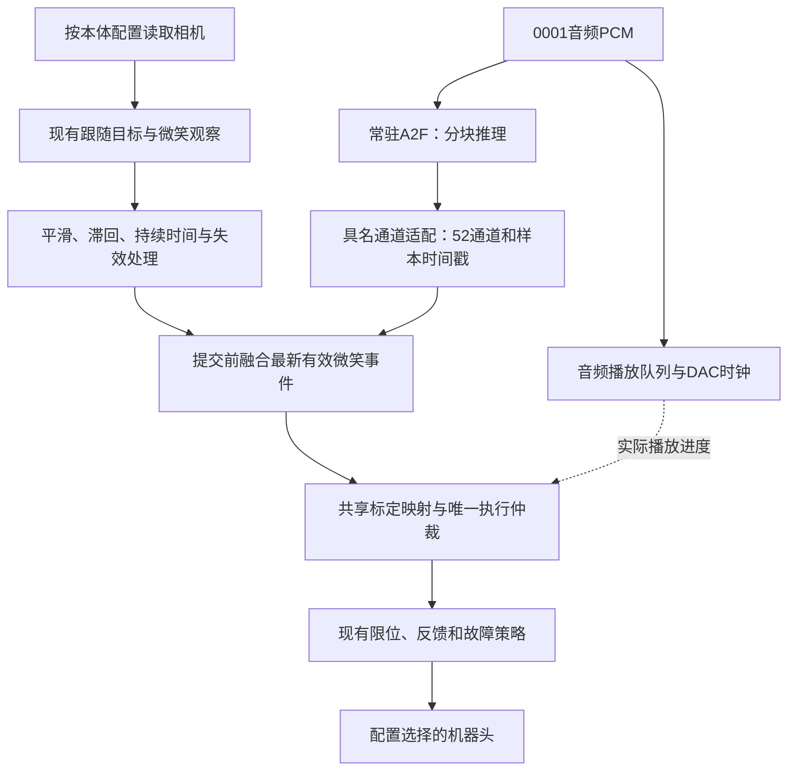

# 多模态交互与社交表达技术方案－开发日志

## 1. 范围与已确认原则

日期：2026-11-06。依据：《机电仿生头_多模态交互与社交表达技术方案_V1.2》。原方案保留不变，本文记录补充约定、执行进度和验证证据，不将待实现能力写成已验收能力。

原方案文件 SHA256：`77f6585f1e361feb921de6c576e386583e729700fe44597274ffcb0fd3c5d008`。

1. 优先验证 Jetson AGX Orin 本地 A2F。首次使用作品0001的音频，不读取既有表情JSON或舵机目标轨迹作为实时口型输入。
2. P0只包含预备歌曲、现场相机、运行时A2F、微笑回应、音画同步和当前人工标定执行链路；麦克风、ASR、LLM、TTS不属于P0前置条件。歌词提示可选。
3. 感知、事件、通道适配、融合、音频时钟和执行实现共用。更换机器头时，通过独立本体配置选择标定、EEPROM限位核验、轴清单、型号、相机安装方式、运动拓扑和必要参数；示例程序不硬编码本体名称或舵机ID。
4. 小帅使用33个实体舵机（ID2～34）、眉心固定相机和独立的左右／俯仰／侧倾颈部。墨甲的35轴、眼部随动相机和并联颈部是另一套配置，不能直接套用。
5. 保留现有已验收的示例播放方式及回退入口。P0开发分支为`feat/multimodal-p0`，起点为小帅分支提交`e14f90a`；模型试验与现有播放器依赖隔离，不直接替换系统CUDA或驱动。

## 2. P0数据链路与验收边界



运行帧需明确通道语义版本、`playback_id`、帧序号、音频样本位置、采样率和52项权重。推理16kHz音频与声卡48kHz音频必须按时长／样本率显式转换；不能混用样本编号。取消播放后，旧实例的帧不能重新生效。

MediaPipe的52项输出与项目52通道不按数组位置直接互换：其默认列表包含`_neutral`，不包含项目的`TongueOut`。P0从具名双侧微笑系数提取事件，不把用户整张脸逐帧复制给机器人。多脸时，微笑必须属于当前跟随对象。

小帅微笑和圆唇存在舵机共享，例如当前标定中左微笑与圆唇共享ID10/15，右微笑与圆唇共享ID15/25；ID31另有已配置的JawOpen规则。只保持口型通道数值不变，不足以证明最终口型不受影响；必须对比融合后的映射目标和真机效果。保留当前组合语义，不在集成过程中悄悄切换为另一种归一化算法。

| 步骤 | 检查内容 | 通过依据 |
| --- | --- | --- |
| P0.0 | 本地SDK、模型、CUDA／TensorRT和具名Blendshape求解 | 有限音频窗口实际生成有限、带时标的具名系数；仅创建TensorRT对象不算通过 |
| P0.1 | 音频分块生成口型，与播放并发 | 不依赖旧动画；首窗就绪后启动；整曲没有持续队列积压，欠载可计数、可回退 |
| P0.2 | 当前交流对象的稳定微笑与失效处理 | 不同微笑时刻产生不同社交帧，无笑、丢脸或过期观察能淡出 |
| P0.3 | 口型＋微笑＋眼颈跟随联合执行 | 沿用本体配置和唯一写入者；比较闭唇、圆口和前突是否被明显削弱 |
| P0.4 | 性能、带声音真机录像和回归 | 区分冷启动／热态、排队／推理／求解时间；记录欠载、同步偏差及主观效果；统计和原始音视频写盘按需开启 |

整曲离线推理或预先导出完整新JSON只能作为诊断步骤，不能当作P0流式实时验收。首次可用混音排查链路；若能取得与0001严格同源、样本对齐的干人声，再单独比较口型质量，不自动替换播放音频。

## 3. 2026-11-06准备检查

以下为本机实测，不代表A2F或P0已经通过。

| 项目 | 结果及限制 |
| --- | --- |
| Orin系统 | Ubuntu24.04.5、ARM64、Python3.12.3；约61GiB系统内存 |
| GPU软件 | 驱动595.78、CUDA Toolkit13.2.2、TensorRT10.16.2.10；系统Python可导入TensorRT并创建Builder |
| 当前播放环境 | 独立`.venv`已有播放器、视觉和轨迹依赖；未安装A2F模型及微笑检测模型。系统Python中的TensorRT不等于播放器虚拟环境已安装TensorRT |
| 离线基线 | `tools/check_delivery.sh`通过299项测试；小帅01／02／03三个示例的`--check`均通过；不打开运动硬件 |
| 小帅只读核验 | 用户确认上电后，33轴共1188次读取；型号与EEPROM限位均匹配，无状态报警，位置指令发送数0。上电前ID2超时单独保留，不能混入上电后的统计 |
| 摄像头 | 640×480请求30FPS；8秒窗口处理109帧，无摄像头错误；处理P50约37.39ms、主机帧龄P95约107.75ms。此次未检测到人脸，不代表完成跟随或微笑验收 |
| USB音频 | USB2.0 Device与DOV均支持48kHz、16位PCM；8秒双输入＋USB2.0静音输出无缓冲溢出／欠载；未保存原始录音。静音输出不证明音箱实际发声质量 |
| 麦克风 | 用户说明只接了一个独立USB麦克风，大概率是DOV；其两路采样RMS约−85dBFS，采集开关已开启。需要现场讲话确认设备和有效收音，不能据此判定设备坏了或要求更换 |

本地详细证据保存在被Git忽略的`outputs/development/p0_readiness_20261106/`。不把现场设备路径及测量材料变成另一份运行配置。

## 4. A2F模型与部署资料

服务器工程用于恢复已验证的模型版本、推理配置和Blendshape求解配置，不意味着Orin运行时依赖4090。若本地可恢复相同SDK源码，不需要再次搬运整个工程。建议优先取得模型原始文件、配置及来源记录，再在Orin重建依赖和TensorRT引擎。

旧工程的锁定记录为SDK提交`1ca0f02535ed774f5dbcd724a31cd486368dc783`；v3.0模型清单记录仓库`nvidia/Audio2Face-3D-v3.0`、修订`b74132732fd9a9d29b237bec193ded64c9745e91`。这些是工程清单记录，尚需与服务器实际使用文件核对。

需要保留的模型资料包括原始`network.onnx`、`model*.json`、`model_data*.npz`、`network_info.json`、`trt_info.json`、`bs_skin*`／`bs_tongue*`求解数据与配置、相关情绪数据、模型说明及许可证。最终所需文件由入口配置的引用闭包确定，不靠文件扩展名猜测后随意删除。若服务器已修改配置，还需取得对应版本。

RTX4090上构建的可执行程序、`.so`、虚拟环境和TensorRT引擎不能默认直接给ARM64 Orin使用；优先搬运可重建的源码、原始模型和配置。SDK默认预编译依赖存在x86_64平台限定，需要核验ARM64源码构建。当前官方README的CUDA／Python范围与本机不同，这是部署验证项，尚不是本地推理不可能的结论。

### 4.1 已完成的本地GPU计算检查

在隔离诊断脚本中，使用系统Python、CUDA13.2和TensorRT10.16.2.10完成一个`y=x+1`网络的构建、序列化、反序列化、设备内存绑定、GPU执行及结果核对。Orin实际计算能力为8.7，测试输入`[0,0.25,-0.5,2]`得到`[1,1.25,0.5,3]`，校验通过。

该最小网络构建耗时约3.24秒，不能作为A2F模型构建／推理延迟指标，也不能证明A2F已经可用。详细脚本、结果及日志位于`outputs/development/p0_local_a2f_20261106/gpu_probe.*`。

已经从官方仓库取得与旧工程记录相同的SDK提交`1ca0f02535ed774f5dbcd724a31cd486368dc783`；原始SDK源码保持不变，单独使用ARM64构建入口和原生依赖，不运行其硬编码`linux-x86_64`的默认依赖下载脚本。ARM64／SM87的CMake配置已通过。

SDK已经完成ARM64／SM87原生构建，并成功创建CPU／GPU Blendshape求解器。适配范围包括：CUDA13的CCCL类型兼容（将两个返回值声明改为`auto`），以及tbtSVD主机浮点模式的ARM64适配。原SDK检出内容不改；构建副本及第三方许可位于`native/a2f/`。64组SVD重构测试通过，最大相对误差约`4.82e-6`，FPCR均恢复到调用前状态。

Orin专用单路TensorRT引擎已重新构建；首次试验构建约54.28秒，大小727167796字节，未使用4090引擎。

### 4.2 服务器模型传输

经只读核实及用户纠正，服务器工程根目录是`ubuntu@192.168.110.109:/home/ubuntu/project`；其下`xiaobai/`是舵机控制资料子目录。Git提交为`281576f`，SDK提交与锁定记录一致。用户在自己的终端完成专用SSH公钥安装；私钥仅保留在Orin的`~/.ssh/`，不进入仓库。读取和传输显式指定专用密钥，不修改服务器工程，不保存密码。

已取得`assets/models/a2f-v3.0/`的原始模型，以及`assets/audio/vocals_v3.0.wav`；模型排除`.trt`等平台产物后共24个文件、约741.14MiB，全部匹配旧清单的Git对象／LFS哈希。模型、干人声和现有0001播放音频共26项还与服务器逐项核对SHA256，无不一致。混音与干声均为1806294个16kHz单声道样本；仅样本数量相同不能独立证明相位对齐，本轮真机使用同一份0001混音作为推理及播放来源。

原始拷贝保存在`incoming/a2f/`，保持Git忽略。通过`tools/setup_p0.py`准备本机可重建的`outputs/a2f/`依赖、模型和引擎。工程源码、虚拟环境及4090引擎均未从服务器搬作本机运行产物。

### 4.3 本地A2F分块实测

| 输入 | 结果 | 限制 |
| --- | --- | --- |
| 0001前8秒混音，250ms分块 | 480帧；输入关闭前465帧；首帧约0.253秒；推理及求解约1.056秒，RTF约0.132 | 未接声卡和舵机的非限速诊断 |
| 完整0001混音112.893375秒 | 6774帧；输入关闭前6735帧；首帧约0.223秒；推理及求解约10.342秒，RTF约0.0916；所有系数有限 | 未测云端；此数据不代表音画偏差或全链路P95 |

SDK原生结果含52个皮肤通道及16个额外舌部通道。本版明确按名称将皮肤52通道适配到项目52通道顺序，不能直接复制数组索引；额外舌部通道不自动混入项目接口。原生模型仓库名称为v3.0，内部`network_info.json`版本字段为3.2，与服务器文件完全一致，不是本次悄悄换模型。

### 4.4 P0运行入口与资源控制

- `src/vivis/interaction/`：A2F适配、有界队列、微笑事件、社交融合和节目入口。
- `configs/interaction/p0.json`：共用的节目参数和模型引用，舵机参数仍只取本体配置。
- `native/a2f/`：固定版本依赖、原生分块推理入口和平台适配。
- `tools/setup_p0.py`：显式准备可选依赖，不修改系统包、驱动、相机或舵机。视觉使用独立环境；安装时清除继承的ROS `PYTHONPATH`，不把ROS包冻结进依赖。

依赖准备命令（现有Orin已完成）：

```bash
cd /home/james/project/Vivis-delivery
/usr/bin/python3 tools/setup_p0.py --model-source incoming/a2f/a2f-v3.0
```

当前P0命令：

```bash
.venv/bin/python -m vivis.interaction.singing \
  --robot configs/robots/xiaoshuai/robot.json \
  --work 0001 --repeat 1 --capture-animation
```

`--check`只检查配置及缺失依赖，不打开运动硬件；`--smile off`供无社交融合对照；`--smile-strength 0.30`是单次社交增量对照，默认配置仍为0.15；`--capture-animation`显式开启有界异步动画记录，平时可省略。

原生进程通过管道产帧，Python队列最多180帧，预备120帧后进入原有准备／回中流程；管道背压限制预计算，不预制整曲动画再播放。声卡DAC时钟取最新适用帧，过期帧丢弃而不补播；欠载最多有界保持0.2秒，超过即取消。逐帧动画写盘默认关闭，开启后不阻塞控制线程。

社交层只增加具名微笑通道，幅度有上限；共享的下颌、闭唇、圆口和前突目标按当前标定推导资源保护集合。眼球及颈部仍由唯一跟随控制器接管。保护集合按标定推导，不新增固定舵机编号表。

### 4.5 联合执行发现与修复

1. 首次运行只发送34帧，约0.56秒后触发反馈看门狗；运行时仅完成6次反馈读取，多轴没有轮到读取。逐帧重新遍历标定占用了控制余量。将同一映射规则预编译，保留原通道加法顺序、中性值、显式零位移成员、条件归一化、眼睑及JawOpen规则，未改变表达算法。保存了两台本体32组组合方式的修改前指纹，另通过小帅旧目标的逐位一致性检查。实时映射P95约0.72ms。
2. 第二次已完成187次反馈读取，但ID5／6各一次坏包后，启动检查及声卡缓冲消耗了首次复查窗口。利用原有DAC预热空窗读取并校验真实完整反馈；不伪造新鲜度，不延长1秒看门狗。新增测试覆盖播放前反馈记录和停止／限位路径。
3. EEPROM、速度、加速度、PID、设备保护及传感器连续确认门槛均未为此次修复放宽。

第三次真机日志为`outputs/p0/20261106_190605_758586/`：

| 项目 | 实测 |
| --- | --- |
| 完整播放 | 成功，结束音频时间112.897秒；提交6774次位置目标 |
| A2F供帧 | 6774帧；欠载0；Python队列上限180，实测未超限 |
| 预热反馈 | 276次读取、69组完整样本；首个音频控制时最旧有效反馈约0.138秒 |
| 总线反馈 | 覆盖全部32个任务轴；39167次读取、156次失败，约0.3983%，包含准备及播放阶段；全曲未触发看门狗 |
| 社交事件 | 最大包络约0.9996；629帧包络超过0.1，1197帧融合权重发生变化 |
| 现场反馈 | 用户确认口型正常；微笑回应不明显，尚未完成微笑效果验收 |

按时钟丢弃的过期A2F帧为563帧；这与供帧欠载不同，不应把“提交6774次目标”说成“6774个不同源帧全部送到硬件”。编码器日志也不能替代皮肤实拍来判断表情幅度。

随后仅离线比较了0.15与0.30社交增量；0.30尚未真机播放或固定为默认值。用户提出先增加表情跟随节目，故暂停追加唱歌对照，保留当前已跑通版本。

## 5. 下一步

1. 优先准备独立的表情跟随节目，验证感知系数、左右语义、标定幅度和真机表现；用户已确认第一版仅面部＋眼睑，眼球和颈部保持原位。
2. 根据表情跟随结果区分感知幅度、映射及机构问题，再回到P0微笑强度与组合效果验收。
3. 用带声音的真机录像继续评估口型同步；尚未给出客观音画偏差数值，不把主观正常等同于已满足量化指标。
4. P0通过后再做P1麦克风的人声、距离、噪声和自播串音测试。现有设备暂没有需要采购替换的证据；AEC和双讲未验收。

## 6. 新节目：表情跟随（用户于2026-11-06提出）

用户要求机器人实时跟随用户表情，并与互动唱歌作为可切换的节目。建议先完成这一独立验证链路，再继续P0表现调优；P0已完成的本地A2F和实时播放不撤回。

Face Landmarker同时提供关键点和Blendshape系数。第一版拟以具名系数进入统一52通道，关键点辅助检测、诊断和稳定性判断；不把用户图像中的绝对关键点坐标直接变成舵机位置。当前MouthSmile检测已在P0中运行过，新增节目用于进一步验证全通道和本体映射，而不是重复部署另一套检测器。

两个节目复用感知、通道适配、标定映射、反馈和唯一串口写入者。互动唱歌使用DAC时钟，表情跟随使用实时控制时钟，不需要A2F、音频播放或麦克风。节目切换先撤销旧来源与队列、保持安全姿态和颈部扭矩，再按新节目准备流程接管；禁止两个节目并行写串口。

用户已确认第一版仅面部与眼睑，眼球和颈部保持原位；这些保持轴不发送位置或使能指令。首轮实现、实测与用户反馈见6.1、6.2、6.4；基础功能成功，幅度与响应尚有优化空间。

阶段回归：P0及映射修复后的完整离线交付检查通过315项测试；已做全新克隆安装检查。表情跟随开发将继承该基线，继续区分离线验证与现场效果反馈。

### 6.1 实现与使用

表情跟随在`feat/expression-follow`分支上开发，继承已提交的P0基线`e7b83ea`，没有撤销实时A2F成果。操作教程见[实时表情跟随](EXPRESSION_FOLLOW.md)。

```bash
# 第一次准备可选视觉环境；不依赖A2F模型或音频
python3 tools/setup_face_landmarker.py

# 只做离线检查
.venv/bin/python -m vivis.interaction.programs expression-follow --check

# 小帅：面部＋眼睑，持续60秒
.venv/bin/python -m vivis.interaction.programs expression-follow \
  --robot configs/robots/xiaoshuai/robot.json --seconds 60
```

共用Face Landmarker的环境、模型URL和SHA256只存于`configs/perception/face_landmarker.json`，互动唱歌也引用它。感知模块从唱歌节目抽到`vision/landmarks.py`；相机进程不连接舵机。节目独有的增益、镜像、轻量滤波及丢失释放参数位于`configs/interaction/expression_follow.json`，本体硬件参数仍只取各机器人配置。

MediaPipe的52项为`_neutral`加51个具名系数；按名称转为项目52表情，不把数组索引当作语义。`_neutral`不驱动舵机，缺少的`TongueOut`明确为零。系数增益默认1.0，滤波常数60ms，无歌曲、A2F或麦克风。使用单调时钟复用现有受约束发送、分步反馈及保护，不建立第二套串口控制算法。

小帅只准备、回中、监测和控制25个面部轴，包含眼睑；眼球7/8/22/23、颈32/33/34和无映射29不接管。Mojia也按同一程序推导本体范围，但没有在本次做Mojia真机验证。程序间共用控制锁，退出后才能启动另一节目；停止时不突然回中或卸载颈部。

### 6.2 人脸选择与首次实测

初检8秒检测到3～4张脸，原单人门控没有输出有效表情，这不能据此认定模型失效。表情节目改为在现有最大面积人脸的ROI内运行Face Landmarker；互动唱歌的社交触发仍保留单人条件，不将多人的微笑混入社交回应。它不是身份跟踪，现场应让操作者的脸成为最大、完整且清晰的人脸。

用户到相机前后，完成一次60秒面部＋眼睑真机测试，日志`outputs/expression_follow/first_onsite_20261106/`：

| 项目 | 实测结果 |
| --- | --- |
| 执行 | 完整结束，单调时钟60.0003秒，3600次控制目标提交 |
| 控制端有效观测 | 636帧；109次无效观测被拒绝或进入保持／释放，不能将其均记作通信坏包 |
| 感知输出 | 有效帧包含478关键点和52项具名系数；最大UDP包约2740字节，小于接收上限4096字节 |
| 系数峰值 | JawOpen约0.985；左右微笑约0.804／0.878；MouthPucker约0.997；左右闭眼约0.901／0.828；不是皮肤位移测量 |
| 总线读取 | 29195次、失败272次，约0.9317%；覆盖全部25轴，未触发看门狗或连续故障停止 |
| 电压告警 | 有孤立0x01及低电压样本，后续正常样本复位计数；不能仅凭恢复就断言是传感器或通信误报 |
| 保持轴 | 启动清单、全部发送目标和已捕获串口写入不含眼球与颈部；未改变EEPROM或既有本体参数 |

应用串口追踪有容量上限：准备阶段完整，播放阶段丢弃23278条追踪事件；不能将它称为完整电气总线抓包。发送目标日志包含3600次提交，可用于核对整个任务的轴所有权。

本轮证明了识别、具名适配、标定映射、受约束执行和反馈这条链路可运行。用户后续反馈及功能状态见6.4；不能将功能通过等同于闭眼完整性、自然程度和量化延迟全部验收。先保持硬件参数及默认增益，按观察再逐项定位。

### 6.3 离线检查

完整离线交付自检通过327项测试，补充视觉服务特性握手回归后，全新克隆安装及完整自检通过328项测试。覆盖名称语义、缺失吐舌、左右镜像、无效／未来／过期帧、丢失释放、保持轴所有权、控制锁互斥、无音频时钟及原有限位保护。安装和离线检查不打开相机、串口、音频或模型。

### 6.4 用户反馈、复查与阶段结论

用户确认“能跟随，但幅度或速度需要调整”，要求先复查代码与逻辑，未发现问题则标记成功并提供独立入口。复查未发现通道错位、数组索引误用、漏发、保持轴误接管或控制循环卡顿。表情跟随（面部＋眼睑）基础功能标记为成功，幅度与动态响应保留为后续整定项；本轮不改变硬件配置、增益和滤波。

| 层次 | 本轮观察及边界 |
| --- | --- |
| 感知 | 运行期间相机记录745帧，约12.42帧/秒；637帧为有效表情，其中636帧被控制端消费。识别结果帧龄中位181.3ms，P95约214.6ms，不能称为端到端皮肤延迟 |
| 系数 | 默认统一增益1.0；60ms是低通时间常数，不是额外固定等待60ms。闭眼峰值未都达到1.0；高速短眨眼可能被感知采样与滤波削弱 |
| 映射与发送 | 复用原有标定及混合规则；控制提交周期P95约16.75ms、最大约17.04ms，未见循环卡顿。眼睑的目标范围在本轮发送中基本覆盖，不能据此保证皮肤完全闭合 |
| 硬件与动态响应 | 本轮面部轴沿用600计数/秒。按样本开始时间与最近目标粗略对齐，四个眼睑轴编码器跟踪偏差P95约23～29计数；ID10、25分别约84、61计数。它是异步反馈下的动态偏差，不是静态标定误差，也不能替代皮肤测量 |

因此幅度或速度不理想不能直接归因于“小帅执行能力不够”。后续可分别比较持续姿态与短促动作，区分源系数、标定范围、软件滤波／限速及本体动态性能。原始观测和目标／编码器分析保存在`outputs/development/expression_follow_20261106/response_review.json`，未调整参数掩盖问题。

独立反复测试示例（三分钟；可改为60或300秒）：

```bash
cd /home/james/project/Vivis-delivery
.venv/bin/python -m vivis.interaction.programs expression-follow \
  --robot configs/robots/xiaoshuai/robot.json --seconds 180
```

保持相机前单个主要操作者；监控`http://127.0.0.1:8765/`，`Ctrl+C`退出。各次均先执行面部轴独立准备及回中，不与唱歌或其他示例并行运行。

### 6.5 可选的表情＋眼球＋颈部联合跟随

用户随后要求在可复用、不过度复杂的前提下加入眼球与颈部跟随。新增`--tracking on`，默认`off`保留原纯表情功能，不改本体配置文件。

```bash
.venv/bin/python -m vivis.interaction.programs expression-follow \
  --robot configs/robots/xiaoshuai/robot.json \
  --tracking on --seconds 180
```

1. Face Landmarker仍只生成面部与眼睑目标；不让其EyeLook系数争夺眼球控制权。
2. 共用同一个相机、最大面积人脸结果、接收器、预览写入器和串口控制循环。既有`MojiaPlaybackGaze`负责眼球与颈部，小帅根据本体配置使用独立俯仰／侧倾，复用Ruckig参考层；没有新增跟踪算法或复制机构解算。
3. 小帅联合模式只准备和控制32轴，不接管无映射的29。面部与眼睑的目标与纯表情模式保持逐值一致；新增的7个眼颈轴由原有位置控制器覆盖中性占位目标，最终目标仍通过共用范围及速度检查。
4. 沿用小帅的固定眉心相机、180度图像校正、方向、EEPROM范围和速度。眼球横向600／纵向300，颈32／33／34为600／400／300计数/秒，硬件加速度和PID不变。结束前复用平滑回中，提前中断保持安全姿态和扭矩。
5. Mojia遵守其本体配置；不会因为小帅启用了独立三轴跟踪就复制小帅参数或强行开启Mojia并联平台。Mojia本轮仅离线检查，未真机验收。

全量离线交付自检通过332项测试，新增覆盖两本体控制权清单、联合与单独表情目标一致性、可配置的并联结构与保持轴，以及无音频时钟下的单串口联合执行。纯表情的眼睑闭合不足未在此次顺手修改，原因已记入[节目教程](EXPRESSION_FOLLOW.md)第5节。

首次联合真机检查`outputs/expression_follow/joint_onsite_20261106/`完成准备和回中，提交101次目标后，ID23反馈位置18589，超出单圈0～4095；当时发送目标2073、前一次合法反馈2066。原始位置回包`ff ff 17 04 00 9d 48 ff`通过协议校验却数值不合理，不能据此断言是机构真的跳到了该位置，也不能确定是线路、设备或其他反馈异常。既有非法编码器保护停止了程序，没有放宽范围或屏蔽告警。

停止后对ID23、8、32、33、34做12轮只读核验，共240次读取、零失败。ID23始终2073，其余位置也稳定；诊断在串口写入口拒绝任何非READ指令。随后保持相同代码、参数和保护，重新进行一次60秒联合检查。

第二次`outputs/expression_follow/joint_onsite_retry_20261106/`完整结束，3600次控制提交，实际单调时钟60.0003秒，22812次读取、196次失败，约0.8592%。全部32个任务轴有反馈，四个眼球轴与三个颈部轴均有目标变化和编码器响应，没有再次触发非法位置保护：

| 轴 | 目标范围（计数） | 编码器观测范围（计数） |
| --- | --- | --- |
| 眼球7 | 1973～2108 | 1999～2097 |
| 眼球8 | 1823～2238 | 1832～2213 |
| 眼球22 | 1987～2102 | 1999～2092 |
| 眼球23 | 1879～2295 | 1882～2289 |
| 颈32 | 2008～2450 | 2013～2444 |
| 颈33 | 1962～2151 | 1967～2156 |
| 颈34 | 2038～2078 | 2037～2080 |

范围极值发生时刻不一定相同，不能相减当成到位误差。第二次运行证明联合控制链路可执行，不抹去首次异常，也不能替代用户对方向、协调性与皮肤表现的现场验收。默认保留纯表情模式，用户可用`--tracking on`单独复测联合模式。

最终补充旧节目配置不含新开关时仍默认纯表情的兼容回归，独立克隆完整自检通过333项测试。在该克隆中另行安装共享Face Landmarker依赖、下载并校验模型，联合模式离线检查的缺失依赖列表为空；没有依赖旧工作目录内的模型、环境或A2F工程。功能本地提交`6003215`，未推送。

### 6.6 左眼睁开偏小的排查（未调整参数）

用户反馈机器人自身左眼（ID5／6）睁开较小，左右眼不对称；尚未留意回中时是否已不对称，稍后现场确认。本次只审查代码和日志，没有启动动作或修改配置。

最近一次联合运行`outputs/expression_follow/20261106_201110_254974/`约119.9秒后由用户中断，不是功能崩溃。原始观测显示：

| 项目 | 机器人左眼 | 机器人右眼 |
| --- | --- | --- |
| 闭眼系数中位值 | 0.2877 | 0.1270 |
| 瞪大眼系数峰值 | 0.1647 | 0.5076 |
| 上眼睑发送范围 | ID5：1850～2048 | ID20：1986～2296 |
| 下眼睑发送范围 | ID6：2040～2263 | ID21：1808～2119 |
| 运行速度／硬件加速度 | 600／0 | 600／0 |
| PID／正反向死区 | 32／32／0；0／0 | 32／32／0；0／0 |

该次左右闭眼系数差的中位值约0.143；此前三次运行也持续为左高于右，中位差约0.114～0.134。程序按原标定将左侧更高的闭眼信号映射成更多闭合量；左上眼睑最张开的发送目标仅2048，远未到标定及硬件允许的2180。左下眼睑最张开的发送目标2040，也未到当前硬件允许的1966。代码中没有单独削弱左眼增益或降低左眼速度；默认整体增益1.0，左右共用60ms系数滤波与同一发送循环。

另有标定边界差异：左侧EyeWide的原终点ID5＝2180、ID6＝1950，按现有EEPROM实际可发送2180／1966；右侧EyeWide终点ID20＝1900、ID21＝2200均在当前硬限位内。这会限制左下眼睑最大睁开行程，但不能把本轮未到睁眼边界的现象主要归因于这个裁剪。左右舵机计数行程也不等同于相同的皮肤开口。

结论：已经确认识别输入和发送目标存在使左眼偏闭合的不对称，这是需要先处理的因素；尚不能认定全部来自模型偏差或机构能力。日志没有记录用户每一刻预期的对称表情，无法区分真人眼部状态、取景／光照／遮挡和模型偏差。

下一步仅需用户观察回中状态：若中位时已不对称，先核对中位与眼睑安装／皮肤张力；若中位时对称、跟随后才偏小，再采集双眼自然睁开的基准，评估视觉系数零点校准，保留完整闭眼端点。不能只降低左眼闭眼增益而忽略此前闭合不完整的问题。原始统计与配置读回记录见`outputs/development/expression_tracking_20261106/left_eye_opening_review.json`。

### 6.7 表情跟随阶段收尾

用户要求回中后观察，既有32轴回中流程成功完成；随后手动调整眼睑／皮肤，反馈左右眼“基本差不多”。本轮不添加单侧视觉补偿，不改眼睑增益、标定或速度。表情跟随的面部／眼睑及可选眼颈联合功能按用户反馈作为当前可用成果；原先一次异常编码器回包和动态闭合不足仍保留记录，不能据此声称已解决全部机械或通信问题。

代码复查发现明确的中断分类问题：原入口只把完整字符串`Operator stop`当作正常退出，控制循环中的`Operator stop during scheduled feedback`等会显示成故障。统一取消判定，仍保留故障与操作中断的区别；不屏蔽舵机或反馈异常。另将唱歌入口的结束状态发布放在释放控制锁之前，避免旧实例晚写状态覆盖新实例。

## 7. P1：本地语音选择、退出和待机

### 7.1 本轮需求与交付边界

在`feat/multimodal-p1`实现，继续使用小帅独立本体配置。用户最终取消魏总朗诵节目；当前菜单只有白骨夫人和表情跟随，历史wz2素材仍保留。后续诗人角色、前台、导游和开放闲聊不在此次实现范围。

1. 白骨夫人仍由运行时音频→A2F产生口型，沿用P0视觉微笑回应与既有眼颈跟踪，**不读取旧表情JSON**。
2. 表情跟随复用已验证的面部／眼睑、眼球与独立三轴颈部控制，不新增表情映射算法。
3. 明确说“停止、结束、退出、不用学了、待机、休息一下、自己玩一会儿”等最终识别结果后，取消当前实例，按原有60计数/秒上限准备、回中，进入低频眨眼／偶尔小幅左右看的待机。待机不开相机、不持续追踪路人；自然结束也进入待机。
4. 原V1.2后续阶段中的“播放中语音退出”按用户要求提前纳入P1：引入最小的本地回声参考、语音分段和整句识别。不能把此项代码接入当作一般全双工自然对话已经验收。

运行、安装和逐项验收步骤集中在[P1测试方法](P1_TEST.md)。本轮机器头关机后没有打开串口或执行动作；仅按用户授权采集短麦克风录音，其余均为离线测试。

### 7.2 分层与唯一配置来源

```text
DOV麦克风 → 时标对齐／SpeexDSP回声处理 → WebRTC语音分段
                                              ↓
                   中文流式Zipformer＋SenseVoice整句候选
                                              ↓
                  明确节目／退出意图 → P1节目管理器
                                              ↓
             白骨夫人／表情跟随／无相机待机（串行交接）
                                              ↓
                     共用启动、回中、单串口控制与反馈

实际音箱PCM与DAC时标 ───────────────→ 回声参考
```

| 内容 | 唯一来源 |
| --- | --- |
| 两个节目、选择与待机别名 | `configs/interaction/programs.json` |
| 管理器、取消超时、节目时长、日志模式 | `configs/interaction/p1.json` |
| 待机节律与小幅动作 | `configs/interaction/standby.json` |
| 麦克风、识别、分段、回声、提示音路径 | `configs/perception/speech.json` |
| 舵机型号、标定、速度、启动与设备保护 | `configs/robots/xiaoshuai/`，沿用既有配置 |
| 可选语音资产的上游版本及逐文件摘要 | `native/speech/sources.json`，许可说明见同目录`NOTICE.md` |

本地菜单提示由MeloTTS预生成，播放时不请求网络，也暂不为这些短提示驱动A2F口型；歌曲本身仍使用运行时A2F。语音模型安装到独立环境，不改变主运动环境。全部后端在本机运行；默认不保存持续麦克风PCM，不把现场录音或模型权重提交到Git。

每个子节目有独立实例和取消文件，先等待旧进程退出、关闭视觉及推理资源，再启动新实例；旧帧不转给新实例。管理器使用独立单实例锁，子节目沿用控制锁；不另开串口读取线程。退出超时只清理本管理器创建的进程组，转故障保持，不强行自动恢复运动。`Ctrl+C`退出整个管理器；语音“退出”只退出当前节目、保留待机。

音频退出使用40ms淡出；该数值不含识别、分段、声卡既有缓冲和回中时间。全局`outputs/STOP`及硬件异常仍立即走原有停止处理。舵机保护、位置边界、通信看门狗、硬限位、PID和既有运行速度均未放宽。待机也复用本体启动参数核验和有界回中，而不是依赖上个节目的SRAM残留值。

默认节目日志保留必要反馈／告警／计数和最近600次控制提交，待机同样有界；需要完整节目控制记录时用`--diagnostics on`。不能把截断后的近期数据当作完整歌曲轨迹。程序状态与识别／切换事件另有持续记录，便于分析语音结束、声停、准备及回中耗时。

### 7.3 录音与离线证据，及尚未通过的部分

12.04秒DOV采音没有溢出，平均约−33.9dBFS、峰值约−12.4dBFS，48kHz双通道重复同一信号，取第0通道转换为16kHz处理。另一USB2.0 Device输入没有识别出可用人声，当前不选作麦克风。首句采集开始太晚，只录到“夫人”，不能用它判断完整节目名的识别能力。

早期小模型在真人录音中大量误识别，已经换为较大的中文流式模型，再加整句识别与候选核对。当前这份短录音能识别“开始表情跟随”“退出吧”，但要求说的“停止”“结束”仍曾识别成“零点”“演肃”，“不用学了”在不同解码方式间也不稳定。**这些词不作为别名写入，不用错误转录掩盖识别问题；P1现场语音验收仍未通过。** 用户暂不需要逐条录制或训练命令；下一步等“麦克风已就绪”后，在实际使用距离逐句复测，尤其检查音乐播放中的退出。

合成20秒歌曲回声测试，包含40／75ms延迟的线性多径，测得约29.1dB抑制；加入合成“停止”的测试约29.3dB。处理后的纯回声没有路由出节目动作，加入短句的样本识别并路由为待机。DAC／ADC对齐回归另覆盖包边界及约200ppm采样时钟差。以上只证明指定合成条件下的处理链有效，不能替代房间、真实音箱和麦克风的双讲测量。

完整离线交付自检通过355项测试。回归覆盖最终文本去重及过期拒绝、否定与歧义、菜单剔除wz2、实例取消、串行控制权交接、正常退出与硬件异常区分、淡出与紧急停止区别、有界日志、无相机待机范围及节律、回声参考时标和取消时的参考截断；提示音资源关闭失败时，仍须完成运动子进程清理。完整真机流程、低频待机的观感、语音误唤醒率以及双讲成功率均留待用户现场验收，不据离线测试提前宣称成功。

原始录音、识别结果、合成回声样本和回归日志保存在已忽略的`outputs/development/p1_20261106/`；交付文档保留结论和限制，不携带用户录音。

最终模型离线复测的7条独立TTS短句（停止、结束、退出、休息一下、自己玩一会儿、开始表情跟随、播放白骨夫人）均路由到预期意图；其中歌曲名由两个完整候选核对后选中正确名称。相同代码下真人录音仍有前述错误，不能把合成语音成功率替换成现场成功率。另补充“我不想退出”等否定句的候选一致性回归，防止第二候选丢掉否定词后执行相反动作。

独立Git克隆也通过355项完整离线检查，Python可编辑安装路径指向该克隆自身。可选语音环境在克隆中单独创建和安装；模型使用本地已下载缓存，仍由安装脚本按固定上游摘要重新校验，不依赖原开发目录的运行环境。此项验证不等于重新下载模型，也不等于已为第二台Orin构建A2F引擎。

## 8. 官方参考

- [Audio2Face-3D SDK源码与构建依赖](https://github.com/NVIDIA/Audio2Face-3D-SDK)。
- [SDK预编译依赖的平台声明](https://github.com/NVIDIA/Audio2Face-3D-SDK/blob/1ca0f02535ed774f5dbcd724a31cd486368dc783/deps/target-deps.packman.xml)。
- [Audio2Face-3D-v3.0模型说明](https://huggingface.co/nvidia/Audio2Face-3D-v3.0)。
- [MediaPipe Face Landmarker](https://developers.google.com/edge/mediapipe/solutions/vision/face_landmarker)。
- [MediaPipe默认52项系数名称](https://github.com/google-ai-edge/mediapipe/blob/master/mediapipe/tasks/cc/vision/face_landmarker/face_blendshapes_graph.cc)。
- [TensorRT引擎的平台与硬件兼容边界](https://docs.nvidia.com/deeplearning/tensorrt/latest/getting-started/support-matrix.html)。
